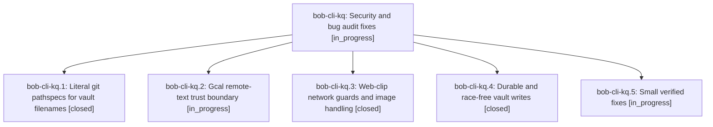

# Bead: bob-cli-kq — Security and bug audit fixes

[Bead Pages](../README.md) / bob-cli-kq

**Status:** ◐ in_progress · **Type:** ▸ plan · **Tier:** epic
**Owner:** `bryanbugyi34@gmail.com` · **Created by:** [bbugyi200.athena.1bo](https://github.com/bobs-org/bob-cli--agents/blob/main/sessions/bbugyi200.athena.1bo.md) · **Assignee:** `bob-cli-kq.land`
**Created:** 2026-11-12 05:24:40 EST
**Plan:** [202611/security\_audit\_fixes\_1.md](https://github.com/bobs-org/bob-cli--plans/blob/main/202611/security_audit_fixes_1.md)

<!-- sase:links:start -->

## Links

| Relation | Artifact | Why |
| --- | --- | --- |
| implemented-by | [plan:202611/security_audit_fixes_1.md][1] | derived from the plan's `bead_id:` frontmatter field |

_Plus 1 automatic references — see [Referenced By](#referenced-by)._

[1]: https://github.com/bobs-org/bob-cli--plans/blob/main/202611/security_audit_fixes_1.md

<!-- sase:links:end -->

## Description

The 19 verified findings from the five-area security/bug audit of bob-cli are fixed with regression tests: git pathspec globbing can no longer revert the wrong vault file, calendar titles can no longer inject tags/links, the web clipper's private- network guard holds across redirects and WebSockets, vault writes are guarded and crash-durable, and the small verified defects are corrected.

## Phases

| Bead | Title | Status | Size | Created | Agents | Commits |
|---|---|---|---|---|---:|---:|
| [bob-cli-kq.1](bob-cli-kq.1.md) | Literal git pathspecs for vault filenames | ✓ closed | small | 2026-11-12 | 1 | 1 |
| [bob-cli-kq.2](bob-cli-kq.2.md) | Gcal remote-text trust boundary | ◐ in_progress | medium | 2026-11-12 | 1 | 1 |
| [bob-cli-kq.3](bob-cli-kq.3.md) | Web-clip network guards and image handling | ✓ closed | medium | 2026-11-12 | 1 | 1 |
| [bob-cli-kq.4](bob-cli-kq.4.md) | Durable and race-free vault writes | ✓ closed | medium | 2026-11-12 | 1 | 1 |
| [bob-cli-kq.5](bob-cli-kq.5.md) | Small verified fixes | ◐ in_progress | medium | 2026-11-12 | 1 | 0 |

## Lineage

## Agents

| Agent | Bead | Commits |
|---|---|---:|
| [bbugyi200.athena.bob-cli-kq.1](https://github.com/bobs-org/bob-cli--agents/blob/main/sessions/bbugyi200.athena.bob-cli-kq.1.md) | [bob-cli-kq.1](bob-cli-kq.1.md) | 1 |
| [bbugyi200.athena.bob-cli-kq.2](https://github.com/bobs-org/bob-cli--agents/blob/main/sessions/bbugyi200.athena.bob-cli-kq.2.md) | [bob-cli-kq.2](bob-cli-kq.2.md) | 1 |
| [bbugyi200.athena.bob-cli-kq.3](https://github.com/bobs-org/bob-cli--agents/blob/main/agents/bbugyi200.athena.bob-cli-kq.3/README.md) | [bob-cli-kq.3](bob-cli-kq.3.md) | 1 |
| [bbugyi200.athena.bob-cli-kq.4](https://github.com/bobs-org/bob-cli--agents/blob/main/agents/bbugyi200.athena.bob-cli-kq.4/README.md) | [bob-cli-kq.4](bob-cli-kq.4.md) | 1 |
| [bbugyi200.athena.bob-cli-kq.5](https://github.com/bobs-org/bob-cli--agents/blob/main/sessions/bbugyi200.athena.bob-cli-kq.5.md) | [bob-cli-kq.5](bob-cli-kq.5.md) | 0 |

## Commits

| Repo | Commit | Subject | Bead | Committed |
|---|---|---|---|---|
| bob-cli | [`4835680`](https://github.com/bobs-org/bob-cli/commit/4835680dc5e8a09bc9ab3d4537160f0254670a65) | feat(web-clip): add network guards and image handling | [bob-cli-kq.3](bob-cli-kq.3.md) | 2026-11-12 05:46:22 EST |
| bob-cli | [`1507772`](https://github.com/bobs-org/bob-cli/commit/15077720eefcc714ecec559c62106149648f9a25) | fix(storage): harden vault and cache writes | [bob-cli-kq.4](bob-cli-kq.4.md) | 2026-11-12 06:10:33 EST |
| bob-cli | [`1920aab`](https://github.com/bobs-org/bob-cli/commit/1920aab661d37310fc58d57790b8a66026054d2c) | fix(git): use literal pathspecs for file mutations | [bob-cli-kq.1](bob-cli-kq.1.md) | 2026-11-12 06:11:12 EST |
| bob-cli | [`4ffa85d`](https://github.com/bobs-org/bob-cli/commit/4ffa85d03376aa5747dbb10070658f1a452a56a4) | fix(gcal): escape organizer title tags and links | [bob-cli-kq.2](bob-cli-kq.2.md) | 2026-11-12 06:22:44 EST |

<!-- sase:referenced-by:start -->

## Referenced By

| Relation | Artifact | Why | Uses |
| --- | --- | --- | ---: |
| read-by | [agent:bob-cli-kq.3][1] | Need epic context and plan | 1 |

[1]: https://github.com/bobs-org/bob-cli--agents/blob/main/agents/bbugyi200.athena.bob-cli-kq.3/README.md

<!-- sase:referenced-by:end -->
