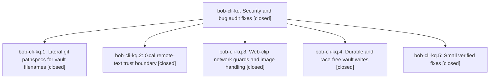

# Bead: bob-cli-kq — Security and bug audit fixes

[Bead Pages](../README.md) / bob-cli-kq

**Status:** ✓ closed · **Resolution:** done · **Type:** ▸ plan · **Tier:** epic
**Owner:** `bryanbugyi34@gmail.com` · **Created by:** [bbugyi200.athena.1bo](https://github.com/bobs-org/bob-cli--agents/blob/main/sessions/bbugyi200.athena.1bo.md) · **Assignee:** `bob-cli-kq.land`
**Created:** 2026-11-12 05:24:40 EST · **Closed:** 2026-11-12 08:27:01 EST
**Plan:** [202611/security\_audit\_fixes\_1.md](https://github.com/bobs-org/bob-cli--plans/blob/main/202611/security_audit_fixes_1.md)

<!-- sase:links:start -->

## Links

| Relation | Artifact | Why |
| --- | --- | --- |
| implemented-by | [plan:202611/security_audit_fixes_1.md][1] | derived from the plan's `bead_id:` frontmatter field |

_Plus 1 automatic references — see [Referenced By](#referenced-by)._

[1]: https://github.com/bobs-org/bob-cli--plans/blob/main/202611/security_audit_fixes_1.md

<!-- sase:links:end -->

## Description

The 19 verified findings from the five-area security/bug audit of bob-cli are fixed with regression tests: git pathspec globbing can no longer revert the wrong vault file, calendar titles can no longer inject tags/links, the web clipper's private- network guard holds across redirects and WebSockets, vault writes are guarded and crash-durable, and the small verified defects are corrected.

## Notes

[2026-11-12T13:27:01Z · bob-cli-kq.land] Verified all 5 phases against plan security_audit_fixes_1 and their commits: kq.3 4835680d (post-goto redirect-chain/final-URL host_is_global refusal on headless+headed paths, route_web_socket guard, positional img src parse/rewrite in adapter+render, callable re.sub for data-bob-origin; self-tests cover each); kq.4 15077720 (bank ensure preimage from the single planning snapshot + stale-write refusal test, clip attachments via hard_link/create_new with plant-before-install test, fsync in periods/highlights_ref/completion atomic_write, 0600 temp+rename gkeep token, per-uid 0700 owner-verified temp cache fallback in env.rs and runner.rs); kq.1 1920aab6 (literal pathspecs in recovery checkout/diff/ls-tree, reference_mutation reset/log, execute ls-files, collect_done add/diff/commit; ':' magic rejected in validated_paths; glob-sibling tests); kq.2 4ffa85d0 (escape_title neutralizes mid-line #tags, [[ and ]( after clock tokens are stripped; span hashes and updates use the escaped title so untouched rows rewrite once; gog 429 only as HTTP status; DECISION gate_organizer_clock_tags=no honored: no clock-tag change, no memory edits); kq.5 736aa820 (OVERDUE prefix match in notify.rs+bob_notify, Perl 3-arg open, damaged albums -> plain io, empty bank import refused, tracker anchor stripped by BLOCK_ID span). Landing fix: kq.1's audit missed concrete-filename callers outside its four files. Switched vault_rewrite::unstage_paths (git reset, a mutation), gmail save::git_path_is_dirty and migrate_tasks dirty_paths (git status) to git_command_literal, with regression tests for the first two that fail on the old builder. migrate_zorg (fixed dir) and the *.md / rev / check-ignore callers stay globbing by design. Integration: c1e28399 (bank kd.5) kept the single-snapshot ensure fix and deliberately relaxed FILE to optional for -F while keeping kq.5's empty-list refusal (docs and tests updated there). 1174a17b (albums kr.1) and d1d0db6f (docs) do not overlap. just check passed (exit 0) on master c1e28399 plus the landing edits. Follow-ups: kq.4 #1 and kq.5 #2/#4 proposed the subprocess_runner pipe-drain flake. It duplicates bob-cli-kl, so it got a +1 there (now 2 independent reports), no new task. Not caused by this epic and no active-epic link. Optional Chrome PNA flags (plan Fix A) were not added. No --epic-symbol entries.

## Phases

| Bead | Title | Status | Size | Created | Agents | Commits |
|---|---|---|---|---|---:|---:|
| [bob-cli-kq.1](bob-cli-kq.1.md) | Literal git pathspecs for vault filenames | ✓ closed | small | 2026-11-12 | 1 | 1 |
| [bob-cli-kq.2](bob-cli-kq.2.md) | Gcal remote-text trust boundary | ✓ closed | medium | 2026-11-12 | 1 | 1 |
| [bob-cli-kq.3](bob-cli-kq.3.md) | Web-clip network guards and image handling | ✓ closed | medium | 2026-11-12 | 1 | 1 |
| [bob-cli-kq.4](bob-cli-kq.4.md) | Durable and race-free vault writes | ✓ closed | medium | 2026-11-12 | 1 | 1 |
| [bob-cli-kq.5](bob-cli-kq.5.md) | Small verified fixes | ✓ closed | medium | 2026-11-12 | 1 | 1 |

## Lineage

## Agents

| Agent | Bead | Commits |
|---|---|---:|
| [bbugyi200.athena.bob-cli-kq.1](https://github.com/bobs-org/bob-cli--agents/blob/main/sessions/bbugyi200.athena.bob-cli-kq.1.md) | [bob-cli-kq.1](bob-cli-kq.1.md) | 1 |
| [bbugyi200.athena.bob-cli-kq.2](https://github.com/bobs-org/bob-cli--agents/blob/main/sessions/bbugyi200.athena.bob-cli-kq.2.md) | [bob-cli-kq.2](bob-cli-kq.2.md) | 1 |
| [bbugyi200.athena.bob-cli-kq.3](https://github.com/bobs-org/bob-cli--agents/blob/main/agents/bbugyi200.athena.bob-cli-kq.3/README.md) | [bob-cli-kq.3](bob-cli-kq.3.md) | 1 |
| [bbugyi200.athena.bob-cli-kq.4](https://github.com/bobs-org/bob-cli--agents/blob/main/agents/bbugyi200.athena.bob-cli-kq.4/README.md) | [bob-cli-kq.4](bob-cli-kq.4.md) | 1 |
| [bbugyi200.athena.bob-cli-kq.5](https://github.com/bobs-org/bob-cli--agents/blob/main/sessions/bbugyi200.athena.bob-cli-kq.5.md) | [bob-cli-kq.5](bob-cli-kq.5.md) | 1 |
| [bbugyi200.athena.bob-cli-kq.land](https://github.com/bobs-org/bob-cli--agents/blob/main/agents/bbugyi200.athena.bob-cli-kq.land/README.md) | [bob-cli-kq](README.md) | 1 |

## Commits

| Repo | Commit | Subject | Bead | Committed |
|---|---|---|---|---|
| bob-cli | [`4835680`](https://github.com/bobs-org/bob-cli/commit/4835680dc5e8a09bc9ab3d4537160f0254670a65) | feat(web-clip): add network guards and image handling | [bob-cli-kq.3](bob-cli-kq.3.md) | 2026-11-12 05:46:22 EST |
| bob-cli | [`1507772`](https://github.com/bobs-org/bob-cli/commit/15077720eefcc714ecec559c62106149648f9a25) | fix(storage): harden vault and cache writes | [bob-cli-kq.4](bob-cli-kq.4.md) | 2026-11-12 06:10:33 EST |
| bob-cli | [`1920aab`](https://github.com/bobs-org/bob-cli/commit/1920aab661d37310fc58d57790b8a66026054d2c) | fix(git): use literal pathspecs for file mutations | [bob-cli-kq.1](bob-cli-kq.1.md) | 2026-11-12 06:11:12 EST |
| bob-cli | [`4ffa85d`](https://github.com/bobs-org/bob-cli/commit/4ffa85d03376aa5747dbb10070658f1a452a56a4) | fix(gcal): escape organizer title tags and links | [bob-cli-kq.2](bob-cli-kq.2.md) | 2026-11-12 06:22:44 EST |
| bob-cli | [`736aa82`](https://github.com/bobs-org/bob-cli/commit/736aa820d4a9a25fe261f26a8103c4d69c9d5e7a) | fix: apply five small security-audit corrections | [bob-cli-kq.5](bob-cli-kq.5.md) | 2026-11-12 07:04:10 EST |
| bob-cli | [`d4ea1b2`](https://github.com/bobs-org/bob-cli/commit/d4ea1b25d9aba334248bb075427e0bd76117a3d8) | fix(git): use literal pathspecs for remaining filename callers | [bob-cli-kq](README.md) | 2026-11-12 08:28:52 EST |

<!-- sase:referenced-by:start -->

## Referenced By

| Relation | Artifact | Why | Uses |
| --- | --- | --- | ---: |
| read-by | [agent:bob-cli-kq.3][1] | Need epic context and plan | 1 |

[1]: https://github.com/bobs-org/bob-cli--agents/blob/main/agents/bbugyi200.athena.bob-cli-kq.3/README.md

<!-- sase:referenced-by:end -->
