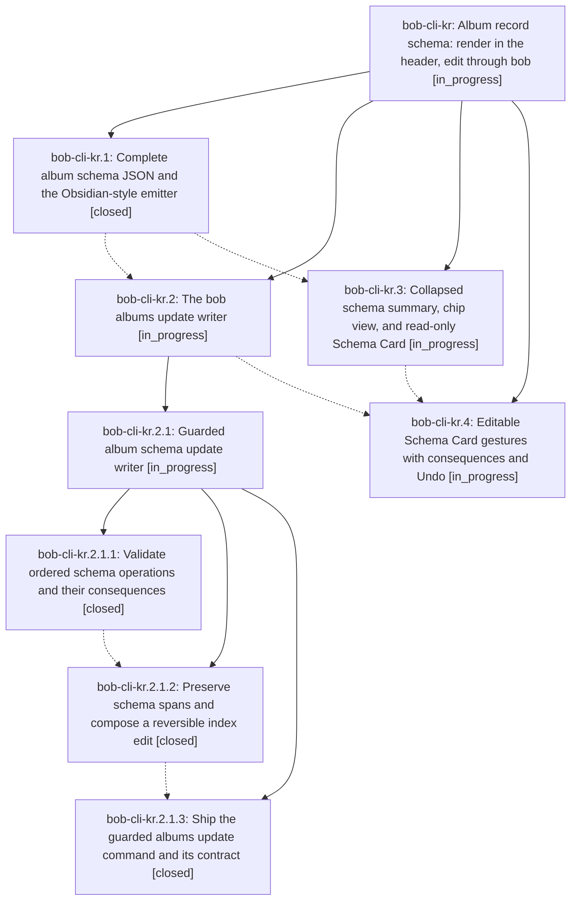

# Bead: bob-cli-kr — Album record schema: render in the header, edit through bob

[Bead Pages](../README.md) / bob-cli-kr

**Status:** ◐ in_progress · **Type:** ▸ plan · **Tier:** epic
**Owner:** `bryanbugyi34@gmail.com` · **Created by:** [bbugyi200.apollo.research.4b.linker.w0](https://github.com/bobs-org/bob-cli--agents/blob/main/sessions/bbugyi200.apollo.research.4b.linker.w0.md) · **Assignee:** `bob-cli-kr.land`
**Created:** 2026-11-12 07:00:44 EST
**Plan:** [202611/album\_schema\_render\_and\_edit.md](https://github.com/bobs-org/bob-cli--plans/blob/main/202611/album_schema_render_and_edit.md)

<!-- sase:links:start -->

## Links

| Relation | Artifact | Why |
| --- | --- | --- |
| implemented-by | [plan:202611/album_schema_render_and_edit.md][1] | derived from the plan's `bead_id:` frontmatter field |

[1]: https://github.com/bobs-org/bob-cli--plans/blob/main/202611/album_schema_render_and_edit.md

<!-- sase:links:end -->

## Description

The record frontmatter mapping on album notes renders as beautiful, honest header chrome instead of a truncated JSON row, and every common schema edit becomes one safe, previewed, revertable gesture through bob, with YAML editing kept first-class.

## Notes

[2026-11-12T14:56:38Z · bryanbugyi34@gmail.com] The epic lander agent should make sure this works better than shown in the 🔒 20261112\_095308.png screenshot before landing.

## Attachments

- 🔒 20261112\_095308.png · image/png · 2858×1728 · 358.144 KiB (private attachment)

## Phases

| Bead | Title | Status | Size | Created | Agents | Commits |
|---|---|---|---|---|---:|---:|
| [bob-cli-kr.1](bob-cli-kr.1.md) | Complete album schema JSON and the Obsidian-style emitter | ✓ closed | medium | 2026-11-12 | 1 | 1 |
| [bob-cli-kr.2](bob-cli-kr.2.md) | The bob albums update writer | ◐ in_progress | large | 2026-11-12 | 1 | 0 |
| [bob-cli-kr.3](bob-cli-kr.3.md) | Collapsed schema summary, chip view, and read-only Schema Card | ◐ in_progress | medium | 2026-11-12 | 1 | 0 |
| [bob-cli-kr.4](bob-cli-kr.4.md) | Editable Schema Card gestures with consequences and Undo | ◐ in_progress | large | 2026-11-12 | 1 | 0 |

## Lineage

## Agents

| Agent | Bead | Commits |
|---|---|---:|
| [bbugyi200.apollo.bob-cli-kr.1](https://github.com/bobs-org/bob-cli--agents/blob/main/sessions/bbugyi200.apollo.bob-cli-kr.1.md) | [bob-cli-kr.1](bob-cli-kr.1.md) | 1 |
| [bbugyi200.apollo.bob-cli-kr.2](https://github.com/bobs-org/bob-cli--agents/blob/main/sessions/bbugyi200.apollo.bob-cli-kr.2.md) | [bob-cli-kr.2](bob-cli-kr.2.md) | 0 |
| [bbugyi200.apollo.bob-cli-kr.2.1.1](https://github.com/bobs-org/bob-cli--agents/blob/main/agents/bbugyi200.apollo.bob-cli-kr.2.1.1/README.md) | [bob-cli-kr.2.1.1](bob-cli-kr.2.1.1.md) | 1 |
| [bbugyi200.apollo.bob-cli-kr.2.1.2](https://github.com/bobs-org/bob-cli--agents/blob/main/agents/bbugyi200.apollo.bob-cli-kr.2.1.2/README.md) | [bob-cli-kr.2.1.2](bob-cli-kr.2.1.2.md) | 1 |
| [bbugyi200.apollo.bob-cli-kr.2.1.3](https://github.com/bobs-org/bob-cli--agents/blob/main/agents/bbugyi200.apollo.bob-cli-kr.2.1.3/README.md) | [bob-cli-kr.2.1.3](bob-cli-kr.2.1.3.md) | 1 |
| [bbugyi200.apollo.bob-cli-kr.2.1.land](https://github.com/bobs-org/bob-cli--agents/blob/main/agents/bbugyi200.apollo.bob-cli-kr.2.1.land/README.md) | [bob-cli-kr.2.1](bob-cli-kr.2.1.md) | 0 |
| [bbugyi200.apollo.bob-cli-kr.3](https://github.com/bobs-org/bob-cli--agents/blob/main/sessions/bbugyi200.apollo.bob-cli-kr.3.md) | [bob-cli-kr.3](bob-cli-kr.3.md) | 0 |
| [bbugyi200.apollo.bob-cli-kr.4](https://github.com/bobs-org/bob-cli--agents/blob/main/agents/bbugyi200.apollo.bob-cli-kr.4/README.md) | [bob-cli-kr.4](bob-cli-kr.4.md) | 0 |
| [bbugyi200.apollo.bob-cli-kr.land](https://github.com/bobs-org/bob-cli--agents/blob/main/agents/bbugyi200.apollo.bob-cli-kr.land/README.md) | [bob-cli-kr](README.md) | 0 |

## Commits

| Repo | Commit | Subject | Bead | Committed |
|---|---|---|---|---|
| bob-cli | [`1174a17`](https://github.com/bobs-org/bob-cli/commit/1174a17b7cf18bf6d9b3e98968657e313b7aa5b6) | feat(albums): report schema metadata and emit canonical YAML records | [bob-cli-kr.1](bob-cli-kr.1.md) | 2026-11-12 07:45:21 EST |
| bob-cli | [`de5c0e5`](https://github.com/bobs-org/bob-cli/commit/de5c0e56d041af61aa0a4dd3d433a228754e66af) | feat(albums): validate ordered schema operations and consequences | [bob-cli-kr.2.1.1](bob-cli-kr.2.1.1.md) | 2026-11-12 09:11:26 EST |
| bob-cli | [`a7b5efe`](https://github.com/bobs-org/bob-cli/commit/a7b5efed64aac470c6f3ea578519e355bdf1b85f) | feat(albums): preserve schema spans and plan reversible updates | [bob-cli-kr.2.1.2](bob-cli-kr.2.1.2.md) | 2026-11-12 10:27:13 EST |
| bob-cli | [`859c157`](https://github.com/bobs-org/bob-cli/commit/859c157119f63ff2b6d1a2106c27d1cfb2b2ff7c) | feat(albums): ship guarded albums update command and its contract | [bob-cli-kr.2.1.3](bob-cli-kr.2.1.3.md) | 2026-11-12 11:33:14 EST |
