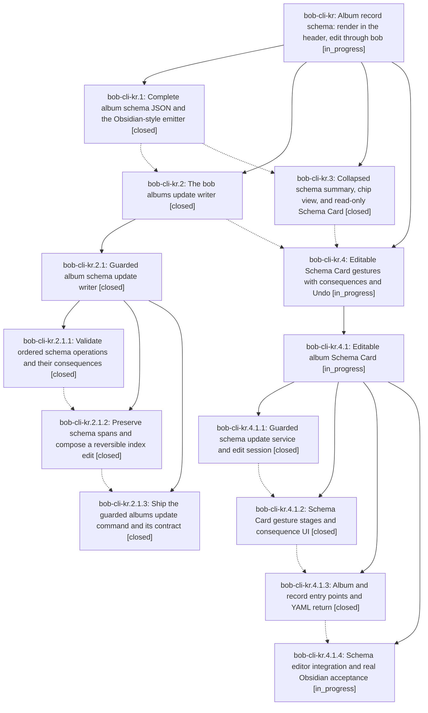

# Bead: bob-cli-kr — Album record schema: render in the header, edit through bob

[Bead Pages](../README.md) / bob-cli-kr

**Status:** ◐ in_progress · **Type:** ▸ plan · **Tier:** epic
**Owner:** `bryanbugyi34@gmail.com` · **Created by:** [bbugyi200.apollo.research.4b.linker.w0](https://github.com/bobs-org/bob-cli--agents/blob/main/sessions/bbugyi200.apollo.research.4b.linker.w0.md) · **Assignee:** `bob-cli-kr.land`
**Created:** 2026-11-12 07:00:44 EST
**Plan:** [202611/album\_schema\_render\_and\_edit.md](https://github.com/bobs-org/bob-cli--plans/blob/main/202611/album_schema_render_and_edit.md)

<!-- sase:links:start -->

## Links

| Relation | Artifact | Why |
| --- | --- | --- |
| implemented-by | [plan:202611/album_schema_render_and_edit.md][1] | derived from the plan's `bead_id:` frontmatter field |

[1]: https://github.com/bobs-org/bob-cli--plans/blob/main/202611/album_schema_render_and_edit.md

<!-- sase:links:end -->

## Description

The record frontmatter mapping on album notes renders as beautiful, honest header chrome instead of a truncated JSON row, and every common schema edit becomes one safe, previewed, revertable gesture through bob, with YAML editing kept first-class.

## Notes

[2026-11-12T14:56:38Z · bryanbugyi34@gmail.com] The epic lander agent should make sure this works better than shown in the 🔒 20261112\_095308.png screenshot before landing.

[2026-11-12T18:54:15Z · bob-cli-k3.land] DISCOVERED ISSUE: (from bob-cli-k3.land) In bob-plugins, plugins/bob-ledger-tools/src/241w-plugin-album-schema-model.js albumHeaderRecordCountPhrase (added by kr.3 in f714fee) uses the raw schema noun id as the singular, so an album with exactly one record whose noun is an identifier such as tv_show reads '1 tv_show' rather than '1 TV show'. The bob-cli-k3 landing tale is adding an additive display 'singular' field (the label with the same lowercasing rule as plural) to bob albums list -f json and fixing the k3-owned [!records] tally and owner [!albums] card counts. Once that lands, the album header phrase should use singular (falling back to plural or noun for older bob). k3's tale deliberately leaves 241w untouched to avoid colliding with the active kr.4.1 Schema Card worker.

[2026-11-12T20:04:52Z · do] DISCOVERED ISSUE: root causes behind the header problems in note #1's screenshot (and 🔒 20261112\_144853.png from today). (1) The 'Some owner ancestry could not be resolved' warning fires on EVERY album: bob-plugins 241u-plugin-album-header-model.js albumHeaderOwnerChain marks the chain broken when an ancestor's pomodoroHomeType is not area/project, but the vault convention (glossary Area Note) is that top-level areas carry parent: [[area]] pointing at the type-definition note area.md, which has no type: frontmatter - so every chain tops out 'broken'. pomodoroHomeResolve walks through non-home notes without flagging. (2) In Live Preview the header card also paints 3x inside the [!records] callout: 241v renderAlbumHeaderInReading paints per post-processed element; Obsidian renders callout content on detached elements, so the closest('.cm-editor') guard and notebookHeaderReadingSurface both miss, and each detached chunk becomes its own surface. 241f's coalesce-per-sourcePath + attached-surface chooser is the shipped pattern that avoids this. A tale plan (sase_plan_album_header_warning_and_dupes.md) is being proposed to fix both in 241u/241v, so the lander should not double-fix them; what remains for note #1 is the album_child_reparent lint bullets rendering as identical anonymous duplicates - the bob-cli finding carries the child note's path (src/native/albums/registry.rs:765) but albumHeaderIssueModel drops it and the bullet shows only message, so two outside children read as two identical lines naming neither.

## Attachments

- 🔒 20261112\_095308.png · image/png · 2858×1728 · 358.144 KiB (private attachment)
- 🔒 20261112\_144853.png · image/png · 2858×1728 · 389.297 KiB (private attachment)

## Phases

| Bead | Title | Status | Size | Created | Agents | Commits |
|---|---|---|---|---|---:|---:|
| [bob-cli-kr.1](bob-cli-kr.1.md) | Complete album schema JSON and the Obsidian-style emitter | ✓ closed | medium | 2026-11-12 | 1 | 1 |
| [bob-cli-kr.2](bob-cli-kr.2.md) | The bob albums update writer | ✓ closed | large | 2026-11-12 | 1 | 0 |
| [bob-cli-kr.3](bob-cli-kr.3.md) | Collapsed schema summary, chip view, and read-only Schema Card | ✓ closed | medium | 2026-11-12 | 1 | 1 |
| [bob-cli-kr.4](bob-cli-kr.4.md) | Editable Schema Card gestures with consequences and Undo | ◐ in_progress | large | 2026-11-12 | 1 | 0 |

## Lineage

## Agents

| Agent | Bead | Commits |
|---|---|---:|
| [bbugyi200.apollo.bob-cli-kr.1](https://github.com/bobs-org/bob-cli--agents/blob/main/sessions/bbugyi200.apollo.bob-cli-kr.1.md) | [bob-cli-kr.1](bob-cli-kr.1.md) | 1 |
| [bbugyi200.apollo.bob-cli-kr.2](https://github.com/bobs-org/bob-cli--agents/blob/main/sessions/bbugyi200.apollo.bob-cli-kr.2.md) | [bob-cli-kr.2](bob-cli-kr.2.md) | 0 |
| [bbugyi200.apollo.bob-cli-kr.2.1.1](https://github.com/bobs-org/bob-cli--agents/blob/main/agents/bbugyi200.apollo.bob-cli-kr.2.1.1/README.md) | [bob-cli-kr.2.1.1](bob-cli-kr.2.1.1.md) | 1 |
| [bbugyi200.apollo.bob-cli-kr.2.1.2](https://github.com/bobs-org/bob-cli--agents/blob/main/agents/bbugyi200.apollo.bob-cli-kr.2.1.2/README.md) | [bob-cli-kr.2.1.2](bob-cli-kr.2.1.2.md) | 1 |
| [bbugyi200.apollo.bob-cli-kr.2.1.3](https://github.com/bobs-org/bob-cli--agents/blob/main/agents/bbugyi200.apollo.bob-cli-kr.2.1.3/README.md) | [bob-cli-kr.2.1.3](bob-cli-kr.2.1.3.md) | 1 |
| [bbugyi200.apollo.bob-cli-kr.2.1.land](https://github.com/bobs-org/bob-cli--agents/blob/main/sessions/bbugyi200.apollo.bob-cli-kr.2.1.land.md) | [bob-cli-kr.2.1](bob-cli-kr.2.1.md) | 2 |
| [bbugyi200.apollo.bob-cli-kr.3](https://github.com/bobs-org/bob-cli--agents/blob/main/sessions/bbugyi200.apollo.bob-cli-kr.3.md) | [bob-cli-kr.3](bob-cli-kr.3.md) | 1 |
| [bbugyi200.apollo.bob-cli-kr.4](https://github.com/bobs-org/bob-cli--agents/blob/main/sessions/bbugyi200.apollo.bob-cli-kr.4.md) | [bob-cli-kr.4](bob-cli-kr.4.md) | 0 |
| [bbugyi200.apollo.bob-cli-kr.4.1.1](https://github.com/bobs-org/bob-cli--agents/blob/main/agents/bbugyi200.apollo.bob-cli-kr.4.1.1/README.md) | [bob-cli-kr.4.1.1](bob-cli-kr.4.1.1.md) | 1 |
| [bbugyi200.apollo.bob-cli-kr.4.1.2](https://github.com/bobs-org/bob-cli--agents/blob/main/sessions/bbugyi200.apollo.bob-cli-kr.4.1.2.md) | [bob-cli-kr.4.1.2](bob-cli-kr.4.1.2.md) | 0 |
| [bbugyi200.apollo.bob-cli-kr.4.1.3](https://github.com/bobs-org/bob-cli--agents/blob/main/agents/bbugyi200.apollo.bob-cli-kr.4.1.3/README.md) | [bob-cli-kr.4.1.3](bob-cli-kr.4.1.3.md) | 1 |
| [bbugyi200.apollo.bob-cli-kr.4.1.4](https://github.com/bobs-org/bob-cli--agents/blob/main/agents/bbugyi200.apollo.bob-cli-kr.4.1.4/README.md) | [bob-cli-kr.4.1.4](bob-cli-kr.4.1.4.md) | 0 |
| [bbugyi200.apollo.bob-cli-kr.4.1.land](https://github.com/bobs-org/bob-cli--agents/blob/main/agents/bbugyi200.apollo.bob-cli-kr.4.1.land/README.md) | [bob-cli-kr.4.1](bob-cli-kr.4.1.md) | 0 |
| [bbugyi200.apollo.bob-cli-kr.land](https://github.com/bobs-org/bob-cli--agents/blob/main/agents/bbugyi200.apollo.bob-cli-kr.land/README.md) | [bob-cli-kr](README.md) | 0 |

## Commits

| Repo | Commit | Subject | Bead | Committed |
|---|---|---|---|---|
| bob-cli | [`1174a17`](https://github.com/bobs-org/bob-cli/commit/1174a17b7cf18bf6d9b3e98968657e313b7aa5b6) | feat(albums): report schema metadata and emit canonical YAML records | [bob-cli-kr.1](bob-cli-kr.1.md) | 2026-11-12 07:45:21 EST |
| bob-cli | [`de5c0e5`](https://github.com/bobs-org/bob-cli/commit/de5c0e56d041af61aa0a4dd3d433a228754e66af) | feat(albums): validate ordered schema operations and consequences | [bob-cli-kr.2.1.1](bob-cli-kr.2.1.1.md) | 2026-11-12 09:11:26 EST |
| bob-cli | [`a7b5efe`](https://github.com/bobs-org/bob-cli/commit/a7b5efed64aac470c6f3ea578519e355bdf1b85f) | feat(albums): preserve schema spans and plan reversible updates | [bob-cli-kr.2.1.2](bob-cli-kr.2.1.2.md) | 2026-11-12 10:27:13 EST |
| bob-cli | [`859c157`](https://github.com/bobs-org/bob-cli/commit/859c157119f63ff2b6d1a2106c27d1cfb2b2ff7c) | feat(albums): ship guarded albums update command and its contract | [bob-cli-kr.2.1.3](bob-cli-kr.2.1.3.md) | 2026-11-12 11:33:14 EST |
| bob-plugins | [`bob-plugins@f714fee`](https://github.com/bobs-org/bob-plugins/commit/f714fee11fefd5f4ac868e6a61ac8504ac377e7d) | feat(albums): reshape schema header into summary, chips, and Schema Card | [bob-cli-kr.3](bob-cli-kr.3.md) | 2026-11-12 11:47:51 EST |
| bob-cli | [`27dd275`](https://github.com/bobs-org/bob-cli/commit/27dd275664eb928df33f88cc952604b1dc18f106) | feat(albums): repair guarded writer landing | [bob-cli-kr.2.1](bob-cli-kr.2.1.md) | 2026-11-12 13:38:15 EST |
| bob-cli--plans | [`bob-cli--plans@024b5f6`](https://github.com/bobs-org/bob-cli--plans/commit/024b5f665debdf9896c08f0e31ca2b24e0547368) | docs(plans): mark album\_schema\_writer done | [bob-cli-kr.2.1](bob-cli-kr.2.1.md) | 2026-11-12 13:39:28 EST |
| bob-plugins | [`bob-plugins@da5cdda`](https://github.com/bobs-org/bob-plugins/commit/da5cdda67a5bda235b9607e02b3669baa8e5537b) | feat(ledger-tools): guarded album schema update service and edit session | [bob-cli-kr.4.1.1](bob-cli-kr.4.1.1.md) | 2026-11-12 14:26:47 EST |
| bob-plugins | [`bob-plugins@6050124`](https://github.com/bobs-org/bob-plugins/commit/60501241910be77c9cccadbbf584cd219088010c) | feat(albums): add schema entry points and YAML return | [bob-cli-kr.4.1.3](bob-cli-kr.4.1.3.md) | 2026-11-12 15:56:42 EST |
