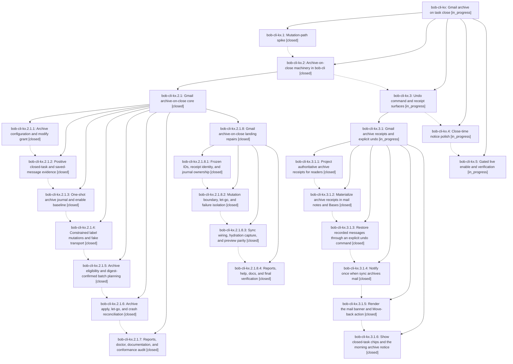

# Bead: bob-cli-kx — Gmail archive on task close

[Bead Pages](../README.md) / bob-cli-kx

**Status:** ◐ in_progress · **Type:** ▸ plan · **Tier:** epic
**Owner:** `bryanbugyi34@gmail.com` · **Created by:** [bbugyi200.athena.1bt](https://github.com/bobs-org/bob-cli--agents/blob/main/sessions/bbugyi200.athena.1bt.md) · **Assignee:** `bob-cli-kx.land`
**Created:** 2026-11-12 11:11:53 EST
**Plan:** [202611/gmail\_archive\_on\_task\_close.md](https://github.com/bobs-org/bob-cli--plans/blob/main/202611/gmail_archive_on_task_close.md)

<!-- sase:links:start -->

## Links

| Relation | Artifact | Why |
| --- | --- | --- |
| implemented-by | [plan:202611/gmail_archive_on_task_close.md][1] | derived from the plan's `bead_id:` frontmatter field |

_Plus 1 automatic references — see [Referenced By](#referenced-by)._

[1]: https://github.com/bobs-org/bob-cli--plans/blob/main/202611/gmail_archive_on_task_close.md

<!-- sase:links:end -->

## Description

bob gmail sync archives a bob-labelled thread's saved messages exactly once when every linking Obsidian task is closed, visibly, undoably, and opt-in; Bryan is opted in and a gated live run on the Mac writer verifies the expected threads were archived.

## Notes

[2026-11-13T17:02:07Z · bob-cli-ld.2] DISCOVERED ISSUE: On clean master 2709046a, just check fails with five deny-level clippy errors in src/native/gmail/unarchive.rs, all introduced by commit 2ddfc944 for bob-cli-kx.3.1.3: clippy::needless_borrow at lines 283 twice, 313, and 330; and clippy::useless_conversion at line 464. The same diagnostics reproduce byte-for-byte on clean HEAD. Follow-up should fix these errors in the Gmail archive epic.

## Phases

| Bead | Title | Status | Size | Created | Agents | Commits |
|---|---|---|---|---|---:|---:|
| [bob-cli-kx.1](bob-cli-kx.1.md) | Mutation-path spike | ✓ closed | small | 2026-11-12 | 1 | 0 |
| [bob-cli-kx.2](bob-cli-kx.2.md) | Archive-on-close machinery in bob-cli | ✓ closed | large | 2026-11-12 | 1 | 0 |
| [bob-cli-kx.3](bob-cli-kx.3.md) | Undo command and receipt surfaces | ◐ in_progress | large | 2026-11-12 | 1 | 0 |
| [bob-cli-kx.4](bob-cli-kx.4.md) | Close-time notice polish | ◐ in_progress | small | 2026-11-12 | 1 | 0 |
| [bob-cli-kx.5](bob-cli-kx.5.md) | Gated live enable and verification | ◐ in_progress | medium | 2026-11-12 | 1 | 0 |

## Lineage

## Agents

| Agent | Bead | Commits |
|---|---|---:|
| [bbugyi200.athena.bob-cli-kx.1](https://github.com/bobs-org/bob-cli--agents/blob/main/agents/bbugyi200.athena.bob-cli-kx.1/README.md) | [bob-cli-kx.1](bob-cli-kx.1.md) | 0 |
| [bbugyi200.athena.bob-cli-kx.2](https://github.com/bobs-org/bob-cli--agents/blob/main/sessions/bbugyi200.athena.bob-cli-kx.2.md) | [bob-cli-kx.2](bob-cli-kx.2.md) | 0 |
| [bbugyi200.athena.bob-cli-kx.2.1.1](https://github.com/bobs-org/bob-cli--agents/blob/main/agents/bbugyi200.athena.bob-cli-kx.2.1.1/README.md) | [bob-cli-kx.2.1.1](bob-cli-kx.2.1.1.md) | 1 |
| [bbugyi200.athena.bob-cli-kx.2.1.2](https://github.com/bobs-org/bob-cli--agents/blob/main/agents/bbugyi200.athena.bob-cli-kx.2.1.2/README.md) | [bob-cli-kx.2.1.2](bob-cli-kx.2.1.2.md) | 1 |
| [bbugyi200.athena.bob-cli-kx.2.1.3](https://github.com/bobs-org/bob-cli--agents/blob/main/sessions/bbugyi200.athena.bob-cli-kx.2.1.3.md) | [bob-cli-kx.2.1.3](bob-cli-kx.2.1.3.md) | 1 |
| [bbugyi200.athena.bob-cli-kx.2.1.4](https://github.com/bobs-org/bob-cli--agents/blob/main/agents/bbugyi200.athena.bob-cli-kx.2.1.4/README.md) | [bob-cli-kx.2.1.4](bob-cli-kx.2.1.4.md) | 1 |
| [bbugyi200.athena.bob-cli-kx.2.1.5](https://github.com/bobs-org/bob-cli--agents/blob/main/agents/bbugyi200.athena.bob-cli-kx.2.1.5/README.md) | [bob-cli-kx.2.1.5](bob-cli-kx.2.1.5.md) | 1 |
| [bbugyi200.athena.bob-cli-kx.2.1.6](https://github.com/bobs-org/bob-cli--agents/blob/main/agents/bbugyi200.athena.bob-cli-kx.2.1.6/README.md) | [bob-cli-kx.2.1.6](bob-cli-kx.2.1.6.md) | 1 |
| [bbugyi200.athena.bob-cli-kx.2.1.7](https://github.com/bobs-org/bob-cli--agents/blob/main/agents/bbugyi200.athena.bob-cli-kx.2.1.7/README.md) | [bob-cli-kx.2.1.7](bob-cli-kx.2.1.7.md) | 1 |
| [bbugyi200.athena.bob-cli-kx.2.1.8.1](https://github.com/bobs-org/bob-cli--agents/blob/main/sessions/bbugyi200.athena.bob-cli-kx.2.1.8.1.md) | [bob-cli-kx.2.1.8.1](bob-cli-kx.2.1.8.1.md) | 0 |
| [bbugyi200.athena.bob-cli-kx.2.1.8.2](https://github.com/bobs-org/bob-cli--agents/blob/main/agents/bbugyi200.athena.bob-cli-kx.2.1.8.2/README.md) | [bob-cli-kx.2.1.8.2](bob-cli-kx.2.1.8.2.md) | 1 |
| [bbugyi200.athena.bob-cli-kx.2.1.8.3](https://github.com/bobs-org/bob-cli--agents/blob/main/agents/bbugyi200.athena.bob-cli-kx.2.1.8.3/README.md) | [bob-cli-kx.2.1.8.3](bob-cli-kx.2.1.8.3.md) | 1 |
| [bbugyi200.athena.bob-cli-kx.2.1.8.4](https://github.com/bobs-org/bob-cli--agents/blob/main/agents/bbugyi200.athena.bob-cli-kx.2.1.8.4/README.md) | [bob-cli-kx.2.1.8.4](bob-cli-kx.2.1.8.4.md) | 1 |
| [bbugyi200.athena.bob-cli-kx.2.1.8.land](https://github.com/bobs-org/bob-cli--agents/blob/main/sessions/bbugyi200.athena.bob-cli-kx.2.1.8.land.md) | [bob-cli-kx.2.1.8](bob-cli-kx.2.1.8.md) | 2 |
| [bbugyi200.athena.bob-cli-kx.2.1.land](https://github.com/bobs-org/bob-cli--agents/blob/main/sessions/bbugyi200.athena.bob-cli-kx.2.1.land.md) | [bob-cli-kx.2.1](bob-cli-kx.2.1.md) | 0 |
| [bbugyi200.athena.bob-cli-kx.3](https://github.com/bobs-org/bob-cli--agents/blob/main/sessions/bbugyi200.athena.bob-cli-kx.3.md) | [bob-cli-kx.3](bob-cli-kx.3.md) | 0 |
| [bbugyi200.athena.bob-cli-kx.3.1.1](https://github.com/bobs-org/bob-cli--agents/blob/main/agents/bbugyi200.athena.bob-cli-kx.3.1.1/README.md) | [bob-cli-kx.3.1.1](bob-cli-kx.3.1.1.md) | 1 |
| [bbugyi200.athena.bob-cli-kx.3.1.2](https://github.com/bobs-org/bob-cli--agents/blob/main/agents/bbugyi200.athena.bob-cli-kx.3.1.2/README.md) | [bob-cli-kx.3.1.2](bob-cli-kx.3.1.2.md) | 1 |
| [bbugyi200.athena.bob-cli-kx.3.1.3](https://github.com/bobs-org/bob-cli--agents/blob/main/agents/bbugyi200.athena.bob-cli-kx.3.1.3/README.md) | [bob-cli-kx.3.1.3](bob-cli-kx.3.1.3.md) | 1 |
| [bbugyi200.athena.bob-cli-kx.3.1.4](https://github.com/bobs-org/bob-cli--agents/blob/main/agents/bbugyi200.athena.bob-cli-kx.3.1.4/README.md) | [bob-cli-kx.3.1.4](bob-cli-kx.3.1.4.md) | 1 |
| [bbugyi200.athena.bob-cli-kx.3.1.5](https://github.com/bobs-org/bob-cli--agents/blob/main/sessions/bbugyi200.athena.bob-cli-kx.3.1.5.md) | [bob-cli-kx.3.1.5](bob-cli-kx.3.1.5.md) | 0 |
| [bbugyi200.athena.bob-cli-kx.3.1.6](https://github.com/bobs-org/bob-cli--agents/blob/main/sessions/bbugyi200.athena.bob-cli-kx.3.1.6.md) | [bob-cli-kx.3.1.6](bob-cli-kx.3.1.6.md) | 1 |
| [bbugyi200.athena.bob-cli-kx.3.1.land](https://github.com/bobs-org/bob-cli--agents/blob/main/agents/bbugyi200.athena.bob-cli-kx.3.1.land/README.md) | [bob-cli-kx.3.1](bob-cli-kx.3.1.md) | 0 |
| [bbugyi200.athena.bob-cli-kx.4](https://github.com/bobs-org/bob-cli--agents/blob/main/agents/bbugyi200.athena.bob-cli-kx.4/README.md) | [bob-cli-kx.4](bob-cli-kx.4.md) | 0 |
| [bbugyi200.athena.bob-cli-kx.5](https://github.com/bobs-org/bob-cli--agents/blob/main/agents/bbugyi200.athena.bob-cli-kx.5/README.md) | [bob-cli-kx.5](bob-cli-kx.5.md) | 0 |
| [bbugyi200.athena.bob-cli-kx.land](https://github.com/bobs-org/bob-cli--agents/blob/main/agents/bbugyi200.athena.bob-cli-kx.land/README.md) | [bob-cli-kx](README.md) | 0 |

## Commits

| Repo | Commit | Subject | Bead | Committed |
|---|---|---|---|---|
| bob-cli | [`677e740`](https://github.com/bobs-org/bob-cli/commit/677e7407a7dc4b9b65c680784d3d9d8433b0523c) | feat(gmail): add archive config and modify login scope | [bob-cli-kx.2.1.1](bob-cli-kx.2.1.1.md) | 2026-11-12 12:36:22 EST |
| bob-cli | [`92b52e4`](https://github.com/bobs-org/bob-cli/commit/92b52e4f66d619109f9b49c37ecf24931361d972) | feat(gmail)!: add strict archive evidence scan | [bob-cli-kx.2.1.2](bob-cli-kx.2.1.2.md) | 2026-11-12 13:58:04 EST |
| bob-cli | [`4c2cb87`](https://github.com/bobs-org/bob-cli/commit/4c2cb87885f88df245f72243f72a484969fa30dc) | feat(gmail): add archive state journal | [bob-cli-kx.2.1.3](bob-cli-kx.2.1.3.md) | 2026-11-12 15:48:06 EST |
| bob-cli | [`8e78584`](https://github.com/bobs-org/bob-cli/commit/8e78584d5b93b7a978017096adef8bad3587b381) | feat(gmail)!: add constrained archive label transport | [bob-cli-kx.2.1.4](bob-cli-kx.2.1.4.md) | 2026-11-12 16:47:51 EST |
| bob-cli | [`0b806ae`](https://github.com/bobs-org/bob-cli/commit/0b806ae83fc4285c60eee2e631ee5678c757b732) | feat(gmail)!: add digest-confirmed archive batch planning preview | [bob-cli-kx.2.1.5](bob-cli-kx.2.1.5.md) | 2026-11-12 19:45:47 EST |
| bob-cli | [`62ad26d`](https://github.com/bobs-org/bob-cli/commit/62ad26d7472c4ee98153a9ac8a86d661faa5b4f4) | feat(gmail)!: add archive apply, let-go and crash reconciliation | [bob-cli-kx.2.1.6](bob-cli-kx.2.1.6.md) | 2026-11-12 21:21:27 EST |
| bob-cli | [`54fc8c6`](https://github.com/bobs-org/bob-cli/commit/54fc8c61870cf863710fb8051fb4d25c6f1e8117) | feat(gmail)!: complete archive reports and conformance audit | [bob-cli-kx.2.1.7](bob-cli-kx.2.1.7.md) | 2026-11-12 22:59:42 EST |
| bob-cli | [`642e158`](https://github.com/bobs-org/bob-cli/commit/642e1580872c74acc2ce3d30b02ff2cfe510841e) | feat(gmail)!: apply mutation boundary, let-go isolation, and fault tests \[bob-cli-kx.2.1.8.2\] | [bob-cli-kx.2.1.8.2](bob-cli-kx.2.1.8.2.md) | 2026-11-13 05:22:41 EST |
| bob-cli | [`6b9261a`](https://github.com/bobs-org/bob-cli/commit/6b9261a74b0c0f27548de4992501c52c549f4447) | fix(gmail): preserve archive preview and sync safety | [bob-cli-kx.2.1.8.3](bob-cli-kx.2.1.8.3.md) | 2026-11-13 06:01:18 EST |
| bob-cli | [`a8dd820`](https://github.com/bobs-org/bob-cli/commit/a8dd82047ee1ca2ea15d5747ab168dc57447198e) | feat(gmail)!: archive surfaces reports help docs and verification \[bob-cli-kx.2.1.8.4\] | [bob-cli-kx.2.1.8.4](bob-cli-kx.2.1.8.4.md) | 2026-11-13 06:49:00 EST |
| bob-cli | [`fada115`](https://github.com/bobs-org/bob-cli/commit/fada115450d2ab8fc55c461c59401014f97ebd35) | fix(gmail)!: fail closed at archive mutation boundaries | [bob-cli-kx.2.1.8](bob-cli-kx.2.1.8.md) | 2026-11-13 07:55:31 EST |
| bob-cli--plans | [`bob-cli--plans@3a72a54`](https://github.com/bobs-org/bob-cli--plans/commit/3a72a54198c739ac0054d4e40d39c7f0c8351fac) | docs(plans): mark Gmail archive plans done | [bob-cli-kx.2.1.8](bob-cli-kx.2.1.8.md) | 2026-11-13 07:56:29 EST |
| bob-cli | [`c994cfb`](https://github.com/bobs-org/bob-cli/commit/c994cfbd1d0d0a8271b5b27c3db5b6d6d73b0795) | feat(gmail): project archive receipts for readers | [bob-cli-kx.3.1.1](bob-cli-kx.3.1.1.md) | 2026-11-13 08:43:19 EST |
| bob-cli | [`59b6149`](https://github.com/bobs-org/bob-cli/commit/59b6149a41aa7f6f89ad715c4054aef4fe4302b8) | feat(gmail): materialize owned archive receipts into mail notes | [bob-cli-kx.3.1.2](bob-cli-kx.3.1.2.md) | 2026-11-13 09:34:50 EST |
| bob-cli | [`2ddfc94`](https://github.com/bobs-org/bob-cli/commit/2ddfc9444b523367ff70541524302b3cb923ae69) | feat(gmail): add receipt-scoped unarchive command | [bob-cli-kx.3.1.3](bob-cli-kx.3.1.3.md) | 2026-11-13 10:23:44 EST |
| bob-cli | [`cd6aefa`](https://github.com/bobs-org/bob-cli/commit/cd6aefae7974e11557d3d84268ac397b19e993a9) | feat(gmail)!: notify once when sync archives mail | [bob-cli-kx.3.1.4](bob-cli-kx.3.1.4.md) | 2026-11-13 10:57:56 EST |
| bob-cli | [`01ab076`](https://github.com/bobs-org/bob-cli/commit/01ab0767f85ab3fa3ef2467b505e2ce4f676234b) | docs(gmail): document archive receipt UI | [bob-cli-kx.3.1.6](bob-cli-kx.3.1.6.md) | 2026-11-13 13:58:36 EST |

<!-- sase:referenced-by:start -->

## Referenced By

| Relation | Artifact | Why | Uses |
| --- | --- | --- | ---: |
| read-by | [agent:bob-cli-ld.2][1] | Need to verify and correct the clippy report recorded from this phase | 3 |

[1]: https://github.com/bobs-org/bob-cli--agents/blob/main/agents/bbugyi200.athena.bob-cli-ld.2/README.md

<!-- sase:referenced-by:end -->
