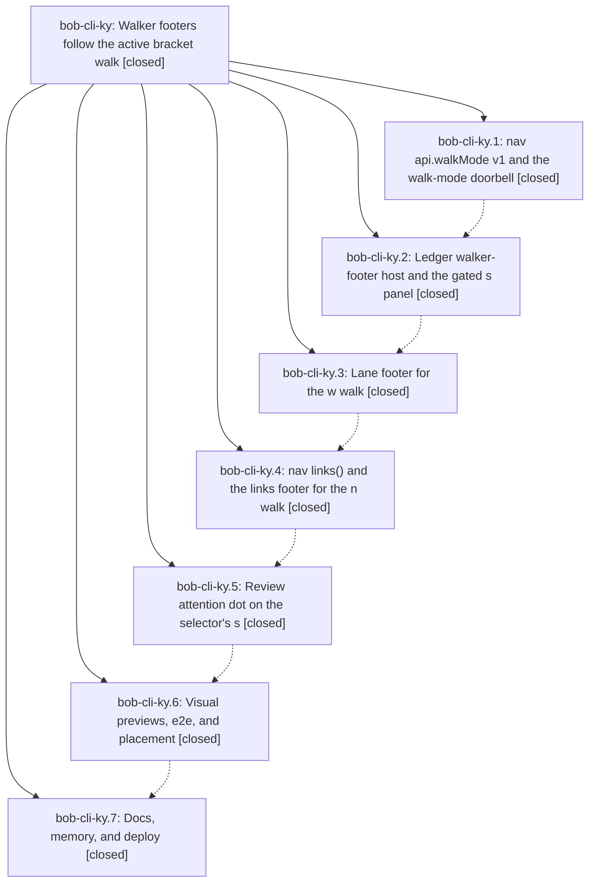

# Bead: bob-cli-ky — Walker footers follow the active bracket walk

[Bead Pages](../README.md) / bob-cli-ky

**Status:** ✓ closed · **Resolution:** done · **Type:** ▸ plan · **Tier:** epic
**Owner:** `bryanbugyi34@gmail.com` · **Created by:** [bbugyi200.athena.1bu](https://github.com/bobs-org/bob-cli--agents/blob/main/sessions/bbugyi200.athena.1bu.md) · **Assignee:** `bob-cli-ky.land`
**Created:** 2026-11-12 12:30:15 EST · **Closed:** 2026-11-12 17:45:15 EST
**Plan:** [202611/walker\_footers.md](https://github.com/bobs-org/bob-cli--plans/blob/main/202611/walker_footers.md)

<!-- sase:links:start -->

## Links

| Relation | Artifact | Why |
| --- | --- | --- |
| implemented-by | [plan:202611/walker_footers.md][1] | derived from the plan's `bead_id:` frontmatter field |

_Plus 2 automatic references — see [Referenced By](#referenced-by)._

[1]: https://github.com/bobs-org/bob-cli--plans/blob/main/202611/walker_footers.md

<!-- sase:links:end -->

## Description

Obsidian's status bar shows exactly one walker footer that matches the persisted bracket walk: the review footer only while `s` is active (with a calm clear state instead of hiding), a new lane footer for `w`, a new links compass for `n`, a quiet review-due dot on the selector's `s` letter, byte-compatible legacy fallbacks, updated docs, and a published Walker Footer glossary term.

## Notes

[2026-11-12T21:26:59Z · dq--1] DISCOVERED ISSUE: full album-header validation on 6050124 found three stale walkMode v2 assertions (two bracket-repeat tests and period-links); production API is v3 after review attention. dq--1 updates assertions to v3, preserving top-level API v3. All 70 task-tag/bracket/period tests pass; changes will land with album-header follow-up.

[2026-11-12T21:42:19Z · dq--2] DISCOVERED ISSUE: album-header validation at bob-cli 70f69c2304ee2c7d1765ea0397962ee306253362 passes docs lint after trimming the mounted navigation reference, then fails generated drift: docs/reference/glossary.md (run just docs-gen). The ky.7 commit 70f69c23 adds glossary:walker-footer and amends two glossary strands but does not update docs/reference/glossary.md; the tracked generated page contains no Walker Footer entry. This blocks the album plan npm run docs:check. Please regenerate the glossary in the walker-footer landing scope; the album plan explicitly forbids bob-cli changes. The navigation budget repair is included with the album changes, and no memory or bob-cli source was changed here.

[2026-11-12T21:53:08Z · bob-cli-ky.land] LANDER FOLLOW-UP TRIAGE: (1) task-tag-marks 'session toggle and onload wiring' failure (proposed by ky.1, ky.2, ky.3, ky.4) -> duplicate of bob-cli-kw (root cause: bank-marks subscription, commit 4e4a580); corroborated with +1, reproduced on bob-plugins 6050124. (2) album UI e2e self-test 'unrecognized subcommand albums' (ky.4 #2) -> new task bob-cli-l8 (small): findRealBob prefers a stale workspace target/debug/bob 0.1.0 over installed bob 0.5.0; not epic-caused, adding epic bob-cli-k3 closed. (3) docs-check lychee broken link gcal-notes -> ../reference/mac-capture/event-notes (ky.6 #2, ky.7 #1) -> new task bob-cli-l7 (xsmall), caused by bob-cli-ji.7.1.6 (closed epic), linked related to bob-cli-kk. (4) stale walkMode version-2 assertions (ky.6 #1; also epic note #1 from dq--1, whose fix never landed) -> DECLINED as a follow-up: epic-caused (dot phase bumped walkMode to v3), kept as remaining epic work. Non-proposed timing flakes (off-clock 25ms budget, one parallel perf threshold) were notes only and already have flake beads (bob-cli-ju, bob-cli-io family); nothing filed.

[2026-11-12T22:45:15Z · bob-cli-ky.land] LANDER FINDINGS VERIFIED: phases 1-4 and 7 verified in source; dot phase shipped no tests; visual phase proved invariant 7 only in Chromium preview with live-vault confirmation left for ship which never did it; nav-hotkeys reference page over word cap at 6039/6000; generated glossary already regenerated by land agent (not redone).

TALE FIXES (bob-plugins 6050124 base):
- Stale walkMode v2 assertions -> v3 in test-navigation-bracket-repeat (2x) and test-navigation-period-links (1x); top-level api.version stays 3.
- Review-attention tests: buildBracketModeView s-only off-s/w/n/none never on s or w/n segments with tier/label/aria; paint has-attention/data-attention-tier/title set/clear, attention-only repaint, unchanged key skips writes, never toggles is-instant; styles.css has-attention::after has no animation/transition and forced-colors uses Highlight; setAttention invalid-type/invalid-value/clear/freeze-normalize/throwing-refresh/unavailable; exported walkerFooterPushReviewAttention + walkerFooterWalkMode (354) and bracketModeViewKey (700).
- Push tests: first nonzero commitment tier off-s, ROTTEN/POST-only null, s/legacy/unavailable null, version<3 no-call, throwing never escapes, s->w->s via updateFreshnessStatusBar non-null then null.
- Unload: setupFreshnessStatusBar registers clear callback next to linksWalkerFooterInvalidate; calls setAttention(s,null) when walkMode>=3, never throws; tested missing/old nav.
- E2E: added scripts/obsidian-walker-footer-e2e.cjs plus offline test-obsidian-walker-footer-e2e.cjs registered in test:unit. Real athena run under xvfb-run: FAILED as recorded below (Obsidian launched, trust accepted). Geometry NOT stable across s/w/n in live vault (invariant 7 fails outside Chromium preview); panels swap within frame, single footer item, dot appears off-s and clears on s. Tasks plugin loaded but api.getTasks unavailable via apiV1/api/self (hasPlugin true, hasGet false); ledger still computed 6 commitments.
- Docs: trimmed walker/bracket redundancy in docs/bob-navigation-hotkeys.md (~65 words); bob-docs lint now ok (was 6039/6000). bob-plugins docs:check lychee 1 error on gcal-notes mac-capture/event-notes is bob-cli-l7 expected.

TEST COUNTS: walker files 140/140 pass (repeat, period-links, indicator, freshness-footer, walker-footer, lane-walk, walker e2e offline). Full npm test: 6420 pass / 5 fail (2x 200-link 25ms budget timing flakes pass in isolation, 1x relation-chips MN click passes in isolation, 1x task-tag-marks session toggle = bob-cli-kw known, 1x album e2e self-test = bob-cli-l8 known); perf 5/5 pass. build, build:check, validate pass. bob plugins sync ok (3 copied).

E2E JSON (athena, /snap/bin/obsidian, xvfb-run): status failed, trustButtonClicked true, tasksPlugin true, tasksReady {ready false, count -1, hasPlugin true, hasGet false, timeout true}, geometryStable false, panelsSwap true, singleItem true, dotBehaves true, rectS {x 459.01, y 766, w 87.03, h 30}, rectWImmediate {x 595.92}, rectW {x 595.92}, rectNImmediate {x 595.92}, rectN {x 725.15}, panelS s Review 6 due 6 commitments NEW4WIP1NEXT1, panelW w Lanes 2 WIP1NEXT1, panelAfterCommand w, panelN n, textN no links in this note, dotOffS true tier new title Review: 6 due 6 commitments NEW first, dotCleared true, panelBackS s, footerItems 1.

TRIAGE (already on epic, not redone): bob-cli-kw +1, new bob-cli-l7 (gcal-notes lychee), new bob-cli-l8 (album e2e self-test); v2-assertion proposal declined as epic work (landed here). No --force. epic-symbols clean.

## Phases

| Bead | Title | Status | Size | Created | Agents | Commits |
|---|---|---|---|---|---:|---:|
| [bob-cli-ky.1](bob-cli-ky.1.md) | nav api.walkMode v1 and the walk-mode doorbell | ✓ closed | small | 2026-11-12 | 1 | 1 |
| [bob-cli-ky.2](bob-cli-ky.2.md) | Ledger walker-footer host and the gated s panel | ✓ closed | medium | 2026-11-12 | 1 | 1 |
| [bob-cli-ky.3](bob-cli-ky.3.md) | Lane footer for the w walk | ✓ closed | medium | 2026-11-12 | 1 | 1 |
| [bob-cli-ky.4](bob-cli-ky.4.md) | nav links() and the links footer for the n walk | ✓ closed | medium | 2026-11-12 | 1 | 1 |
| [bob-cli-ky.5](bob-cli-ky.5.md) | Review attention dot on the selector's s | ✓ closed | small | 2026-11-12 | 1 | 1 |
| [bob-cli-ky.6](bob-cli-ky.6.md) | Visual previews, e2e, and placement | ✓ closed | medium | 2026-11-12 | 1 | 1 |
| [bob-cli-ky.7](bob-cli-ky.7.md) | Docs, memory, and deploy | ✓ closed | medium | 2026-11-12 | 1 | 2 |

## Lineage

## Agents

| Agent | Bead | Commits |
|---|---|---:|
| [bbugyi200.athena.bob-cli-ky.1](https://github.com/bobs-org/bob-cli--agents/blob/main/agents/bbugyi200.athena.bob-cli-ky.1/README.md) | [bob-cli-ky.1](bob-cli-ky.1.md) | 1 |
| [bbugyi200.athena.bob-cli-ky.2](https://github.com/bobs-org/bob-cli--agents/blob/main/agents/bbugyi200.athena.bob-cli-ky.2/README.md) | [bob-cli-ky.2](bob-cli-ky.2.md) | 1 |
| [bbugyi200.athena.bob-cli-ky.3](https://github.com/bobs-org/bob-cli--agents/blob/main/agents/bbugyi200.athena.bob-cli-ky.3/README.md) | [bob-cli-ky.3](bob-cli-ky.3.md) | 1 |
| [bbugyi200.athena.bob-cli-ky.4](https://github.com/bobs-org/bob-cli--agents/blob/main/sessions/bbugyi200.athena.bob-cli-ky.4.md) | [bob-cli-ky.4](bob-cli-ky.4.md) | 1 |
| [bbugyi200.athena.bob-cli-ky.5](https://github.com/bobs-org/bob-cli--agents/blob/main/agents/bbugyi200.athena.bob-cli-ky.5/README.md) | [bob-cli-ky.5](bob-cli-ky.5.md) | 1 |
| [bbugyi200.athena.bob-cli-ky.6](https://github.com/bobs-org/bob-cli--agents/blob/main/agents/bbugyi200.athena.bob-cli-ky.6/README.md) | [bob-cli-ky.6](bob-cli-ky.6.md) | 1 |
| [bbugyi200.athena.bob-cli-ky.7](https://github.com/bobs-org/bob-cli--agents/blob/main/agents/bbugyi200.athena.bob-cli-ky.7/README.md) | [bob-cli-ky.7](bob-cli-ky.7.md) | 2 |
| [bbugyi200.athena.bob-cli-ky.land](https://github.com/bobs-org/bob-cli--agents/blob/main/sessions/bbugyi200.athena.bob-cli-ky.land.md) | [bob-cli-ky](README.md) | 3 |

## Commits

| Repo | Commit | Subject | Bead | Committed |
|---|---|---|---|---|
| bob-plugins | [`bob-plugins@d36acba`](https://github.com/bobs-org/bob-plugins/commit/d36acba1b09d1ae19868a467ad56c8b9e4ea9e0f) | feat(nav-hotkeys): add api.walkMode v1 and the walk-mode doorbell | [bob-cli-ky.1](bob-cli-ky.1.md) | 2026-11-12 12:47:01 EST |
| bob-plugins | [`bob-plugins@83d4a9f`](https://github.com/bobs-org/bob-plugins/commit/83d4a9f06e9489cd6f454118dd2599b0497f5b48) | feat(ledger-tools): route walker footer by bracket walk with gated s panel | [bob-cli-ky.2](bob-cli-ky.2.md) | 2026-11-12 13:10:48 EST |
| bob-plugins | [`bob-plugins@394b793`](https://github.com/bobs-org/bob-plugins/commit/394b793ea7be226c090c9654c3c3af8bec2bc040) | feat(ledger-tools): add bracket walk lane footer | [bob-cli-ky.3](bob-cli-ky.3.md) | 2026-11-12 13:56:06 EST |
| bob-plugins | [`bob-plugins@3fc55c9`](https://github.com/bobs-org/bob-plugins/commit/3fc55c911cecca84be0e9a80ddf7a26180ab5894) | feat(walker-footer): add links compass panel | [bob-cli-ky.4](bob-cli-ky.4.md) | 2026-11-12 14:51:26 EST |
| bob-plugins | [`bob-plugins@c7a500e`](https://github.com/bobs-org/bob-plugins/commit/c7a500e43207df63c4c80246f6a5d23e711e54cb) | feat(navigation): add review attention dot to walk selector | [bob-cli-ky.5](bob-cli-ky.5.md) | 2026-11-12 15:03:30 EST |
| bob-plugins | [`bob-plugins@75493b0`](https://github.com/bobs-org/bob-plugins/commit/75493b09f177dce7c9abd40290cbf91156ed80ab) | feat(walker-footer): visual previews, motion polish, and placement evidence | [bob-cli-ky.6](bob-cli-ky.6.md) | 2026-11-12 15:31:55 EST |
| bob-cli | [`70f69c2`](https://github.com/bobs-org/bob-cli/commit/70f69c2304ee2c7d1765ea0397962ee306253362) | docs(memory): publish walker-footer glossary and ship docs for bracket-walk footers | [bob-cli-ky.7](bob-cli-ky.7.md) | 2026-11-12 15:55:28 EST |
| bob-plugins | [`bob-plugins@444b8a8`](https://github.com/bobs-org/bob-plugins/commit/444b8a866775746a3e5b3f735ef6a579ee13ab52) | docs(plugins): document walker footer, walkMode API, and review attention dot | [bob-cli-ky.7](bob-cli-ky.7.md) | 2026-11-12 15:56:13 EST |
| bob-cli | [`6981b04`](https://github.com/bobs-org/bob-cli/commit/6981b04cc0801a836d888f52b6145c24c98fb901) | docs(glossary): regenerate reference glossary for the walker footer | [bob-cli-ky](README.md) | 2026-11-12 16:55:50 EST |
| bob-plugins | [`bob-plugins@3ef045b`](https://github.com/bobs-org/bob-plugins/commit/3ef045b64ff62bcdb63493d16a2518f311b530b6) | feat(walker-footer): land walker\_footer\_landing tale, close bob-cli-ky | [bob-cli-ky](README.md) | 2026-11-12 17:51:54 EST |
| bob-cli--plans | [`bob-cli--plans@435c1ae`](https://github.com/bobs-org/bob-cli--plans/commit/435c1ae87894d5e4bfd3656442380524161f91a4) | docs(plans): land walker\_footers epic plan for bracket-walk footers | [bob-cli-ky](README.md) | 2026-11-12 17:55:13 EST |

<!-- sase:referenced-by:start -->

## Referenced By

| Relation | Artifact | Why | Uses |
| --- | --- | --- | ---: |
| read-by | [agent:bob-cli-ky.7][1] | need epic scope and decisions | 1 |
| read-by | [agent:bob-cli-ky.land][2] | Need the epic scope, children, and linked plan file | 1 |

[1]: https://github.com/bobs-org/bob-cli--agents/blob/main/agents/bbugyi200.athena.bob-cli-ky.7/README.md
[2]: https://github.com/bobs-org/bob-cli--agents/blob/main/sessions/bbugyi200.athena.bob-cli-ky.land.md

<!-- sase:referenced-by:end -->
