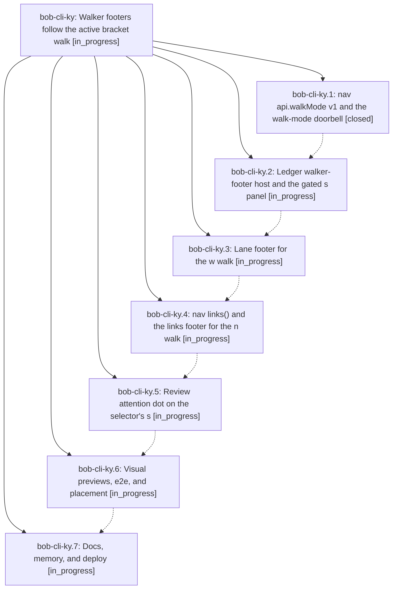

# Bead: bob-cli-ky — Walker footers follow the active bracket walk

[Bead Pages](../README.md) / bob-cli-ky

**Status:** ◐ in_progress · **Type:** ▸ plan · **Tier:** epic
**Owner:** `bryanbugyi34@gmail.com` · **Created by:** [bbugyi200.athena.1bu](https://github.com/bobs-org/bob-cli--agents/blob/main/sessions/bbugyi200.athena.1bu.md) · **Assignee:** `bob-cli-ky.land`
**Created:** 2026-11-12 12:30:15 EST
**Plan:** [202611/walker\_footers.md](https://github.com/bobs-org/bob-cli--plans/blob/main/202611/walker_footers.md)

## Description

Obsidian's status bar shows exactly one walker footer that matches the persisted bracket walk: the review footer only while `s` is active (with a calm clear state instead of hiding), a new lane footer for `w`, a new links compass for `n`, a quiet review-due dot on the selector's `s` letter, byte-compatible legacy fallbacks, updated docs, and a published Walker Footer glossary term.

## Phases

| Bead | Title | Status | Size | Created | Agents | Commits |
|---|---|---|---|---|---:|---:|
| [bob-cli-ky.1](bob-cli-ky.1.md) | nav api.walkMode v1 and the walk-mode doorbell | ✓ closed | small | 2026-11-12 | 1 | 1 |
| [bob-cli-ky.2](bob-cli-ky.2.md) | Ledger walker-footer host and the gated s panel | ◐ in_progress | medium | 2026-11-12 | 1 | 0 |
| [bob-cli-ky.3](bob-cli-ky.3.md) | Lane footer for the w walk | ◐ in_progress | medium | 2026-11-12 | 1 | 0 |
| [bob-cli-ky.4](bob-cli-ky.4.md) | nav links() and the links footer for the n walk | ◐ in_progress | medium | 2026-11-12 | 1 | 0 |
| [bob-cli-ky.5](bob-cli-ky.5.md) | Review attention dot on the selector's s | ◐ in_progress | small | 2026-11-12 | 1 | 0 |
| [bob-cli-ky.6](bob-cli-ky.6.md) | Visual previews, e2e, and placement | ◐ in_progress | medium | 2026-11-12 | 1 | 0 |
| [bob-cli-ky.7](bob-cli-ky.7.md) | Docs, memory, and deploy | ◐ in_progress | medium | 2026-11-12 | 1 | 0 |

## Lineage

## Agents

| Agent | Bead | Commits |
|---|---|---:|
| [bbugyi200.athena.bob-cli-ky.1](https://github.com/bobs-org/bob-cli--agents/blob/main/agents/bbugyi200.athena.bob-cli-ky.1/README.md) | [bob-cli-ky.1](bob-cli-ky.1.md) | 1 |
| [bbugyi200.athena.bob-cli-ky.2](https://github.com/bobs-org/bob-cli--agents/blob/main/agents/bbugyi200.athena.bob-cli-ky.2/README.md) | [bob-cli-ky.2](bob-cli-ky.2.md) | 0 |
| [bbugyi200.athena.bob-cli-ky.3](https://github.com/bobs-org/bob-cli--agents/blob/main/agents/bbugyi200.athena.bob-cli-ky.3/README.md) | [bob-cli-ky.3](bob-cli-ky.3.md) | 0 |
| [bbugyi200.athena.bob-cli-ky.4](https://github.com/bobs-org/bob-cli--agents/blob/main/agents/bbugyi200.athena.bob-cli-ky.4/README.md) | [bob-cli-ky.4](bob-cli-ky.4.md) | 0 |
| [bbugyi200.athena.bob-cli-ky.5](https://github.com/bobs-org/bob-cli--agents/blob/main/agents/bbugyi200.athena.bob-cli-ky.5/README.md) | [bob-cli-ky.5](bob-cli-ky.5.md) | 0 |
| [bbugyi200.athena.bob-cli-ky.6](https://github.com/bobs-org/bob-cli--agents/blob/main/agents/bbugyi200.athena.bob-cli-ky.6/README.md) | [bob-cli-ky.6](bob-cli-ky.6.md) | 0 |
| [bbugyi200.athena.bob-cli-ky.7](https://github.com/bobs-org/bob-cli--agents/blob/main/agents/bbugyi200.athena.bob-cli-ky.7/README.md) | [bob-cli-ky.7](bob-cli-ky.7.md) | 0 |
| [bbugyi200.athena.bob-cli-ky.land](https://github.com/bobs-org/bob-cli--agents/blob/main/agents/bbugyi200.athena.bob-cli-ky.land/README.md) | [bob-cli-ky](README.md) | 0 |

## Commits

| Repo | Commit | Subject | Bead | Committed |
|---|---|---|---|---|
| bob-plugins | [`bob-plugins@d36acba`](https://github.com/bobs-org/bob-plugins/commit/d36acba1b09d1ae19868a467ad56c8b9e4ea9e0f) | feat(nav-hotkeys): add api.walkMode v1 and the walk-mode doorbell | [bob-cli-ky.1](bob-cli-ky.1.md) | 2026-11-12 12:47:01 EST |
