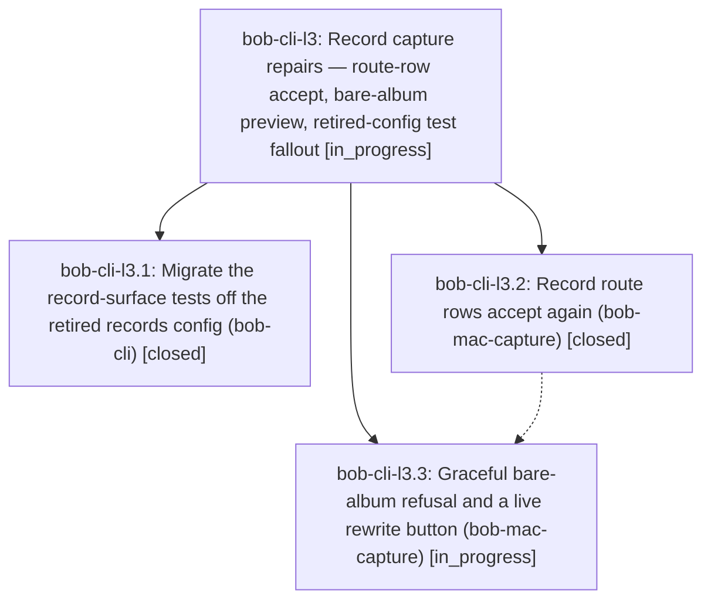

# Bead: bob-cli-l3 — Record capture repairs — route-row accept, bare-album preview, retired-config test fallout

[Bead Pages](../README.md) / bob-cli-l3

**Status:** ◐ in_progress · **Type:** ▸ plan · **Tier:** epic
**Owner:** `bryanbugyi34@gmail.com` · **Created by:** [bbugyi200.apollo.dp](https://github.com/bobs-org/bob-cli--agents/blob/main/sessions/bbugyi200.apollo.dp.md) · **Assignee:** `bob-cli-l3.land`
**Created:** 2026-11-12 16:11:26 EST
**Plan:** [202611/record\_capture\_repairs.md](https://github.com/bobs-org/bob-cli--plans/blob/main/202611/record_capture_repairs.md)

<!-- sase:links:start -->

## Links

| Relation | Artifact | Why |
| --- | --- | --- |
| implemented-by | [plan:202611/record_capture_repairs.md][1] | derived from the plan's `bead_id:` frontmatter field |

_Plus 1 automatic references — see [Referenced By](#referenced-by)._

[1]: https://github.com/bobs-org/bob-cli--plans/blob/main/202611/record_capture_repairs.md

<!-- sase:links:end -->

## Description

Accepting a record route row in Bob Mac Capture works again and continues into the field flow, a bare album route previews as a teaching refusal with its one-key fix instead of a generic failure, and bob-cli's record-surface tests run on album fixtures so master CI and the release train unblock.

## Phases

| Bead | Title | Status | Size | Created | Agents | Commits |
|---|---|---|---|---|---:|---:|
| [bob-cli-l3.1](bob-cli-l3.1.md) | Migrate the record-surface tests off the retired records config (bob-cli) | ✓ closed | medium | 2026-11-12 | 1 | 1 |
| [bob-cli-l3.2](bob-cli-l3.2.md) | Record route rows accept again (bob-mac-capture) | ✓ closed | medium | 2026-11-12 | 1 | 0 |
| [bob-cli-l3.3](bob-cli-l3.3.md) | Graceful bare-album refusal and a live rewrite button (bob-mac-capture) | ◐ in_progress | medium | 2026-11-12 | 1 | 0 |

## Lineage

## Agents

| Agent | Bead | Commits |
|---|---|---:|
| [bbugyi200.apollo.bob-cli-l3.1](https://github.com/bobs-org/bob-cli--agents/blob/main/agents/bbugyi200.apollo.bob-cli-l3.1/README.md) | [bob-cli-l3.1](bob-cli-l3.1.md) | 1 |
| [bbugyi200.apollo.bob-cli-l3.2](https://github.com/bobs-org/bob-cli--agents/blob/main/agents/bbugyi200.apollo.bob-cli-l3.2/README.md) | [bob-cli-l3.2](bob-cli-l3.2.md) | 0 |
| [bbugyi200.apollo.bob-cli-l3.3](https://github.com/bobs-org/bob-cli--agents/blob/main/sessions/bbugyi200.apollo.bob-cli-l3.3.md) | [bob-cli-l3.3](bob-cli-l3.3.md) | 0 |
| [bbugyi200.apollo.bob-cli-l3.land](https://github.com/bobs-org/bob-cli--agents/blob/main/agents/bbugyi200.apollo.bob-cli-l3.land/README.md) | [bob-cli-l3](README.md) | 0 |

## Commits

| Repo | Commit | Subject | Bead | Committed |
|---|---|---|---|---|
| bob-cli | [`b7f74b5`](https://github.com/bobs-org/bob-cli/commit/b7f74b584481453d4e1446d032072cff1405479c) | test(record-capture): migrate record fixtures off retired records config | [bob-cli-l3.1](bob-cli-l3.1.md) | 2026-11-12 17:44:56 EST |

<!-- sase:referenced-by:start -->

## Referenced By

| Relation | Artifact | Why | Uses |
| --- | --- | --- | ---: |
| read-by | [agent:1c3][1] | Check whether record-capture repairs epic covers the stale capture.md @dir/stem row | 1 |

[1]: https://github.com/bobs-org/bob-cli--agents/blob/main/agents/bbugyi200.apollo.1c3/README.md

<!-- sase:referenced-by:end -->
