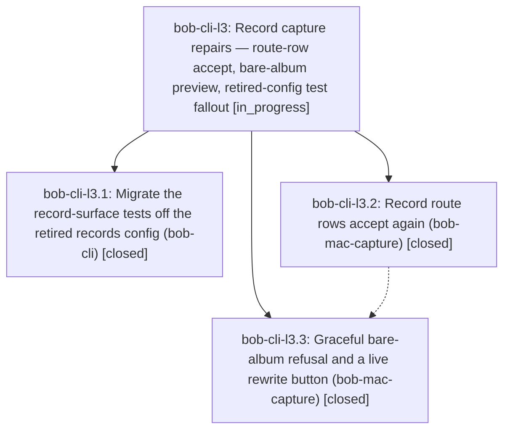

# Bead: bob-cli-l3 — Record capture repairs — route-row accept, bare-album preview, retired-config test fallout

[Bead Pages](../README.md) / bob-cli-l3

**Status:** ◐ in_progress · **Type:** ▸ plan · **Tier:** epic
**Owner:** `bryanbugyi34@gmail.com` · **Created by:** [bbugyi200.apollo.dp](https://github.com/bobs-org/bob-cli--agents/blob/main/sessions/bbugyi200.apollo.dp.md) · **Assignee:** `bob-cli-l3.land`
**Created:** 2026-11-12 16:11:26 EST
**Plan:** [202611/record\_capture\_repairs.md](https://github.com/bobs-org/bob-cli--plans/blob/main/202611/record_capture_repairs.md)

<!-- sase:links:start -->

## Links

| Relation | Artifact | Why |
| --- | --- | --- |
| implemented-by | [plan:202611/record_capture_repairs.md][1] | derived from the plan's `bead_id:` frontmatter field |
| related | file:explicit:e7464a79500ce17eac54934f | attached via sase artifact create --bead |

_Plus 1 automatic references — see [Referenced By](#referenced-by)._

[1]: https://github.com/bobs-org/bob-cli--plans/blob/main/202611/record_capture_repairs.md

<!-- sase:links:end -->

## Description

Accepting a record route row in Bob Mac Capture works again and continues into the field flow, a bare album route previews as a teaching refusal with its one-key fix instead of a generic failure, and bob-cli's record-surface tests run on album fixtures so master CI and the release train unblock.

## Notes

[2026-11-13T00:17:54Z · bob-cli-l3.land] LAND AUDIT — remaining-work tale required; do not close yet. Read the epic (initially no notes), every note on l3.1/.2/.3, and plan:202611/record_capture_repairs.md. Reviewed actual b7f74b58 (CLI), e0c6c16 and 9faa57b (Mac) diffs plus acceptance, cache/ranking, preview/reset and test-fixture code. The selected skip/refusal/repurpose decisions are implemented. Rust fixtures use album schemas with the retirement regression retained; no product/version/changelog changes. No parent_bead. Detailed evidence: file:explicit:e7464a79500ce17eac54934f.

BLOCKER: cachedRouteCompletion delegates to CaptureRefFileUnder.rankedTargets, whose eligibleTargets discards every record. Thus l3.2's testCachedRecordRouteAcceptsAndRequestsItsNextMissingField and testRecordRouteRowsDoNotQuickCommitPlusOrComma fail in exact-SHA Mac run 43328622700 on 9faa57b (4758 tests, 1 skipped, 7 assertions across those 2 nodes). l3.3 calling them pre-existing does not remove them from this epic's explicit cache scope. The cached route must rank Bob targets independently from File-under's restricted parents. Existing tests also stop at argv/splice: their unconditional completion/parse fixture overrides do not prove the first field menu or post-rewrite record flow. The remaining medium tale repairs those contracts with real generated fixtures, compiles/tests them, and closes l3 itself.

INTEGRATION: fetched primary origin; b7f74b58 equals origin/master and has no later commits. Also reviewed all non-epic changes since epic creation: 8e78584d Gmail archive transport, 6981b04c walker glossary, b6ed0e59 gcal ack journal/classifier; no record-route/schema conflicts or new consumers. Linked Mac origin/master is 9faa57b, with only the two epic commits since creation. The older 6dddea35 File-under filter is the remaining integration conflict within the cached-record scope. Subsequent plugin 3ef045b/b6f3dd9 already repair the proposed docs budget issue.

CI EVIDENCE: primary run 43322752069 at b7f74b58 passes package/lint. Linux: 6836 lib pass, only l2 fails; 3640 CLI pass and g8's two shell tests fail. All migrated record nodes pass. The cancelled Mac job 131547552217 nevertheless completed lib (6842 pass / 5 fail / 3 ignored) and CLI (3636 pass / 2 fail) results: l2, both kl nodes, and four pre-existing case-sensitive fixture assertions, now l9. In particular stale_plan_notices_a_collision_introduced_after_planning is NOT records-config fallout: the guard correctly reports eat.base appeared rather than namespace on a case-insensitive filesystem. Do not report full master CI or release-train readiness as green. Mac run 43328622700 passes Bob-served Return/Tab/click/ordinary-route tests and all three l3.3 refusal tests, but the two cached tests block this epic.

FOLLOW-UP TRIAGE (complete before proposal):
- l3.1 #1 and #2 are the same gcal proposal: corroborated bob-cli-l2 with independent exact-SHA CI evidence. No new task.
- l3.1 #3 requested Mac collision validation: four unrelated pre-existing filesystem-dependent assertions are now sized medium CI task bob-cli-l9, with source blame, exact errors, portable fixture strategy and audit artifact. Assumptions originate in 0c8df969/b6f3b92c/aef23542/a729a8fd, before l3; no active causal epic found. Ready for triage.
- l3.3 #1 docs budget: declined as already fixed. Canonical count_words: 6050124=6039, 3ef045b=5977, b6f3dd9=5980 (cap 6000), Mac capture-previews=5832. Recorded resolution corroboration on causal epic kr.4.1; historical jz stays closed, no new task.
- l3.3 #3 and repeated #4 cached test failures: declined as independent tasks; remain l3 work in the tale.
- l3.3 #2/#5 handoff/gate/push status: committed 9faa57b and completed exact-SHA run inspected; duplicate old monitor is informational, no repeat push required.
- Newly inspected shell-theme failures: corroborated existing bob-cli-g8 and recorded causal ownership evidence on active epic bob-cli-3j. gd covers other files, so no duplicate report there. No new failure frequency claimed.
- Newly inspected Mac pipe-drain pair: corroborated existing bob-cli-kl; same SHA passes them on Linux. l3.1's earlier run passed them; no new task.
Same-type/broader duplicate searches, last-week task sweep, and every active-epic scope were inspected. No other follow-up is deferred to the tale for triage.

CLOSEOUT: epic-symbols bob-cli-l3 is empty; no symvision recipe in primary or Mac justfile. Epic remains in_progress and original plan remains wip. No local just check was run in this read-only audit; check-full was not run. Proposed tale sase_plan_record_capture_landing.md (medium) is only remaining work and must finish: verify current tree (including Mac precommit snapshot gate, without waiting for its own final commit/push), recheck all descendants/notes and drift, resolve/re-key any newly listed epic symbols, close bob-cli-l3 normally with all dispositions, run just symvision where available, mark plan:202611/record_capture_repairs.md status done. No force for successful landing and no parent close is needed.

## Phases

| Bead | Title | Status | Size | Created | Agents | Commits |
|---|---|---|---|---|---:|---:|
| [bob-cli-l3.1](bob-cli-l3.1.md) | Migrate the record-surface tests off the retired records config (bob-cli) | ✓ closed | medium | 2026-11-12 | 1 | 1 |
| [bob-cli-l3.2](bob-cli-l3.2.md) | Record route rows accept again (bob-mac-capture) | ✓ closed | medium | 2026-11-12 | 1 | 1 |
| [bob-cli-l3.3](bob-cli-l3.3.md) | Graceful bare-album refusal and a live rewrite button (bob-mac-capture) | ✓ closed | medium | 2026-11-12 | 1 | 1 |

## Lineage

## Agents

| Agent | Bead | Commits |
|---|---|---:|
| [bbugyi200.apollo.bob-cli-l3.1](https://github.com/bobs-org/bob-cli--agents/blob/main/agents/bbugyi200.apollo.bob-cli-l3.1/README.md) | [bob-cli-l3.1](bob-cli-l3.1.md) | 1 |
| [bbugyi200.apollo.bob-cli-l3.2](https://github.com/bobs-org/bob-cli--agents/blob/main/agents/bbugyi200.apollo.bob-cli-l3.2/README.md) | [bob-cli-l3.2](bob-cli-l3.2.md) | 1 |
| [bbugyi200.apollo.bob-cli-l3.3](https://github.com/bobs-org/bob-cli--agents/blob/main/sessions/bbugyi200.apollo.bob-cli-l3.3.md) | [bob-cli-l3.3](bob-cli-l3.3.md) | 1 |
| [bbugyi200.apollo.bob-cli-l3.land](https://github.com/bobs-org/bob-cli--agents/blob/main/sessions/bbugyi200.apollo.bob-cli-l3.land.md) | [bob-cli-l3](README.md) | 1 |

## Commits

| Repo | Commit | Subject | Bead | Committed |
|---|---|---|---|---|
| bob-mac-capture | [`bob-mac-capture@e0c6c16`](https://github.com/bobs-org/bob-mac-capture/commit/e0c6c162a7b855ba22f6f98e911d1563d4154e46) | fix(capture): accept record route completions | [bob-cli-l3.2](bob-cli-l3.2.md) | 2026-11-12 16:48:53 EST |
| bob-cli | [`b7f74b5`](https://github.com/bobs-org/bob-cli/commit/b7f74b584481453d4e1446d032072cff1405479c) | test(record-capture): migrate record fixtures off retired records config | [bob-cli-l3.1](bob-cli-l3.1.md) | 2026-11-12 17:44:56 EST |
| bob-mac-capture | [`bob-mac-capture@9faa57b`](https://github.com/bobs-org/bob-mac-capture/commit/9faa57b6ed4b26de2abdc2f44d017c0e381a7aaa) | fix(capture): teach previews a bare-album refusal with a one-key rewrite | [bob-cli-l3.3](bob-cli-l3.3.md) | 2026-11-12 18:24:37 EST |
| bob-mac-capture | [`bob-mac-capture@832a27d`](https://github.com/bobs-org/bob-mac-capture/commit/832a27dc3418e0c441d521490d4c33cdf0ff3a61) | fix(capture): retain record targets for typed routes with truthful movie fixtures | [bob-cli-l3](README.md) | 2026-11-12 20:48:10 EST |

<!-- sase:referenced-by:start -->

## Referenced By

| Relation | Artifact | Why | Uses |
| --- | --- | --- | ---: |
| read-by | [agent:1c3][1] | Check whether record-capture repairs epic covers the stale capture.md @dir/stem row | 1 |

[1]: https://github.com/bobs-org/bob-cli--agents/blob/main/agents/bbugyi200.apollo.1c3/README.md

<!-- sase:referenced-by:end -->
