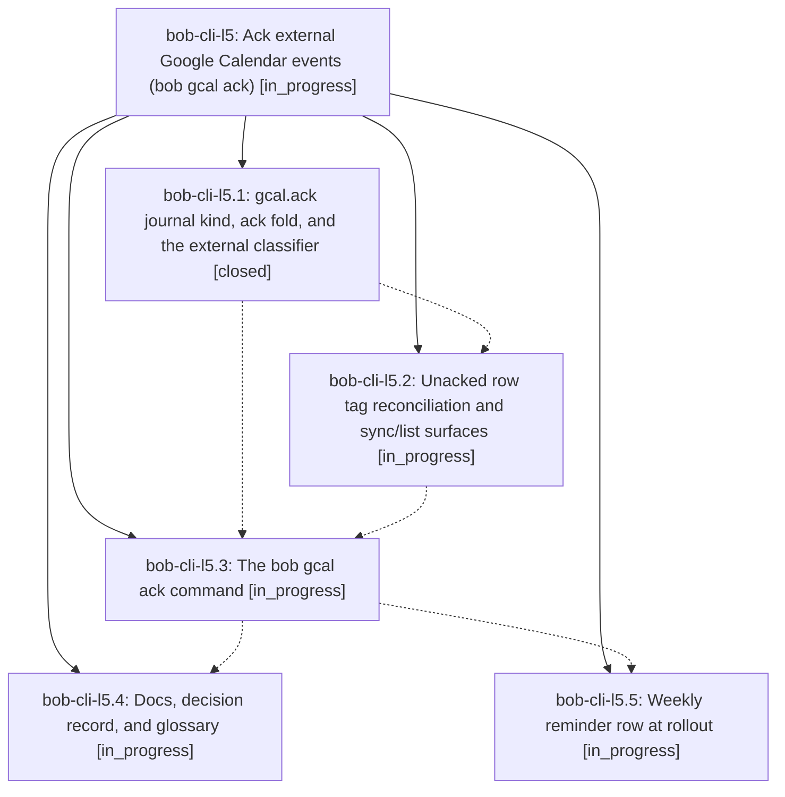

# Bead: bob-cli-l5 — Ack external Google Calendar events (bob gcal ack)

[Bead Pages](../README.md) / bob-cli-l5

**Status:** ◐ in_progress · **Type:** ▸ plan · **Tier:** epic
**Owner:** `bryanbugyi34@gmail.com` · **Created by:** [bbugyi200.athena.1c2](https://github.com/bobs-org/bob-cli--agents/blob/main/sessions/bbugyi200.athena.1c2.md) · **Assignee:** `bob-cli-l5.land`
**Created:** 2026-11-12 16:39:07 EST
**Plan:** [202611/gcal\_external\_event\_ack.md](https://github.com/bobs-org/bob-cli--plans/blob/main/202611/gcal_external_event_ack.md)

<!-- sase:links:start -->

## Links

| Relation | Artifact | Why |
| --- | --- | --- |
| implemented-by | [plan:202611/gcal_external_event_ack.md][1] | derived from the plan's `bead_id:` frontmatter field |

[1]: https://github.com/bobs-org/bob-cli--plans/blob/main/202611/gcal_external_event_ack.md

<!-- sase:links:end -->

## Description

Every external Google Calendar event bound for an Event Task is asked about once through a one-key `bob gcal ack` review queue; until acked (or noted) its open row wears a hard-to-miss Bob-owned warning tag, sync keeps creating rows regardless, and a weekly vault chore drives the sweep.

## Phases

| Bead | Title | Status | Size | Created | Agents | Commits |
|---|---|---|---|---|---:|---:|
| [bob-cli-l5.1](bob-cli-l5.1.md) | gcal.ack journal kind, ack fold, and the external classifier | ✓ closed | medium | 2026-11-12 | 1 | 1 |
| [bob-cli-l5.2](bob-cli-l5.2.md) | Unacked row tag reconciliation and sync/list surfaces | ◐ in_progress | medium | 2026-11-12 | 1 | 0 |
| [bob-cli-l5.3](bob-cli-l5.3.md) | The bob gcal ack command | ◐ in_progress | large | 2026-11-12 | 1 | 0 |
| [bob-cli-l5.4](bob-cli-l5.4.md) | Docs, decision record, and glossary | ◐ in_progress | medium | 2026-11-12 | 1 | 0 |
| [bob-cli-l5.5](bob-cli-l5.5.md) | Weekly reminder row at rollout | ◐ in_progress | small | 2026-11-12 | 1 | 0 |

## Lineage

## Agents

| Agent | Bead | Commits |
|---|---|---:|
| [bbugyi200.athena.bob-cli-l5.1](https://github.com/bobs-org/bob-cli--agents/blob/main/agents/bbugyi200.athena.bob-cli-l5.1/README.md) | [bob-cli-l5.1](bob-cli-l5.1.md) | 1 |
| [bbugyi200.athena.bob-cli-l5.2](https://github.com/bobs-org/bob-cli--agents/blob/main/agents/bbugyi200.athena.bob-cli-l5.2/README.md) | [bob-cli-l5.2](bob-cli-l5.2.md) | 0 |
| [bbugyi200.athena.bob-cli-l5.3](https://github.com/bobs-org/bob-cli--agents/blob/main/agents/bbugyi200.athena.bob-cli-l5.3/README.md) | [bob-cli-l5.3](bob-cli-l5.3.md) | 0 |
| [bbugyi200.athena.bob-cli-l5.4](https://github.com/bobs-org/bob-cli--agents/blob/main/agents/bbugyi200.athena.bob-cli-l5.4/README.md) | [bob-cli-l5.4](bob-cli-l5.4.md) | 0 |
| [bbugyi200.athena.bob-cli-l5.5](https://github.com/bobs-org/bob-cli--agents/blob/main/agents/bbugyi200.athena.bob-cli-l5.5/README.md) | [bob-cli-l5.5](bob-cli-l5.5.md) | 0 |
| [bbugyi200.athena.bob-cli-l5.land](https://github.com/bobs-org/bob-cli--agents/blob/main/agents/bbugyi200.athena.bob-cli-l5.land/README.md) | [bob-cli-l5](README.md) | 0 |

## Commits

| Repo | Commit | Subject | Bead | Committed |
|---|---|---|---|---|
| bob-cli | [`b6ed0e5`](https://github.com/bobs-org/bob-cli/commit/b6ed0e597395ee22d8276d1c6063c96afec2e047) | feat(gcal): add ack journal and event classifier | [bob-cli-l5.1](bob-cli-l5.1.md) | 2026-11-12 17:38:48 EST |
