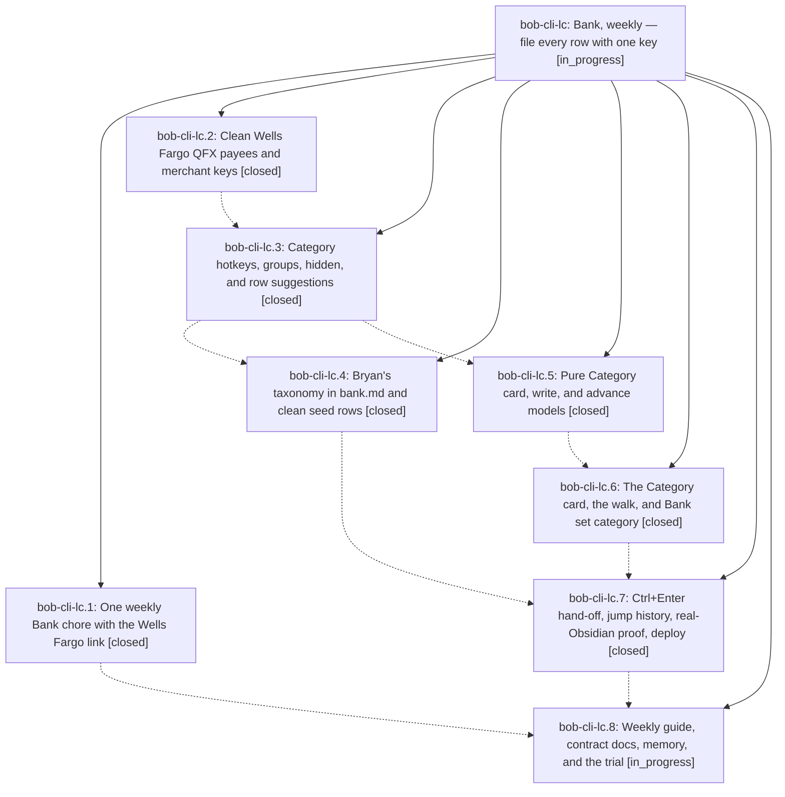

# Bead: bob-cli-lc — Bank, weekly — file every row with one key

[Bead Pages](../README.md) / bob-cli-lc

**Status:** ◐ in_progress · **Type:** ▸ plan · **Tier:** epic
**Owner:** `bryanbugyi34@gmail.com` · **Created by:** [bbugyi200.athena.1c7](https://github.com/bobs-org/bob-cli--agents/blob/main/sessions/bbugyi200.athena.1c7.md) · **Assignee:** `bob-cli-lc.land`
**Created:** 2026-11-13 10:55:28 EST
**Plan:** [202611/bank\_weekly\_category\_walk.md](https://github.com/bobs-org/bob-cli--plans/blob/main/202611/bank_weekly_category_walk.md)

<!-- sase:links:start -->

## Links

| Relation | Artifact | Why |
| --- | --- | --- |
| implemented-by | [plan:202611/bank_weekly_category_walk.md][1] | derived from the plan's `bead_id:` frontmatter field |

_Plus 1 automatic references — see [Referenced By](#referenced-by)._

[1]: https://github.com/bobs-org/bob-cli--plans/blob/main/202611/bank_weekly_category_walk.md

<!-- sase:links:end -->

## Description

Bank tracking becomes one Monday chore: a Wells Fargo download link, one import command, then Ctrl+Enter on each waiting bank row opens a Category card where a single key ticks the row, files its category from Bryan's own list, and lands the cursor on the next waiting row, so a week of transactions takes about two minutes.

## Phases

| Bead | Title | Status | Size | Created | Agents | Commits |
|---|---|---|---|---|---:|---:|
| [bob-cli-lc.1](bob-cli-lc.1.md) | One weekly Bank chore with the Wells Fargo link | ✓ closed | small | 2026-11-13 | 1 | 0 |
| [bob-cli-lc.2](bob-cli-lc.2.md) | Clean Wells Fargo QFX payees and merchant keys | ✓ closed | medium | 2026-11-13 | 1 | 1 |
| [bob-cli-lc.3](bob-cli-lc.3.md) | Category hotkeys, groups, hidden, and row suggestions | ✓ closed | medium | 2026-11-13 | 1 | 1 |
| [bob-cli-lc.4](bob-cli-lc.4.md) | Bryan's taxonomy in bank.md and clean seed rows | ✓ closed | small | 2026-11-13 | 1 | 0 |
| [bob-cli-lc.5](bob-cli-lc.5.md) | Pure Category card, write, and advance models | ✓ closed | medium | 2026-11-13 | 1 | 1 |
| [bob-cli-lc.6](bob-cli-lc.6.md) | The Category card, the walk, and Bank set category | ✓ closed | medium | 2026-11-13 | 1 | 2 |
| [bob-cli-lc.7](bob-cli-lc.7.md) | Ctrl+Enter hand-off, jump history, real-Obsidian proof, deploy | ✓ closed | medium | 2026-11-13 | 1 | 1 |
| [bob-cli-lc.8](bob-cli-lc.8.md) | Weekly guide, contract docs, memory, and the trial | ◐ in_progress | medium | 2026-11-13 | 1 | 0 |

## Lineage

## Agents

| Agent | Bead | Commits |
|---|---|---:|
| [bbugyi200.athena.bob-cli-lc.1](https://github.com/bobs-org/bob-cli--agents/blob/main/agents/bbugyi200.athena.bob-cli-lc.1/README.md) | [bob-cli-lc.1](bob-cli-lc.1.md) | 0 |
| [bbugyi200.athena.bob-cli-lc.2](https://github.com/bobs-org/bob-cli--agents/blob/main/sessions/bbugyi200.athena.bob-cli-lc.2.md) | [bob-cli-lc.2](bob-cli-lc.2.md) | 1 |
| [bbugyi200.athena.bob-cli-lc.3](https://github.com/bobs-org/bob-cli--agents/blob/main/agents/bbugyi200.athena.bob-cli-lc.3/README.md) | [bob-cli-lc.3](bob-cli-lc.3.md) | 1 |
| [bbugyi200.athena.bob-cli-lc.4](https://github.com/bobs-org/bob-cli--agents/blob/main/agents/bbugyi200.athena.bob-cli-lc.4/README.md) | [bob-cli-lc.4](bob-cli-lc.4.md) | 0 |
| [bbugyi200.athena.bob-cli-lc.5](https://github.com/bobs-org/bob-cli--agents/blob/main/agents/bbugyi200.athena.bob-cli-lc.5/README.md) | [bob-cli-lc.5](bob-cli-lc.5.md) | 1 |
| [bbugyi200.athena.bob-cli-lc.6](https://github.com/bobs-org/bob-cli--agents/blob/main/agents/bbugyi200.athena.bob-cli-lc.6/README.md) | [bob-cli-lc.6](bob-cli-lc.6.md) | 2 |
| [bbugyi200.athena.bob-cli-lc.7](https://github.com/bobs-org/bob-cli--agents/blob/main/agents/bbugyi200.athena.bob-cli-lc.7/README.md) | [bob-cli-lc.7](bob-cli-lc.7.md) | 1 |
| [bbugyi200.athena.bob-cli-lc.8](https://github.com/bobs-org/bob-cli--agents/blob/main/agents/bbugyi200.athena.bob-cli-lc.8/README.md) | [bob-cli-lc.8](bob-cli-lc.8.md) | 0 |
| [bbugyi200.athena.bob-cli-lc.land](https://github.com/bobs-org/bob-cli--agents/blob/main/agents/bbugyi200.athena.bob-cli-lc.land/README.md) | [bob-cli-lc](README.md) | 0 |

## Commits

| Repo | Commit | Subject | Bead | Committed |
|---|---|---|---|---|
| bob-cli | [`d6d755a`](https://github.com/bobs-org/bob-cli/commit/d6d755a1da262080f5a78196a653f5f296017475) | feat(bank): clean QFX payees and merchant keys | [bob-cli-lc.2](bob-cli-lc.2.md) | 2026-11-13 12:08:10 EST |
| bob-cli | [`1501c0c`](https://github.com/bobs-org/bob-cli/commit/1501c0c3e00792a27df81df4aa85caf73183002f) | feat(bank): add category hotkeys, groups, hidden, and row suggestions | [bob-cli-lc.3](bob-cli-lc.3.md) | 2026-11-13 13:03:20 EST |
| bob-plugins | [`bob-plugins@2522e47`](https://github.com/bobs-org/bob-plugins/commit/2522e47db82e089d8d6464f3ed75341c633e4634) | feat(bank): add pure Category card, write, and advance models | [bob-cli-lc.5](bob-cli-lc.5.md) | 2026-11-13 13:27:06 EST |
| bob-cli | [`a1dee92`](https://github.com/bobs-org/bob-cli/commit/a1dee92f8b77e889cab63adfeb67423ea0a598ff) | docs(memory): document bank category gesture | [bob-cli-lc.6](bob-cli-lc.6.md) | 2026-11-13 14:12:00 EST |
| bob-plugins | [`bob-plugins@0b1000b`](https://github.com/bobs-org/bob-plugins/commit/0b1000bd344e1d065793fe0b8ef4f96fa07f9027) | feat(bank): add Category card workflow | [bob-cli-lc.6](bob-cli-lc.6.md) | 2026-11-13 14:12:38 EST |
| bob-plugins | [`bob-plugins@b2a77a7`](https://github.com/bobs-org/bob-plugins/commit/b2a77a78949d68c247159d3557810d4f9a5042d6) | feat(bank): file a waiting row with Ctrl+Enter and advance the walk | [bob-cli-lc.7](bob-cli-lc.7.md) | 2026-11-13 15:02:34 EST |

<!-- sase:referenced-by:start -->

## Referenced By

| Relation | Artifact | Why | Uses |
| --- | --- | --- | ---: |
| read-by | [agent:bob-cli-lc.5][1] | Need epic scope and decisions | 1 |

[1]: https://github.com/bobs-org/bob-cli--agents/blob/main/agents/bbugyi200.athena.bob-cli-lc.5/README.md

<!-- sase:referenced-by:end -->
