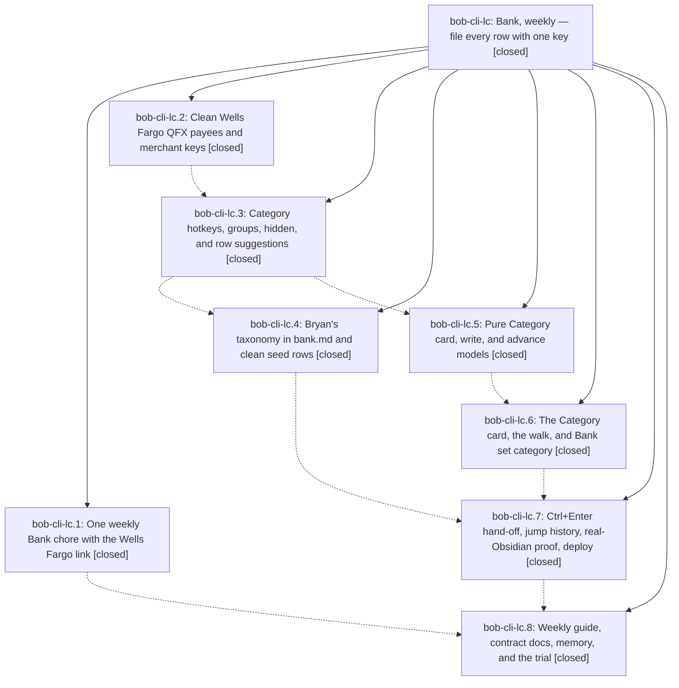

# Bead: bob-cli-lc — Bank, weekly — file every row with one key

[Bead Pages](../README.md) / bob-cli-lc

**Status:** ✓ closed · **Resolution:** done · **Type:** ▸ plan · **Tier:** epic
**Owner:** `bryanbugyi34@gmail.com` · **Created by:** [bbugyi200.athena.1c7](https://github.com/bobs-org/bob-cli--agents/blob/main/sessions/bbugyi200.athena.1c7.md) · **Assignee:** `bob-cli-lc.land`
**Created:** 2026-11-13 10:55:28 EST · **Closed:** 2026-11-13 16:44:37 EST
**Plan:** [202611/bank\_weekly\_category\_walk.md](https://github.com/bobs-org/bob-cli--plans/blob/main/202611/bank_weekly_category_walk.md)

<!-- sase:links:start -->

## Links

| Relation | Artifact | Why |
| --- | --- | --- |
| implemented-by | [plan:202611/bank_weekly_category_walk.md][1] | derived from the plan's `bead_id:` frontmatter field |

_Plus 3 automatic references — see [Referenced By](#referenced-by)._

[1]: https://github.com/bobs-org/bob-cli--plans/blob/main/202611/bank_weekly_category_walk.md

<!-- sase:links:end -->

## Description

Bank tracking becomes one Monday chore: a Wells Fargo download link, one import command, then Ctrl+Enter on each waiting bank row opens a Category card where a single key ticks the row, files its category from Bryan's own list, and lands the cursor on the next waiting row, so a week of transactions takes about two minutes.

## Notes

[2026-11-13T21:01:23Z · bob-cli-lc.land] LAND TRIAGE of child PROPOSED FOLLOW-UPs: (1) docs-check 6000-word cap on mounted plugin pages (lc.2#1, lc.3#2, lc.6#1, lc.7#2, lc.8#3) -> +1 bob-cli-jz (bob-navigation-hotkeys) and +1 bob-cli-il (bob-ledger-tools); pre-existing, epic kept net-zero prose. (2) gmail/unarchive.rs clippy errors (lc.2#2, lc.3#1) -> declined: already fixed on master, just check lint is clean at 9c53b8d8. (3) keep-moving 200-link timing flake (lc.6#1) -> +1 bob-cli-ki. (4) chip-today real-Obsidian e2e failure (lc.7#1) -> new bob-cli-le (task ci, small): FIXTURE_TODAY hard-coded to 2026-11-12, not caused by this epic. (5) stage-ranker 16 ms flake (lc.7#3) -> +1 bob-cli-3w. (6) Mac plugin deploy skipped (lc.7#4) -> epic work, folded into the remaining-work tale (Mac still unreachable at landing). (7) 2-4 week walk trial review (lc.8#2) -> new bob-cli-lf (task feature, large), snoozed to 2026-12-14 with links to bob-cli-kv/bob-cli-ku. (8) gcal sync_args test failure (lc.8#3) -> +1 bob-cli-l2, reproduced by the land agent on master. (9) subprocess_runner raw_run_bounds_pipe_drain flake (lc.8#3) -> +1 bob-cli-kl. Also added the missing kv_snooze=hold note on bob-cli-kv.

[2026-11-13T21:44:37Z · bob-cli-lc.land] Land verification: all 8 phases closed and their notes addressed; bob-cli commits d6d755a1, 1501c0c3, a1dee92f, 9c53b8d8 and bob-plugins 2522e47, 0b1000b, b2a77a7 match the contract (QFX cleaning + default-account acct fix; mapping-form categories with derived hotkeys/groups/hidden; shared rule>learned>bank suggestion on list/report/import; import Next: line; api.bank v2 claimRowClose/setCategory; cycler delegation with local-flip fallback on both Ctrl+Enter entry points; nav recordJump; hidden categories out of [cat:: suggestions; payee-start landings). Decisions honored: tech/media split, seed rows pre-filed, kv held (note added on bob-cli-kv), glossary:bank-row updated, no decisions record. Real vault: bank check 0 errors (1 pre-existing coverage-gap warning), 25 categories (24 visible, all hotkeyed; kids hidden), weekly chore open, daily occurrence cancelled. just check: only the pre-existing gcal failure (bob-cli-l2). Integration: none of the 10 non-epic commits since d6d755a1 (bob-cli) or 2522e47 (bob-plugins) touch bank code. Follow-ups triaged in the epic's LAND TRIAGE note (bob-cli-le and bob-cli-lf created; jz, il, ki, 3w, kl, l2 corroborated).

Remaining-work tale plan:202611/bank_category_card_landing_fixes.md (card_stays_open=keep):
- Card root class is now `bob-bank-category-card bob-key-card` on contentEl and the inner section; month-card `.bob-bank-category { display: grid; … }` at styles.css L8846 left untouched.
- `bankCategoryCommit` awaits `bankCategorySaveNote` before `apiBankRefresh`; throwing save still refreshes; `reportGen` drops stale opening refresh.
- Header is amount-first; inflows use `+` and `var(--color-green, var(--text-success))`; progress is `N of M · Month` plus an aria-hidden meter; tiles are 3-col (4 at 42rem) with `<kbd>` keycaps, `aria-keyshortcuts`, trailing ↵; polite live region survives `empty()`; restricted keys are `␣ acknowledge · esc cancel`; loading reason is `loading…`.
- Tests: node --test bank card/model/ui + cycler guard + nav jump + bank cards + stats/reading-board stylesheet = 114 pass; after ff-merge onto 274f1db, card suites 25/25. npm test 6548/6554 under load: keep-moving 200-link 560.2 ms (bob-cli-ki, isolation pass 86.7 ms) and off-clock 200-link 95.9 ms (bob-cli-ju +1, isolation pass 8.8 ms); stylesheet hex failures were this tale and are fixed. e2e: walk-card-layout PASS (display:flex, class `bob-bank-category-card bob-key-card`, tilesSpan); walk-learn-coffee and walk-learn-accept PASS (`suggestion.category==="coffee"`, `source==="learned"`, card stayed open); chip-today FAIL (bob-cli-le +1). CDP screenshots of walk-card.png / walk-card-dark.png show the month note without the modal overlay; layout probe is the look proof. just check: gcal bob-cli-l2 and subprocess_runner bob-cli-kl. docs-check: pre-existing word caps (bob-cli-jz, bob-cli-il, json-outputs).
- Athena: stash/ff-only onto 274f1db (no -F), then dirty `bob plugins sync --no-pull -p bob-ledger-tools` from bob-cli_14; vault main.js and styles.css contain `bob-bank-category-card`. task-status-cycler and bob-navigation-hotkeys remain at 0b1000b with claimRowClose / recordJump.
- Mac: ssh ConnectTimeout=8 timed out; filed ready task bob-cli-lg (needs the bob-plugins stitch that introduces `bob-bank-category-card` on parent 274f1db).
- Guide §2 and glossary:bank-row say the card stays open on the next waiting row. epic-symbols: none.

## Phases

| Bead | Title | Status | Size | Created | Agents | Commits |
|---|---|---|---|---|---:|---:|
| [bob-cli-lc.1](bob-cli-lc.1.md) | One weekly Bank chore with the Wells Fargo link | ✓ closed | small | 2026-11-13 | 1 | 0 |
| [bob-cli-lc.2](bob-cli-lc.2.md) | Clean Wells Fargo QFX payees and merchant keys | ✓ closed | medium | 2026-11-13 | 1 | 1 |
| [bob-cli-lc.3](bob-cli-lc.3.md) | Category hotkeys, groups, hidden, and row suggestions | ✓ closed | medium | 2026-11-13 | 1 | 1 |
| [bob-cli-lc.4](bob-cli-lc.4.md) | Bryan's taxonomy in bank.md and clean seed rows | ✓ closed | small | 2026-11-13 | 1 | 0 |
| [bob-cli-lc.5](bob-cli-lc.5.md) | Pure Category card, write, and advance models | ✓ closed | medium | 2026-11-13 | 1 | 1 |
| [bob-cli-lc.6](bob-cli-lc.6.md) | The Category card, the walk, and Bank set category | ✓ closed | medium | 2026-11-13 | 1 | 2 |
| [bob-cli-lc.7](bob-cli-lc.7.md) | Ctrl+Enter hand-off, jump history, real-Obsidian proof, deploy | ✓ closed | medium | 2026-11-13 | 1 | 1 |
| [bob-cli-lc.8](bob-cli-lc.8.md) | Weekly guide, contract docs, memory, and the trial | ✓ closed | medium | 2026-11-13 | 1 | 1 |

## Lineage

## Agents

| Agent | Bead | Commits |
|---|---|---:|
| [bbugyi200.athena.bob-cli-lc.1](https://github.com/bobs-org/bob-cli--agents/blob/main/agents/bbugyi200.athena.bob-cli-lc.1/README.md) | [bob-cli-lc.1](bob-cli-lc.1.md) | 0 |
| [bbugyi200.athena.bob-cli-lc.2](https://github.com/bobs-org/bob-cli--agents/blob/main/sessions/bbugyi200.athena.bob-cli-lc.2.md) | [bob-cli-lc.2](bob-cli-lc.2.md) | 1 |
| [bbugyi200.athena.bob-cli-lc.3](https://github.com/bobs-org/bob-cli--agents/blob/main/agents/bbugyi200.athena.bob-cli-lc.3/README.md) | [bob-cli-lc.3](bob-cli-lc.3.md) | 1 |
| [bbugyi200.athena.bob-cli-lc.4](https://github.com/bobs-org/bob-cli--agents/blob/main/agents/bbugyi200.athena.bob-cli-lc.4/README.md) | [bob-cli-lc.4](bob-cli-lc.4.md) | 0 |
| [bbugyi200.athena.bob-cli-lc.5](https://github.com/bobs-org/bob-cli--agents/blob/main/agents/bbugyi200.athena.bob-cli-lc.5/README.md) | [bob-cli-lc.5](bob-cli-lc.5.md) | 1 |
| [bbugyi200.athena.bob-cli-lc.6](https://github.com/bobs-org/bob-cli--agents/blob/main/agents/bbugyi200.athena.bob-cli-lc.6/README.md) | [bob-cli-lc.6](bob-cli-lc.6.md) | 2 |
| [bbugyi200.athena.bob-cli-lc.7](https://github.com/bobs-org/bob-cli--agents/blob/main/agents/bbugyi200.athena.bob-cli-lc.7/README.md) | [bob-cli-lc.7](bob-cli-lc.7.md) | 1 |
| [bbugyi200.athena.bob-cli-lc.8](https://github.com/bobs-org/bob-cli--agents/blob/main/agents/bbugyi200.athena.bob-cli-lc.8/README.md) | [bob-cli-lc.8](bob-cli-lc.8.md) | 1 |
| [bbugyi200.athena.bob-cli-lc.land](https://github.com/bobs-org/bob-cli--agents/blob/main/sessions/bbugyi200.athena.bob-cli-lc.land.md) | [bob-cli-lc](README.md) | 1 |

## Commits

| Repo | Commit | Subject | Bead | Committed |
|---|---|---|---|---|
| bob-cli | [`d6d755a`](https://github.com/bobs-org/bob-cli/commit/d6d755a1da262080f5a78196a653f5f296017475) | feat(bank): clean QFX payees and merchant keys | [bob-cli-lc.2](bob-cli-lc.2.md) | 2026-11-13 12:08:10 EST |
| bob-cli | [`1501c0c`](https://github.com/bobs-org/bob-cli/commit/1501c0c3e00792a27df81df4aa85caf73183002f) | feat(bank): add category hotkeys, groups, hidden, and row suggestions | [bob-cli-lc.3](bob-cli-lc.3.md) | 2026-11-13 13:03:20 EST |
| bob-plugins | [`bob-plugins@2522e47`](https://github.com/bobs-org/bob-plugins/commit/2522e47db82e089d8d6464f3ed75341c633e4634) | feat(bank): add pure Category card, write, and advance models | [bob-cli-lc.5](bob-cli-lc.5.md) | 2026-11-13 13:27:06 EST |
| bob-cli | [`a1dee92`](https://github.com/bobs-org/bob-cli/commit/a1dee92f8b77e889cab63adfeb67423ea0a598ff) | docs(memory): document bank category gesture | [bob-cli-lc.6](bob-cli-lc.6.md) | 2026-11-13 14:12:00 EST |
| bob-plugins | [`bob-plugins@0b1000b`](https://github.com/bobs-org/bob-plugins/commit/0b1000bd344e1d065793fe0b8ef4f96fa07f9027) | feat(bank): add Category card workflow | [bob-cli-lc.6](bob-cli-lc.6.md) | 2026-11-13 14:12:38 EST |
| bob-plugins | [`bob-plugins@b2a77a7`](https://github.com/bobs-org/bob-plugins/commit/b2a77a78949d68c247159d3557810d4f9a5042d6) | feat(bank): file a waiting row with Ctrl+Enter and advance the walk | [bob-cli-lc.7](bob-cli-lc.7.md) | 2026-11-13 15:02:34 EST |
| bob-cli | [`9c53b8d`](https://github.com/bobs-org/bob-cli/commit/9c53b8d8ae975f86bf7be969d633ec03928c39e7) | docs(bank): rewrite acknowledge guide for the weekly Category-card walk \[bob-cli-lc.8\] | [bob-cli-lc.8](bob-cli-lc.8.md) | 2026-11-13 15:25:42 EST |
| bob-cli | [`21d12f2`](https://github.com/bobs-org/bob-cli/commit/21d12f23a0738a94b030b2c6a2a2d8b47001bdc4) | docs(bank): keep the Category card open on the next waiting row | [bob-cli-lc](README.md) | 2026-11-13 16:47:53 EST |

<!-- sase:referenced-by:start -->

## Referenced By

| Relation | Artifact | Why | Uses |
| --- | --- | --- | ---: |
| read-by | [agent:bob-cli-lc.5][1] | Need epic scope and decisions | 1 |
| read-by | [agent:bob-cli-lc.7][2] | Need parent epic DECISIONS, notes, and phase list for ctrl-enter-walk | 1 |
| read-by | [agent:bob-cli-lc.8][3] | wrapup phase needs epic context | 1 |

[1]: https://github.com/bobs-org/bob-cli--agents/blob/main/agents/bbugyi200.athena.bob-cli-lc.5/README.md
[2]: https://github.com/bobs-org/bob-cli--agents/blob/main/agents/bbugyi200.athena.bob-cli-lc.7/README.md
[3]: https://github.com/bobs-org/bob-cli--agents/blob/main/agents/bbugyi200.athena.bob-cli-lc.8/README.md

<!-- sase:referenced-by:end -->
