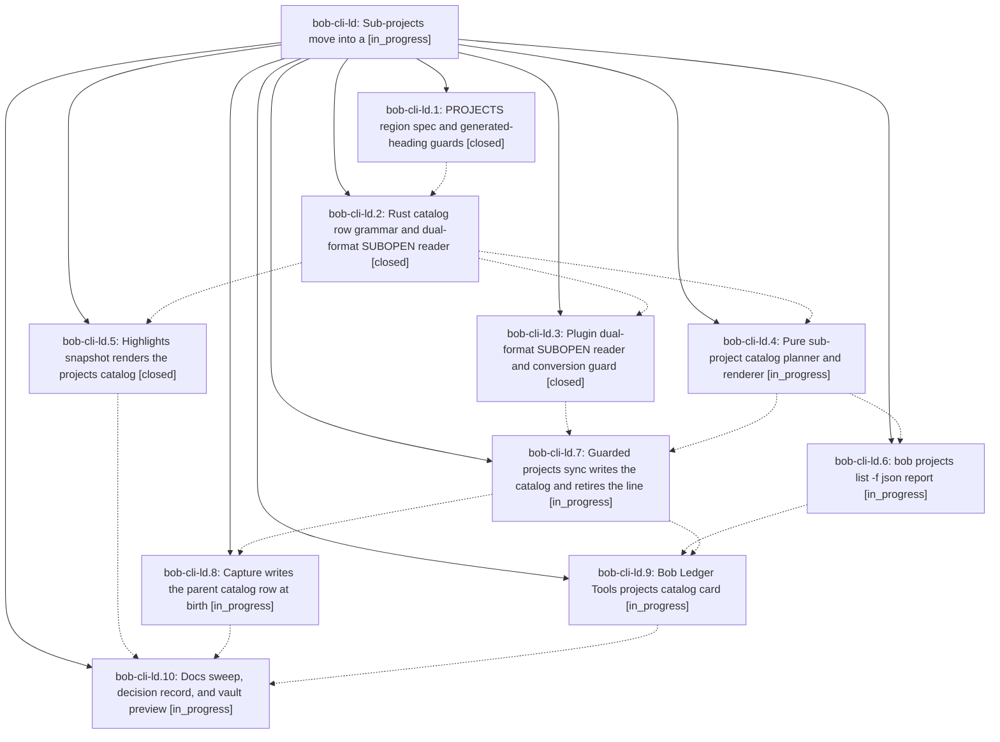

# Bead: bob-cli-ld — Sub-projects move into a

[Bead Pages](../README.md) / bob-cli-ld

**Status:** ◐ in_progress · **Type:** ▸ plan · **Tier:** epic
**Owner:** `bryanbugyi34@gmail.com` · **Created by:** [bbugyi200.athena.1c6](https://github.com/bobs-org/bob-cli--agents/blob/main/sessions/bbugyi200.athena.1c6.md) · **Assignee:** `bob-cli-ld.land`
**Created:** 2026-11-13 10:58:46 EST
**Plan:** [202611/subprojects\_catalog\_section.md](https://github.com/bobs-org/bob-cli--plans/blob/main/202611/subprojects_catalog_section.md)

<!-- sase:links:start -->

## Links

| Relation | Artifact | Why |
| --- | --- | --- |
| implemented-by | [plan:202611/subprojects_catalog_section.md][1] | derived from the plan's `bead_id:` frontmatter field |

_Plus 1 automatic references — see [Referenced By](#referenced-by)._

[1]: https://github.com/bobs-org/bob-cli--plans/blob/main/202611/subprojects_catalog_section.md

<!-- sase:links:end -->

## Description

Every area and project note lists its direct child projects in one bob-owned `> [!projects]` callout under a `## Projects` heading Bryan owns, rendered by Bob Ledger Tools as a card in the notebook/album family. The `🧩 **Sub-projects:**` bullet under `^prj` is retired, and no reader ever mistakes a parent for finished while it still has open children.

## Phases

| Bead | Title | Status | Size | Created | Agents | Commits |
|---|---|---|---|---|---:|---:|
| [bob-cli-ld.1](bob-cli-ld.1.md) | PROJECTS region spec and generated-heading guards | ✓ closed | small | 2026-11-13 | 1 | 1 |
| [bob-cli-ld.10](bob-cli-ld.10.md) | Docs sweep, decision record, and vault preview | ◐ in_progress | small | 2026-11-13 | 1 | 0 |
| [bob-cli-ld.2](bob-cli-ld.2.md) | Rust catalog row grammar and dual-format SUBOPEN reader | ✓ closed | medium | 2026-11-13 | 1 | 1 |
| [bob-cli-ld.3](bob-cli-ld.3.md) | Plugin dual-format SUBOPEN reader and conversion guard | ✓ closed | medium | 2026-11-13 | 1 | 1 |
| [bob-cli-ld.4](bob-cli-ld.4.md) | Pure sub-project catalog planner and renderer | ◐ in_progress | medium | 2026-11-13 | 1 | 0 |
| [bob-cli-ld.5](bob-cli-ld.5.md) | Highlights snapshot renders the projects catalog | ✓ closed | small | 2026-11-13 | 1 | 0 |
| [bob-cli-ld.6](bob-cli-ld.6.md) | bob projects list -f json report | ◐ in_progress | medium | 2026-11-13 | 1 | 0 |
| [bob-cli-ld.7](bob-cli-ld.7.md) | Guarded projects sync writes the catalog and retires the line | ◐ in_progress | large | 2026-11-13 | 1 | 0 |
| [bob-cli-ld.8](bob-cli-ld.8.md) | Capture writes the parent catalog row at birth | ◐ in_progress | medium | 2026-11-13 | 1 | 0 |
| [bob-cli-ld.9](bob-cli-ld.9.md) | Bob Ledger Tools projects catalog card | ◐ in_progress | large | 2026-11-13 | 1 | 0 |

## Lineage

## Agents

| Agent | Bead | Commits |
|---|---|---:|
| [bbugyi200.athena.bob-cli-ld.1](https://github.com/bobs-org/bob-cli--agents/blob/main/agents/bbugyi200.athena.bob-cli-ld.1/README.md) | [bob-cli-ld.1](bob-cli-ld.1.md) | 1 |
| [bbugyi200.athena.bob-cli-ld.10](https://github.com/bobs-org/bob-cli--agents/blob/main/agents/bbugyi200.athena.bob-cli-ld.10/README.md) | [bob-cli-ld.10](bob-cli-ld.10.md) | 0 |
| [bbugyi200.athena.bob-cli-ld.2](https://github.com/bobs-org/bob-cli--agents/blob/main/agents/bbugyi200.athena.bob-cli-ld.2/README.md) | [bob-cli-ld.2](bob-cli-ld.2.md) | 1 |
| [bbugyi200.athena.bob-cli-ld.3](https://github.com/bobs-org/bob-cli--agents/blob/main/agents/bbugyi200.athena.bob-cli-ld.3/README.md) | [bob-cli-ld.3](bob-cli-ld.3.md) | 1 |
| [bbugyi200.athena.bob-cli-ld.4](https://github.com/bobs-org/bob-cli--agents/blob/main/agents/bbugyi200.athena.bob-cli-ld.4/README.md) | [bob-cli-ld.4](bob-cli-ld.4.md) | 0 |
| [bbugyi200.athena.bob-cli-ld.5](https://github.com/bobs-org/bob-cli--agents/blob/main/agents/bbugyi200.athena.bob-cli-ld.5/README.md) | [bob-cli-ld.5](bob-cli-ld.5.md) | 0 |
| [bbugyi200.athena.bob-cli-ld.6](https://github.com/bobs-org/bob-cli--agents/blob/main/agents/bbugyi200.athena.bob-cli-ld.6/README.md) | [bob-cli-ld.6](bob-cli-ld.6.md) | 0 |
| [bbugyi200.athena.bob-cli-ld.7](https://github.com/bobs-org/bob-cli--agents/blob/main/agents/bbugyi200.athena.bob-cli-ld.7/README.md) | [bob-cli-ld.7](bob-cli-ld.7.md) | 0 |
| [bbugyi200.athena.bob-cli-ld.8](https://github.com/bobs-org/bob-cli--agents/blob/main/agents/bbugyi200.athena.bob-cli-ld.8/README.md) | [bob-cli-ld.8](bob-cli-ld.8.md) | 0 |
| [bbugyi200.athena.bob-cli-ld.9](https://github.com/bobs-org/bob-cli--agents/blob/main/agents/bbugyi200.athena.bob-cli-ld.9/README.md) | [bob-cli-ld.9](bob-cli-ld.9.md) | 0 |
| [bbugyi200.athena.bob-cli-ld.land](https://github.com/bobs-org/bob-cli--agents/blob/main/agents/bbugyi200.athena.bob-cli-ld.land/README.md) | [bob-cli-ld](README.md) | 0 |

## Commits

| Repo | Commit | Subject | Bead | Committed |
|---|---|---|---|---|
| bob-cli | [`2709046`](https://github.com/bobs-org/bob-cli/commit/2709046a2a7912fc19f741e085bfd4e406a2d541) | feat(capture): protect generated project catalog heading | [bob-cli-ld.1](bob-cli-ld.1.md) | 2026-11-13 11:28:53 EST |
| bob-cli | [`86be434`](https://github.com/bobs-org/bob-cli/commit/86be4344ca1fb41169c74df637d25d74ef5624ee) | feat(projects): add dual-format SUBOPEN catalog reader | [bob-cli-ld.2](bob-cli-ld.2.md) | 2026-11-13 12:07:13 EST |
| bob-plugins | [`bob-plugins@7b27f05`](https://github.com/bobs-org/bob-plugins/commit/7b27f051620a4cb90618d50557b74b8c53685e4e) | feat(plugins): add dual-format SUBOPEN catalog reader | [bob-cli-ld.3](bob-cli-ld.3.md) | 2026-11-13 12:30:34 EST |

<!-- sase:referenced-by:start -->

## Referenced By

| Relation | Artifact | Why | Uses |
| --- | --- | --- | ---: |
| read-by | [agent:bob-cli-ld.1][1] | Need phase notes and the epic design decisions before implementation | 1 |

[1]: https://github.com/bobs-org/bob-cli--agents/blob/main/agents/bbugyi200.athena.bob-cli-ld.1/README.md

<!-- sase:referenced-by:end -->
