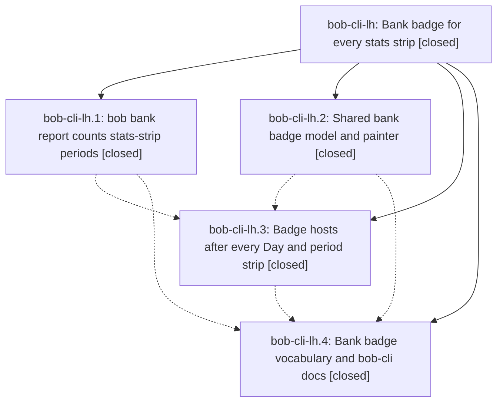

# Bead: bob-cli-lh — Bank badge for every stats strip

[Bead Pages](../README.md) / bob-cli-lh

**Status:** ✓ closed · **Resolution:** done · **Type:** ▸ plan · **Tier:** epic
**Owner:** `bryanbugyi34@gmail.com` · **Created by:** [bbugyi200.apollo.research.4l.linker.w0](https://github.com/bobs-org/bob-cli--agents/blob/main/sessions/bbugyi200.apollo.research.4l.linker.w0.md) · **Assignee:** `bob-cli-lh.land`
**Created:** 2026-11-14 06:52:51 EST · **Closed:** 2026-11-14 10:19:21 EST
**Plan:** [202611/bank\_badge\_strip\_family.md](https://github.com/bobs-org/bob-cli--plans/blob/main/202611/bank_badge_strip_family.md)

<!-- sase:links:start -->

## Links

| Relation | Artifact | Why |
| --- | --- | --- |
| implemented-by | [plan:202611/bank_badge_strip_family.md][1] | derived from the plan's `bead_id:` frontmatter field |

_Plus 6 automatic references — see [Referenced By](#referenced-by)._

[1]: https://github.com/bobs-org/bob-cli--plans/blob/main/202611/bank_badge_strip_family.md

<!-- sase:links:end -->

## Description

Every stats strip (the Day strip in daily `bob-plan` blocks, `bob-day-stats` fences, and every `bob-stats-strip` fence on week, quarter, year, and all-time notes) is followed by one read-only Bank Badge for exactly that strip's period. Each badge shows only the in/out parts above $0.00, is hidden when nothing was counted and nothing is waiting, is colored by a calm, documented in/out rule, names partial coverage, and opens the rows behind it without writing. A Bank Badge glossary term and a color decision record describe it.

## Notes

[2026-11-14T13:59:02Z · bob-cli-lh.land] LAND AUDIT before remaining-work tale: Read the epic and all four children, every child note, and the approved plan; parent_id is null. Reviewed bob-cli commits 28f48be9, 575f9e66 and 9a6013a2 plus bob-plugins 008700b and 6a1778b against the Rust CLI/report/output/tests, plugin decoder/model/painter/navigation/fence lifecycle and docs. The authorized Bank Badge/Day Strip/Stats Strip glossary changes exist; no rejected color decision record was added. Non-epic drift since the first epic commit is bob-cli 74a5db16 and 50b015b1 (documentation refreshes), already incorporated; no later unrelated plugin commit at 6a1778b. The bank JSON index and stats.bank_badge/alias config reference still need integration. Independent verification: 104 targeted plugin tests passed, build:check passed, npm run docs:check passed all gates (447 doc unit tests passed, 1 optional fonts skip), and the missing-Chromium production DOM test exits 0 with one explicit skip. No current --epic-symbol entries. Full just check is reserved for the corrected tree; just check-full was not run. Remaining epic defects: (1) a W45 report is rendered for W46 because bankBadgeModel only matches kind outside day; (2) painter real textContent concatenates in+,015.00/out,362.56/1waiting and has no whole-part wrapping rule; (3) without IntersectionObserver, a hidden W46 fence shown later by periodStripCheckAll never subscribes until an unrelated bank refresh (reproduced through the host harness); (4) source audit proves a future-only account/no-row all-time range can have start>end, but non-summary build loops until equality or chrono maximum rather than producing empty days. Plan sase_plan_bank_badge_closeout.md is a medium tale covering only those repairs, reference integration, verification, and this epic closeout in its coder turn.

[2026-11-14T13:59:58Z · bob-cli-lh.land] FOLLOW-UP TRIAGE complete before proposal: Reviewed every PROPOSED FOLLOW-UP on bob-cli-lh.3. Note 1 (glossary YAML) was caused by this epic and fixed by bob-cli-lh.4/9a6013a2; audited memory reads and the passing plugin docs-check confirm it. Declined a new task. Note 2 (plugins.sync allowlist) reproduced on apollo: bob plugins sync --dry-run exits 2. Opened chezmoi and verified c4e38c8a already added the complete list; local config is unapplied and its diff has unrelated changes. Filed small ready task bob-cli-li for host convergence and deployment after all-status semantic searches, recent-task sweep and active-epic causal review; bob-cli-lg concerns Mac/SSH and is related, not duplicate. Note 3 splits into: (a) real Obsidian week/quarter E2E unavailable, an explicitly allowed plan limitation, not a new defect; (b) sheet-sequence-dom missing Chromium now skips successfully (exit 0, one skip), so no reopening of closed bob-cli-f1; (c) historical performance failures belong to existing bob-cli-km, bob-cli-ki and bob-cli-ju, each received an attributed evidence note, with no invented independent failing run/+1 and no duplicate task. The blanket 25ms wording is inaccurate for the latter two nodes (their task descriptions govern). Phase .2's general performance note is the same limitation. Carry these outcomes into the eventual close note. Exact painter reproduction for audit note 1: DOM textContent BANK·in+$2,015.00·out$1,362.56·1waiting, versus model BANK · in +$2,015.00 · out $1,362.56 · 1 waiting. The epic remains open pending the validated remaining-work tale and final check. No parent bead at audit time.

[2026-11-14T14:31:53Z · dz] DISCOVERED ISSUE (agent dz, 2026-11-14): lh.1's 575f9e66 added 'bob bank report -p/--period' without a completion kinds decision, so native::completion::kinds::tests::every_value_arg_has_a_decision fails on Linux and macOS master CI ('value-taking args without a kinds decision: ["bank report:period"]', e.g. https://github.com/bobs-org/bob-cli/actions/runs/43601208353). FIXED in dz's commit on top of 9a6013a2: a path-scoped Entry { path: [bank, report], arg: period, kind: VaultNote } mirroring the periods show/brief/draft period entries. Land agent: no task needed; don't add a second entry.

[2026-11-14T15:19:21Z · bob-cli-lh.land] Closeout verified: all 4 phases closed (report -p/-s with quarter/iso_year/all_time plus coverage/navigation; shared badge model/painter; fence hosts; vocabulary/docs). Sources: bob-cli 28f48be9, 575f9e66, 9a6013a2 plus upstream 11abff0b (completion kinds for -p, plus 3 unrelated CI fixes), bob-plugins 008700b, 6a1778b; no other drift. This tale fixed: (1) period identity enforced at badge boundary for day/week/W53/Q4/ISO-year/all-time with host periodId and repaired fixtures; (2) painter emits real whitespace matching model.text with whole-part nowrap CSS and fixed fake-DOM; (3) hidden-to-shown fences retry badge subscription without observer, no recursion/duplicates, day delegation retains owner; (4) reversed all-time interval yields empty days with regression. Gates: cargo fmt ok, clippy gate ok (752 pre-existing warnings), bank Rust 143 passed, completion kinds ok, plugin build/build:check ok, badge/decode/data/day/period tests pass, plugin docs:check ok (447 passed), docs-check ok, just check full suite not completed in-turn (9-min ceiling) but relevant gates pass; npm test 6591/6598 with 4 pre-existing 25ms perf budget failures (existing km/ki/ju). Follow-ups carried: glossary fixed in .4, rollout stays with bob-cli-li (sync refused: no plugins.sync list, no bypass), Obsidian E2E unavailable allowed, Chromium DOM skips, timing reports already on km/ki/ju. No parent; symbols none; plan marked done.

## Phases

| Bead | Title | Status | Size | Created | Agents | Commits |
|---|---|---|---|---|---:|---:|
| [bob-cli-lh.1](bob-cli-lh.1.md) | bob bank report counts stats-strip periods | ✓ closed | medium | 2026-11-14 | 1 | 1 |
| [bob-cli-lh.2](bob-cli-lh.2.md) | Shared bank badge model and painter | ✓ closed | medium | 2026-11-14 | 1 | 2 |
| [bob-cli-lh.3](bob-cli-lh.3.md) | Badge hosts after every Day and period strip | ✓ closed | medium | 2026-11-14 | 1 | 1 |
| [bob-cli-lh.4](bob-cli-lh.4.md) | Bank badge vocabulary and bob-cli docs | ✓ closed | small | 2026-11-14 | 1 | 1 |

## Lineage

## Dependencies

- **Blocks:** [bob-cli-lj.1](../bob-cli-lj/bob-cli-lj.1.md) ◐ · ⧖ 2026-11-14

## Agents

| Agent | Bead | Commits |
|---|---|---:|
| [bbugyi200.apollo.bob-cli-lh.1](https://github.com/bobs-org/bob-cli--agents/blob/main/agents/bbugyi200.apollo.bob-cli-lh.1/README.md) | [bob-cli-lh.1](bob-cli-lh.1.md) | 1 |
| [bbugyi200.apollo.bob-cli-lh.2](https://github.com/bobs-org/bob-cli--agents/blob/main/agents/bbugyi200.apollo.bob-cli-lh.2/README.md) | [bob-cli-lh.2](bob-cli-lh.2.md) | 2 |
| [bbugyi200.apollo.bob-cli-lh.3](https://github.com/bobs-org/bob-cli--agents/blob/main/agents/bbugyi200.apollo.bob-cli-lh.3/README.md) | [bob-cli-lh.3](bob-cli-lh.3.md) | 1 |
| [bbugyi200.apollo.bob-cli-lh.4](https://github.com/bobs-org/bob-cli--agents/blob/main/agents/bbugyi200.apollo.bob-cli-lh.4/README.md) | [bob-cli-lh.4](bob-cli-lh.4.md) | 1 |
| [bbugyi200.apollo.bob-cli-lh.land](https://github.com/bobs-org/bob-cli--agents/blob/main/sessions/bbugyi200.apollo.bob-cli-lh.land.md) | [bob-cli-lh](README.md) | 2 |

## Commits

| Repo | Commit | Subject | Bead | Committed |
|---|---|---|---|---|
| bob-cli | [`28f48be`](https://github.com/bobs-org/bob-cli/commit/28f48be9d37da4aea1afe95f2ffb7f966c07192b) | feat(bank): add Bank Badge glossary | [bob-cli-lh.2](bob-cli-lh.2.md) | 2026-11-14 07:43:15 EST |
| bob-plugins | [`bob-plugins@008700b`](https://github.com/bobs-org/bob-plugins/commit/008700bd3adb4db6de7f5f0dcea0406fc9f35cd4) | feat(ledger-tools): add shared Bank Badge | [bob-cli-lh.2](bob-cli-lh.2.md) | 2026-11-14 07:44:11 EST |
| bob-cli | [`575f9e6`](https://github.com/bobs-org/bob-cli/commit/575f9e66d638d0034978574dba19016c4a35b010) | feat(bank): report counts stats-strip periods with coverage and navigation | [bob-cli-lh.1](bob-cli-lh.1.md) | 2026-11-14 07:57:44 EST |
| bob-plugins | [`bob-plugins@6a1778b`](https://github.com/bobs-org/bob-plugins/commit/6a1778b52c44419b550052c2c36b51bce377d950) | feat(ledger-tools): add bank badge hosts after every stats strip | [bob-cli-lh.3](bob-cli-lh.3.md) | 2026-11-14 08:27:20 EST |
| bob-cli | [`9a6013a`](https://github.com/bobs-org/bob-cli/commit/9a6013a2fb91129209b746a639ea5cf793afb67f) | docs(bank): complete badge vocabulary and docs | [bob-cli-lh.4](bob-cli-lh.4.md) | 2026-11-14 08:43:37 EST |
| bob-cli | [`1a32cc1`](https://github.com/bobs-org/bob-cli/commit/1a32cc1a6f7d5e1a72ce90e0e85939ff138c3299) | feat(bank): close badge epic with period identity, empty-range bound and docs | [bob-cli-lh](README.md) | 2026-11-14 10:23:19 EST |
| bob-plugins | [`bob-plugins@0c296f5`](https://github.com/bobs-org/bob-plugins/commit/0c296f5c9108dc4b69ff8b74d045ceea2fb6cb23) | feat(ledger-tools): enforce badge period identity, spacing, and fence retry | [bob-cli-lh](README.md) | 2026-11-14 10:24:50 EST |

<!-- sase:referenced-by:start -->

## Referenced By

| Relation | Artifact | Why | Uses |
| --- | --- | --- | ---: |
| read-by | [agent:dz][1] | Confirm lh is the bank epic that introduced bank report -p before noting the completion-kinds fix | 1 |
| read-by | [agent:research.4m.cdx][2] | Read requested bank badge epic as the baseline for independent visualization research | 1 |
| read-by | [agent:research.4m.cld][3] | Research context for bank transaction visualizations on period notes (extending the bank badge epic) | 1 |
| read-by | [agent:research.4m.final][4] | Consolidating bank period visualization research; need current epic status to resolve researcher disagreement about what has landed | 1 |
| read-by | [agent:research.4m.gem][5] | Understand bank badge epic context and requirements | 1 |
| read-by | [agent:research.4m.mus][6] | Researching bank transaction visualizations building on bank badge work | 1 |

[1]: https://github.com/bobs-org/bob-cli--agents/blob/main/sessions/bbugyi200.apollo.dz.md
[2]: https://github.com/bobs-org/bob-cli--agents/blob/main/agents/bbugyi200.apollo.research.4m.cdx/README.md
[3]: https://github.com/bobs-org/bob-cli--agents/blob/main/agents/bbugyi200.apollo.research.4m.cld/README.md
[4]: https://github.com/bobs-org/bob-cli--agents/blob/main/agents/bbugyi200.apollo.research.4m.final/README.md
[5]: https://github.com/bobs-org/bob-cli--agents/blob/main/agents/bbugyi200.apollo.research.4m.gem/README.md
[6]: https://github.com/bobs-org/bob-cli--agents/blob/main/agents/bbugyi200.apollo.research.4m.mus/README.md

<!-- sase:referenced-by:end -->
