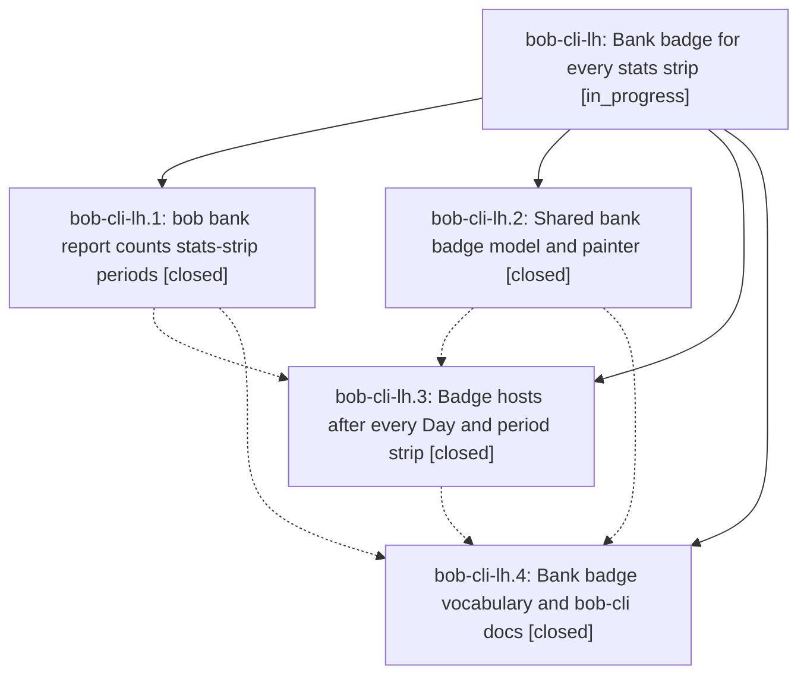

# Bead: bob-cli-lh — Bank badge for every stats strip

[Bead Pages](../README.md) / bob-cli-lh

**Status:** ◐ in_progress · **Type:** ▸ plan · **Tier:** epic
**Owner:** `bryanbugyi34@gmail.com` · **Created by:** [bbugyi200.apollo.research.4l.linker.w0](https://github.com/bobs-org/bob-cli--agents/blob/main/sessions/bbugyi200.apollo.research.4l.linker.w0.md) · **Assignee:** `bob-cli-lh.land`
**Created:** 2026-11-14 06:52:51 EST
**Plan:** [202611/bank\_badge\_strip\_family.md](https://github.com/bobs-org/bob-cli--plans/blob/main/202611/bank_badge_strip_family.md)

<!-- sase:links:start -->

## Links

| Relation | Artifact | Why |
| --- | --- | --- |
| implemented-by | [plan:202611/bank_badge_strip_family.md][1] | derived from the plan's `bead_id:` frontmatter field |

_Plus 4 automatic references — see [Referenced By](#referenced-by)._

[1]: https://github.com/bobs-org/bob-cli--plans/blob/main/202611/bank_badge_strip_family.md

<!-- sase:links:end -->

## Description

Every stats strip (the Day strip in daily `bob-plan` blocks, `bob-day-stats` fences, and every `bob-stats-strip` fence on week, quarter, year, and all-time notes) is followed by one read-only Bank Badge for exactly that strip's period. Each badge shows only the in/out parts above $0.00, is hidden when nothing was counted and nothing is waiting, is colored by a calm, documented in/out rule, names partial coverage, and opens the rows behind it without writing. A Bank Badge glossary term and a color decision record describe it.

## Phases

| Bead | Title | Status | Size | Created | Agents | Commits |
|---|---|---|---|---|---:|---:|
| [bob-cli-lh.1](bob-cli-lh.1.md) | bob bank report counts stats-strip periods | ✓ closed | medium | 2026-11-14 | 1 | 1 |
| [bob-cli-lh.2](bob-cli-lh.2.md) | Shared bank badge model and painter | ✓ closed | medium | 2026-11-14 | 1 | 1 |
| [bob-cli-lh.3](bob-cli-lh.3.md) | Badge hosts after every Day and period strip | ✓ closed | medium | 2026-11-14 | 1 | 0 |
| [bob-cli-lh.4](bob-cli-lh.4.md) | Bank badge vocabulary and bob-cli docs | ✓ closed | small | 2026-11-14 | 1 | 1 |

## Lineage

## Agents

| Agent | Bead | Commits |
|---|---|---:|
| [bbugyi200.apollo.bob-cli-lh.1](https://github.com/bobs-org/bob-cli--agents/blob/main/agents/bbugyi200.apollo.bob-cli-lh.1/README.md) | [bob-cli-lh.1](bob-cli-lh.1.md) | 1 |
| [bbugyi200.apollo.bob-cli-lh.2](https://github.com/bobs-org/bob-cli--agents/blob/main/agents/bbugyi200.apollo.bob-cli-lh.2/README.md) | [bob-cli-lh.2](bob-cli-lh.2.md) | 1 |
| [bbugyi200.apollo.bob-cli-lh.3](https://github.com/bobs-org/bob-cli--agents/blob/main/agents/bbugyi200.apollo.bob-cli-lh.3/README.md) | [bob-cli-lh.3](bob-cli-lh.3.md) | 0 |
| [bbugyi200.apollo.bob-cli-lh.4](https://github.com/bobs-org/bob-cli--agents/blob/main/agents/bbugyi200.apollo.bob-cli-lh.4/README.md) | [bob-cli-lh.4](bob-cli-lh.4.md) | 1 |
| [bbugyi200.apollo.bob-cli-lh.land](https://github.com/bobs-org/bob-cli--agents/blob/main/agents/bbugyi200.apollo.bob-cli-lh.land/README.md) | [bob-cli-lh](README.md) | 0 |

## Commits

| Repo | Commit | Subject | Bead | Committed |
|---|---|---|---|---|
| bob-cli | [`28f48be`](https://github.com/bobs-org/bob-cli/commit/28f48be9d37da4aea1afe95f2ffb7f966c07192b) | feat(bank): add Bank Badge glossary | [bob-cli-lh.2](bob-cli-lh.2.md) | 2026-11-14 07:43:15 EST |
| bob-cli | [`575f9e6`](https://github.com/bobs-org/bob-cli/commit/575f9e66d638d0034978574dba19016c4a35b010) | feat(bank): report counts stats-strip periods with coverage and navigation | [bob-cli-lh.1](bob-cli-lh.1.md) | 2026-11-14 07:57:44 EST |
| bob-cli | [`9a6013a`](https://github.com/bobs-org/bob-cli/commit/9a6013a2fb91129209b746a639ea5cf793afb67f) | docs(bank): complete badge vocabulary and docs | [bob-cli-lh.4](bob-cli-lh.4.md) | 2026-11-14 08:43:37 EST |

<!-- sase:referenced-by:start -->

## Referenced By

| Relation | Artifact | Why | Uses |
| --- | --- | --- | ---: |
| read-by | [agent:research.4m.cdx][1] | Read requested bank badge epic as the baseline for independent visualization research | 1 |
| read-by | [agent:research.4m.cld][2] | Research context for bank transaction visualizations on period notes (extending the bank badge epic) | 1 |
| read-by | [agent:research.4m.gem][3] | Understand bank badge epic context and requirements | 1 |
| read-by | [agent:research.4m.mus][4] | Researching bank transaction visualizations building on bank badge work | 1 |

[1]: https://github.com/bobs-org/bob-cli--agents/blob/main/agents/bbugyi200.apollo.research.4m.cdx/README.md
[2]: https://github.com/bobs-org/bob-cli--agents/blob/main/agents/bbugyi200.apollo.research.4m.cld/README.md
[3]: https://github.com/bobs-org/bob-cli--agents/blob/main/agents/bbugyi200.apollo.research.4m.gem/README.md
[4]: https://github.com/bobs-org/bob-cli--agents/blob/main/agents/bbugyi200.apollo.research.4m.mus/README.md

<!-- sase:referenced-by:end -->
