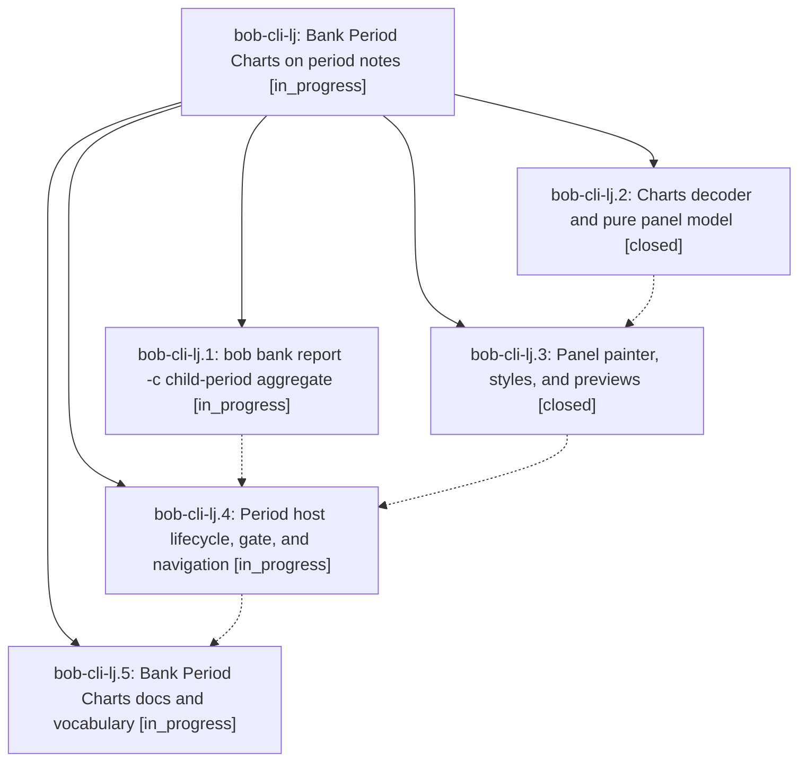

# Bead: bob-cli-lj — Bank Period Charts on period notes

[Bead Pages](../README.md) / bob-cli-lj

**Status:** ◐ in_progress · **Type:** ▸ plan · **Tier:** epic
**Owner:** `bryanbugyi34@gmail.com` · **Created by:** [bbugyi200.apollo.research.4m.linker.w0](https://github.com/bobs-org/bob-cli--agents/blob/main/sessions/bbugyi200.apollo.research.4m.linker.w0.md) · **Assignee:** `bob-cli-lj.land`
**Created:** 2026-11-14 09:39:37 EST
**Plan:** [202611/bank\_period\_charts.md](https://github.com/bobs-org/bob-cli--plans/blob/main/202611/bank_period_charts.md)

<!-- sase:links:start -->

## Links

| Relation | Artifact | Why |
| --- | --- | --- |
| implemented-by | [plan:202611/bank_period_charts.md][1] | derived from the plan's `bead_id:` frontmatter field |

[1]: https://github.com/bobs-org/bob-cli--plans/blob/main/202611/bank_period_charts.md

<!-- sase:links:end -->

## Description

Every week, quarter, ISO-year, and all-time note shows one compact, read-only Bank Period Charts panel after its Bank Badge. The panel answers when money moved and where Out went. bob computes every cent, coverage gaps are never drawn as $0, and the panel looks like part of the stats-strip family. Daily notes, the badge, briefs, Stats, and the Mac app stay unchanged.

## Phases

| Bead | Title | Status | Size | Created | Agents | Commits |
|---|---|---|---|---|---:|---:|
| [bob-cli-lj.1](bob-cli-lj.1.md) | bob bank report -c child-period aggregate | ◐ in_progress | medium | 2026-11-14 | 1 | 0 |
| [bob-cli-lj.2](bob-cli-lj.2.md) | Charts decoder and pure panel model | ✓ closed | medium | 2026-11-14 | 1 | 1 |
| [bob-cli-lj.3](bob-cli-lj.3.md) | Panel painter, styles, and previews | ✓ closed | medium | 2026-11-14 | 1 | 1 |
| [bob-cli-lj.4](bob-cli-lj.4.md) | Period host lifecycle, gate, and navigation | ◐ in_progress | medium | 2026-11-14 | 1 | 0 |
| [bob-cli-lj.5](bob-cli-lj.5.md) | Bank Period Charts docs and vocabulary | ◐ in_progress | small | 2026-11-14 | 1 | 0 |

## Lineage

## Agents

| Agent | Bead | Commits |
|---|---|---:|
| [bbugyi200.apollo.bob-cli-lj.1](https://github.com/bobs-org/bob-cli--agents/blob/main/sessions/bbugyi200.apollo.bob-cli-lj.1.md) | [bob-cli-lj.1](bob-cli-lj.1.md) | 0 |
| [bbugyi200.apollo.bob-cli-lj.2](https://github.com/bobs-org/bob-cli--agents/blob/main/agents/bbugyi200.apollo.bob-cli-lj.2/README.md) | [bob-cli-lj.2](bob-cli-lj.2.md) | 1 |
| [bbugyi200.apollo.bob-cli-lj.3](https://github.com/bobs-org/bob-cli--agents/blob/main/agents/bbugyi200.apollo.bob-cli-lj.3/README.md) | [bob-cli-lj.3](bob-cli-lj.3.md) | 1 |
| [bbugyi200.apollo.bob-cli-lj.4](https://github.com/bobs-org/bob-cli--agents/blob/main/agents/bbugyi200.apollo.bob-cli-lj.4/README.md) | [bob-cli-lj.4](bob-cli-lj.4.md) | 0 |
| [bbugyi200.apollo.bob-cli-lj.5](https://github.com/bobs-org/bob-cli--agents/blob/main/agents/bbugyi200.apollo.bob-cli-lj.5/README.md) | [bob-cli-lj.5](bob-cli-lj.5.md) | 0 |
| [bbugyi200.apollo.bob-cli-lj.land](https://github.com/bobs-org/bob-cli--agents/blob/main/agents/bbugyi200.apollo.bob-cli-lj.land/README.md) | [bob-cli-lj](README.md) | 0 |

## Commits

| Repo | Commit | Subject | Bead | Committed |
|---|---|---|---|---|
| bob-plugins | [`bob-plugins@d845e04`](https://github.com/bobs-org/bob-plugins/commit/d845e04dd7bb70ac870831f5512e685eb40d5940) | feat(ledger-tools): decode bank report charts and model the period panel | [bob-cli-lj.2](bob-cli-lj.2.md) | 2026-11-14 10:19:07 EST |
| bob-plugins | [`bob-plugins@d4b2bb2`](https://github.com/bobs-org/bob-plugins/commit/d4b2bb2bf4ed255383fdf257706d62e979f713c4) | feat(bank): paint the Bank Period Charts panel with styles and previews | [bob-cli-lj.3](bob-cli-lj.3.md) | 2026-11-14 11:13:55 EST |
