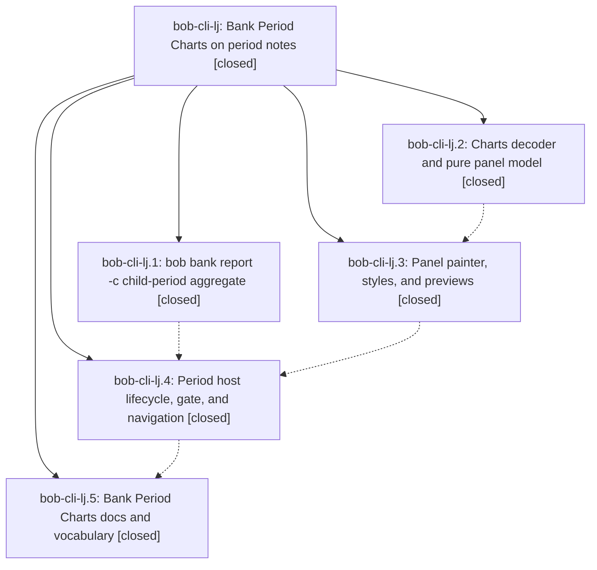

# Bead: bob-cli-lj — Bank Period Charts on period notes

[Bead Pages](../README.md) / bob-cli-lj

**Status:** ✓ closed · **Resolution:** done · **Type:** ▸ plan · **Tier:** epic
**Owner:** `bryanbugyi34@gmail.com` · **Created by:** [bbugyi200.apollo.research.4m.linker.w0](https://github.com/bobs-org/bob-cli--agents/blob/main/sessions/bbugyi200.apollo.research.4m.linker.w0.md) · **Assignee:** `bob-cli-lj.land`
**Created:** 2026-11-14 09:39:37 EST · **Closed:** 2026-11-14 15:55:34 EST
**Plan:** [202611/bank\_period\_charts.md](https://github.com/bobs-org/bob-cli--plans/blob/main/202611/bank_period_charts.md)

<!-- sase:links:start -->

## Links

| Relation | Artifact | Why |
| --- | --- | --- |
| implemented-by | [plan:202611/bank_period_charts.md][1] | derived from the plan's `bead_id:` frontmatter field |

_Plus 1 automatic references — see [Referenced By](#referenced-by)._

[1]: https://github.com/bobs-org/bob-cli--plans/blob/main/202611/bank_period_charts.md

<!-- sase:links:end -->

## Description

Every week, quarter, ISO-year, and all-time note shows one compact, read-only Bank Period Charts panel after its Bank Badge. The panel answers when money moved and where Out went. bob computes every cent, coverage gaps are never drawn as $0, and the panel looks like part of the stats-strip family. Daily notes, the badge, briefs, Stats, and the Mac app stay unchanged.

## Notes

[2026-11-14T20:41:10Z · bob-cli-lm.land] DISCOVERED ISSUE: docs/reference/json-outputs.md is 3 words over the 6000-word reference budget, so bob-cli just docs-check fails lint with 'docs/reference/json-outputs.md:1: budget: over budget at 6003 words (cap 6000 for reference/)'. Reproduced on master 643b3697 (2026-11-14) by bob-cli-lm.land; first reported by bob-cli-lm.5 (PROPOSED FOLLOW-UP note #1), which saw it identically on a clean tree. The last commit to touch the file is b3dc64a0 (SASE_BEAD bob-cli-lj.1, 'Document the charts JSON contract in docs/bank.md and json-outputs'), which added a line. Remediation: trim 3+ words from json-outputs.md, or split or move the bank report charts paragraph, then rerun just docs-check.

[2026-11-14T20:55:06Z · bob-cli-lj.land] LAND FOLLOW-UP TRIAGE (bob-cli-lj.land): lj.2 #1 Chromium hard-fail: DECLINED. It throws only when CI is set, which is the deliberate CI contract from closed bob-cli-f1. On apollo with CI unset the full npm test skips it cleanly; no defect. lj.2 #2, lj.3 #1, lj.4 #1 (perf budgets): corroborated with +1 on bob-cli-io, bob-cli-km, bob-cli-ki, bob-cli-ju; they failed in full npm test under concurrent load and passed in isolation. The bob-cli-3w stage ranker did not reproduce here and stays with its existing tracker. lj.4 #1 note-ready 'startup storm is linear' (3!=2): bisected to 2562300 (bob-cli-lm.1, bankWalk initial getMarkdownFiles scan), not this epic; bob-cli-lm.land already owns it in its remaining-work tale, so no task. lj.2 #3 shared period identity: caused by this epic, FIXED in landing (the panel now uses bankBadgePeriodIdentityValid). lj.5 #3 and DISCOVERED ISSUE #1 (json-outputs.md 6003 words): caused by lj.1's line plus a concurrent gmail edit, FIXED in landing (trimmed to 5996). lj.5 #1 (bob-cli-ku re-scope) and #2 (per-account coverage quality object): recorded as a note on snoozed bob-cli-ku; the plan's Out of scope gates both on that trial, so no new task. New: docs/reference/glossary.md generated drift from bob-cli-lm.5 (643b3697) recorded as DISCOVERED ISSUE on active epic bob-cli-lm; no task.

[2026-11-14T20:55:34Z · bob-cli-lj.land] Verified all 5 phases against plan:202611/bank_period_charts.md and their commits: bob-cli b3dc64a0 (children.rs shared partition, charts.rs, -c CLI with exit-2 refusal, human table, 22 unit + 2 CLI tests, JSON docs) and e221958e (docs); bob-plugins d845e04 (decoder/model), d4b2bb2 (painter/styles/preview), 90f0dc9 (hosts, BANK_CACHE_SIZE 32, stats.bank_period, real-bob fixtures), 5672727 (docs). Read charts.rs: states, folding, coarsening, and targets match the contract. Both memory decisions were 'no' and no memory was edited. Integration in this landing: (1) the panel now uses the badge's bankBadgePeriodIdentityValid, one rule instead of the duplicate bankPeriodIdentityMatches that landed before badge closeout 0c296f5 (lj.2 #3); the test/preview all-time key is now the real 'all_time'. (2) The panel's waiting targets now use bankBadgeLocation plus type 'waiting', so the waiting link selects bank walk family b like the badge after bob-cli-lm.4 f5866bf; new host test. (3) Trimmed the lj.1 json-outputs.md bank line, 6003 to 5996 words, which clears the docs-check lint failure. Gates: bob-cli just check passed and just docs-check lint passed; the only docs-check failure left is glossary.md drift from bob-cli-lm.5, recorded on bob-cli-lm. bob-plugins: build:check passed, 192/192 bank tests passed, full npm test 6673/6681; the failures are 4 known load flakes (+1'd) and the startup storm bisected to bob-cli-lm.1. bob plugins sync deployed. No real Obsidian or Chromium runtime on apollo, so the real-Obsidian panel e2e was not run, as the plan allows. The installed bob 0.5.0 lacks -c, so the panel stays hidden with one warn until the release train ships. No epic symbols. Follow-up triage is in the epic notes.

## Phases

| Bead | Title | Status | Size | Created | Agents | Commits |
|---|---|---|---|---|---:|---:|
| [bob-cli-lj.1](bob-cli-lj.1.md) | bob bank report -c child-period aggregate | ✓ closed | medium | 2026-11-14 | 1 | 1 |
| [bob-cli-lj.2](bob-cli-lj.2.md) | Charts decoder and pure panel model | ✓ closed | medium | 2026-11-14 | 1 | 1 |
| [bob-cli-lj.3](bob-cli-lj.3.md) | Panel painter, styles, and previews | ✓ closed | medium | 2026-11-14 | 1 | 1 |
| [bob-cli-lj.4](bob-cli-lj.4.md) | Period host lifecycle, gate, and navigation | ✓ closed | medium | 2026-11-14 | 1 | 1 |
| [bob-cli-lj.5](bob-cli-lj.5.md) | Bank Period Charts docs and vocabulary | ✓ closed | small | 2026-11-14 | 1 | 2 |

## Lineage

## Agents

| Agent | Bead | Commits |
|---|---|---:|
| [bbugyi200.apollo.bob-cli-lj.1](https://github.com/bobs-org/bob-cli--agents/blob/main/agents/bbugyi200.apollo.bob-cli-lj.1/README.md) | [bob-cli-lj.1](bob-cli-lj.1.md) | 1 |
| [bbugyi200.apollo.bob-cli-lj.2](https://github.com/bobs-org/bob-cli--agents/blob/main/agents/bbugyi200.apollo.bob-cli-lj.2/README.md) | [bob-cli-lj.2](bob-cli-lj.2.md) | 1 |
| [bbugyi200.apollo.bob-cli-lj.3](https://github.com/bobs-org/bob-cli--agents/blob/main/agents/bbugyi200.apollo.bob-cli-lj.3/README.md) | [bob-cli-lj.3](bob-cli-lj.3.md) | 1 |
| [bbugyi200.apollo.bob-cli-lj.4](https://github.com/bobs-org/bob-cli--agents/blob/main/sessions/bbugyi200.apollo.bob-cli-lj.4.md) | [bob-cli-lj.4](bob-cli-lj.4.md) | 1 |
| [bbugyi200.apollo.bob-cli-lj.5](https://github.com/bobs-org/bob-cli--agents/blob/main/agents/bbugyi200.apollo.bob-cli-lj.5/README.md) | [bob-cli-lj.5](bob-cli-lj.5.md) | 2 |
| [bbugyi200.apollo.bob-cli-lj.land](https://github.com/bobs-org/bob-cli--agents/blob/main/agents/bbugyi200.apollo.bob-cli-lj.land/README.md) | [bob-cli-lj](README.md) | 3 |

## Commits

| Repo | Commit | Subject | Bead | Committed |
|---|---|---|---|---|
| bob-plugins | [`bob-plugins@d845e04`](https://github.com/bobs-org/bob-plugins/commit/d845e04dd7bb70ac870831f5512e685eb40d5940) | feat(ledger-tools): decode bank report charts and model the period panel | [bob-cli-lj.2](bob-cli-lj.2.md) | 2026-11-14 10:19:07 EST |
| bob-plugins | [`bob-plugins@d4b2bb2`](https://github.com/bobs-org/bob-plugins/commit/d4b2bb2bf4ed255383fdf257706d62e979f713c4) | feat(bank): paint the Bank Period Charts panel with styles and previews | [bob-cli-lj.3](bob-cli-lj.3.md) | 2026-11-14 11:13:55 EST |
| bob-cli | [`b3dc64a`](https://github.com/bobs-org/bob-cli/commit/b3dc64a04fd7b2ac9c9b8835c86e3dca6885c7b1) | feat(bank): add bob bank report -c child-period chart aggregate | [bob-cli-lj.1](bob-cli-lj.1.md) | 2026-11-14 13:46:57 EST |
| bob-plugins | [`bob-plugins@90f0dc9`](https://github.com/bobs-org/bob-plugins/commit/90f0dc93e5165f2cb605f31e0b2437f3e838c4ec) | feat(bank): add period chart host lifecycle | [bob-cli-lj.4](bob-cli-lj.4.md) | 2026-11-14 14:46:34 EST |
| bob-cli | [`e221958`](https://github.com/bobs-org/bob-cli/commit/e221958e5dab8733b04d067f754724cd7f11f2de) | docs(bank): document Bank Period Charts panel and stats.bank\_period | [bob-cli-lj.5](bob-cli-lj.5.md) | 2026-11-14 14:58:14 EST |
| bob-plugins | [`bob-plugins@5672727`](https://github.com/bobs-org/bob-plugins/commit/56727271d9edb143a616d2a2b5e777d4af28a87e) | docs(ledger-tools): document Bank Period Charts panel | [bob-cli-lj.5](bob-cli-lj.5.md) | 2026-11-14 14:59:16 EST |
| bob-cli | [`257fec0`](https://github.com/bobs-org/bob-cli/commit/257fec08194a55d1632983a5be0a8038f0698a34) | docs(bank): trim the report charts line under the json-outputs budget | [bob-cli-lj](README.md) | 2026-11-14 15:58:01 EST |
| bob-plugins | [`bob-plugins@a6d52ad`](https://github.com/bobs-org/bob-plugins/commit/a6d52add2517281a7ee3888f4adf79abaa9fa912) | feat(ledger-tools): share badge period identity and walk hand-off with the period panel | [bob-cli-lj](README.md) | 2026-11-14 15:58:53 EST |
| bob-cli--plans | [`bob-cli--plans@ea02088`](https://github.com/bobs-org/bob-cli--plans/commit/ea020889cb93eea8d881a9246ca736c3bd8bc9b7) | chore(plans): mark bank\_period\_charts done | [bob-cli-lj](README.md) | 2026-11-14 15:59:30 EST |

<!-- sase:referenced-by:start -->

## Referenced By

| Relation | Artifact | Why | Uses |
| --- | --- | --- | ---: |
| read-by | [agent:bob-cli-lj.3][1] | Need epic scope | 1 |

[1]: https://github.com/bobs-org/bob-cli--agents/blob/main/agents/bbugyi200.apollo.bob-cli-lj.3/README.md

<!-- sase:referenced-by:end -->
