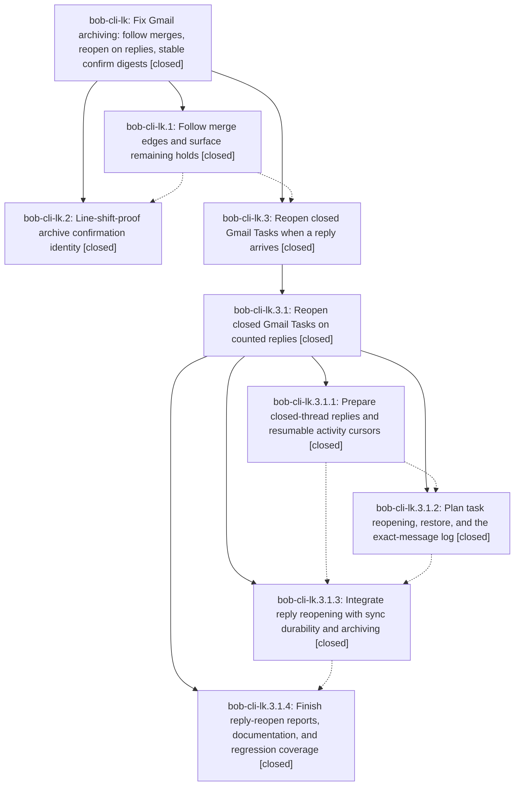

# Bead: bob-cli-lk — Fix Gmail archiving: follow merges, reopen on replies, stable confirm digests

[Bead Pages](../README.md) / bob-cli-lk

**Status:** ✓ closed · **Resolution:** done · **Type:** ▸ plan · **Tier:** epic
**Owner:** `bryanbugyi34@gmail.com` · **Created by:** [bbugyi200.apollo.e1](https://github.com/bobs-org/bob-cli--agents/blob/main/sessions/bbugyi200.apollo.e1.md) · **Assignee:** `bob-cli-lk.land`
**Created:** 2026-11-14 11:42:09 EST · **Closed:** 2026-11-14 23:24:40 EST
**Plan:** [202611/gmail\_archive\_merge\_and\_reply\_reopen.md](https://github.com/bobs-org/bob-cli--plans/blob/main/202611/gmail_archive_merge_and_reply_reopen.md)

<!-- sase:links:start -->

## Links

| Relation | Artifact | Why |
| --- | --- | --- |
| implemented-by | [plan:202611/gmail_archive_merge_and_reply_reopen.md][1] | derived from the plan's `bead_id:` frontmatter field |

_Plus 1 automatic references — see [Referenced By](#referenced-by)._

[1]: https://github.com/bobs-org/bob-cli--plans/blob/main/202611/gmail_archive_merge_and_reply_reopen.md

<!-- sase:links:end -->

## Description

No bob-labelled thread sits in the Inbox unexplained. A merge-retired linker follows its resolved target's status. Any hold that remains is shown as a review row and a doctor count. A reply after close reopens the task and links the reply. A pending -c confirmation survives edits that only shift lines.

## Notes

[2026-11-15T03:05:09Z · bob-cli-lk.land] LAND TRIAGE: Reviewed every PROPOSED FOLLOW-UP in descendants. bob-cli-lk.1 #2 is the existing stale ignored mount-output defect bob-cli-it (+1, now 6), #3 is the existing unpinned complete_themes deadline defect bob-cli-g8 (+1, now 6), and #4 is the existing article-completion deadline defect bob-cli-f2 (+1, now 3). Declined three new tasks as semantic duplicates; corroboration names proposing phase and distinguishes its runtime observations from this lander source audit. Recent-task and full active-epic sweeps found no new causal owner: these independently added tests and mounts.py are not changed by lk. Nested bob-cli-lk.3.1.4 #1 already became bob-cli-lo, fixed/closed and verified in 92f5d1c8 (correct bank.md link). Its #3 already corroborated bob-cli-kl in child LAND TRIAGE; do not file or +1 that same observation again. Later 92813d08 adds a spawn delay to the pipe-drain tests, while kl remains the tracker. No other descendant proposals. These outcomes must be repeated in the eventual close note.

[2026-11-15T03:12:40Z · bob-cli-lk.land] LAND AUDIT: All descendant scopes/notes and both plans read; integrated nested finalizer commit 92f5d1c8 by fetch/fast-forward. Reviewed implementation commits 47fac4b0/7ffc8251/b112a618/78f9bdc9/88fb9cb4/ff272bc6/92f5d1c8 and inherited newest/unblocked/REOPEN LOG/glossary decisions. Remaining epic defects reproduced on freshly built 92f5d1c8 with only synthetic vaults/fake gog: (1) S->Mid with Mid->Open and Mid->Closed yields would_archive with only Closed; reversing those entries yields no archive. follow_merge keeps only its last recursive result. (2) After recorded open -> newly closed -> dry-run, inserting two blank lines changes digest cdd605e0... to 3e6b694b... and live confirmation pauses confirm_mismatch. close_from_evidence hashes line through task_values and plan_digest binds the newly projected generation. (3) Actual id-less gmail.archive_observed and gmail.archive_closed journal hashes do not match pre-lk.2 reader recomputation after ignoring row_hash; the requested mixed-version compatibility is incomplete. Also restore previous-local-midnight wording in the shared JSON reference. One medium tale will repair these bounded issues and close this epic in its own final step. No force close, no real Gmail, no production source edits this turn. Current epic-symbols empty; no symvision recipe; parent link absent. Detailed evidence artifacts and baseline check result will follow.

[2026-11-15T03:13:52Z · bob-cli-lk.land] LAND EVIDENCE: Synthetic reproduction script file:explicit:7c9a1b8c8dc0ec3c318feaa6 and output file:explicit:b03c85385f54e56455009b2e. Script exited 0 after asserting all three current defects; it uses fake_gog.py and new temporary vaults only. Compatibility check recalculates pre-lk.2 parser hash semantics over actual emitted journal events and first confirms current hash equality. This is not an old-binary live test. The source tree is unchanged; a medium repair tale owns regressions and same-turn epic closeout.

[2026-11-15T03:15:31Z · bob-cli-lk.land] LAND INTEGRATION / VERIFICATION: Current integrated tip 92f5d1c8 equals fetched origin/master. Reviewed non-epic drift since creation: 9574e618 (shared enablement/receipt-ID epoch fix preserved), then b3dc64a0/e221958e/643b3697/257fec08 (Bank reports/docs), 13fdf78d/719dbd45/92813d08 (Areas structural catalog/snapshot/CLI/docs). None requires additional Gmail consumer wiring; shared JSON docs retain the Bank/Areas additions, with previous-local-midnight wording to repair in the tale. bob-plugins f68dbdc decoder accepts schema 1/additive actions and close notice consumes locators without action enumeration; no plugin edit. Current just check passed via ToolRun 437730ce997247c921fa316472fa3e92, exit 0: 7044 lib + 3662 CLI tests and all remaining suites, 3 lib ignored. No docs gate or check-full run in this turn; nested landing docs-check is prior evidence. Synthetic probes expose uncovered defects despite that green baseline. The validated medium tale will finish those repairs, close this epic normally, check symbols/symvision, and set the approved epic plan done. Epic remains in_progress; no production source edits made.

[2026-11-15T04:24:40Z · bob-cli-lk.land] Closed after tale plan:202611/gmail_archive_final_safety.md repaired the three remaining epic defects on the 92f5d1c8 baseline and verified them with synthetic fixtures only.

Implementation: follow_merge now collects every terminal effective linker (deduped by path,line), fail-closed on any unresolved branch, diamonds share one terminal. Confirmation digest DIGEST_VERSION 3 binds opened_by and after_generation instead of persisted generation; DigestTask stays semantic (path/block_id/row_hash/status, duplicate id-less rows kept). Journal hashes restore the pre-lk.2 contract; row_hash is unhashed metadata; current readers accept legacy and interim lk.2 hashes. docs/reference/json-outputs.md restores recent_archive "since previous local midnight" inside the reference word budget.

Inherited decisions unchanged: newest effective closed linker, mark_unblocked with WRITE skips, exact-message REOPEN LOG, glossary:Gmail Task only.

Audit/integration commits remain 47fac4b0, 7ffc8251, b112a618, 78f9bdc9, 88fb9cb4, ff272bc6, 92f5d1c8 plus reviewed non-epic 9574e618, b3dc64a0, e221958e, 643b3697, 257fec08, 13fdf78d, 719dbd45, 92813d08. Probe artifacts file:explicit:7c9a1b8c8dc0ec3c318feaa6 and file:explicit:b03c85385f54e56455009b2e.

Regressions: branching_merge_keeps_open_and_closed_terminals_in_either_order, branching_merge_keeps_two_closed_terminals_and_dedupes_diamonds, branching_merge_holds_when_one_branch_is_unresolved, digest_keeps_duplicate_idless_rows_and_rejects_identity_changes, new_idless_events_match_pre_lk2_hashes_and_keep_row_hash_metadata, current_reader_accepts_legacy_and_interim_idless_hashes, live_confirms_idless_close_after_line_shift, live_confirms_duplicate_idless_rows_after_line_shift, confirmation_rejects_status_task_merge_and_saved_set_changes.

Gates: just check exit 0 (7050 lib tests, 3 ignored, 3662 tests/cli plus remaining suites including the three new apply tests); just docs-gen; just docs-check. No just check-full. No epic-symbol leftovers. No symvision recipe. No real Gmail or vault.

bob-cli-ll closed with the remaining digest-path verification. bob-cli-kx received a correction note that lk.2 left generation-bound line dependence and this tale finished it.

LAND TRIAGE (repeated from lander note #1): lk.1 #2 duplicate bob-cli-it (+1, 6 reports), no new task. lk.1 #3 duplicate bob-cli-g8 (+1, 6 reports), no new task. lk.1 #4 duplicate bob-cli-f2 (+1, 3 reports), no new task. lk.3.1.4 #1 already became bob-cli-lo, fixed and closed in 92f5d1c8; not filed again. lk.3.1.4 #3 already corroborated bob-cli-kl (+1, 12 reports); declined another task or repeat +1; 92813d08 later added a spawn delay, kl remains the flake tracker.

## Phases

| Bead | Title | Status | Size | Created | Agents | Commits |
|---|---|---|---|---|---:|---:|
| [bob-cli-lk.1](bob-cli-lk.1.md) | Follow merge edges and surface remaining holds | ✓ closed | medium | 2026-11-14 | 1 | 1 |
| [bob-cli-lk.2](bob-cli-lk.2.md) | Line-shift-proof archive confirmation identity | ✓ closed | small | 2026-11-14 | 1 | 1 |
| [bob-cli-lk.3](bob-cli-lk.3.md) | Reopen closed Gmail Tasks when a reply arrives | ✓ closed | large | 2026-11-14 | 1 | 0 |

## Lineage

## Agents

| Agent | Bead | Commits |
|---|---|---:|
| [bbugyi200.apollo.bob-cli-lk.1](https://github.com/bobs-org/bob-cli--agents/blob/main/agents/bbugyi200.apollo.bob-cli-lk.1/README.md) | [bob-cli-lk.1](bob-cli-lk.1.md) | 1 |
| [bbugyi200.apollo.bob-cli-lk.2](https://github.com/bobs-org/bob-cli--agents/blob/main/agents/bbugyi200.apollo.bob-cli-lk.2/README.md) | [bob-cli-lk.2](bob-cli-lk.2.md) | 1 |
| [bbugyi200.apollo.bob-cli-lk.3](https://github.com/bobs-org/bob-cli--agents/blob/main/sessions/bbugyi200.apollo.bob-cli-lk.3.md) | [bob-cli-lk.3](bob-cli-lk.3.md) | 0 |
| [bbugyi200.apollo.bob-cli-lk.3.1.1](https://github.com/bobs-org/bob-cli--agents/blob/main/sessions/bbugyi200.apollo.bob-cli-lk.3.1.1.md) | [bob-cli-lk.3.1.1](bob-cli-lk.3.1.1.md) | 1 |
| [bbugyi200.apollo.bob-cli-lk.3.1.2](https://github.com/bobs-org/bob-cli--agents/blob/main/agents/bbugyi200.apollo.bob-cli-lk.3.1.2/README.md) | [bob-cli-lk.3.1.2](bob-cli-lk.3.1.2.md) | 1 |
| [bbugyi200.apollo.bob-cli-lk.3.1.3](https://github.com/bobs-org/bob-cli--agents/blob/main/sessions/bbugyi200.apollo.bob-cli-lk.3.1.3.md) | [bob-cli-lk.3.1.3](bob-cli-lk.3.1.3.md) | 1 |
| [bbugyi200.apollo.bob-cli-lk.3.1.4](https://github.com/bobs-org/bob-cli--agents/blob/main/sessions/bbugyi200.apollo.bob-cli-lk.3.1.4.md) | [bob-cli-lk.3.1.4](bob-cli-lk.3.1.4.md) | 1 |
| [bbugyi200.apollo.bob-cli-lk.3.1.land](https://github.com/bobs-org/bob-cli--agents/blob/main/sessions/bbugyi200.apollo.bob-cli-lk.3.1.land.md) | [bob-cli-lk.3.1](bob-cli-lk.3.1.md) | 2 |
| [bbugyi200.apollo.bob-cli-lk.land](https://github.com/bobs-org/bob-cli--agents/blob/main/sessions/bbugyi200.apollo.bob-cli-lk.land.md) | [bob-cli-lk](README.md) | 2 |

## Commits

| Repo | Commit | Subject | Bead | Committed |
|---|---|---|---|---|
| bob-cli | [`47fac4b`](https://github.com/bobs-org/bob-cli/commit/47fac4b0ff0fe82fb1396e949d217fc8e2b3af2f) | feat(gmail): follow merge edges and surface remaining archive holds | [bob-cli-lk.1](bob-cli-lk.1.md) | 2026-11-14 13:35:49 EST |
| bob-cli | [`7ffc825`](https://github.com/bobs-org/bob-cli/commit/7ffc8251782f87288e97421fd3b63058e5332f91) | fix(gmail): make archive confirmation line-shift proof | [bob-cli-lk.2](bob-cli-lk.2.md) | 2026-11-14 14:22:23 EST |
| bob-cli | [`b112a61`](https://github.com/bobs-org/bob-cli/commit/b112a61805a529fa8e69ba0a86cd9114b10ccc49) | feat(gmail): prepare closed-thread replies with resumable activity cursors | [bob-cli-lk.3.1.1](bob-cli-lk.3.1.1.md) | 2026-11-14 15:05:13 EST |
| bob-cli | [`78f9bdc`](https://github.com/bobs-org/bob-cli/commit/78f9bdc9acd852162efb0c52cd5b54a3316fb198) | feat(gmail): plan closed-thread reply reopens over vault snapshots | [bob-cli-lk.3.1.2](bob-cli-lk.3.1.2.md) | 2026-11-14 16:01:50 EST |
| bob-cli | [`88fb9cb`](https://github.com/bobs-org/bob-cli/commit/88fb9cb46f345a6c4a4d1d41a1cbaf6826355742) | fix(gmail): reopen synced messages | [bob-cli-lk.3.1.3](bob-cli-lk.3.1.3.md) | 2026-11-14 18:46:15 EST |
| bob-cli | [`ff272bc`](https://github.com/bobs-org/bob-cli/commit/ff272bc6758d643caebe1fa607fd1ecc14fabb0c) | feat(gmail): finish reply-reopen reports, docs and regression coverage | [bob-cli-lk.3.1.4](bob-cli-lk.3.1.4.md) | 2026-11-14 20:05:23 EST |
| bob-cli | [`92f5d1c`](https://github.com/bobs-org/bob-cli/commit/92f5d1c81d93a72a26cf96c4cad8ba72fa01328e) | fix(gmail): make reply reopen recovery ownership-safe | [bob-cli-lk.3.1](bob-cli-lk.3.1.md) | 2026-11-14 21:57:34 EST |
| bob-cli--plans | [`bob-cli--plans@81221f8`](https://github.com/bobs-org/bob-cli--plans/commit/81221f8d4237102a8581b22222f6268fa97908a4) | docs(plans): mark Gmail reopen plans done | [bob-cli-lk.3.1](bob-cli-lk.3.1.md) | 2026-11-14 21:58:41 EST |
| bob-cli | [`49231b3`](https://github.com/bobs-org/bob-cli/commit/49231b374a483d53bbc33018836577d940d0aa0c) | fix(gmail): keep branching merge terminals and line-shift-proof confirms | [bob-cli-lk](README.md) | 2026-11-14 23:27:50 EST |
| bob-cli--plans | [`bob-cli--plans@6eb282f`](https://github.com/bobs-org/bob-cli--plans/commit/6eb282fc9d94bef523eed7915e8a15a3fcf1c0a8) | docs: mark gmail archive merge-and-reply-reopen epic done | [bob-cli-lk](README.md) | 2026-11-14 23:28:59 EST |

<!-- sase:referenced-by:start -->

## Referenced By

| Relation | Artifact | Why | Uses |
| --- | --- | --- | ---: |
| read-by | [agent:bob-cli-lk.3.1.land--1][1] | Verify the containing Gmail epic remains open for its own land agent | 2 |

[1]: https://github.com/bobs-org/bob-cli--agents/blob/main/sessions/bbugyi200.apollo.bob-cli-lk.3.1.land.md

<!-- sase:referenced-by:end -->
