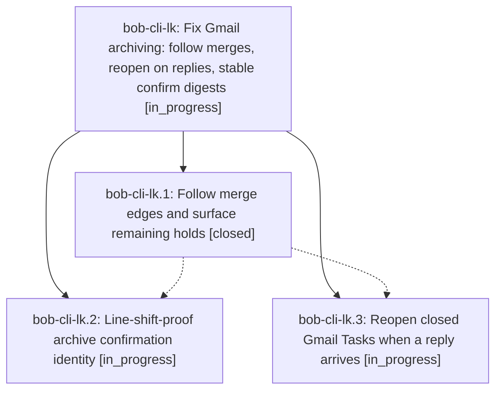

# Bead: bob-cli-lk — Fix Gmail archiving: follow merges, reopen on replies, stable confirm digests

[Bead Pages](../README.md) / bob-cli-lk

**Status:** ◐ in_progress · **Type:** ▸ plan · **Tier:** epic
**Owner:** `bryanbugyi34@gmail.com` · **Created by:** [bbugyi200.apollo.e1](https://github.com/bobs-org/bob-cli--agents/blob/main/sessions/bbugyi200.apollo.e1.md) · **Assignee:** `bob-cli-lk.land`
**Created:** 2026-11-14 11:42:09 EST
**Plan:** [202611/gmail\_archive\_merge\_and\_reply\_reopen.md](https://github.com/bobs-org/bob-cli--plans/blob/main/202611/gmail_archive_merge_and_reply_reopen.md)

<!-- sase:links:start -->

## Links

| Relation | Artifact | Why |
| --- | --- | --- |
| implemented-by | [plan:202611/gmail_archive_merge_and_reply_reopen.md][1] | derived from the plan's `bead_id:` frontmatter field |

[1]: https://github.com/bobs-org/bob-cli--plans/blob/main/202611/gmail_archive_merge_and_reply_reopen.md

<!-- sase:links:end -->

## Description

No bob-labelled thread sits in the Inbox unexplained. A merge-retired linker follows its resolved target's status. Any hold that remains is shown as a review row and a doctor count. A reply after close reopens the task and links the reply. A pending -c confirmation survives edits that only shift lines.

## Phases

| Bead | Title | Status | Size | Created | Agents | Commits |
|---|---|---|---|---|---:|---:|
| [bob-cli-lk.1](bob-cli-lk.1.md) | Follow merge edges and surface remaining holds | ✓ closed | medium | 2026-11-14 | 1 | 1 |
| [bob-cli-lk.2](bob-cli-lk.2.md) | Line-shift-proof archive confirmation identity | ◐ in_progress | small | 2026-11-14 | 1 | 0 |
| [bob-cli-lk.3](bob-cli-lk.3.md) | Reopen closed Gmail Tasks when a reply arrives | ◐ in_progress | large | 2026-11-14 | 1 | 0 |

## Lineage

## Agents

| Agent | Bead | Commits |
|---|---|---:|
| [bbugyi200.apollo.bob-cli-lk.1](https://github.com/bobs-org/bob-cli--agents/blob/main/agents/bbugyi200.apollo.bob-cli-lk.1/README.md) | [bob-cli-lk.1](bob-cli-lk.1.md) | 1 |
| [bbugyi200.apollo.bob-cli-lk.2](https://github.com/bobs-org/bob-cli--agents/blob/main/agents/bbugyi200.apollo.bob-cli-lk.2/README.md) | [bob-cli-lk.2](bob-cli-lk.2.md) | 0 |
| [bbugyi200.apollo.bob-cli-lk.3](https://github.com/bobs-org/bob-cli--agents/blob/main/agents/bbugyi200.apollo.bob-cli-lk.3/README.md) | [bob-cli-lk.3](bob-cli-lk.3.md) | 0 |
| [bbugyi200.apollo.bob-cli-lk.land](https://github.com/bobs-org/bob-cli--agents/blob/main/agents/bbugyi200.apollo.bob-cli-lk.land/README.md) | [bob-cli-lk](README.md) | 0 |

## Commits

| Repo | Commit | Subject | Bead | Committed |
|---|---|---|---|---|
| bob-cli | [`47fac4b`](https://github.com/bobs-org/bob-cli/commit/47fac4b0ff0fe82fb1396e949d217fc8e2b3af2f) | feat(gmail): follow merge edges and surface remaining archive holds | [bob-cli-lk.1](bob-cli-lk.1.md) | 2026-11-14 13:35:49 EST |
