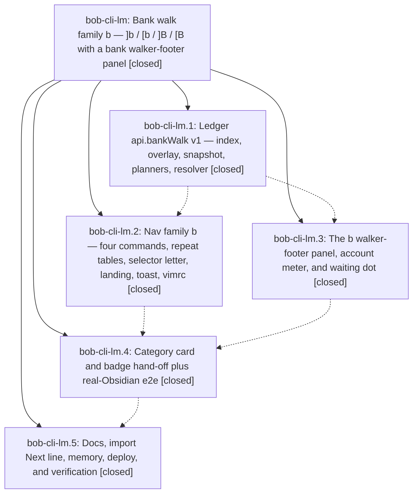

# Bead: bob-cli-lm — Bank walk family b — \]b / \[b / \]B / \[B with a bank walker-footer panel

[Bead Pages](../README.md) / bob-cli-lm

**Status:** ✓ closed · **Resolution:** done · **Type:** ▸ plan · **Tier:** epic
**Owner:** `bryanbugyi34@gmail.com` · **Created by:** [bbugyi200.apollo.research.4n.linker.w0](https://github.com/bobs-org/bob-cli--agents/blob/main/sessions/bbugyi200.apollo.research.4n.linker.w0.md) · **Assignee:** `bob-cli-lm.land`
**Created:** 2026-11-14 12:51:53 EST · **Closed:** 2026-11-14 16:24:53 EST
**Plan:** [202611/bank\_walk\_family\_b.md](https://github.com/bobs-org/bob-cli--plans/blob/main/202611/bank_walk_family_b.md)

<!-- sase:links:start -->

## Links

| Relation | Artifact | Why |
| --- | --- | --- |
| implemented-by | [plan:202611/bank_walk_family_b.md][1] | derived from the plan's `bead_id:` frontmatter field |

_Plus 3 automatic references — see [Referenced By](#referenced-by)._

[1]: https://github.com/bobs-org/bob-cli--plans/blob/main/202611/bank_walk_family_b.md

<!-- sase:links:end -->

## Description

Bank rows get a keyboard walk in Obsidian: ]b / [b step waiting rows (every row when none wait), ]B / [B jump to the first row of the next / previous day, ]] / [[ and ]} / [{ repeat them, and a fourth `b` walker-footer panel always names the walk's scope — all read-only, cross-month, and reliable against unsaved edits.

## Notes

[2026-11-14T20:43:11Z · bob-cli-lm.land] LAND TRIAGE (bob-cli-lm.land): Follow-up outcomes. (1) lm.2 #1 and lm.4 #1, the pre-existing full-suite failures: re-ran npm test on bob-plugins 152b1ea (6680 tests, 6672 pass, 5 fail). Four are the tracked timing flakes, corroborated with +1 on bob-cli-io, bob-cli-km, bob-cli-ki, and bob-cli-ju. The fifth, the note-ready 'startup storm is linear' failure (3 !== 2 markdown walks), is NOT bob-cli-eh (closed 11-04). Bisected to 2562300 (bob-cli-lm.1): bankWalkStartInitialScan calls vault.getMarkdownFiles() at layout-ready. That is caused by this epic, so no task was filed and the fix goes into the remaining-work tale. (2) lm.4 #2, the vault sync refused by the bob-cli-lj.4 dirty deploy: declined, already resolved. lj.4 landed as 90f0dc9, lm.5 then synced apollo, and the drift left on apollo is only the 152b1ea manifest description, which the tale's final sync fixes. (3) lm.5 #1, json-outputs.md 6003/6000 words: reproduced with just docs-check and traced to b3dc64a0 (bob-cli-lj.1). Recorded as DISCOVERED ISSUE on the active epic bob-cli-lj; no task. (4) lm.5 #2, Mac plugins predate the bank walk: same fix as bob-cli-lg (deploy bank plugins to the Mac). +1 on bob-cli-lg with the bank-walk verification checklist. Epic-symbols: none.

[2026-11-14T20:53:27Z · bob-cli-lj.land] DISCOVERED ISSUE (from bob-cli-lj.land): on bob-cli master 643b3697 (bob-cli-lm.5), just docs-check fails with 'generated drift: out of date: docs/reference/glossary.md (run just docs-gen)'. The glossary:walker-footer strand edit (fourth b member, bank footer alias, amber b dot) was not regenerated into docs/reference/glossary.md. just docs-gen rewrites only the Walker Footer entry: the aliases gain 'bank footer', and the body gains the s/w/n/b family, the bank footer member, the amber b dot, and the [[ s w n b ]] selector. bob-cli-lj.land did not regenerate it, to avoid colliding with this landing; please run just docs-gen in the remaining-work tale. Also seen from bob-plugins npm run docs:check, which runs bob-cli master's docs gate. Separately, bob-cli-lj.land trimmed the bob-cli-lj.1 json-outputs.md bank line (6003 -> 5996 words), which clears the lm.5 #1 budget failure.

[2026-11-14T21:24:53Z · bob-cli-lm.land] LAND COMPLETE (bob-cli-lm.land, remaining-work tale plan:202611/bank_walk_land_fixes.md). Five phases verified against the binding contract plan:202611/bank_walk_family_b.md: index (api.bankWalk v1), keys (family b commands/toast/vimrc), footer (b panel + account meter), handoff (Category card and badge), ship (docs/import/memory/deploy).

Audit fixes (sections 1-6) in bob-plugins on a6d52ad, dirty uncommitted land-fixes tree, both plugins synced:

1. Startup: bankWalkStartInitialScan uses getFolderByPath("bank") / getAbstractFileByPath("bank") children; getMarkdownFiles only when no folder API. Note-ready "the startup storm is linear" passes unchanged. 8 new index tests (test-ledger-tools-bank-walk-index.cjs), including zero getMarkdownFiles with a folder API and missing-bank ready-empty.

2. Index lifecycle: per-path pending + 250ms timer; delete/rename-away via bankWalkDropPath; overlay retained until a disk read scheduled at/after overlay seq completes; overlay signature is per-path seq; bankWalkScanSourceMemo per path. Tests: two-month debounce, delete/rename, overlay retention, older disk vs newer overlay, seq signature.

3. Planner: shared bankWalkStepFromTuple; cursor above November heading uses month-floor YYYY-MM-00; anchor-gap ]B/[B leave a day that still has rows; counted N]B/N[B/N]b/N[b from daily origin keyed on YYYYMMDD stem even when locate is null; wrapped on edge cross. Additive monthLabel on every snapshot entry (api.bankWalk stays v1).

4. Tests/parity: bankWalkBuildSnapshotFromContents ALL vs bob-bank-list-all.json (counts.rows + waiting). Fixture regen command from bob-plugins root at plugins/bob-ledger-tools/scripts/fixtures/bank-walk/. bank-walk model suite 19 tests including 5 new (scan memo, November cursor-gap, anchor-gap, counted daily, shared stepper).

5. Footer meter: bankWalkerFooterMeterAttempted never retries until bankVaultGeneration advances; error/stale never paint ✓; cache key is bankCacheKey(bankBuildArgs({command:"list"})); ALL-on-row hint empty; WAITING warning on .bob-freshness-scope only; inflow on .bob-freshness-amount.bob-freshness-inflow. Footer suite 37 tests including 3 new meter cases. preview-walker-footer.cjs: 6 theme/width renders, 0 failed checks.

6. Nav: exact palette names; indexing/empty/Could not open <path> copy; flip banner folded into toast once, or Notice when the run lands nothing; toast header/day rail/day/amount/month+hint. Nav suite 12 tests including 5 copy/toast cases. docs:gen updated command table; docs/bob-navigation-hotkeys.md toast sentence and uppercase b row.

Focused bank-walk/index/nav/note-ready after ff-only onto a6d52ad: 80 pass / 0 fail. Full npm test: 6701 tests, 6694 pass, 5 fail, 2 skipped. Failures: tracked timing flakes bob-cli-io (frees-marks), bob-cli-km (event-link-times), bob-cli-ki (keep-moving-marks-surface), bob-cli-ju (off-clock-link-chips); plus test-command-mode-sheet-sequence-dom.cjs missing Chromium under CI=true, which passes with CHROMIUM_PATH set to the Playwright chrome. npm run build / build:check / validate green. npm run docs:check with BOB_CLI_DIR=this workspace fails only docs/reference/json-outputs.md 6003/6000 (recorded bob-cli-lj DISCOVERED ISSUE from b3dc64a0 / lj.1); this page stayed under the 6000-word cap.

bob plugins sync: first dirty sync refused overwrite of a prior uncommitted deploy. Followed docs/develop/deployment.md: stash -u, ff-only 152b1ea→a6d52ad, clean sync one -p at a time (flag is not repeatable), stash pop, rebuild, dirty sync. Never -F. bob-ledger-tools 1.116.0 and bob-navigation-hotkeys 2.82.0 both synced/enabled from this uncommitted build (apollo, a6d52ad, 2026-11-14T21:21:20Z / 21:21:21Z). Mac deploy remains bob-cli-lg.

Follow-up triage already on land note #1: io/km/ki/ju +1; lg +1; json-outputs DISCOVERED ISSUE on bob-cli-lj; declined resolved vault-sync refusal. Note #2 (lj.land glossary.md drift) is the same generated-docs issue family as lj; this tale's approved plan forbids bob-cli docs edits. epic-symbols: none. justfile has no symvision recipe. No parent_bead.

## Phases

| Bead | Title | Status | Size | Created | Agents | Commits |
|---|---|---|---|---|---:|---:|
| [bob-cli-lm.1](bob-cli-lm.1.md) | Ledger api.bankWalk v1 — index, overlay, snapshot, planners, resolver | ✓ closed | medium | 2026-11-14 | 1 | 1 |
| [bob-cli-lm.2](bob-cli-lm.2.md) | Nav family b — four commands, repeat tables, selector letter, landing, toast, vimrc | ✓ closed | medium | 2026-11-14 | 1 | 1 |
| [bob-cli-lm.3](bob-cli-lm.3.md) | The b walker-footer panel, account meter, and waiting dot | ✓ closed | medium | 2026-11-14 | 1 | 1 |
| [bob-cli-lm.4](bob-cli-lm.4.md) | Category card and badge hand-off plus real-Obsidian e2e | ✓ closed | small | 2026-11-14 | 1 | 1 |
| [bob-cli-lm.5](bob-cli-lm.5.md) | Docs, import Next line, memory, deploy, and verification | ✓ closed | medium | 2026-11-14 | 1 | 2 |

## Lineage

## Agents

| Agent | Bead | Commits |
|---|---|---:|
| [bbugyi200.apollo.bob-cli-lm.1](https://github.com/bobs-org/bob-cli--agents/blob/main/agents/bbugyi200.apollo.bob-cli-lm.1/README.md) | [bob-cli-lm.1](bob-cli-lm.1.md) | 1 |
| [bbugyi200.apollo.bob-cli-lm.2](https://github.com/bobs-org/bob-cli--agents/blob/main/agents/bbugyi200.apollo.bob-cli-lm.2/README.md) | [bob-cli-lm.2](bob-cli-lm.2.md) | 1 |
| [bbugyi200.apollo.bob-cli-lm.3](https://github.com/bobs-org/bob-cli--agents/blob/main/agents/bbugyi200.apollo.bob-cli-lm.3/README.md) | [bob-cli-lm.3](bob-cli-lm.3.md) | 1 |
| [bbugyi200.apollo.bob-cli-lm.4](https://github.com/bobs-org/bob-cli--agents/blob/main/agents/bbugyi200.apollo.bob-cli-lm.4/README.md) | [bob-cli-lm.4](bob-cli-lm.4.md) | 1 |
| [bbugyi200.apollo.bob-cli-lm.5](https://github.com/bobs-org/bob-cli--agents/blob/main/agents/bbugyi200.apollo.bob-cli-lm.5/README.md) | [bob-cli-lm.5](bob-cli-lm.5.md) | 2 |
| [bbugyi200.apollo.bob-cli-lm.land](https://github.com/bobs-org/bob-cli--agents/blob/main/sessions/bbugyi200.apollo.bob-cli-lm.land.md) | [bob-cli-lm](README.md) | 2 |

## Commits

| Repo | Commit | Subject | Bead | Committed |
|---|---|---|---|---|
| bob-plugins | [`bob-plugins@2562300`](https://github.com/bobs-org/bob-plugins/commit/256230091b4dae16f2ec9010b5d34617887c69c5) | feat(bank): add ledger api.bankWalk v1 index, snapshot, planners, resolver | [bob-cli-lm.1](bob-cli-lm.1.md) | 2026-11-14 13:20:53 EST |
| bob-plugins | [`bob-plugins@b8209f3`](https://github.com/bobs-org/bob-plugins/commit/b8209f3309bc7dff84bb4552baa55f9995d4c76b) | feat(bank): paint the b walker-footer panel in ledger tools | [bob-cli-lm.3](bob-cli-lm.3.md) | 2026-11-14 13:58:49 EST |
| bob-plugins | [`bob-plugins@3745bfd`](https://github.com/bobs-org/bob-plugins/commit/3745bfdee30c70ae446d6e8d37385d93d1b97da0) | feat(navigation): add bank bracket walk family | [bob-cli-lm.2](bob-cli-lm.2.md) | 2026-11-14 14:12:35 EST |
| bob-plugins | [`bob-plugins@f5866bf`](https://github.com/bobs-org/bob-plugins/commit/f5866bf6fa3ac6453d1e19fb209516fca5dbae26) | feat(bank): hand off Category card and waiting badges to walk family b | [bob-cli-lm.4](bob-cli-lm.4.md) | 2026-11-14 14:42:08 EST |
| bob-cli | [`643b369`](https://github.com/bobs-org/bob-cli/commit/643b36975ec5c50806a6c3f29d4c18cd9b1d6fcc) | feat(bank): teach \]b in the import Next line and document the bank walk | [bob-cli-lm.5](bob-cli-lm.5.md) | 2026-11-14 15:12:20 EST |
| bob-plugins | [`bob-plugins@152b1ea`](https://github.com/bobs-org/bob-plugins/commit/152b1ea1ceb781fb4e6e010f55844df09f80efc7) | docs(bank): document the \]b bank walk, footer panel, and APIs | [bob-cli-lm.5](bob-cli-lm.5.md) | 2026-11-14 15:13:15 EST |
| bob-plugins | [`bob-plugins@f68dbdc`](https://github.com/bobs-org/bob-plugins/commit/f68dbdcf88f0d36cedcbbd701a16db4fe0f7535d) | fix(ledger-tools): correct bank-walk land-audit defects | [bob-cli-lm](README.md) | 2026-11-14 16:26:33 EST |
| bob-cli--plans | [`bob-cli--plans@5cb58f2`](https://github.com/bobs-org/bob-cli--plans/commit/5cb58f21cd509c9cfaac83c8a6edfa0e516b11d2) | docs(plans): mark bank walk family b done after land-audit closeout | [bob-cli-lm](README.md) | 2026-11-14 16:27:27 EST |

<!-- sase:referenced-by:start -->

## Referenced By

| Relation | Artifact | Why | Uses |
| --- | --- | --- | ---: |
| read-by | [agent:bob-cli-lj.land][1] | Check whether the bank walk epic is still active, for integrating the period panel waiting link with walk family b | 2 |
| read-by | [agent:bob-cli-lm.1][2] | Need epic DECISIONS and plan context | 1 |
| read-by | [agent:bob-cli-lm.3][3] | Need parent epic notes and sibling phase status | 1 |

[1]: https://github.com/bobs-org/bob-cli--agents/blob/main/agents/bbugyi200.apollo.bob-cli-lj.land/README.md
[2]: https://github.com/bobs-org/bob-cli--agents/blob/main/agents/bbugyi200.apollo.bob-cli-lm.1/README.md
[3]: https://github.com/bobs-org/bob-cli--agents/blob/main/agents/bbugyi200.apollo.bob-cli-lm.3/README.md

<!-- sase:referenced-by:end -->
