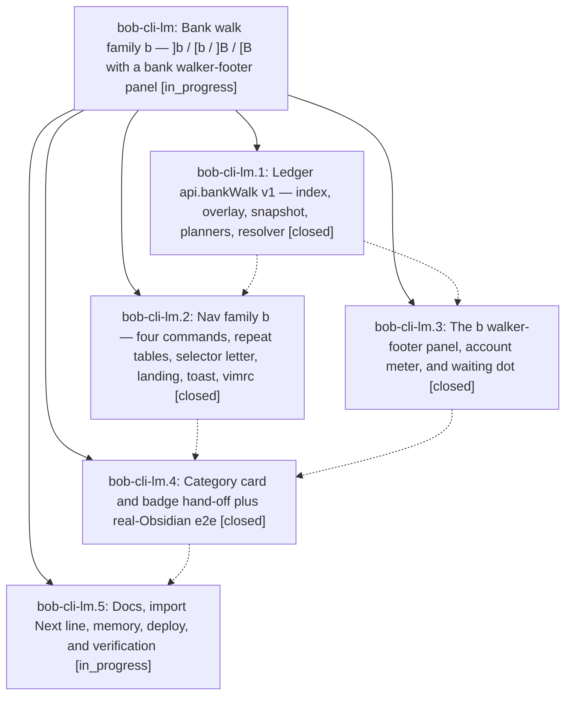

# Bead: bob-cli-lm — Bank walk family b — \]b / \[b / \]B / \[B with a bank walker-footer panel

[Bead Pages](../README.md) / bob-cli-lm

**Status:** ◐ in_progress · **Type:** ▸ plan · **Tier:** epic
**Owner:** `bryanbugyi34@gmail.com` · **Created by:** [bbugyi200.apollo.research.4n.linker.w0](https://github.com/bobs-org/bob-cli--agents/blob/main/sessions/bbugyi200.apollo.research.4n.linker.w0.md) · **Assignee:** `bob-cli-lm.land`
**Created:** 2026-11-14 12:51:53 EST
**Plan:** [202611/bank\_walk\_family\_b.md](https://github.com/bobs-org/bob-cli--plans/blob/main/202611/bank_walk_family_b.md)

<!-- sase:links:start -->

## Links

| Relation | Artifact | Why |
| --- | --- | --- |
| implemented-by | [plan:202611/bank_walk_family_b.md][1] | derived from the plan's `bead_id:` frontmatter field |

_Plus 2 automatic references — see [Referenced By](#referenced-by)._

[1]: https://github.com/bobs-org/bob-cli--plans/blob/main/202611/bank_walk_family_b.md

<!-- sase:links:end -->

## Description

Bank rows get a keyboard walk in Obsidian: ]b / [b step waiting rows (every row when none wait), ]B / [B jump to the first row of the next / previous day, ]] / [[ and ]} / [{ repeat them, and a fourth `b` walker-footer panel always names the walk's scope — all read-only, cross-month, and reliable against unsaved edits.

## Phases

| Bead | Title | Status | Size | Created | Agents | Commits |
|---|---|---|---|---|---:|---:|
| [bob-cli-lm.1](bob-cli-lm.1.md) | Ledger api.bankWalk v1 — index, overlay, snapshot, planners, resolver | ✓ closed | medium | 2026-11-14 | 1 | 1 |
| [bob-cli-lm.2](bob-cli-lm.2.md) | Nav family b — four commands, repeat tables, selector letter, landing, toast, vimrc | ✓ closed | medium | 2026-11-14 | 1 | 1 |
| [bob-cli-lm.3](bob-cli-lm.3.md) | The b walker-footer panel, account meter, and waiting dot | ✓ closed | medium | 2026-11-14 | 1 | 1 |
| [bob-cli-lm.4](bob-cli-lm.4.md) | Category card and badge hand-off plus real-Obsidian e2e | ✓ closed | small | 2026-11-14 | 1 | 1 |
| [bob-cli-lm.5](bob-cli-lm.5.md) | Docs, import Next line, memory, deploy, and verification | ◐ in_progress | medium | 2026-11-14 | 1 | 0 |

## Lineage

## Agents

| Agent | Bead | Commits |
|---|---|---:|
| [bbugyi200.apollo.bob-cli-lm.1](https://github.com/bobs-org/bob-cli--agents/blob/main/agents/bbugyi200.apollo.bob-cli-lm.1/README.md) | [bob-cli-lm.1](bob-cli-lm.1.md) | 1 |
| [bbugyi200.apollo.bob-cli-lm.2](https://github.com/bobs-org/bob-cli--agents/blob/main/agents/bbugyi200.apollo.bob-cli-lm.2/README.md) | [bob-cli-lm.2](bob-cli-lm.2.md) | 1 |
| [bbugyi200.apollo.bob-cli-lm.3](https://github.com/bobs-org/bob-cli--agents/blob/main/agents/bbugyi200.apollo.bob-cli-lm.3/README.md) | [bob-cli-lm.3](bob-cli-lm.3.md) | 1 |
| [bbugyi200.apollo.bob-cli-lm.4](https://github.com/bobs-org/bob-cli--agents/blob/main/agents/bbugyi200.apollo.bob-cli-lm.4/README.md) | [bob-cli-lm.4](bob-cli-lm.4.md) | 1 |
| [bbugyi200.apollo.bob-cli-lm.5](https://github.com/bobs-org/bob-cli--agents/blob/main/agents/bbugyi200.apollo.bob-cli-lm.5/README.md) | [bob-cli-lm.5](bob-cli-lm.5.md) | 0 |
| [bbugyi200.apollo.bob-cli-lm.land](https://github.com/bobs-org/bob-cli--agents/blob/main/agents/bbugyi200.apollo.bob-cli-lm.land/README.md) | [bob-cli-lm](README.md) | 0 |

## Commits

| Repo | Commit | Subject | Bead | Committed |
|---|---|---|---|---|
| bob-plugins | [`bob-plugins@2562300`](https://github.com/bobs-org/bob-plugins/commit/256230091b4dae16f2ec9010b5d34617887c69c5) | feat(bank): add ledger api.bankWalk v1 index, snapshot, planners, resolver | [bob-cli-lm.1](bob-cli-lm.1.md) | 2026-11-14 13:20:53 EST |
| bob-plugins | [`bob-plugins@b8209f3`](https://github.com/bobs-org/bob-plugins/commit/b8209f3309bc7dff84bb4552baa55f9995d4c76b) | feat(bank): paint the b walker-footer panel in ledger tools | [bob-cli-lm.3](bob-cli-lm.3.md) | 2026-11-14 13:58:49 EST |
| bob-plugins | [`bob-plugins@3745bfd`](https://github.com/bobs-org/bob-plugins/commit/3745bfdee30c70ae446d6e8d37385d93d1b97da0) | feat(navigation): add bank bracket walk family | [bob-cli-lm.2](bob-cli-lm.2.md) | 2026-11-14 14:12:35 EST |
| bob-plugins | [`bob-plugins@f5866bf`](https://github.com/bobs-org/bob-plugins/commit/f5866bf6fa3ac6453d1e19fb209516fca5dbae26) | feat(bank): hand off Category card and waiting badges to walk family b | [bob-cli-lm.4](bob-cli-lm.4.md) | 2026-11-14 14:42:08 EST |

<!-- sase:referenced-by:start -->

## Referenced By

| Relation | Artifact | Why | Uses |
| --- | --- | --- | ---: |
| read-by | [agent:bob-cli-lm.1][1] | Need epic DECISIONS and plan context | 1 |
| read-by | [agent:bob-cli-lm.3][2] | Need parent epic notes and sibling phase status | 1 |

[1]: https://github.com/bobs-org/bob-cli--agents/blob/main/agents/bbugyi200.apollo.bob-cli-lm.1/README.md
[2]: https://github.com/bobs-org/bob-cli--agents/blob/main/agents/bbugyi200.apollo.bob-cli-lm.3/README.md

<!-- sase:referenced-by:end -->
