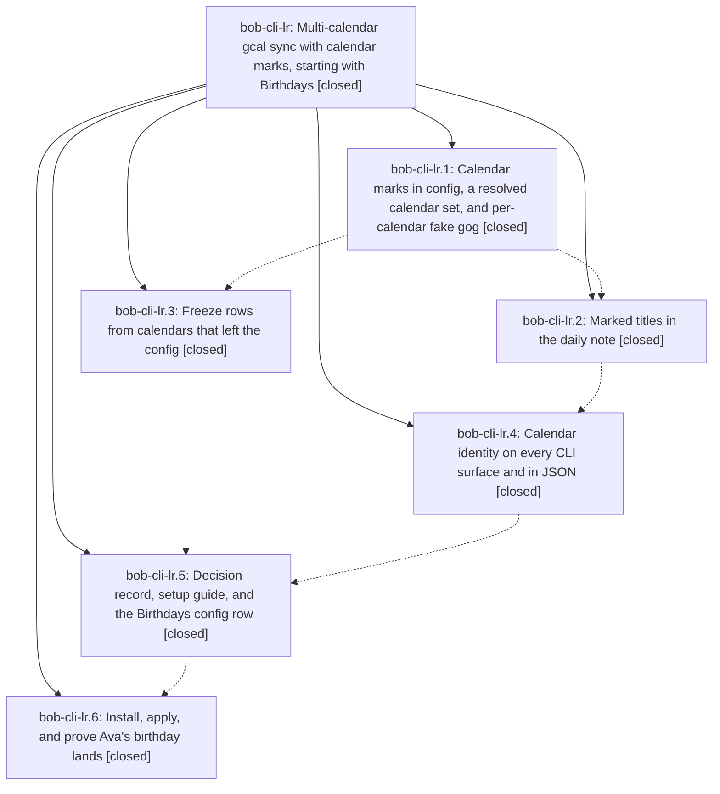

# Bead: bob-cli-lr — Multi-calendar gcal sync with calendar marks, starting with Birthdays

[Bead Pages](../README.md) / bob-cli-lr

**Status:** ✓ closed · **Resolution:** done · **Type:** ▸ plan · **Tier:** epic
**Owner:** `bryanbugyi34@gmail.com` · **Created by:** [bbugyi200.apollo.research.4q.linker.w1](https://github.com/bobs-org/bob-cli--agents/blob/main/sessions/bbugyi200.apollo.research.4q.linker.w1.md) · **Assignee:** `bob-cli-lr.land`
**Created:** 2026-11-15 12:24:26 EST · **Closed:** 2026-11-15 16:06:31 EST
**Plan:** [202611/gcal\_calendar\_marks.md](https://github.com/bobs-org/bob-cli--plans/blob/main/202611/gcal_calendar_marks.md)

<!-- sase:links:start -->

## Links

| Relation | Artifact | Why |
| --- | --- | --- |
| implemented-by | [plan:202611/gcal_calendar_marks.md][1] | derived from the plan's `bead_id:` frontmatter field |

[1]: https://github.com/bobs-org/bob-cli--plans/blob/main/202611/gcal_calendar_marks.md

<!-- sase:links:end -->

## Description

`bob gcal sync` syncs several Google Calendars from one account, chosen by id. Every row from a non-primary calendar starts its title with that calendar's configured mark, so `- **all day** 🎂 Ava's Birthday [📅](…)` lands in 2026/20261114.md and the source calendar is clear in the note, every CLI surface, and JSON. Removing a calendar from config freezes its old rows instead of cancelling them.

## Notes

[2026-11-15T21:06:31Z · bob-cli-lr.land] Land verification: read all 6 phases and their notes against plan:202611/gcal_calendar_marks.md. Reviewed epic commits 2759a4e7 (lr.1), 5acbc8a8 (lr.2), ee6d6503 (lr.3), 476c5440 (lr.4), and d794e0ba (lr.5); lr.6 was the live run. Confirmed in source: config-time mark validation (required on non-primary, shape, Tasks and Bob reserved glyphs in one shared TASKS_SIGNIFIER_CHARS, unique marks and ids); resolve_synced_calendars runs before any fetch (calendar_not_found, calendar_duplicate, unmarked non-primary); SyncedCalendar on SnapshotEvent and DaySnapshot.calendars; per-calendar fake gog; row_title fronts the mark inside the Google-owned title span with bare-title block ids and probes; deconfigured calendars freeze via LeftAlone with no gog lookup; marks and calendar identity on calendars, list, sync, doctor, ack, and note, plus additive JSON. DECISIONS honored: birthday_mark=cake (chezmoi 88bbec95 adds the Birthdays id with mark 🎂); mark_decision_record=no (no decisions strand written, no memory edits). Live result: ~/bob/2026/20261114.md has exactly one '- **all day** 🎂 Ava's Birthday [📅](…)' row directly under the stamp. Landing fixes: (1) lr.1 pushed docs/reference/configuration.md from 6000 to 6009 words, over the reference cap, so I tightened the gcal.calendars and gcal.account rows to 5999 and just docs-check passes; (2) bob gcal calendars -f json now finds the mark by configured id, so a marked primary configured as 'primary' reports its mark like the table does, with a new test calendars_json_reports_a_marked_primary_mark; (3) fixed a misplaced backtick in the connect-google-calendar.md YAML placeholder. Integration: commits since the epic began (152a7e28 capture drawers, 90e5247e ack termios tests, bd9c4c13 and c59b5b80 bank) neither touch nor duplicate the mark feature, and no module outside gcal reads the snapshot. Checks: cargo fmt clean; gcal_calendar_surfaces 2/2; cargo test --workspace: every binary green except the known complete_themes flake (passes alone; +1 on bob-cli-g8). Clippy in just check fails only on bank subscriptions dead code from c59b5b80 (bob-cli-ls.2.1.1, not this epic), recorded as DISCOVERED ISSUE on active epic bob-cli-ls.2.1. Follow-ups: lr.5 iCalUID dedupe filed as bob-cli-lu; contacts-birthday opt-in as bob-cli-lv; stamp legend as bob-cli-lw; per-calendar row policy as bob-cli-lx; lr.1 complete_themes flake corroborated on bob-cli-g8; the configuration.md word-budget proposal (lr.2/3/4/5) was declined as a task because this epic caused it and the landing fixed it. sase bead epic-symbols bob-cli-lr: none.

## Phases

| Bead | Title | Status | Size | Created | Agents | Commits |
|---|---|---|---|---|---:|---:|
| [bob-cli-lr.1](bob-cli-lr.1.md) | Calendar marks in config, a resolved calendar set, and per-calendar fake gog | ✓ closed | medium | 2026-11-15 | 1 | 1 |
| [bob-cli-lr.2](bob-cli-lr.2.md) | Marked titles in the daily note | ✓ closed | medium | 2026-11-15 | 1 | 1 |
| [bob-cli-lr.3](bob-cli-lr.3.md) | Freeze rows from calendars that left the config | ✓ closed | small | 2026-11-15 | 1 | 1 |
| [bob-cli-lr.4](bob-cli-lr.4.md) | Calendar identity on every CLI surface and in JSON | ✓ closed | medium | 2026-11-15 | 1 | 1 |
| [bob-cli-lr.5](bob-cli-lr.5.md) | Decision record, setup guide, and the Birthdays config row | ✓ closed | small | 2026-11-15 | 1 | 2 |
| [bob-cli-lr.6](bob-cli-lr.6.md) | Install, apply, and prove Ava's birthday lands | ✓ closed | small | 2026-11-15 | 1 | 0 |

## Lineage

## Agents

| Agent | Bead | Commits |
|---|---|---:|
| [bbugyi200.apollo.bob-cli-lr.1](https://github.com/bobs-org/bob-cli--agents/blob/main/agents/bbugyi200.apollo.bob-cli-lr.1/README.md) | [bob-cli-lr.1](bob-cli-lr.1.md) | 1 |
| [bbugyi200.apollo.bob-cli-lr.2](https://github.com/bobs-org/bob-cli--agents/blob/main/agents/bbugyi200.apollo.bob-cli-lr.2/README.md) | [bob-cli-lr.2](bob-cli-lr.2.md) | 1 |
| [bbugyi200.apollo.bob-cli-lr.3](https://github.com/bobs-org/bob-cli--agents/blob/main/sessions/bbugyi200.apollo.bob-cli-lr.3.md) | [bob-cli-lr.3](bob-cli-lr.3.md) | 1 |
| [bbugyi200.apollo.bob-cli-lr.4](https://github.com/bobs-org/bob-cli--agents/blob/main/agents/bbugyi200.apollo.bob-cli-lr.4/README.md) | [bob-cli-lr.4](bob-cli-lr.4.md) | 1 |
| [bbugyi200.apollo.bob-cli-lr.5](https://github.com/bobs-org/bob-cli--agents/blob/main/agents/bbugyi200.apollo.bob-cli-lr.5/README.md) | [bob-cli-lr.5](bob-cli-lr.5.md) | 2 |
| [bbugyi200.apollo.bob-cli-lr.6](https://github.com/bobs-org/bob-cli--agents/blob/main/sessions/bbugyi200.apollo.bob-cli-lr.6.md) | [bob-cli-lr.6](bob-cli-lr.6.md) | 0 |
| [bbugyi200.apollo.bob-cli-lr.land](https://github.com/bobs-org/bob-cli--agents/blob/main/agents/bbugyi200.apollo.bob-cli-lr.land/README.md) | [bob-cli-lr](README.md) | 2 |

## Commits

| Repo | Commit | Subject | Bead | Committed |
|---|---|---|---|---|
| bob-cli | [`2759a4e`](https://github.com/bobs-org/bob-cli/commit/2759a4e7c687ce36c859ceb20f790b682204494b) | feat(gcal)!: require unique marks on non-primary calendars | [bob-cli-lr.1](bob-cli-lr.1.md) | 2026-11-15 13:22:30 EST |
| bob-cli | [`5acbc8a`](https://github.com/bobs-org/bob-cli/commit/5acbc8a8f8f6f08913b682b3b48bc4d227f24426) | feat(gcal): render calendar marks at the front of Google-owned title spans | [bob-cli-lr.2](bob-cli-lr.2.md) | 2026-11-15 14:01:57 EST |
| bob-cli | [`ee6d650`](https://github.com/bobs-org/bob-cli/commit/ee6d650376d0fb413e789d704f22e915e608f89d) | feat(gcal): freeze rows from calendars that left the config | [bob-cli-lr.3](bob-cli-lr.3.md) | 2026-11-15 14:46:22 EST |
| bob-cli | [`476c544`](https://github.com/bobs-org/bob-cli/commit/476c54407ebe2eb04e9ccc693fc74b610a4124d8) | feat(gcal): expose calendar marks across CLI and JSON surfaces | [bob-cli-lr.4](bob-cli-lr.4.md) | 2026-11-15 14:56:34 EST |
| bob-cli | [`d794e0b`](https://github.com/bobs-org/bob-cli/commit/d794e0ba262d32da6b8503f88ad8bcbc2ebc79a5) | docs(gcal): document marked calendar setup | [bob-cli-lr.5](bob-cli-lr.5.md) | 2026-11-15 15:09:05 EST |
| chezmoi | [`chezmoi@88bbec9`](https://github.com/bbugyi200/dotfiles/commit/88bbec95181c09fd4dbe9ce9c9eac5a20b0094ca) | feat(config): enable Birthdays calendar mark | [bob-cli-lr.5](bob-cli-lr.5.md) | 2026-11-15 15:10:26 EST |
| bob-cli | [`b638fb0`](https://github.com/bobs-org/bob-cli/commit/b638fb0d1809f116043c7c35b674ab1b8919e4be) | fix(gcal): land calendar marks epic with docs budget, marked-primary JSON, and guide fixes | [bob-cli-lr](README.md) | 2026-11-15 16:08:59 EST |
| bob-cli--plans | [`bob-cli--plans@46a1ec0`](https://github.com/bobs-org/bob-cli--plans/commit/46a1ec01641e38389016b24bd3dd40290df747f4) | chore(plans): mark gcal\_calendar\_marks plan done after bob-cli-lr landed | [bob-cli-lr](README.md) | 2026-11-15 16:09:52 EST |
