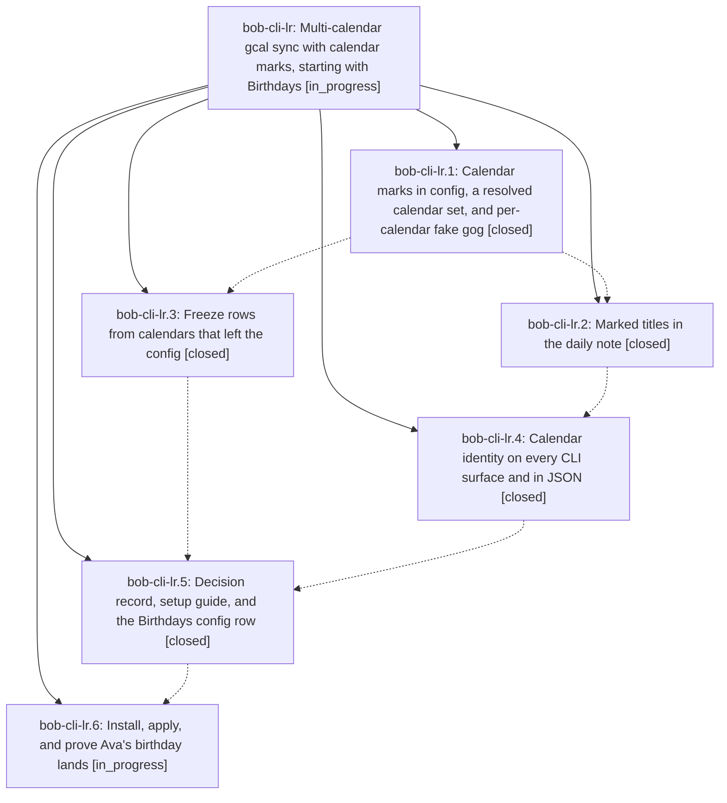

# Bead: bob-cli-lr — Multi-calendar gcal sync with calendar marks, starting with Birthdays

[Bead Pages](../README.md) / bob-cli-lr

**Status:** ◐ in_progress · **Type:** ▸ plan · **Tier:** epic
**Owner:** `bryanbugyi34@gmail.com` · **Created by:** [bbugyi200.apollo.research.4q.linker.w1](https://github.com/bobs-org/bob-cli--agents/blob/main/sessions/bbugyi200.apollo.research.4q.linker.w1.md) · **Assignee:** `bob-cli-lr.land`
**Created:** 2026-11-15 12:24:26 EST
**Plan:** [202611/gcal\_calendar\_marks.md](https://github.com/bobs-org/bob-cli--plans/blob/main/202611/gcal_calendar_marks.md)

<!-- sase:links:start -->

## Links

| Relation | Artifact | Why |
| --- | --- | --- |
| implemented-by | [plan:202611/gcal_calendar_marks.md][1] | derived from the plan's `bead_id:` frontmatter field |

[1]: https://github.com/bobs-org/bob-cli--plans/blob/main/202611/gcal_calendar_marks.md

<!-- sase:links:end -->

## Description

`bob gcal sync` syncs several Google Calendars from one account, chosen by id. Every row from a non-primary calendar starts its title with that calendar's configured mark, so `- **all day** 🎂 Ava's Birthday [📅](…)` lands in 2026/20261114.md and the source calendar is clear in the note, every CLI surface, and JSON. Removing a calendar from config freezes its old rows instead of cancelling them.

## Phases

| Bead | Title | Status | Size | Created | Agents | Commits |
|---|---|---|---|---|---:|---:|
| [bob-cli-lr.1](bob-cli-lr.1.md) | Calendar marks in config, a resolved calendar set, and per-calendar fake gog | ✓ closed | medium | 2026-11-15 | 1 | 1 |
| [bob-cli-lr.2](bob-cli-lr.2.md) | Marked titles in the daily note | ✓ closed | medium | 2026-11-15 | 1 | 1 |
| [bob-cli-lr.3](bob-cli-lr.3.md) | Freeze rows from calendars that left the config | ✓ closed | small | 2026-11-15 | 1 | 1 |
| [bob-cli-lr.4](bob-cli-lr.4.md) | Calendar identity on every CLI surface and in JSON | ✓ closed | medium | 2026-11-15 | 1 | 1 |
| [bob-cli-lr.5](bob-cli-lr.5.md) | Decision record, setup guide, and the Birthdays config row | ✓ closed | small | 2026-11-15 | 1 | 2 |
| [bob-cli-lr.6](bob-cli-lr.6.md) | Install, apply, and prove Ava's birthday lands | ◐ in_progress | small | 2026-11-15 | 1 | 0 |

## Lineage

## Agents

| Agent | Bead | Commits |
|---|---|---:|
| [bbugyi200.apollo.bob-cli-lr.1](https://github.com/bobs-org/bob-cli--agents/blob/main/agents/bbugyi200.apollo.bob-cli-lr.1/README.md) | [bob-cli-lr.1](bob-cli-lr.1.md) | 1 |
| [bbugyi200.apollo.bob-cli-lr.2](https://github.com/bobs-org/bob-cli--agents/blob/main/agents/bbugyi200.apollo.bob-cli-lr.2/README.md) | [bob-cli-lr.2](bob-cli-lr.2.md) | 1 |
| [bbugyi200.apollo.bob-cli-lr.3](https://github.com/bobs-org/bob-cli--agents/blob/main/sessions/bbugyi200.apollo.bob-cli-lr.3.md) | [bob-cli-lr.3](bob-cli-lr.3.md) | 1 |
| [bbugyi200.apollo.bob-cli-lr.4](https://github.com/bobs-org/bob-cli--agents/blob/main/agents/bbugyi200.apollo.bob-cli-lr.4/README.md) | [bob-cli-lr.4](bob-cli-lr.4.md) | 1 |
| [bbugyi200.apollo.bob-cli-lr.5](https://github.com/bobs-org/bob-cli--agents/blob/main/agents/bbugyi200.apollo.bob-cli-lr.5/README.md) | [bob-cli-lr.5](bob-cli-lr.5.md) | 2 |
| [bbugyi200.apollo.bob-cli-lr.6](https://github.com/bobs-org/bob-cli--agents/blob/main/agents/bbugyi200.apollo.bob-cli-lr.6/README.md) | [bob-cli-lr.6](bob-cli-lr.6.md) | 0 |
| [bbugyi200.apollo.bob-cli-lr.land](https://github.com/bobs-org/bob-cli--agents/blob/main/agents/bbugyi200.apollo.bob-cli-lr.land/README.md) | [bob-cli-lr](README.md) | 0 |

## Commits

| Repo | Commit | Subject | Bead | Committed |
|---|---|---|---|---|
| bob-cli | [`2759a4e`](https://github.com/bobs-org/bob-cli/commit/2759a4e7c687ce36c859ceb20f790b682204494b) | feat(gcal)!: require unique marks on non-primary calendars | [bob-cli-lr.1](bob-cli-lr.1.md) | 2026-11-15 13:22:30 EST |
| bob-cli | [`5acbc8a`](https://github.com/bobs-org/bob-cli/commit/5acbc8a8f8f6f08913b682b3b48bc4d227f24426) | feat(gcal): render calendar marks at the front of Google-owned title spans | [bob-cli-lr.2](bob-cli-lr.2.md) | 2026-11-15 14:01:57 EST |
| bob-cli | [`ee6d650`](https://github.com/bobs-org/bob-cli/commit/ee6d650376d0fb413e789d704f22e915e608f89d) | feat(gcal): freeze rows from calendars that left the config | [bob-cli-lr.3](bob-cli-lr.3.md) | 2026-11-15 14:46:22 EST |
| bob-cli | [`476c544`](https://github.com/bobs-org/bob-cli/commit/476c54407ebe2eb04e9ccc693fc74b610a4124d8) | feat(gcal): expose calendar marks across CLI and JSON surfaces | [bob-cli-lr.4](bob-cli-lr.4.md) | 2026-11-15 14:56:34 EST |
| bob-cli | [`d794e0b`](https://github.com/bobs-org/bob-cli/commit/d794e0ba262d32da6b8503f88ad8bcbc2ebc79a5) | docs(gcal): document marked calendar setup | [bob-cli-lr.5](bob-cli-lr.5.md) | 2026-11-15 15:09:05 EST |
| chezmoi | [`chezmoi@88bbec9`](https://github.com/bbugyi200/dotfiles/commit/88bbec95181c09fd4dbe9ce9c9eac5a20b0094ca) | feat(config): enable Birthdays calendar mark | [bob-cli-lr.5](bob-cli-lr.5.md) | 2026-11-15 15:10:26 EST |
