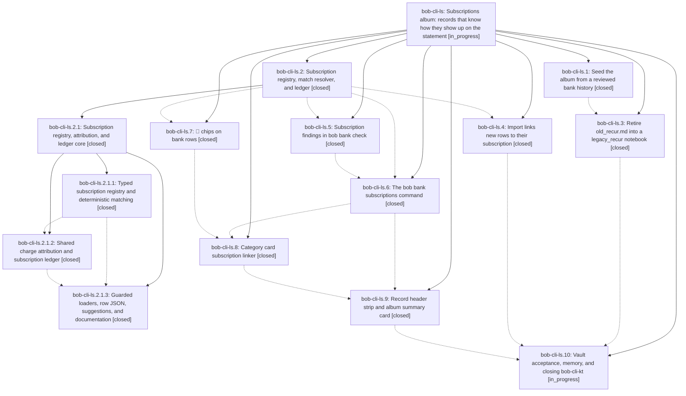

# Bead: bob-cli-ls — Subscriptions album: records that know how they show up on the statement

[Bead Pages](../README.md) / bob-cli-ls

**Status:** ◐ in_progress · **Type:** ▸ plan · **Tier:** epic
**Owner:** `bryanbugyi34@gmail.com` · **Created by:** [bbugyi200.athena.1cp](https://github.com/bobs-org/bob-cli--agents/blob/main/sessions/bbugyi200.athena.1cp.md) · **Assignee:** `bob-cli-ls.land`
**Created:** 2026-11-15 13:11:21 EST
**Plan:** [202611/bank\_subscriptions\_album.md](https://github.com/bobs-org/bob-cli--plans/blob/main/202611/bank_subscriptions_album.md)

<!-- sase:links:start -->

## Links

| Relation | Artifact | Why |
| --- | --- | --- |
| implemented-by | [plan:202611/bank_subscriptions_album.md][1] | derived from the plan's `bead_id:` frontmatter field |

_Plus 3 automatic references — see [Referenced By](#referenced-by)._

[1]: https://github.com/bobs-org/bob-cli--plans/blob/main/202611/bank_subscriptions_album.md

<!-- sase:links:end -->

## Description

A 🔁 Subscriptions album under bank holds every discretionary recurring charge, seeded from a reviewed bank history. bob bank import links each new matching row to its record, and the link renders as a quiet 🔁 chip. bob bank check and bob bank subscriptions keep the album honest: they flag price changes, charges after a cancel, and possible new subscriptions. The old Zorg recurring table retires without losing a link, and bob-cli-kt closes.

## Notes

[2026-11-16T01:13:27Z · 1cv--1] DISCOVERED ISSUE: kr closeout check and source build on clean bob-cli 893bd2af failed E0061 at check_subscriptions.rs:58 and test line 1105 because compute_ledger gained config/raw_descs arguments. Evidence file:explicit:afa1a0e6e83c8ef403056363. This is already repaired by f252f185 (bank subscriptions report); this checkout fast-forwarded to 7729a962 for final verification. No new task.

## Phases

| Bead | Title | Status | Size | Created | Agents | Commits |
|---|---|---|---|---|---:|---:|
| [bob-cli-ls.1](bob-cli-ls.1.md) | Seed the album from a reviewed bank history | ✓ closed | medium | 2026-11-15 | 1 | 0 |
| [bob-cli-ls.10](bob-cli-ls.10.md) | Vault acceptance, memory, and closing bob-cli-kt | ◐ in_progress | medium | 2026-11-15 | 1 | 0 |
| [bob-cli-ls.2](bob-cli-ls.2.md) | Subscription registry, match resolver, and ledger | ✓ closed | large | 2026-11-15 | 1 | 0 |
| [bob-cli-ls.3](bob-cli-ls.3.md) | Retire old\_recur.md into a legacy\_recur notebook | ✓ closed | medium | 2026-11-15 | 1 | 0 |
| [bob-cli-ls.4](bob-cli-ls.4.md) | Import links new rows to their subscription | ✓ closed | medium | 2026-11-15 | 1 | 1 |
| [bob-cli-ls.5](bob-cli-ls.5.md) | Subscription findings in bob bank check | ✓ closed | medium | 2026-11-15 | 1 | 1 |
| [bob-cli-ls.6](bob-cli-ls.6.md) | The bob bank subscriptions command | ✓ closed | medium | 2026-11-15 | 1 | 1 |
| [bob-cli-ls.7](bob-cli-ls.7.md) | 🔁 chips on bank rows | ✓ closed | medium | 2026-11-15 | 1 | 1 |
| [bob-cli-ls.8](bob-cli-ls.8.md) | Category card subscription linker | ✓ closed | medium | 2026-11-15 | 1 | 1 |
| [bob-cli-ls.9](bob-cli-ls.9.md) | Record header strip and album summary card | ✓ closed | medium | 2026-11-15 | 1 | 1 |

## Lineage

## Agents

| Agent | Bead | Commits |
|---|---|---:|
| [bbugyi200.athena.bob-cli-ls.1](https://github.com/bobs-org/bob-cli--agents/blob/main/sessions/bbugyi200.athena.bob-cli-ls.1.md) | [bob-cli-ls.1](bob-cli-ls.1.md) | 0 |
| [bbugyi200.athena.bob-cli-ls.10](https://github.com/bobs-org/bob-cli--agents/blob/main/agents/bbugyi200.athena.bob-cli-ls.10/README.md) | [bob-cli-ls.10](bob-cli-ls.10.md) | 0 |
| [bbugyi200.athena.bob-cli-ls.2](https://github.com/bobs-org/bob-cli--agents/blob/main/sessions/bbugyi200.athena.bob-cli-ls.2.md) | [bob-cli-ls.2](bob-cli-ls.2.md) | 0 |
| [bbugyi200.athena.bob-cli-ls.2.1.1](https://github.com/bobs-org/bob-cli--agents/blob/main/sessions/bbugyi200.athena.bob-cli-ls.2.1.1.md) | [bob-cli-ls.2.1.1](bob-cli-ls.2.1.1.md) | 0 |
| [bbugyi200.athena.bob-cli-ls.2.1.2](https://github.com/bobs-org/bob-cli--agents/blob/main/sessions/bbugyi200.athena.bob-cli-ls.2.1.2.md) | [bob-cli-ls.2.1.2](bob-cli-ls.2.1.2.md) | 1 |
| [bbugyi200.athena.bob-cli-ls.2.1.3](https://github.com/bobs-org/bob-cli--agents/blob/main/agents/bbugyi200.athena.bob-cli-ls.2.1.3/README.md) | [bob-cli-ls.2.1.3](bob-cli-ls.2.1.3.md) | 1 |
| [bbugyi200.athena.bob-cli-ls.2.1.land](https://github.com/bobs-org/bob-cli--agents/blob/main/sessions/bbugyi200.athena.bob-cli-ls.2.1.land.md) | [bob-cli-ls.2.1](bob-cli-ls.2.1.md) | 2 |
| [bbugyi200.athena.bob-cli-ls.3](https://github.com/bobs-org/bob-cli--agents/blob/main/agents/bbugyi200.athena.bob-cli-ls.3/README.md) | [bob-cli-ls.3](bob-cli-ls.3.md) | 0 |
| [bbugyi200.athena.bob-cli-ls.4](https://github.com/bobs-org/bob-cli--agents/blob/main/agents/bbugyi200.athena.bob-cli-ls.4/README.md) | [bob-cli-ls.4](bob-cli-ls.4.md) | 1 |
| [bbugyi200.athena.bob-cli-ls.5](https://github.com/bobs-org/bob-cli--agents/blob/main/sessions/bbugyi200.athena.bob-cli-ls.5.md) | [bob-cli-ls.5](bob-cli-ls.5.md) | 1 |
| [bbugyi200.athena.bob-cli-ls.6](https://github.com/bobs-org/bob-cli--agents/blob/main/agents/bbugyi200.athena.bob-cli-ls.6/README.md) | [bob-cli-ls.6](bob-cli-ls.6.md) | 1 |
| [bbugyi200.athena.bob-cli-ls.7](https://github.com/bobs-org/bob-cli--agents/blob/main/agents/bbugyi200.athena.bob-cli-ls.7/README.md) | [bob-cli-ls.7](bob-cli-ls.7.md) | 1 |
| [bbugyi200.athena.bob-cli-ls.8](https://github.com/bobs-org/bob-cli--agents/blob/main/sessions/bbugyi200.athena.bob-cli-ls.8.md) | [bob-cli-ls.8](bob-cli-ls.8.md) | 1 |
| [bbugyi200.athena.bob-cli-ls.9](https://github.com/bobs-org/bob-cli--agents/blob/main/agents/bbugyi200.athena.bob-cli-ls.9/README.md) | [bob-cli-ls.9](bob-cli-ls.9.md) | 1 |
| [bbugyi200.athena.bob-cli-ls.land](https://github.com/bobs-org/bob-cli--agents/blob/main/agents/bbugyi200.athena.bob-cli-ls.land/README.md) | [bob-cli-ls](README.md) | 0 |

## Commits

| Repo | Commit | Subject | Bead | Committed |
|---|---|---|---|---|
| bob-cli | [`96b35f4`](https://github.com/bobs-org/bob-cli/commit/96b35f41c4d20cecc065e85e2fe5ac1d8d191c2c) | feat(bank): add subscription attribution and ledger | [bob-cli-ls.2.1.2](bob-cli-ls.2.1.2.md) | 2026-11-15 16:08:32 EST |
| bob-cli | [`055f9b6`](https://github.com/bobs-org/bob-cli/commit/055f9b6e0558c8458ac37a20d0533f22ac4d5d77) | feat(bank): integrate subscription core into rows, suggestions, and docs | [bob-cli-ls.2.1.3](bob-cli-ls.2.1.3.md) | 2026-11-15 16:51:38 EST |
| bob-cli | [`b8aed5a`](https://github.com/bobs-org/bob-cli/commit/b8aed5a943242a5517a6f536de9914432193ed90) | fix(bank): repair subscription core ledger, import after-state, and guards | [bob-cli-ls.2.1](bob-cli-ls.2.1.md) | 2026-11-15 17:58:47 EST |
| bob-cli--plans | [`bob-cli--plans@594215a`](https://github.com/bobs-org/bob-cli--plans/commit/594215ae91c9d361ab200f833ee8dbf82f45ea2e) | docs: mark subscription core epic plan done | [bob-cli-ls.2.1](bob-cli-ls.2.1.md) | 2026-11-15 17:59:49 EST |
| bob-plugins | [`bob-plugins@cd14e67`](https://github.com/bobs-org/bob-plugins/commit/cd14e675b165530ece3797f697df4e790ec3ddbf) | feat(bank): paint state-aware 🔁 subscription chips on bank rows | [bob-cli-ls.7](bob-cli-ls.7.md) | 2026-11-15 18:31:27 EST |
| bob-cli | [`cfd4548`](https://github.com/bobs-org/bob-cli/commit/cfd4548a2cd60a165fdbdc67bd0472e2d6968343) | feat(bank): add native bank checks and subscription registry | [bob-cli-ls.5](bob-cli-ls.5.md) | 2026-11-15 18:48:43 EST |
| bob-cli | [`219e854`](https://github.com/bobs-org/bob-cli/commit/219e854eab66ef329e1b9a5b21873f98279153f0) | feat(bank): link import rows to subscriptions with summary | [bob-cli-ls.4](bob-cli-ls.4.md) | 2026-11-15 18:59:57 EST |
| bob-cli | [`f252f18`](https://github.com/bobs-org/bob-cli/commit/f252f1856abc3ef2f12c6e7555f7c6964b484979) | feat(bank): add bank subscriptions report command | [bob-cli-ls.6](bob-cli-ls.6.md) | 2026-11-15 19:52:02 EST |
| bob-plugins | [`bob-plugins@a6eaea6`](https://github.com/bobs-org/bob-plugins/commit/a6eaea6601cbd9c891d34ab6f49e8b55697cb8c5) | feat(bank): link subscriptions from the Category card | [bob-cli-ls.8](bob-cli-ls.8.md) | 2026-11-15 20:58:39 EST |
| bob-plugins | [`bob-plugins@cb885ca`](https://github.com/bobs-org/bob-plugins/commit/cb885cad16ccf013466b5b1ee8ebe89c7d75834c) | feat(bank): add subscription header strip and album summary card | [bob-cli-ls.9](bob-cli-ls.9.md) | 2026-11-15 21:43:22 EST |

<!-- sase:referenced-by:start -->

## Referenced By

| Relation | Artifact | Why | Uses |
| --- | --- | --- | ---: |
| read-by | [agent:1cv--1][1] | Inspect exact scope and prior evidence for unrelated check failures | 2 |
| read-by | [agent:bob-cli-lr.land][2] | Check whether bank subscription registry dead code breaking just check on master is tracked in-flight work | 1 |
| read-by | [agent:bob-cli-ls.7][3] | Need parent epic DECISIONS and overall design | 1 |

[1]: https://github.com/bobs-org/bob-cli--agents/blob/main/sessions/bbugyi200.athena.1cv.md
[2]: https://github.com/bobs-org/bob-cli--agents/blob/main/agents/bbugyi200.athena.bob-cli-lr.land/README.md
[3]: https://github.com/bobs-org/bob-cli--agents/blob/main/agents/bbugyi200.athena.bob-cli-ls.7/README.md

<!-- sase:referenced-by:end -->
