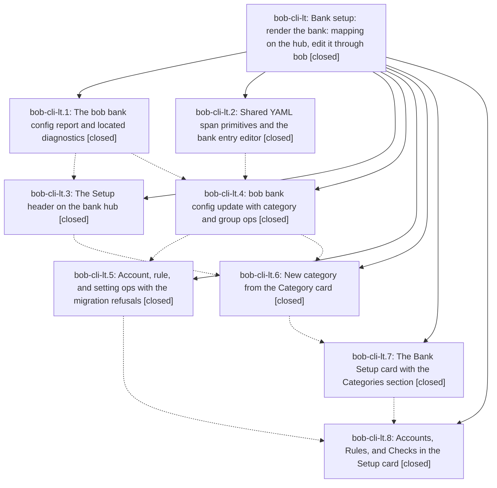

# Bead: bob-cli-lt — Bank setup: render the bank: mapping on the hub, edit it through bob

[Bead Pages](../README.md) / bob-cli-lt

**Status:** ✓ closed · **Resolution:** done · **Type:** ▸ plan · **Tier:** epic
**Owner:** `bryanbugyi34@gmail.com` · **Created by:** [bbugyi200.athena.1co](https://github.com/bobs-org/bob-cli--agents/blob/main/sessions/bbugyi200.athena.1co.md) · **Assignee:** `bob-cli-lt.land`
**Created:** 2026-11-15 13:16:08 EST · **Closed:** 2026-11-16 00:58:34 EST
**Plan:** [202611/bank\_setup\_render\_and\_edit.md](https://github.com/bobs-org/bob-cli--plans/blob/main/202611/bank_setup_render_and_edit.md)

<!-- sase:links:start -->

## Links

| Relation | Artifact | Why |
| --- | --- | --- |
| implemented-by | [plan:202611/bank_setup_render_and_edit.md][1] | derived from the plan's `bead_id:` frontmatter field |
| related | [bead:bob-cli-lz][2] | Bank setup shares guarded update infrastructure; coordinate any extraction before the deferred album migration flow |
| related | [bead:bob-cli-m3][3] | Bank setup epic: owns the guarded rule.add op and the plugin config-update service this action would call |
| related | [bead:bob-cli-m6][4] | reproduced during bob-cli-lt landing; proposer bob-cli-lt |
| related | [bead:bob-cli-m7][5] | reproduced during bob-cli-lt landing; proposer bob-cli-lt |
| related | [bead:bob-cli-m8][6] | found during bob-cli-lt npm test; not caused by the landing tale |
| related | file:explicit:0a0b622c742c4650208a3952 | attached via sase artifact create --bead |
| related | file:explicit:34f11fe48e65ea73984d0fc5 | attached via sase artifact create --bead |
| related | file:explicit:4cdec0f9211442a7aa403d0c | attached via sase artifact create --bead |
| related | file:explicit:51dcaec4621d8cc79bf46edf | attached via sase artifact create --bead |
| related | file:explicit:8438a3d51b740dbde9b7279d | attached via sase artifact create --bead |
| related | file:explicit:96340422e29c8b25d79f1c8b | attached via sase artifact create --bead |
| related | file:explicit:976c7d21c1017143dc5b1f4a | attached via sase artifact create --bead |
| related | file:explicit:c84c975f7194e212fe16ea75 | attached via sase artifact create --bead |
| related | file:explicit:dcbd88a2e076072c3f1870b4 | attached via sase artifact create --bead |

_Plus 4 automatic references — see [Referenced By](#referenced-by)._

[1]: https://github.com/bobs-org/bob-cli--plans/blob/main/202611/bank_setup_render_and_edit.md
[2]: https://github.com/bobs-org/bob-cli--beads/blob/main/pages/bob-cli-lz/README.md
[3]: https://github.com/bobs-org/bob-cli--beads/blob/main/pages/bob-cli-m3/README.md
[4]: https://github.com/bobs-org/bob-cli--beads/blob/main/pages/bob-cli-m6/README.md
[5]: https://github.com/bobs-org/bob-cli--beads/blob/main/pages/bob-cli-m7/README.md
[6]: https://github.com/bobs-org/bob-cli--beads/blob/main/pages/bob-cli-m8/README.md

<!-- sase:links:end -->

## Description

bank.md's nested bank: mapping renders on the hub as a calm, honest Setup header showing what bob actually uses (accounts, categories as Category-card keycaps, rules, free keys, located errors), and every common edit — above all "none of these categories fits this row" — becomes one previewed, revertable gesture written only by a guarded bob writer that preserves Bryan's authored YAML byte-for-byte, with YAML editing kept first-class.

## Notes

[2026-11-15T22:02:23Z · bob-cli-ls.2.1.land] DISCOVERED ISSUE: Triaged bob-cli-ls.2.1.3 note #1 during subscription-core landing. Canonical count_words on opened bob-plugins history proves f72bd4e docs/bob-ledger-tools.md = 6000 and lt.3 commit 63ff165 = 6055; current mounted copy is also 6055. This is caused by the Setup header documentation added by bob-cli-lt.3, whose own note #1 acknowledges the +55. Please trim existing prose while preserving the new contract before landing lt; do not raise budgets. The previous headroom fix is present (61c506d = 5546); corroborated bob-cli-il as a post-close recurrence, with no new task. This unrelated docs failure must not block subscription-core closeout once its own requirements pass.

[2026-11-16T01:13:41Z · 1cv--1] DISCOVERED ISSUE: kr closeout reproduces the already-recorded Setup docs budget failure on clean bob-plugins 1caabb8: mounted ledger-tools reference is now 6146 words vs cap 6000. Closeout made no docs edits. Evidence file:explicit:97b1d98e440b37caf15a9dc2; corroborated existing bob-cli-il. Preserve the new Bank behavior while trimming before lt lands.

[2026-11-16T03:56:45Z · bob-cli-ls.land] CROSS-EPIC COORDINATION from bob-cli-ls.land:
(a) bob bank config update category.remove (refuse_in_use / UsageIndex in src/native/bank/config_update) counts rows and rules but not subscription records whose category field holds the key. Removing a key used only by a subscription record succeeds and leaves bank_subscription_category_unknown behind. The bob-cli-ls landing tale will make category.remove also refuse when subscription records use the key. lt.land need not do this.
(b) docs/bank.md: lt's membership line ('the hub's bank: setup') and ls's runner.rs about-line ('the subscription records rows link to') each dropped the other's wording. The ls landing tale merges both and adds bob bank subscriptions to the docs/bank.md usage block.
(c) The ls landing tale trims bob-plugins docs/bob-ledger-tools.md to 6000 words or fewer. Before trimming in lt.land, pull and re-measure; trim only if the page is still over the cap.

[2026-11-16T04:18:55Z · bob-cli-lt.land] LAND TRIAGE (bob-cli-lt.land). Integration edits (bob-cli, committed with this landing turn): (1) bob bank subscriptions (f252f185, landed in parallel) now emits one located bank_config_invalid finding per config diagnostic (line + key_path, check's shape) instead of one unlocated first message; new CLI test subscriptions_reports_every_located_config_finding. (2) category.remove and its undo_blocked guard now also count subscription records whose category names the key (SubscriptionRegistry, all statuses), so the writer never strands a subscription's category; plan_update takes SubscriptionRefs; docs/bank.md op table updated; unit test subscription_records_block_category_remove_and_its_undo. just check passed (exit 0). Follow-ups: lt.2 #1 (cargo fmt gcal_auth.rs) declined: cargo fmt --check is clean on current master. lt.3 #2 (configuration.md 6009 words) declined: docs-check no longer reports that page. lt.3 #3 and lt.7 #2 timing flakes corroborated as +1 on existing bob-cli-km (event-link-times), bob-cli-ki (keep-moving surface, 306.6 ms), and bob-cli-ju (off-clock chips); no new task. lt.3 #1, lt.5 #1, lt.6 #1, lt.7 #1, lt.8 #1 (bob-ledger-tools reference at 6302/6000 words) are epic work, not a task: the landing tale trims the page under the cap without raising budgets (related standing headroom task bob-cli-il). Plan item 4 deferred work filed: bob-cli-m4 (bank category-key rename/merge and account alias rename migrations, large, related bob-cli-lz) and bob-cli-m5 (+ Rule from the Category card, medium, related bob-cli-m3). The subscription-candidate rule dismissal is already owned by bob-cli-m3; no new task. bob-cli-lq verified and closed. Remaining epic work, planned as a landing tale: the Setup e2e scenarios, real-Obsidian acceptance with screenshots, the leftover .bob-bank-hub-note CSS hide that defeats the scoped Setup-surface hide, the docs trim, gates/sync, and closeout.

[2026-11-16T05:50:39Z · bob-cli-lt.land] LAND GATES (bob-cli-lt.land). Setup e2e xvfb green (file:explicit:4cdec0f9211442a7aa403d0c). Existing obsidian-bank-ui-e2e.cjs failed invalid-fence, walk-learn-coffee, walk-learn-accept, walk-real-key-swallowed on the land tree and identically on clean HEAD 99e3410; filed bob-cli-m6 and bob-cli-m7. chip-today did not fail this run (badge-today passed with 2 waiting); citing standing bob-cli-le. npm test 6803/6808: keep-moving surface 25ms flake alone-green (bob-cli-ki +1), frees-marks 25ms flake alone-green (bob-cli-io +1), block-marks e2e self-test fails alone because plus4 on 2026-11-16 is 2026-11-20 (filed bob-cli-m8). Known km/ki/ju: ki reproduced under load. docs:check word cap for bob-ledger-tools is 5996/6000; the command failed later on the capture-token //<query> miss (bob-cli-fo +1, noted on bob-cli-ly). validate passed. No just check (no bob-cli code this tale). justfile still has no symvision recipe.

[2026-11-16T05:58:34Z · bob-cli-lt.land] Landed remaining bob-cli-lt acceptance (plan:202611/bank_setup_landing.md). All eight phases were already closed and verified; integration edits (located subscription config findings, category.remove counts subscriptions) and bob-cli-lq close stand from the earlier LAND TRIAGE note.

Scoped hide: removed bob-bank-hub-note class writes and CSS; only .bob-bank-setup-surface hides the native bank row.

docs/bob-ledger-tools.md is 5996/6000 words (cap held, not under 5700 so no bob-cli-il headroom note).

Setup e2e xvfb green (file:explicit:4cdec0f9211442a7aa403d0c). Screenshots inspected against Visual language: collapsed/expanded/invalid ~375px light (file:explicit:51dcaec4621d8cc79bf46edf, file:explicit:976c7d21c1017143dc5b1f4a, file:explicit:34f11fe48e65ea73984d0fc5), Setup card Categories (file:explicit:c84c975f7194e212fe16ea75), New category stage (file:explicit:0a0b622c742c4650208a3952).

Existing obsidian-bank-ui-e2e.cjs failed invalid-fence + walk-learn-coffee/accept + walk-real-key-swallowed on the land tree and identically on clean HEAD 99e3410 (file:explicit:8438a3d51b740dbde9b7279d, file:explicit:dcbd88a2e076072c3f1870b4); filed bob-cli-m6 and bob-cli-m7. chip-today did not fail this run (badge-today passed with 2 waiting); citing standing bob-cli-le.

Gates: npm run build current; validate passed; npm test 6803/6808 — keep-moving surface 25ms flake alone-green (bob-cli-ki, already reported), frees-marks 25ms flake alone-green (bob-cli-io +1), block-marks e2e self-test fails alone because plus4 on 2026-11-16 is 2026-11-20 (filed bob-cli-m8). BOB_CLI_DIR docs-check held the ledger-tools cap then failed on capture-token '//<query>' at #double-slash-picker (bob-cli-fo +1; DISCOVERED ISSUE on bob-cli-ly). No bob-cli code this tale, so no just check. justfile still has no symvision recipe.

Deploy: bob plugins sync --repo land-checkout --no-pull copied bob-ledger-tools main.js and styles.css (uncommitted stamp, backups 20261116-005709). epic-symbols: none.

## Phases

| Bead | Title | Status | Size | Created | Agents | Commits |
|---|---|---|---|---|---:|---:|
| [bob-cli-lt.1](bob-cli-lt.1.md) | The bob bank config report and located diagnostics | ✓ closed | medium | 2026-11-15 | 1 | 1 |
| [bob-cli-lt.2](bob-cli-lt.2.md) | Shared YAML span primitives and the bank entry editor | ✓ closed | medium | 2026-11-15 | 1 | 1 |
| [bob-cli-lt.3](bob-cli-lt.3.md) | The Setup header on the bank hub | ✓ closed | medium | 2026-11-15 | 1 | 1 |
| [bob-cli-lt.4](bob-cli-lt.4.md) | bob bank config update with category and group ops | ✓ closed | medium | 2026-11-15 | 1 | 1 |
| [bob-cli-lt.5](bob-cli-lt.5.md) | Account, rule, and setting ops with the migration refusals | ✓ closed | medium | 2026-11-15 | 1 | 1 |
| [bob-cli-lt.6](bob-cli-lt.6.md) | New category from the Category card | ✓ closed | medium | 2026-11-15 | 1 | 2 |
| [bob-cli-lt.7](bob-cli-lt.7.md) | The Bank Setup card with the Categories section | ✓ closed | medium | 2026-11-15 | 1 | 1 |
| [bob-cli-lt.8](bob-cli-lt.8.md) | Accounts, Rules, and Checks in the Setup card | ✓ closed | medium | 2026-11-15 | 1 | 1 |

## Lineage

## Agents

| Agent | Bead | Commits |
|---|---|---:|
| [bbugyi200.athena.bob-cli-lt.1](https://github.com/bobs-org/bob-cli--agents/blob/main/sessions/bbugyi200.athena.bob-cli-lt.1.md) | [bob-cli-lt.1](bob-cli-lt.1.md) | 1 |
| [bbugyi200.athena.bob-cli-lt.2](https://github.com/bobs-org/bob-cli--agents/blob/main/sessions/bbugyi200.athena.bob-cli-lt.2.md) | [bob-cli-lt.2](bob-cli-lt.2.md) | 1 |
| [bbugyi200.athena.bob-cli-lt.3](https://github.com/bobs-org/bob-cli--agents/blob/main/agents/bbugyi200.athena.bob-cli-lt.3/README.md) | [bob-cli-lt.3](bob-cli-lt.3.md) | 1 |
| [bbugyi200.athena.bob-cli-lt.4](https://github.com/bobs-org/bob-cli--agents/blob/main/sessions/bbugyi200.athena.bob-cli-lt.4.md) | [bob-cli-lt.4](bob-cli-lt.4.md) | 1 |
| [bbugyi200.athena.bob-cli-lt.5](https://github.com/bobs-org/bob-cli--agents/blob/main/sessions/bbugyi200.athena.bob-cli-lt.5.md) | [bob-cli-lt.5](bob-cli-lt.5.md) | 1 |
| [bbugyi200.athena.bob-cli-lt.6](https://github.com/bobs-org/bob-cli--agents/blob/main/agents/bbugyi200.athena.bob-cli-lt.6/README.md) | [bob-cli-lt.6](bob-cli-lt.6.md) | 2 |
| [bbugyi200.athena.bob-cli-lt.7](https://github.com/bobs-org/bob-cli--agents/blob/main/sessions/bbugyi200.athena.bob-cli-lt.7.md) | [bob-cli-lt.7](bob-cli-lt.7.md) | 1 |
| [bbugyi200.athena.bob-cli-lt.8](https://github.com/bobs-org/bob-cli--agents/blob/main/agents/bbugyi200.athena.bob-cli-lt.8/README.md) | [bob-cli-lt.8](bob-cli-lt.8.md) | 1 |
| [bbugyi200.athena.bob-cli-lt.land](https://github.com/bobs-org/bob-cli--agents/blob/main/sessions/bbugyi200.athena.bob-cli-lt.land.md) | [bob-cli-lt](README.md) | 2 |

## Commits

| Repo | Commit | Subject | Bead | Committed |
|---|---|---|---|---|
| bob-cli | [`bd9c4c1`](https://github.com/bobs-org/bob-cli/commit/bd9c4c13e7a6a1f64f57baff735f05834f9f8bb1) | feat(bank): extract YAML span primitives and add a bank config editor | [bob-cli-lt.2](bob-cli-lt.2.md) | 2026-11-15 14:30:49 EST |
| bob-cli | [`248befd`](https://github.com/bobs-org/bob-cli/commit/248befdde6b414552b6373799496b1594cad5cba) | feat(bank): add read-only config report | [bob-cli-lt.1](bob-cli-lt.1.md) | 2026-11-15 15:46:31 EST |
| bob-plugins | [`bob-plugins@63ff165`](https://github.com/bobs-org/bob-plugins/commit/63ff1654a8ffc52c6c1419479a7e3bb17d08f012) | feat(bank): render the Setup header on the bank hub | [bob-cli-lt.3](bob-cli-lt.3.md) | 2026-11-15 16:28:58 EST |
| bob-cli | [`8a6d746`](https://github.com/bobs-org/bob-cli/commit/8a6d746d86a6ef88483530df22da0a65f666c620) | feat(bank): add guarded config update for category and group ops | [bob-cli-lt.4](bob-cli-lt.4.md) | 2026-11-15 18:19:29 EST |
| bob-cli | [`1894456`](https://github.com/bobs-org/bob-cli/commit/189445652a6637099f7b22fad974e4447a83d1d4) | docs(bank): add the Category-card + New category filing step | [bob-cli-lt.6](bob-cli-lt.6.md) | 2026-11-15 18:52:37 EST |
| bob-plugins | [`bob-plugins@1caabb8`](https://github.com/bobs-org/bob-plugins/commit/1caabb8d4148c1e46106f384e297f162d1c45139) | feat(bank): add New category from the Category card | [bob-cli-lt.6](bob-cli-lt.6.md) | 2026-11-15 18:53:17 EST |
| bob-cli | [`893bd2a`](https://github.com/bobs-org/bob-cli/commit/893bd2afa2c5f6e339d7f5e32b21c8187dff92e3) | feat(bank): add account, rule, and setting writer ops | [bob-cli-lt.5](bob-cli-lt.5.md) | 2026-11-15 19:40:14 EST |
| bob-plugins | [`bob-plugins@65570a0`](https://github.com/bobs-org/bob-plugins/commit/65570a0e63537ce78a5c8d5366b7c53ec3f7442a) | feat(bank): add the keyboard-first setup card | [bob-cli-lt.7](bob-cli-lt.7.md) | 2026-11-15 22:22:41 EST |
| bob-plugins | [`bob-plugins@99e3410`](https://github.com/bobs-org/bob-plugins/commit/99e34103666e00b5edda98629eb40dc6ce9a7339) | feat(bank): add Accounts, Rules, and Checks to the Bank Setup card | [bob-cli-lt.8](bob-cli-lt.8.md) | 2026-11-15 22:41:08 EST |
| bob-cli | [`2a6377d`](https://github.com/bobs-org/bob-cli/commit/2a6377dd717726cf9c0b2fc12d072011915f9680) | fix(bank): integrate bank setup writer and config findings with subscriptions | [bob-cli-lt](README.md) | 2026-11-15 23:21:50 EST |
| bob-plugins | [`bob-plugins@ccdd865`](https://github.com/bobs-org/bob-plugins/commit/ccdd86559283c66aab06c2e2ba872bc6479c1142) | feat(bank): land Setup e2e, scoped hub hide, and docs budget | [bob-cli-lt](README.md) | 2026-11-16 00:59:59 EST |

<!-- sase:referenced-by:start -->

## Referenced By

| Relation | Artifact | Why | Uses |
| --- | --- | --- | ---: |
| read-by | [agent:1cv--1][1] | Identify new Bank setup documentation contributing to clean-base docs overage | 1 |
| read-by | [agent:bob-cli-lr.land][2] | Check whether bank subscriptions dead code that breaks just check is in-flight work of this epic | 1 |
| read-by | [agent:bob-cli-lt.8][3] | Need epic scope for setup-card-more phase | 1 |
| read-by | [agent:bob-cli-lt.land][4] | Need the epic scope, children, and linked plan file | 1 |

[1]: https://github.com/bobs-org/bob-cli--agents/blob/main/sessions/bbugyi200.athena.1cv.md
[2]: https://github.com/bobs-org/bob-cli--agents/blob/main/agents/bbugyi200.athena.bob-cli-lr.land/README.md
[3]: https://github.com/bobs-org/bob-cli--agents/blob/main/agents/bbugyi200.athena.bob-cli-lt.8/README.md
[4]: https://github.com/bobs-org/bob-cli--agents/blob/main/sessions/bbugyi200.athena.bob-cli-lt.land.md

<!-- sase:referenced-by:end -->
