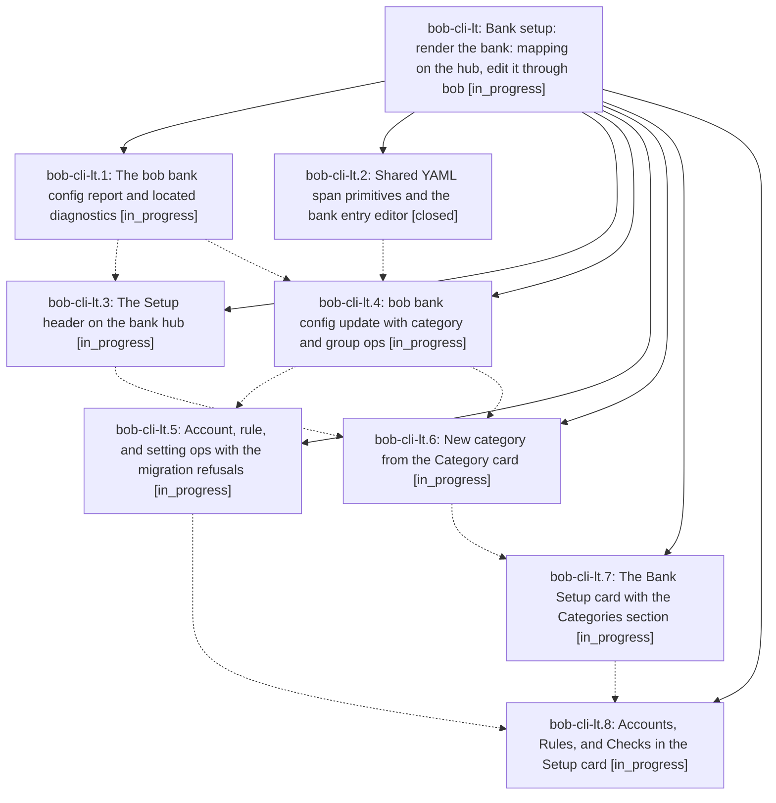

# Bead: bob-cli-lt — Bank setup: render the bank: mapping on the hub, edit it through bob

[Bead Pages](../README.md) / bob-cli-lt

**Status:** ◐ in_progress · **Type:** ▸ plan · **Tier:** epic
**Owner:** `bryanbugyi34@gmail.com` · **Created by:** [bbugyi200.athena.1co](https://github.com/bobs-org/bob-cli--agents/blob/main/sessions/bbugyi200.athena.1co.md) · **Assignee:** `bob-cli-lt.land`
**Created:** 2026-11-15 13:16:08 EST
**Plan:** [202611/bank\_setup\_render\_and\_edit.md](https://github.com/bobs-org/bob-cli--plans/blob/main/202611/bank_setup_render_and_edit.md)

<!-- sase:links:start -->

## Links

| Relation | Artifact | Why |
| --- | --- | --- |
| implemented-by | [plan:202611/bank_setup_render_and_edit.md][1] | derived from the plan's `bead_id:` frontmatter field |

[1]: https://github.com/bobs-org/bob-cli--plans/blob/main/202611/bank_setup_render_and_edit.md

<!-- sase:links:end -->

## Description

bank.md's nested bank: mapping renders on the hub as a calm, honest Setup header showing what bob actually uses (accounts, categories as Category-card keycaps, rules, free keys, located errors), and every common edit — above all "none of these categories fits this row" — becomes one previewed, revertable gesture written only by a guarded bob writer that preserves Bryan's authored YAML byte-for-byte, with YAML editing kept first-class.

## Phases

| Bead | Title | Status | Size | Created | Agents | Commits |
|---|---|---|---|---|---:|---:|
| [bob-cli-lt.1](bob-cli-lt.1.md) | The bob bank config report and located diagnostics | ◐ in_progress | medium | 2026-11-15 | 1 | 1 |
| [bob-cli-lt.2](bob-cli-lt.2.md) | Shared YAML span primitives and the bank entry editor | ✓ closed | medium | 2026-11-15 | 1 | 1 |
| [bob-cli-lt.3](bob-cli-lt.3.md) | The Setup header on the bank hub | ◐ in_progress | medium | 2026-11-15 | 1 | 0 |
| [bob-cli-lt.4](bob-cli-lt.4.md) | bob bank config update with category and group ops | ◐ in_progress | medium | 2026-11-15 | 1 | 0 |
| [bob-cli-lt.5](bob-cli-lt.5.md) | Account, rule, and setting ops with the migration refusals | ◐ in_progress | medium | 2026-11-15 | 1 | 0 |
| [bob-cli-lt.6](bob-cli-lt.6.md) | New category from the Category card | ◐ in_progress | medium | 2026-11-15 | 1 | 0 |
| [bob-cli-lt.7](bob-cli-lt.7.md) | The Bank Setup card with the Categories section | ◐ in_progress | medium | 2026-11-15 | 1 | 0 |
| [bob-cli-lt.8](bob-cli-lt.8.md) | Accounts, Rules, and Checks in the Setup card | ◐ in_progress | medium | 2026-11-15 | 1 | 0 |

## Lineage

## Agents

| Agent | Bead | Commits |
|---|---|---:|
| [bbugyi200.athena.bob-cli-lt.1](https://github.com/bobs-org/bob-cli--agents/blob/main/sessions/bbugyi200.athena.bob-cli-lt.1.md) | [bob-cli-lt.1](bob-cli-lt.1.md) | 1 |
| [bbugyi200.athena.bob-cli-lt.2](https://github.com/bobs-org/bob-cli--agents/blob/main/sessions/bbugyi200.athena.bob-cli-lt.2.md) | [bob-cli-lt.2](bob-cli-lt.2.md) | 1 |
| [bbugyi200.athena.bob-cli-lt.3](https://github.com/bobs-org/bob-cli--agents/blob/main/agents/bbugyi200.athena.bob-cli-lt.3/README.md) | [bob-cli-lt.3](bob-cli-lt.3.md) | 0 |
| [bbugyi200.athena.bob-cli-lt.4](https://github.com/bobs-org/bob-cli--agents/blob/main/agents/bbugyi200.athena.bob-cli-lt.4/README.md) | [bob-cli-lt.4](bob-cli-lt.4.md) | 0 |
| [bbugyi200.athena.bob-cli-lt.5](https://github.com/bobs-org/bob-cli--agents/blob/main/agents/bbugyi200.athena.bob-cli-lt.5/README.md) | [bob-cli-lt.5](bob-cli-lt.5.md) | 0 |
| [bbugyi200.athena.bob-cli-lt.6](https://github.com/bobs-org/bob-cli--agents/blob/main/agents/bbugyi200.athena.bob-cli-lt.6/README.md) | [bob-cli-lt.6](bob-cli-lt.6.md) | 0 |
| [bbugyi200.athena.bob-cli-lt.7](https://github.com/bobs-org/bob-cli--agents/blob/main/agents/bbugyi200.athena.bob-cli-lt.7/README.md) | [bob-cli-lt.7](bob-cli-lt.7.md) | 0 |
| [bbugyi200.athena.bob-cli-lt.8](https://github.com/bobs-org/bob-cli--agents/blob/main/agents/bbugyi200.athena.bob-cli-lt.8/README.md) | [bob-cli-lt.8](bob-cli-lt.8.md) | 0 |
| [bbugyi200.athena.bob-cli-lt.land](https://github.com/bobs-org/bob-cli--agents/blob/main/agents/bbugyi200.athena.bob-cli-lt.land/README.md) | [bob-cli-lt](README.md) | 0 |

## Commits

| Repo | Commit | Subject | Bead | Committed |
|---|---|---|---|---|
| bob-cli | [`bd9c4c1`](https://github.com/bobs-org/bob-cli/commit/bd9c4c13e7a6a1f64f57baff735f05834f9f8bb1) | feat(bank): extract YAML span primitives and add a bank config editor | [bob-cli-lt.2](bob-cli-lt.2.md) | 2026-11-15 14:30:49 EST |
| bob-cli | [`248befd`](https://github.com/bobs-org/bob-cli/commit/248befdde6b414552b6373799496b1594cad5cba) | feat(bank): add read-only config report | [bob-cli-lt.1](bob-cli-lt.1.md) | 2026-11-15 15:46:31 EST |
