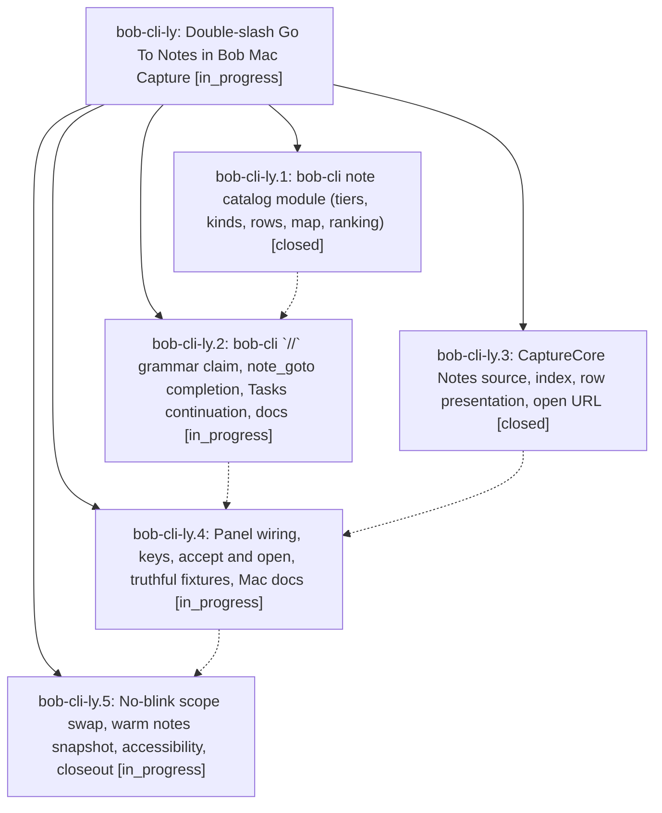

# Bead: bob-cli-ly — Double-slash Go To Notes in Bob Mac Capture

[Bead Pages](../README.md) / bob-cli-ly

**Status:** ◐ in_progress · **Type:** ▸ plan · **Tier:** epic
**Owner:** `bryanbugyi34@gmail.com` · **Created by:** [bbugyi200.athena.1cr](https://github.com/bobs-org/bob-cli--agents/blob/main/sessions/bbugyi200.athena.1cr.md) · **Assignee:** `bob-cli-ly.land`
**Created:** 2026-11-15 16:47:01 EST
**Plan:** [202611/note\_goto\_double\_slash.md](https://github.com/bobs-org/bob-cli--plans/blob/main/202611/note_goto_double_slash.md)

<!-- sase:links:start -->

## Links

| Relation | Artifact | Why |
| --- | --- | --- |
| implemented-by | [plan:202611/note_goto_double_slash.md][1] | derived from the plan's `bead_id:` frontmatter field |

[1]: https://github.com/bobs-org/bob-cli--plans/blob/main/202611/note_goto_double_slash.md

<!-- sase:links:end -->

## Description

Typing a second real `/` after the `/` Go To trigger (or pasting a whole-draft `//query`) opens a Go To · Notes picker over the vault's living notes; picking a row opens that note in Obsidian without writing anything, while `\\` still types one literal backslash.

## Notes

[2026-11-15T21:55:49Z · bob-cli-ly.3] INTERFACE CHANGE: Reviewer decision bases=yes overrides the epic plan text excluding .base files. The shared note_goto contract needs kind=view rows, keyed by note_path, with a line-less Obsidian open URL.

## Phases

| Bead | Title | Status | Size | Created | Agents | Commits |
|---|---|---|---|---|---:|---:|
| [bob-cli-ly.1](bob-cli-ly.1.md) | bob-cli note catalog module (tiers, kinds, rows, map, ranking) | ✓ closed | medium | 2026-11-15 | 1 | 1 |
| [bob-cli-ly.2](bob-cli-ly.2.md) | bob-cli \`//\` grammar claim, note\_goto completion, Tasks continuation, docs | ◐ in_progress | medium | 2026-11-15 | 1 | 0 |
| [bob-cli-ly.3](bob-cli-ly.3.md) | CaptureCore Notes source, index, row presentation, open URL | ✓ closed | medium | 2026-11-15 | 1 | 0 |
| [bob-cli-ly.4](bob-cli-ly.4.md) | Panel wiring, keys, accept and open, truthful fixtures, Mac docs | ◐ in_progress | medium | 2026-11-15 | 1 | 0 |
| [bob-cli-ly.5](bob-cli-ly.5.md) | No-blink scope swap, warm notes snapshot, accessibility, closeout | ◐ in_progress | medium | 2026-11-15 | 1 | 0 |

## Lineage

## Agents

| Agent | Bead | Commits |
|---|---|---:|
| [bbugyi200.athena.bob-cli-ly.1](https://github.com/bobs-org/bob-cli--agents/blob/main/agents/bbugyi200.athena.bob-cli-ly.1/README.md) | [bob-cli-ly.1](bob-cli-ly.1.md) | 1 |
| [bbugyi200.athena.bob-cli-ly.2](https://github.com/bobs-org/bob-cli--agents/blob/main/agents/bbugyi200.athena.bob-cli-ly.2/README.md) | [bob-cli-ly.2](bob-cli-ly.2.md) | 0 |
| [bbugyi200.athena.bob-cli-ly.3](https://github.com/bobs-org/bob-cli--agents/blob/main/sessions/bbugyi200.athena.bob-cli-ly.3.md) | [bob-cli-ly.3](bob-cli-ly.3.md) | 0 |
| [bbugyi200.athena.bob-cli-ly.4](https://github.com/bobs-org/bob-cli--agents/blob/main/agents/bbugyi200.athena.bob-cli-ly.4/README.md) | [bob-cli-ly.4](bob-cli-ly.4.md) | 0 |
| [bbugyi200.athena.bob-cli-ly.5](https://github.com/bobs-org/bob-cli--agents/blob/main/agents/bbugyi200.athena.bob-cli-ly.5/README.md) | [bob-cli-ly.5](bob-cli-ly.5.md) | 0 |
| [bbugyi200.athena.bob-cli-ly.land](https://github.com/bobs-org/bob-cli--agents/blob/main/agents/bbugyi200.athena.bob-cli-ly.land/README.md) | [bob-cli-ly](README.md) | 0 |

## Commits

| Repo | Commit | Subject | Bead | Committed |
|---|---|---|---|---|
| bob-cli | [`7729a96`](https://github.com/bobs-org/bob-cli/commit/7729a96220e57a517f749ad08903e1084679238c) | feat(native): add read-only note catalog scan and rank | [bob-cli-ly.1](bob-cli-ly.1.md) | 2026-11-15 20:09:26 EST |
