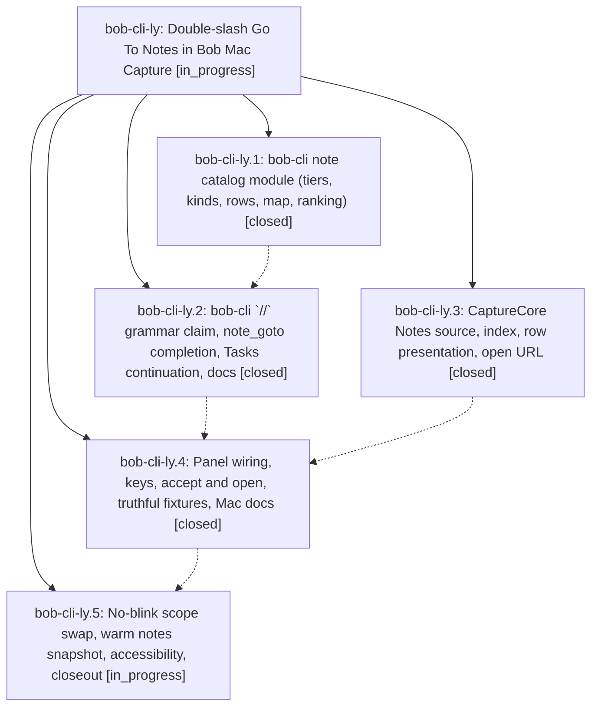

# Bead: bob-cli-ly — Double-slash Go To Notes in Bob Mac Capture

[Bead Pages](../README.md) / bob-cli-ly

**Status:** ◐ in_progress · **Type:** ▸ plan · **Tier:** epic
**Owner:** `bryanbugyi34@gmail.com` · **Created by:** [bbugyi200.athena.1cr](https://github.com/bobs-org/bob-cli--agents/blob/main/sessions/bbugyi200.athena.1cr.md) · **Assignee:** `bob-cli-ly.land`
**Created:** 2026-11-15 16:47:01 EST
**Plan:** [202611/note\_goto\_double\_slash.md](https://github.com/bobs-org/bob-cli--plans/blob/main/202611/note_goto_double_slash.md)

<!-- sase:links:start -->

## Links

| Relation | Artifact | Why |
| --- | --- | --- |
| implemented-by | [plan:202611/note_goto_double_slash.md][1] | derived from the plan's `bead_id:` frontmatter field |

_Plus 1 automatic references — see [Referenced By](#referenced-by)._

[1]: https://github.com/bobs-org/bob-cli--plans/blob/main/202611/note_goto_double_slash.md

<!-- sase:links:end -->

## Description

Typing a second real `/` after the `/` Go To trigger (or pasting a whole-draft `//query`) opens a Go To · Notes picker over the vault's living notes; picking a row opens that note in Obsidian without writing anything, while `\\` still types one literal backslash.

## Notes

[2026-11-15T21:55:49Z · bob-cli-ly.3] INTERFACE CHANGE: Reviewer decision bases=yes overrides the epic plan text excluding .base files. The shared note_goto contract needs kind=view rows, keyed by note_path, with a line-less Obsidian open URL.

[2026-11-16T05:50:28Z · bob-cli-lt.land] DISCOVERED ISSUE: bob-cli-lt.land docs-check failed tools/docs/tests/test_capture_token_coverage.py::test_every_capture_token_has_a_literal_query_at_its_heading with "'//<query>' at #double-slash-picker". Corroborated existing bob-cli-fo. bob-cli-lt made no capture-syntax edits; this is this epic's token row without a search_smoke.yml literal.

## Phases

| Bead | Title | Status | Size | Created | Agents | Commits |
|---|---|---|---|---|---:|---:|
| [bob-cli-ly.1](bob-cli-ly.1.md) | bob-cli note catalog module (tiers, kinds, rows, map, ranking) | ✓ closed | medium | 2026-11-15 | 1 | 1 |
| [bob-cli-ly.2](bob-cli-ly.2.md) | bob-cli \`//\` grammar claim, note\_goto completion, Tasks continuation, docs | ✓ closed | medium | 2026-11-15 | 1 | 1 |
| [bob-cli-ly.3](bob-cli-ly.3.md) | CaptureCore Notes source, index, row presentation, open URL | ✓ closed | medium | 2026-11-15 | 1 | 1 |
| [bob-cli-ly.4](bob-cli-ly.4.md) | Panel wiring, keys, accept and open, truthful fixtures, Mac docs | ✓ closed | medium | 2026-11-15 | 1 | 5 |
| [bob-cli-ly.5](bob-cli-ly.5.md) | No-blink scope swap, warm notes snapshot, accessibility, closeout | ◐ in_progress | medium | 2026-11-15 | 1 | 1 |

## Lineage

## Agents

| Agent | Bead | Commits |
|---|---|---:|
| [bbugyi200.athena.bob-cli-ly.1](https://github.com/bobs-org/bob-cli--agents/blob/main/agents/bbugyi200.athena.bob-cli-ly.1/README.md) | [bob-cli-ly.1](bob-cli-ly.1.md) | 1 |
| [bbugyi200.athena.bob-cli-ly.2](https://github.com/bobs-org/bob-cli--agents/blob/main/agents/bbugyi200.athena.bob-cli-ly.2/README.md) | [bob-cli-ly.2](bob-cli-ly.2.md) | 1 |
| [bbugyi200.athena.bob-cli-ly.3](https://github.com/bobs-org/bob-cli--agents/blob/main/sessions/bbugyi200.athena.bob-cli-ly.3.md) | [bob-cli-ly.3](bob-cli-ly.3.md) | 1 |
| [bbugyi200.athena.bob-cli-ly.4](https://github.com/bobs-org/bob-cli--agents/blob/main/sessions/bbugyi200.athena.bob-cli-ly.4.md) | [bob-cli-ly.4](bob-cli-ly.4.md) | 5 |
| [bbugyi200.athena.bob-cli-ly.5](https://github.com/bobs-org/bob-cli--agents/blob/main/agents/bbugyi200.athena.bob-cli-ly.5/README.md) | [bob-cli-ly.5](bob-cli-ly.5.md) | 1 |
| [bbugyi200.athena.bob-cli-ly.land](https://github.com/bobs-org/bob-cli--agents/blob/main/agents/bbugyi200.athena.bob-cli-ly.land/README.md) | [bob-cli-ly](README.md) | 0 |

## Commits

| Repo | Commit | Subject | Bead | Committed |
|---|---|---|---|---|
| bob-mac-capture | [`bob-mac-capture@19e4c40`](https://github.com/bobs-org/bob-mac-capture/commit/19e4c4048a0e7bfbdc69eeb356ddb497481dca99) | fix(capture): normalize relation equals aliases | [bob-cli-ly.3](bob-cli-ly.3.md) | 2026-11-15 19:27:29 EST |
| bob-cli | [`7729a96`](https://github.com/bobs-org/bob-cli/commit/7729a96220e57a517f749ad08903e1084679238c) | feat(native): add read-only note catalog scan and rank | [bob-cli-ly.1](bob-cli-ly.1.md) | 2026-11-15 20:09:26 EST |
| bob-cli | [`fc3d6eb`](https://github.com/bobs-org/bob-cli/commit/fc3d6eb47c9d85e7f5622196faf688016fa800f3) | feat(capture)!: claim whole-draft //query as Go To Notes | [bob-cli-ly.2](bob-cli-ly.2.md) | 2026-11-15 21:06:37 EST |
| bob-mac-capture | [`bob-mac-capture@5bc9478`](https://github.com/bobs-org/bob-mac-capture/commit/5bc9478f3322bbdcb4da52e72bcfba8e85b0e62f) | feat(capture): open notes from the // Go To Notes picker | [bob-cli-ly.4](bob-cli-ly.4.md) | 2026-11-15 22:33:52 EST |
| bob-mac-capture | [`bob-mac-capture@d12cd6c`](https://github.com/bobs-org/bob-mac-capture/commit/d12cd6c7d94d61d300e102257e065eb17d8ad646) | fix(capture): compile Notes picker macOS tests | [bob-cli-ly.4](bob-cli-ly.4.md) | 2026-11-15 23:29:36 EST |
| bob-mac-capture | [`bob-mac-capture@39ba0d0`](https://github.com/bobs-org/bob-mac-capture/commit/39ba0d0ea0304a2780f31c5da5c0e0bd094b5f3d) | fix(capture): correct Notes picker CI fixtures | [bob-cli-ly.4](bob-cli-ly.4.md) | 2026-11-15 23:58:25 EST |
| bob-mac-capture | [`bob-mac-capture@f24475e`](https://github.com/bobs-org/bob-mac-capture/commit/f24475e53185c8ca94534d6633ed35dc28ad1353) | fix(capture): add monthly Notes picker parse fixture | [bob-cli-ly.4](bob-cli-ly.4.md) | 2026-11-16 02:08:15 EST |
| bob-mac-capture | [`bob-mac-capture@1e0a344`](https://github.com/bobs-org/bob-mac-capture/commit/1e0a344e948b81e675dfcd6090aa4cd901721c01) | test(capture): synchronize separator replies and alias tip setup | [bob-cli-ly.4](bob-cli-ly.4.md) | 2026-11-16 06:55:13 EST |
| bob-mac-capture | [`bob-mac-capture@df08e6f`](https://github.com/bobs-org/bob-mac-capture/commit/df08e6f56fbed7c0a7c944bfa793c7ffdbe2f685) | feat(capture): keep Go To mounted across / and // with a warm notes snapshot | [bob-cli-ly.5](bob-cli-ly.5.md) | 2026-11-16 08:13:39 EST |

<!-- sase:referenced-by:start -->

## Referenced By

| Relation | Artifact | Why | Uses |
| --- | --- | --- | ---: |
| read-by | [agent:bob-cli-ly.1][1] | Need epic plan context | 1 |

[1]: https://github.com/bobs-org/bob-cli--agents/blob/main/agents/bbugyi200.athena.bob-cli-ly.1/README.md

<!-- sase:referenced-by:end -->
