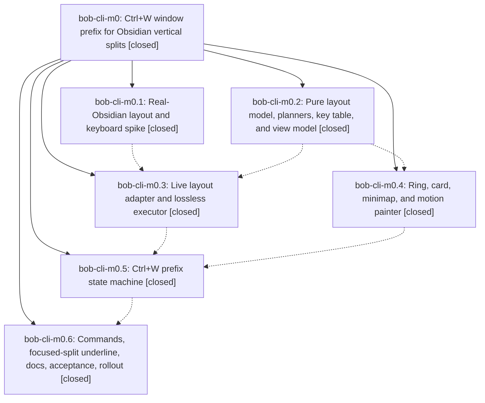

# Bead: bob-cli-m0 — Ctrl+W window prefix for Obsidian vertical splits

[Bead Pages](../README.md) / bob-cli-m0

**Status:** ✓ closed · **Resolution:** done · **Type:** ▸ plan · **Tier:** epic
**Owner:** `bryanbugyi34@gmail.com` · **Created by:** [bbugyi200.apollo.e9](https://github.com/bobs-org/bob-cli--agents/blob/main/sessions/bbugyi200.apollo.e9.md) · **Assignee:** `bob-cli-m0.land`
**Created:** 2026-11-15 20:01:48 EST · **Closed:** 2026-11-16 10:16:07 EST
**Plan:** [202611/obsidian\_ctrl\_w\_window\_prefix.md](https://github.com/bobs-org/bob-cli--plans/blob/main/202611/obsidian_ctrl_w_window_prefix.md)

<!-- sase:links:start -->

## Links

| Relation | Artifact | Why |
| --- | --- | --- |
| implemented-by | [plan:202611/obsidian_ctrl_w_window_prefix.md][1] | derived from the plan's `bead_id:` frontmatter field |

_Plus 7 automatic references — see [Referenced By](#referenced-by)._

[1]: https://github.com/bobs-org/bob-cli--plans/blob/main/202611/obsidian_ctrl_w_window_prefix.md

<!-- sase:links:end -->

## Description

In Bob's Obsidian, Ctrl+W followed by a key focuses, moves, and creates main-area splits from the keyboard. h/l focus the neighbouring split, H/L move the current tab into, out of, or across splits (creating and collapsing splits as needed) without losing its editor state, and a calm, theme-native hint shows exactly what each key will do.

## Notes

[2026-11-16T14:33:42Z · bob-cli-m0.land] LAND TRIAGE of child PROPOSED FOLLOW-UPs (bob-cli-m0.land): (1) m0.1#1/m0.2#1/m0.3#1/m0.4#1 block-marks e2e hardcoded-date guard -> duplicate of READY bob-cli-m8; reproduced on bob-plugins 0e16e30 and +1 recorded. (2) m0.1#1 perf budgets under full-suite load -> +1 on existing bob-cli-km (event-link-times), bob-cli-ki (keep-moving-marks-surface), bob-cli-ju (off-clock-link-chips), bob-cli-io (frees-marks). (3) m0.3#1 stage-ranker 16 ms -> +1 bob-cli-3w. (4) m0.2#1 task-wikilink timing -> +1 bob-cli-f8. (5) m0.2#1 reduced-motion Chromium timeout + m0.3#1 task-link motion fixture 90 s timeout -> +1 bob-cli-fz. (6) m0.4#1 Chromium PATH hard-fail in test-command-mode-sheet-sequence-dom -> DECLINED: on master the test skips without Chromium (verified: 1 skipped) and hard-fails only when CI is set, which is bob-cli-f1's intended CI contract, so this is an environment artifact, not a defect. (7) m0.6#2 stale spike/keyboard-unbound-capture probe -> DECLINED as a task: caused by this epic (m0.5 prefix consumes Ctrl+W at window capture), so it stays epic work in the landing tale. (8) m0.6#3 docs-check test_every_capture_token_has_a_literal_query_at_its_heading -> DECLINED: passes on bob-cli master 122c7fcf (2 passed), already fixed upstream. (9) m0.6#4 blocked vault deploy -> RESOLVED by the land agent: vault nav bundle was an abandoned dirty ws13 build (2.83.0 on 1a9e304); its 16 vault-only lines are the pre-refactor inline review-landing notice and settle-lock code that 4288af6 superseded, and styles.css matched byte for byte; per docs/develop/deployment.md (deployed bytes in no commit, clean commit carries their work), ran bob plugins sync -p bob-navigation-hotkeys -F from clean 0e16e30; vault now 2.83.1 clean, and a dry run reports all 31 plugins unchanged.

[2026-11-16T15:03:35Z · research.4y.cld] DISCOVERED ISSUE: Obsidian 1.15.1 WorkspaceTabs has no selectedTab (typeof undefined) and currentTab is a numeric index (selected leaf = group.children[group.currentTab]); verified by a real-Obsidian CDP probe on athena against nav 2.83.1 (bob-plugins 0e16e30). In 267-window-prefix-actions.js, windowPrefixSelectedLeaf's selectedTab and currentTab-as-leaf branches are dead (selection still resolves via the getMostRecentLeaf fallback), and executeWindowPrefixMove's targetSelectedLeaf = targetGroup?.selectedTab ?? null is always null, so a failed join's rollback never reselects the destination split's previously selected tab; the selectedTabIsMoved diagnostic is always false. Low impact (failure path only). Fix: read children[currentTab] with the getMostRecentLeaf fallback. Evidence and context: file:explicit:a509adf38b97c54a171251d2 (research:202611/obsidian_ctrl_w_tab_numbers__cld.md, section 'Side finding in the shipped executor').

[2026-11-16T15:16:07Z · bob-cli-m0.land] Land tale complete on athena (Obsidian 1.15.1, xvfb): spike 15/15 PASS, actions 18/18 PASS (12 decision vectors via runWindowPrefixPaletteKey + focus-sequence + lossless-L/H + reload-persists + reading-pdf-image-survive), prefix 17/17 PASS, visual 28/28 PASS. Reports: report-spike.json, report-actions.json, report-prefix.json, report-visual.json copied back from athena mktemp dir. Collapse hardening: executeWindowPrefixMove now decides collapse from live tree (sourceChain immediate parent + live parent) and explicitly collapses an emptied-but-attached split via parent.removeChild + recomputeChildrenDimensions + onLayoutChange, throwing to rollback on failure; unit tests cover non-auto-collapse last-tab join + middle-out (sourceCollapsed true, no empty group) and parent-remove throw (restored true). Ctrl+W re-arm: running-state Ctrl+W enqueues a post-action re-arm that re-collects arming context, clears defaultPrevented only for the consumed prefix event, and arms on allow; serialization test covers arm, gated l, Ctrl+W, l, gate release, both l run serially from fresh snapshots with scope popped. Spike probe keyboard-unbound-capture rewritten to shipped behavior (Ctrl+W arms, lastVerdict allowed defaultPrevented false, leaf count/text/Vim unchanged, Escape cancels). Model tests added for six columns, stacked overlap/tie-breaks, uneven widths, and full parity across fixtures. Nav bumped 2.83.1 to 2.83.2, npm run build + build:check green, window-prefix unit suites 70/70 green, docs:gen + inventory:check + docs:check green; npm test:unit 6890/6902 with 9 failures all reproduced on clean 0e16e30 (block-marks dates bob-cli-m8, 4 perf budgets km/ki/ju/io, relation-chips + bracket-indicator + highlights-hints x2 pre-existing). bob plugins sync -p bob-navigation-hotkeys deployed 2.83.2 (manifest + main.js) from dirty worktree; clean commit will carry identical bytes. Six phases already verified against commits a2550d6, 615aaea, 4678586, 1a9e304, c725370, 0e16e30 by land agent; no integration changes needed from bank, catalog-scroll, Ctrl+Enter-from-last-PRE, capture //, docs landings during epic (new bank setup card is Obsidian modal, prefix already refuses to arm over modals). Follow-up outcomes in land-triage note bob-cli-m0#1.

## Phases

| Bead | Title | Status | Size | Created | Agents | Commits |
|---|---|---|---|---|---:|---:|
| [bob-cli-m0.1](bob-cli-m0.1.md) | Real-Obsidian layout and keyboard spike | ✓ closed | medium | 2026-11-15 | 1 | 1 |
| [bob-cli-m0.2](bob-cli-m0.2.md) | Pure layout model, planners, key table, and view model | ✓ closed | medium | 2026-11-15 | 1 | 0 |
| [bob-cli-m0.3](bob-cli-m0.3.md) | Live layout adapter and lossless executor | ✓ closed | medium | 2026-11-15 | 1 | 1 |
| [bob-cli-m0.4](bob-cli-m0.4.md) | Ring, card, minimap, and motion painter | ✓ closed | medium | 2026-11-15 | 1 | 1 |
| [bob-cli-m0.5](bob-cli-m0.5.md) | Ctrl+W prefix state machine | ✓ closed | medium | 2026-11-15 | 1 | 1 |
| [bob-cli-m0.6](bob-cli-m0.6.md) | Commands, focused-split underline, docs, acceptance, rollout | ✓ closed | medium | 2026-11-15 | 1 | 1 |

## Lineage

## Agents

| Agent | Bead | Commits |
|---|---|---:|
| [bbugyi200.apollo.bob-cli-m0.1](https://github.com/bobs-org/bob-cli--agents/blob/main/agents/bbugyi200.apollo.bob-cli-m0.1/README.md) | [bob-cli-m0.1](bob-cli-m0.1.md) | 1 |
| [bbugyi200.apollo.bob-cli-m0.2](https://github.com/bobs-org/bob-cli--agents/blob/main/sessions/bbugyi200.apollo.bob-cli-m0.2.md) | [bob-cli-m0.2](bob-cli-m0.2.md) | 0 |
| [bbugyi200.apollo.bob-cli-m0.3](https://github.com/bobs-org/bob-cli--agents/blob/main/agents/bbugyi200.apollo.bob-cli-m0.3/README.md) | [bob-cli-m0.3](bob-cli-m0.3.md) | 1 |
| [bbugyi200.apollo.bob-cli-m0.4](https://github.com/bobs-org/bob-cli--agents/blob/main/sessions/bbugyi200.apollo.bob-cli-m0.4.md) | [bob-cli-m0.4](bob-cli-m0.4.md) | 1 |
| [bbugyi200.apollo.bob-cli-m0.5](https://github.com/bobs-org/bob-cli--agents/blob/main/agents/bbugyi200.apollo.bob-cli-m0.5/README.md) | [bob-cli-m0.5](bob-cli-m0.5.md) | 1 |
| [bbugyi200.apollo.bob-cli-m0.6](https://github.com/bobs-org/bob-cli--agents/blob/main/agents/bbugyi200.apollo.bob-cli-m0.6/README.md) | [bob-cli-m0.6](bob-cli-m0.6.md) | 1 |
| [bbugyi200.apollo.bob-cli-m0.land](https://github.com/bobs-org/bob-cli--agents/blob/main/sessions/bbugyi200.apollo.bob-cli-m0.land.md) | [bob-cli-m0](README.md) | 2 |

## Commits

| Repo | Commit | Subject | Bead | Committed |
|---|---|---|---|---|
| bob-plugins | [`bob-plugins@a2550d6`](https://github.com/bobs-org/bob-plugins/commit/a2550d69ef0cf0606dd4bd3647c7a43646d9e7f2) | feat(nav): add Ctrl+W window-prefix real-Obsidian spike e2e harness | [bob-cli-m0.1](bob-cli-m0.1.md) | 2026-11-15 21:05:21 EST |
| bob-plugins | [`bob-plugins@4678586`](https://github.com/bobs-org/bob-plugins/commit/4678586a48a18379888946803fd456361731c132) | feat(navigation-hotkeys): add lossless window prefix adapter | [bob-cli-m0.3](bob-cli-m0.3.md) | 2026-11-16 07:07:01 EST |
| bob-plugins | [`bob-plugins@1a9e304`](https://github.com/bobs-org/bob-plugins/commit/1a9e304d828b36c5735fcb42ccf14a43e894e8ea) | feat(navigation): paint Ctrl+W window-prefix hint | [bob-cli-m0.4](bob-cli-m0.4.md) | 2026-11-16 07:20:22 EST |
| bob-plugins | [`bob-plugins@c725370`](https://github.com/bobs-org/bob-plugins/commit/c72537068ac0601f42069cd8af3f53d928614ba8) | feat(navigation): add Ctrl+W prefix state machine | [bob-cli-m0.5](bob-cli-m0.5.md) | 2026-11-16 08:25:23 EST |
| bob-plugins | [`bob-plugins@0e16e30`](https://github.com/bobs-org/bob-plugins/commit/0e16e304142f94c70c78357f7bdfe4ded19d0db5) | feat(navigation): add Ctrl+W palette commands, focused-split underline, window-keys docs, and visual acceptance | [bob-cli-m0.6](bob-cli-m0.6.md) | 2026-11-16 09:12:12 EST |
| bob-plugins | [`bob-plugins@21ad362`](https://github.com/bobs-org/bob-plugins/commit/21ad3624b788da6d4ec175cb8d1f53cb3898ebc2) | feat(navigation): land Ctrl+W window prefix 2.83.2 with collapse hardening, re-arm, and actions e2e | [bob-cli-m0](README.md) | 2026-11-16 10:18:00 EST |
| bob-cli--plans | [`bob-cli--plans@58c8577`](https://github.com/bobs-org/bob-cli--plans/commit/58c85771cf189d32ab86e746f47f73e9e6a904fa) | chore(plans): mark Ctrl+W window prefix epic done | [bob-cli-m0](README.md) | 2026-11-16 10:18:55 EST |

<!-- sase:referenced-by:start -->

## Referenced By

| Relation | Artifact | Why | Uses |
| --- | --- | --- | ---: |
| read-by | [agent:bob-cli-m0.1][1] | epic scope | 1 |
| read-by | [agent:bob-cli-m0.6][2] | need epic context | 1 |
| read-by | [agent:research.4y.cdx][3] | Understand accepted Ctrl+W window-management design before proposing tab addressing | 1 |
| read-by | [agent:research.4y.cld][4] | Context for ctrl+w split-window keymaps research (ctrl+w N tab jump design) | 1 |
| read-by | [agent:research.4y.gem][5] | Inspect bob-cli-m0 epic bead for existing <ctrl+w> split window keymap context | 1 |
| read-by | [agent:research.4y.grk][6] | Need epic context for shipped Ctrl+W window prefix as base for tab-jump design | 1 |
| read-by | [agent:research.4y.mus][7] | research context for ctrl+w N tab jump design, need epic background on ctrl+w keymaps | 1 |

[1]: https://github.com/bobs-org/bob-cli--agents/blob/main/agents/bbugyi200.apollo.bob-cli-m0.1/README.md
[2]: https://github.com/bobs-org/bob-cli--agents/blob/main/agents/bbugyi200.apollo.bob-cli-m0.6/README.md
[3]: https://github.com/bobs-org/bob-cli--agents/blob/main/agents/bbugyi200.apollo.research.4y.cdx/README.md
[4]: https://github.com/bobs-org/bob-cli--agents/blob/main/agents/bbugyi200.apollo.research.4y.cld/README.md
[5]: https://github.com/bobs-org/bob-cli--agents/blob/main/agents/bbugyi200.apollo.research.4y.gem/README.md
[6]: https://github.com/bobs-org/bob-cli--agents/blob/main/agents/bbugyi200.apollo.research.4y.grk/README.md
[7]: https://github.com/bobs-org/bob-cli--agents/blob/main/agents/bbugyi200.apollo.research.4y.mus/README.md

<!-- sase:referenced-by:end -->
