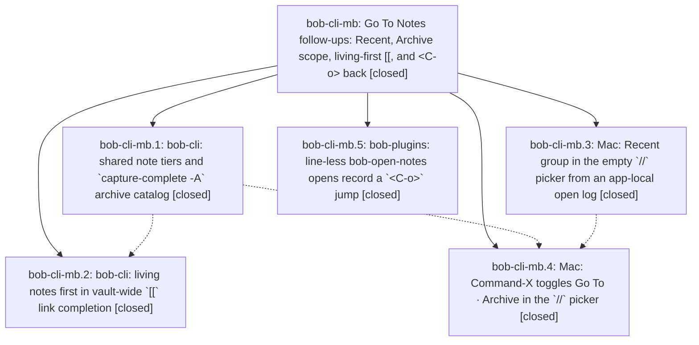

# Bead: bob-cli-mb — Go To Notes follow-ups: Recent, Archive scope, living-first \[\[, and \<C-o\> back

[Bead Pages](../README.md) / bob-cli-mb

**Status:** ✓ closed · **Resolution:** done · **Type:** ▸ plan · **Tier:** epic
**Owner:** `bryanbugyi34@gmail.com` · **Created by:** [bbugyi200.athena.1cs](https://github.com/bobs-org/bob-cli--agents/blob/main/sessions/bbugyi200.athena.1cs.md) · **Assignee:** `bob-cli-mb.land`
**Created:** 2026-11-16 10:14:21 EST · **Closed:** 2026-11-16 13:24:37 EST
**Plan:** [202611/note\_goto\_followups.md](https://github.com/bobs-org/bob-cli--plans/blob/main/202611/note_goto_followups.md)

<!-- sase:links:start -->

## Links

| Relation | Artifact | Why |
| --- | --- | --- |
| implemented-by | [plan:202611/note_goto_followups.md][1] | derived from the plan's `bead_id:` frontmatter field |

[1]: https://github.com/bobs-org/bob-cli--plans/blob/main/202611/note_goto_followups.md

<!-- sase:links:end -->

## Description

The `//` Go To Notes picker remembers what Bryan opened (a Recent group), reaches archived notes behind Command-X, lends its living-note tiers to `[[` link completion so machinery and zorg satellites stop crowding the 20 suggestion slots, and a line-less note open records a Vim jump so `<C-o>` returns to where Bryan was.

## Notes

[2026-11-16T18:00:33Z · bob-cli-mb.land] LANDER FOLLOW-UP TRIAGE: No child recorded a PROPOSED FOLLOW-UP. (1) bob-cli-mb.3 note #3 reported a flaky Mac test (CaptureDotRouteAliasTests.testFastDoubleDotBeforeReplyCollapsesToOne, run 43899389310 on 61d29a6f): semantic duplicate of bob-cli-ko, corroborated with sase bead +1 (now +2 independent reports); no new task. (2) bob-cli-mb.5 note #1 mentioned unnamed pre-existing bob-plugins perf/e2e flakes that also fail on the clean base tree: declined, no test names or reproduction to file and not caused by this epic.

[2026-11-16T18:02:22Z · bob-cli-mb.land] LANDER VERIFICATION: mb.1 (430162f5), mb.3 (bob-mac-capture 61d29a6f, CI 43899389310 green), mb.4 (bob-mac-capture 0f430144, exact-SHA CI green), and mb.5 (bob-plugins c68ff50, deployed) verified complete against the plan and link_tiers=demote. mb.2 (b73cf56f) has correct partition code but omitted the plan's capture-complete long-help sentence, docs/capture.md rule, docs-gen, and most required tests (lib/PDF sidecar, date query vs satellites, >20 truncation, empty query, resolution, record values). No post-start commits conflict or duplicate the feature; epic-symbols empty. Remaining work proposed as a landing tale that ends with this epic's closeout.

[2026-11-16T18:24:37Z · bob-cli-mb.land] Verified all five phases against plan:202611/note_goto_followups.md and the link_tiers=demote decision: mb.1 tiers + capture-complete -A (430162f5); mb.2 living-first [[ partition (b73cf56f), completed by the landing tale with the capture-complete help sentence, docs/capture.md living-first rule (same path tiers as //), docs-gen (docs/reference/cli/capture-complete.md), and partition tests covering library sidecars, daily-vs-satellite date queries, RESULT_LIMIT truncation of exact-stem archive on [[ / [[## / [[^^, empty-query Living/Archive/Hidden order, unchanged resolve_target plus target-scoped headings, matching_note_inserts living-first twins, and record-value stem dedup keeping the living note; mb.3 Recent group (bob-mac-capture 61d29a6f, CI run 43899389310 green); mb.4 Command-X Archive scope (bob-mac-capture 0f430144, exact-SHA CI green); mb.5 <C-o> jump on line-less opens (bob-plugins c68ff50, deployed). No post-start commits conflicted or duplicated the feature. Follow-ups: flake corroborated on bob-cli-ko; vague bob-plugins flake mention declined. just check and just docs-check passed; no epic-symbol entries.

## Phases

| Bead | Title | Status | Size | Created | Agents | Commits |
|---|---|---|---|---|---:|---:|
| [bob-cli-mb.1](bob-cli-mb.1.md) | bob-cli: shared note tiers and \`capture-complete -A\` archive catalog | ✓ closed | medium | 2026-11-16 | 1 | 1 |
| [bob-cli-mb.2](bob-cli-mb.2.md) | bob-cli: living notes first in vault-wide \`\[\[\` link completion | ✓ closed | small | 2026-11-16 | 1 | 1 |
| [bob-cli-mb.3](bob-cli-mb.3.md) | Mac: Recent group in the empty \`//\` picker from an app-local open log | ✓ closed | medium | 2026-11-16 | 1 | 1 |
| [bob-cli-mb.4](bob-cli-mb.4.md) | Mac: Command-X toggles Go To · Archive in the \`//\` picker | ✓ closed | medium | 2026-11-16 | 1 | 1 |
| [bob-cli-mb.5](bob-cli-mb.5.md) | bob-plugins: line-less bob-open-notes opens record a \`\<C-o\>\` jump | ✓ closed | small | 2026-11-16 | 1 | 1 |

## Lineage

## Agents

| Agent | Bead | Commits |
|---|---|---:|
| [bbugyi200.athena.bob-cli-mb.1](https://github.com/bobs-org/bob-cli--agents/blob/main/agents/bbugyi200.athena.bob-cli-mb.1/README.md) | [bob-cli-mb.1](bob-cli-mb.1.md) | 1 |
| [bbugyi200.athena.bob-cli-mb.2](https://github.com/bobs-org/bob-cli--agents/blob/main/sessions/bbugyi200.athena.bob-cli-mb.2.md) | [bob-cli-mb.2](bob-cli-mb.2.md) | 1 |
| [bbugyi200.athena.bob-cli-mb.3](https://github.com/bobs-org/bob-cli--agents/blob/main/sessions/bbugyi200.athena.bob-cli-mb.3.md) | [bob-cli-mb.3](bob-cli-mb.3.md) | 1 |
| [bbugyi200.athena.bob-cli-mb.4](https://github.com/bobs-org/bob-cli--agents/blob/main/sessions/bbugyi200.athena.bob-cli-mb.4.md) | [bob-cli-mb.4](bob-cli-mb.4.md) | 1 |
| [bbugyi200.athena.bob-cli-mb.5](https://github.com/bobs-org/bob-cli--agents/blob/main/agents/bbugyi200.athena.bob-cli-mb.5/README.md) | [bob-cli-mb.5](bob-cli-mb.5.md) | 1 |
| [bbugyi200.athena.bob-cli-mb.land](https://github.com/bobs-org/bob-cli--agents/blob/main/sessions/bbugyi200.athena.bob-cli-mb.land.md) | [bob-cli-mb](README.md) | 1 |

## Commits

| Repo | Commit | Subject | Bead | Committed |
|---|---|---|---|---|
| bob-plugins | [`bob-plugins@c68ff50`](https://github.com/bobs-org/bob-plugins/commit/c68ff50650eaa340eef610092644b3492a148179) | feat(navigation): record a jump on line-less bob-open-notes opens | [bob-cli-mb.5](bob-cli-mb.5.md) | 2026-11-16 10:41:20 EST |
| bob-mac-capture | [`bob-mac-capture@61d29a6`](https://github.com/bobs-org/bob-mac-capture/commit/61d29a6f3c1978ca78067e235ce98938344d8bf1) | feat(capture): show recently opened notes in the // empty state | [bob-cli-mb.3](bob-cli-mb.3.md) | 2026-11-16 10:43:01 EST |
| bob-cli | [`430162f`](https://github.com/bobs-org/bob-cli/commit/430162f5716f93cf64b846dde5572e745b4013f3) | feat(note-catalog): add archive tiers to note goto | [bob-cli-mb.1](bob-cli-mb.1.md) | 2026-11-16 11:07:58 EST |
| bob-cli | [`b73cf56`](https://github.com/bobs-org/bob-cli/commit/b73cf56f5fec9b4de6e95c9e326c6f6970e1d8f6) | feat(capture): prioritize living vault link suggestions | [bob-cli-mb.2](bob-cli-mb.2.md) | 2026-11-16 11:37:03 EST |
| bob-mac-capture | [`bob-mac-capture@0f43014`](https://github.com/bobs-org/bob-mac-capture/commit/0f43014477912ab037e30d66cbe4a651ef1296c1) | feat(capture): toggle a // archive scope with Command-X | [bob-cli-mb.4](bob-cli-mb.4.md) | 2026-11-16 12:23:46 EST |
| bob-cli | [`0510aaf`](https://github.com/bobs-org/bob-cli/commit/0510aaf0e997ca97c10919ec21214b362a1b8c12) | docs(capture): document living-first \[\[ suggestions and cover the tier partition | [bob-cli-mb](README.md) | 2026-11-16 13:26:16 EST |
