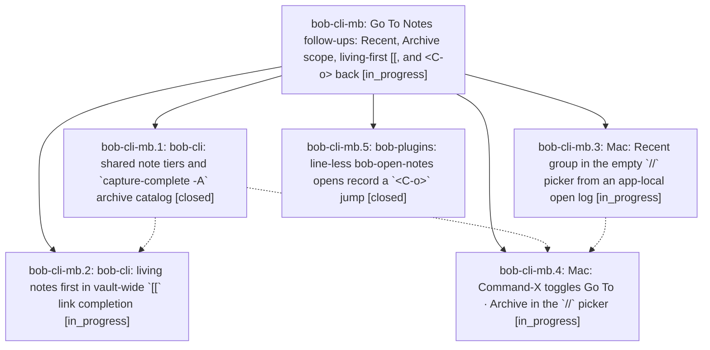

# Bead: bob-cli-mb — Go To Notes follow-ups: Recent, Archive scope, living-first \[\[, and \<C-o\> back

[Bead Pages](../README.md) / bob-cli-mb

**Status:** ◐ in_progress · **Type:** ▸ plan · **Tier:** epic
**Owner:** `bryanbugyi34@gmail.com` · **Created by:** [bbugyi200.athena.1cs](https://github.com/bobs-org/bob-cli--agents/blob/main/sessions/bbugyi200.athena.1cs.md) · **Assignee:** `bob-cli-mb.land`
**Created:** 2026-11-16 10:14:21 EST
**Plan:** [202611/note\_goto\_followups.md](https://github.com/bobs-org/bob-cli--plans/blob/main/202611/note_goto_followups.md)

<!-- sase:links:start -->

## Links

| Relation | Artifact | Why |
| --- | --- | --- |
| implemented-by | [plan:202611/note_goto_followups.md][1] | derived from the plan's `bead_id:` frontmatter field |

[1]: https://github.com/bobs-org/bob-cli--plans/blob/main/202611/note_goto_followups.md

<!-- sase:links:end -->

## Description

The `//` Go To Notes picker remembers what Bryan opened (a Recent group), reaches archived notes behind Command-X, lends its living-note tiers to `[[` link completion so machinery and zorg satellites stop crowding the 20 suggestion slots, and a line-less note open records a Vim jump so `<C-o>` returns to where Bryan was.

## Phases

| Bead | Title | Status | Size | Created | Agents | Commits |
|---|---|---|---|---|---:|---:|
| [bob-cli-mb.1](bob-cli-mb.1.md) | bob-cli: shared note tiers and \`capture-complete -A\` archive catalog | ✓ closed | medium | 2026-11-16 | 1 | 1 |
| [bob-cli-mb.2](bob-cli-mb.2.md) | bob-cli: living notes first in vault-wide \`\[\[\` link completion | ◐ in_progress | small | 2026-11-16 | 1 | 0 |
| [bob-cli-mb.3](bob-cli-mb.3.md) | Mac: Recent group in the empty \`//\` picker from an app-local open log | ◐ in_progress | medium | 2026-11-16 | 1 | 0 |
| [bob-cli-mb.4](bob-cli-mb.4.md) | Mac: Command-X toggles Go To · Archive in the \`//\` picker | ◐ in_progress | medium | 2026-11-16 | 1 | 0 |
| [bob-cli-mb.5](bob-cli-mb.5.md) | bob-plugins: line-less bob-open-notes opens record a \`\<C-o\>\` jump | ✓ closed | small | 2026-11-16 | 1 | 0 |

## Lineage

## Agents

| Agent | Bead | Commits |
|---|---|---:|
| [bbugyi200.athena.bob-cli-mb.1](https://github.com/bobs-org/bob-cli--agents/blob/main/agents/bbugyi200.athena.bob-cli-mb.1/README.md) | [bob-cli-mb.1](bob-cli-mb.1.md) | 1 |
| [bbugyi200.athena.bob-cli-mb.2](https://github.com/bobs-org/bob-cli--agents/blob/main/agents/bbugyi200.athena.bob-cli-mb.2/README.md) | [bob-cli-mb.2](bob-cli-mb.2.md) | 0 |
| [bbugyi200.athena.bob-cli-mb.3](https://github.com/bobs-org/bob-cli--agents/blob/main/sessions/bbugyi200.athena.bob-cli-mb.3.md) | [bob-cli-mb.3](bob-cli-mb.3.md) | 0 |
| [bbugyi200.athena.bob-cli-mb.4](https://github.com/bobs-org/bob-cli--agents/blob/main/agents/bbugyi200.athena.bob-cli-mb.4/README.md) | [bob-cli-mb.4](bob-cli-mb.4.md) | 0 |
| [bbugyi200.athena.bob-cli-mb.5](https://github.com/bobs-org/bob-cli--agents/blob/main/agents/bbugyi200.athena.bob-cli-mb.5/README.md) | [bob-cli-mb.5](bob-cli-mb.5.md) | 0 |
| [bbugyi200.athena.bob-cli-mb.land](https://github.com/bobs-org/bob-cli--agents/blob/main/agents/bbugyi200.athena.bob-cli-mb.land/README.md) | [bob-cli-mb](README.md) | 0 |

## Commits

| Repo | Commit | Subject | Bead | Committed |
|---|---|---|---|---|
| bob-cli | [`430162f`](https://github.com/bobs-org/bob-cli/commit/430162f5716f93cf64b846dde5572e745b4013f3) | feat(note-catalog): add archive tiers to note goto | [bob-cli-mb.1](bob-cli-mb.1.md) | 2026-11-16 11:07:58 EST |
