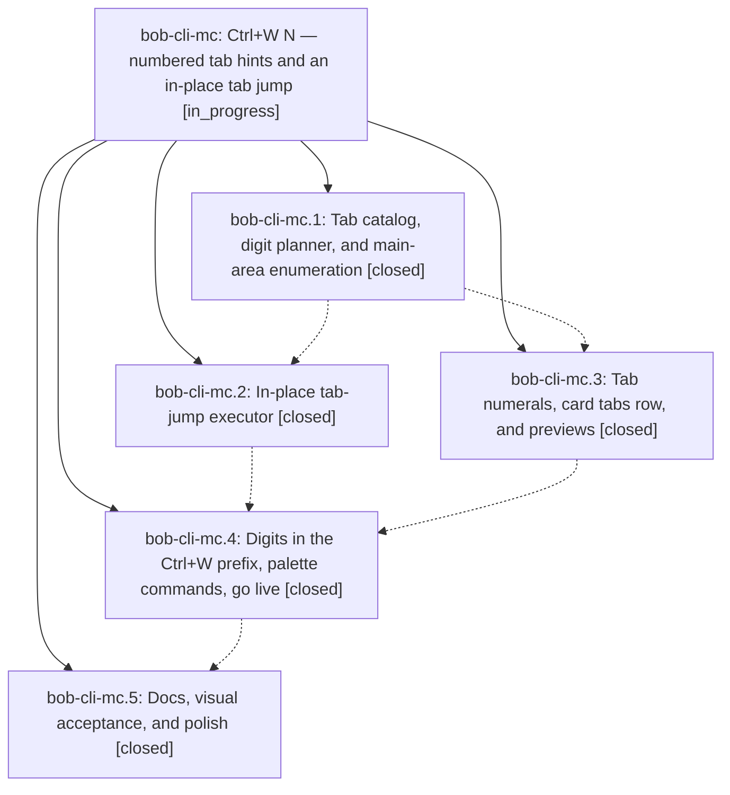

# Bead: bob-cli-mc — Ctrl+W N — numbered tab hints and an in-place tab jump

[Bead Pages](../README.md) / bob-cli-mc

**Status:** ◐ in_progress · **Type:** ▸ plan · **Tier:** epic
**Owner:** `bryanbugyi34@gmail.com` · **Created by:** [bbugyi200.apollo.research.4y.linker.w0](https://github.com/bobs-org/bob-cli--agents/blob/main/sessions/bbugyi200.apollo.research.4y.linker.w0.md) · **Assignee:** `bob-cli-mc.land`
**Created:** 2026-11-16 11:01:02 EST
**Plan:** [202611/obsidian\_ctrl\_w\_numbered\_tab\_jump.md](https://github.com/bobs-org/bob-cli--plans/blob/main/202611/obsidian_ctrl_w_numbered_tab_jump.md)

<!-- sase:links:start -->

## Links

| Relation | Artifact | Why |
| --- | --- | --- |
| implemented-by | [plan:202611/obsidian_ctrl_w_numbered_tab_jump.md][1] | derived from the plan's `bead_id:` frontmatter field |

_Plus 4 automatic references — see [Referenced By](#referenced-by)._

[1]: https://github.com/bobs-org/bob-cli--plans/blob/main/202611/obsidian_ctrl_w_numbered_tab_jump.md

<!-- sase:links:end -->

## Description

In Bob's Obsidian, every main-area tab carries a quiet numeral (1–9, in reading order across splits) beside its title, and Ctrl+W followed by that digit focuses exactly that tab where it lives — selected inside its own split, never moved, cloned, or reopened — while the numerals brighten into accent key caps when the Ctrl+W card appears and the destination numeral flashes once to confirm the jump.

## Phases

| Bead | Title | Status | Size | Created | Agents | Commits |
|---|---|---|---|---|---:|---:|
| [bob-cli-mc.1](bob-cli-mc.1.md) | Tab catalog, digit planner, and main-area enumeration | ✓ closed | medium | 2026-11-16 | 1 | 1 |
| [bob-cli-mc.2](bob-cli-mc.2.md) | In-place tab-jump executor | ✓ closed | medium | 2026-11-16 | 1 | 1 |
| [bob-cli-mc.3](bob-cli-mc.3.md) | Tab numerals, card tabs row, and previews | ✓ closed | medium | 2026-11-16 | 1 | 1 |
| [bob-cli-mc.4](bob-cli-mc.4.md) | Digits in the Ctrl+W prefix, palette commands, go live | ✓ closed | medium | 2026-11-16 | 1 | 1 |
| [bob-cli-mc.5](bob-cli-mc.5.md) | Docs, visual acceptance, and polish | ✓ closed | medium | 2026-11-16 | 1 | 1 |

## Lineage

## Agents

| Agent | Bead | Commits |
|---|---|---:|
| [bbugyi200.apollo.bob-cli-mc.1](https://github.com/bobs-org/bob-cli--agents/blob/main/agents/bbugyi200.apollo.bob-cli-mc.1/README.md) | [bob-cli-mc.1](bob-cli-mc.1.md) | 1 |
| [bbugyi200.apollo.bob-cli-mc.2](https://github.com/bobs-org/bob-cli--agents/blob/main/agents/bbugyi200.apollo.bob-cli-mc.2/README.md) | [bob-cli-mc.2](bob-cli-mc.2.md) | 1 |
| [bbugyi200.apollo.bob-cli-mc.3](https://github.com/bobs-org/bob-cli--agents/blob/main/agents/bbugyi200.apollo.bob-cli-mc.3/README.md) | [bob-cli-mc.3](bob-cli-mc.3.md) | 1 |
| [bbugyi200.apollo.bob-cli-mc.4](https://github.com/bobs-org/bob-cli--agents/blob/main/agents/bbugyi200.apollo.bob-cli-mc.4/README.md) | [bob-cli-mc.4](bob-cli-mc.4.md) | 1 |
| [bbugyi200.apollo.bob-cli-mc.5](https://github.com/bobs-org/bob-cli--agents/blob/main/sessions/bbugyi200.apollo.bob-cli-mc.5.md) | [bob-cli-mc.5](bob-cli-mc.5.md) | 1 |
| [bbugyi200.apollo.bob-cli-mc.land](https://github.com/bobs-org/bob-cli--agents/blob/main/agents/bbugyi200.apollo.bob-cli-mc.land/README.md) | [bob-cli-mc](README.md) | 0 |

## Commits

| Repo | Commit | Subject | Bead | Committed |
|---|---|---|---|---|
| bob-plugins | [`bob-plugins@2e15ec3`](https://github.com/bobs-org/bob-plugins/commit/2e15ec3d1b0a6c16f46e83d336676780193fcd7a) | feat(navigation): add numbered tab catalog model | [bob-cli-mc.1](bob-cli-mc.1.md) | 2026-11-16 11:32:38 EST |
| bob-plugins | [`bob-plugins@b61b55c`](https://github.com/bobs-org/bob-plugins/commit/b61b55cc6b7e7fd321398b5f5a4930278183fa85) | feat(navigation): add in-place tab-jump executor | [bob-cli-mc.2](bob-cli-mc.2.md) | 2026-11-16 12:02:05 EST |
| bob-plugins | [`bob-plugins@6b5a7b3`](https://github.com/bobs-org/bob-plugins/commit/6b5a7b3b5793120b44d76dfec6389cf8282e1ed2) | feat(navigation): paint dormant tab numerals, card tabs row, and previews | [bob-cli-mc.3](bob-cli-mc.3.md) | 2026-11-16 12:19:15 EST |
| bob-plugins | [`bob-plugins@91e9097`](https://github.com/bobs-org/bob-plugins/commit/91e909791a86fa30bba0b8b11c712e03a80e4dd4) | feat(navigation): ship Ctrl+W numbered tab jump 2.85.0 | [bob-cli-mc.4](bob-cli-mc.4.md) | 2026-11-16 13:04:58 EST |
| bob-plugins | [`bob-plugins@cf25d60`](https://github.com/bobs-org/bob-plugins/commit/cf25d6027c57f3d68065c79de245f99afd751129) | feat(navigation): add numbered tab focus hints | [bob-cli-mc.5](bob-cli-mc.5.md) | 2026-11-16 14:06:52 EST |

<!-- sase:referenced-by:start -->

## Referenced By

| Relation | Artifact | Why | Uses |
| --- | --- | --- | ---: |
| read-by | [agent:bob-cli-mc.1][1] | Need the parent epic's final decisions before implementation | 1 |
| read-by | [agent:bob-cli-mc.2][2] | Need epic DECISIONS before closing the actions phase | 2 |
| read-by | [agent:bob-cli-mc.3][3] | Need epic full description DECISIONS plan link | 2 |
| read-by | [agent:bob-cli-mc.4][4] | Need epic DECISIONS that the prefix phase must honor | 2 |

[1]: https://github.com/bobs-org/bob-cli--agents/blob/main/agents/bbugyi200.apollo.bob-cli-mc.1/README.md
[2]: https://github.com/bobs-org/bob-cli--agents/blob/main/agents/bbugyi200.apollo.bob-cli-mc.2/README.md
[3]: https://github.com/bobs-org/bob-cli--agents/blob/main/agents/bbugyi200.apollo.bob-cli-mc.3/README.md
[4]: https://github.com/bobs-org/bob-cli--agents/blob/main/agents/bbugyi200.apollo.bob-cli-mc.4/README.md

<!-- sase:referenced-by:end -->
