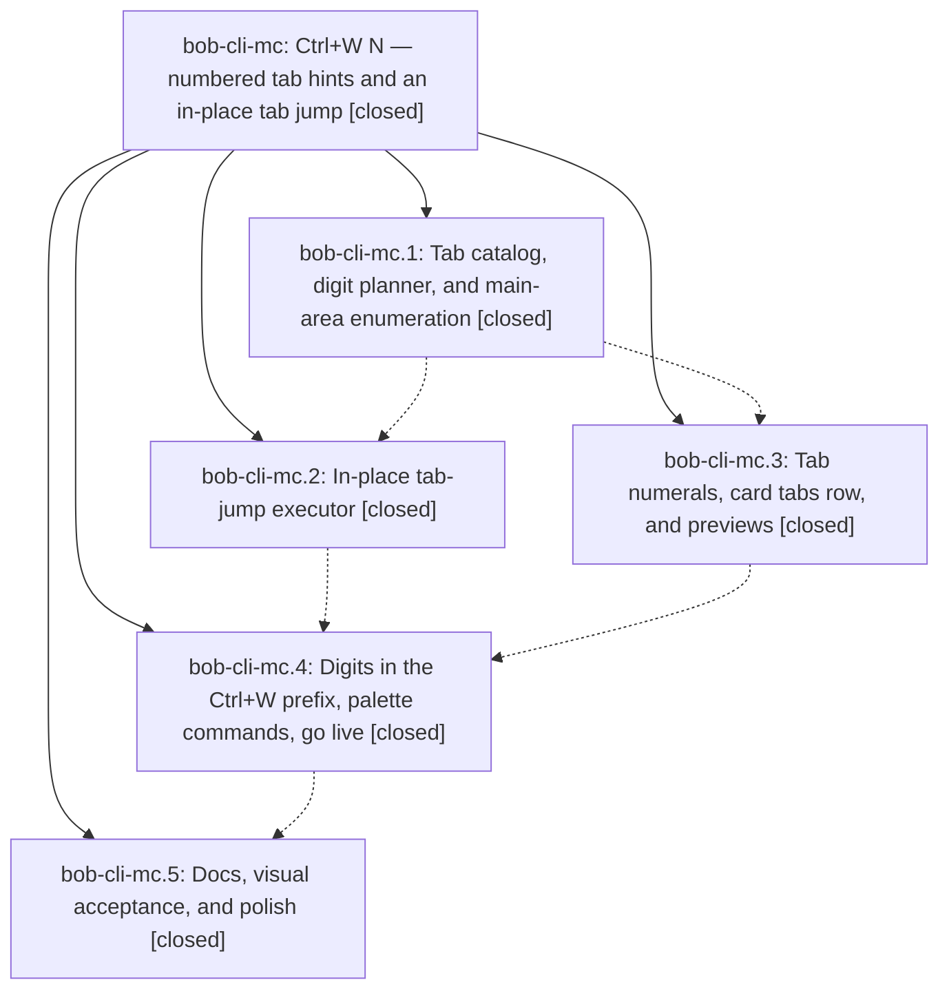

# Bead: bob-cli-mc — Ctrl+W N — numbered tab hints and an in-place tab jump

[Bead Pages](../README.md) / bob-cli-mc

**Status:** ✓ closed · **Resolution:** done · **Type:** ▸ plan · **Tier:** epic
**Owner:** `bryanbugyi34@gmail.com` · **Created by:** [bbugyi200.apollo.research.4y.linker.w0](https://github.com/bobs-org/bob-cli--agents/blob/main/sessions/bbugyi200.apollo.research.4y.linker.w0.md) · **Assignee:** `bob-cli-mc.land`
**Created:** 2026-11-16 11:01:02 EST · **Closed:** 2026-11-16 14:55:37 EST
**Plan:** [202611/obsidian\_ctrl\_w\_numbered\_tab\_jump.md](https://github.com/bobs-org/bob-cli--plans/blob/main/202611/obsidian_ctrl_w_numbered_tab_jump.md)

<!-- sase:links:start -->

## Links

| Relation | Artifact | Why |
| --- | --- | --- |
| implemented-by | [plan:202611/obsidian_ctrl_w_numbered_tab_jump.md][1] | derived from the plan's `bead_id:` frontmatter field |

_Plus 5 automatic references — see [Referenced By](#referenced-by)._

[1]: https://github.com/bobs-org/bob-cli--plans/blob/main/202611/obsidian_ctrl_w_numbered_tab_jump.md

<!-- sase:links:end -->

## Description

In Bob's Obsidian, every main-area tab carries a quiet numeral (1–9, in reading order across splits) beside its title, and Ctrl+W followed by that digit focuses exactly that tab where it lives — selected inside its own split, never moved, cloned, or reopened — while the numerals brighten into accent key caps when the Ctrl+W card appears and the destination numeral flashes once to confirm the jump.

## Notes

[2026-11-16T19:55:19Z · bob-cli-mc.land] LAND TRIAGE of child PROPOSED FOLLOW-UPs (bob-cli-mc.land): (1) mc.1#1 / mc.3#1 pre-existing npm test reds -> perf budgets: +1 on bob-cli-km (event-link-times), bob-cli-io (frees-marks), bob-cli-ki (keep-moving-marks-surface), bob-cli-ju (off-clock-link-chips), bob-cli-3w (stage ranker; passed in isolation), bob-cli-fz (task-link-marks reduced-motion Chromium 90 s timeout); block-marks date guard -> +1 bob-cli-m8; bracket-mode-indicator mobile test + highlights-hints x2 -> NEW bob-cli-me (bisected: pass 30/30 at c725370^, fail from c725370, bob-cli-m0.5's module-level `const Platform = obsidian.Platform` shadows the tests' globalThis.Platform; not caused by bob-cli-mc). (2) mc.2#2 thirteen-clip -> RESOLVED as epic work, no task: the e2e case was an already-here no-op (WP-I* focused, jump 9), so it never exercised the jump; corrected to start on WP-A and added strip metrics. Athena run: Obsidian 1.15.1's .workspace-tab-header-container-inner is `overflow-x: clip`, so neither scrollIntoView nor scrollLeft can reveal a clipped header (before == after under the artificial 280 px clip), and at natural width (680 px split, 13 tabs) tab 9 is fully visible. The executor's scrollIntoView could only scroll a workspace ancestor (the bug class bob-ledger-tools' workspace scroll guard undoes), so it was removed; the e2e now fails if tab 9 is clipped at natural width. Inner-container scrollLeft proposal DECLINED for the same reason. (3) mc.5#1 block-marks guard -> +1 bob-cli-m8 (same as 1). (4) Discovered while landing, not caused by this epic: d0726f6 (non-epic walker-footer w dot / tier hues) left 5 deterministic reds (walkMode v4 pins in bracket-repeat x3 + period-links, priority-notice hex guard over new attention-tier fallbacks) -> NEW bob-cli-md.

[2026-11-16T19:55:37Z · bob-cli-mc.land] VERIFIED: read all 5 phases and every note, the epic's 5 bob-plugins commits (2e15ec3, b61b55c, 6b5a7b3, 91e9097, cf25d60) and the shipped fragments (266a catalog/digit/verdict, 267a executor, 687a digit glue, 688 Jump to tab 1-9, 689 stamper, 473 card, styles). Decision contract, plan shape, digit normalization, armed-catalog stale refusal, arm-generation isCurrent, lit-with-card / flash / flash-hold, aria-description, dormant seams flipped with the 2.85.0 minor bump, docs (window-keys Numbered tabs, Linux, palette, Scope) all honored. LAND FIXES (nav 2.85.2): (a) the card's "numbers hidden" aside was never wired in production (view model never set tabs.numbersHidden; the unit test only asserted tabs.total) -> 689 windowTabNumbersHeadersHidden + 687a decorateWindowPrefixTabsModel, hooked in showWindowPrefixCardNow, with real assertions; (b) removed the executor's ancestor-scrolling scrollIntoView after athena proved the tab strip is overflow-x: clip and tab 9 is visible at natural width; corrected the thirteen-clip e2e (it was an already-here no-op) and made it enforce natural visibility. CHECKS: build:check, docs:inventory:check, validate-manifests, window suites 170/170, docs:check with BOB_CLI_DIR passed; athena xvfb /snap/bin/obsidian --only tabs 31/31, prefix 17/17, actions 18/18; full npm test 14 fails, all pre-existing or non-epic and triaged (see LAND TRIAGE note). INTEGRATION: only non-epic bob-plugins commit since start is d0726f6 (walker footer, walkMode v5), no overlap with the window prefix; its 5 test regressions filed as bob-cli-md. bob-cli commits since start (note goto archive tiers, living-first [[ suggestions, docs) do not touch window keys; bob-cli's generated plugin docs mirror already reflects 2.85.2. bob plugins sync deployed nav 2.85.2. No --epic-symbol entries. FOLLOW-UPS: new bob-cli-md, bob-cli-me; +1 bob-cli-km/io/ki/ju/3w/fz/m8; mc.2 clip proposal resolved in-epic, scrollLeft variant declined.

## Phases

| Bead | Title | Status | Size | Created | Agents | Commits |
|---|---|---|---|---|---:|---:|
| [bob-cli-mc.1](bob-cli-mc.1.md) | Tab catalog, digit planner, and main-area enumeration | ✓ closed | medium | 2026-11-16 | 1 | 1 |
| [bob-cli-mc.2](bob-cli-mc.2.md) | In-place tab-jump executor | ✓ closed | medium | 2026-11-16 | 1 | 1 |
| [bob-cli-mc.3](bob-cli-mc.3.md) | Tab numerals, card tabs row, and previews | ✓ closed | medium | 2026-11-16 | 1 | 1 |
| [bob-cli-mc.4](bob-cli-mc.4.md) | Digits in the Ctrl+W prefix, palette commands, go live | ✓ closed | medium | 2026-11-16 | 1 | 1 |
| [bob-cli-mc.5](bob-cli-mc.5.md) | Docs, visual acceptance, and polish | ✓ closed | medium | 2026-11-16 | 1 | 1 |

## Lineage

## Agents

| Agent | Bead | Commits |
|---|---|---:|
| [bbugyi200.apollo.bob-cli-mc.1](https://github.com/bobs-org/bob-cli--agents/blob/main/agents/bbugyi200.apollo.bob-cli-mc.1/README.md) | [bob-cli-mc.1](bob-cli-mc.1.md) | 1 |
| [bbugyi200.apollo.bob-cli-mc.2](https://github.com/bobs-org/bob-cli--agents/blob/main/agents/bbugyi200.apollo.bob-cli-mc.2/README.md) | [bob-cli-mc.2](bob-cli-mc.2.md) | 1 |
| [bbugyi200.apollo.bob-cli-mc.3](https://github.com/bobs-org/bob-cli--agents/blob/main/agents/bbugyi200.apollo.bob-cli-mc.3/README.md) | [bob-cli-mc.3](bob-cli-mc.3.md) | 1 |
| [bbugyi200.apollo.bob-cli-mc.4](https://github.com/bobs-org/bob-cli--agents/blob/main/agents/bbugyi200.apollo.bob-cli-mc.4/README.md) | [bob-cli-mc.4](bob-cli-mc.4.md) | 1 |
| [bbugyi200.apollo.bob-cli-mc.5](https://github.com/bobs-org/bob-cli--agents/blob/main/sessions/bbugyi200.apollo.bob-cli-mc.5.md) | [bob-cli-mc.5](bob-cli-mc.5.md) | 1 |
| [bbugyi200.apollo.bob-cli-mc.land](https://github.com/bobs-org/bob-cli--agents/blob/main/agents/bbugyi200.apollo.bob-cli-mc.land/README.md) | [bob-cli-mc](README.md) | 2 |

## Commits

| Repo | Commit | Subject | Bead | Committed |
|---|---|---|---|---|
| bob-plugins | [`bob-plugins@2e15ec3`](https://github.com/bobs-org/bob-plugins/commit/2e15ec3d1b0a6c16f46e83d336676780193fcd7a) | feat(navigation): add numbered tab catalog model | [bob-cli-mc.1](bob-cli-mc.1.md) | 2026-11-16 11:32:38 EST |
| bob-plugins | [`bob-plugins@b61b55c`](https://github.com/bobs-org/bob-plugins/commit/b61b55cc6b7e7fd321398b5f5a4930278183fa85) | feat(navigation): add in-place tab-jump executor | [bob-cli-mc.2](bob-cli-mc.2.md) | 2026-11-16 12:02:05 EST |
| bob-plugins | [`bob-plugins@6b5a7b3`](https://github.com/bobs-org/bob-plugins/commit/6b5a7b3b5793120b44d76dfec6389cf8282e1ed2) | feat(navigation): paint dormant tab numerals, card tabs row, and previews | [bob-cli-mc.3](bob-cli-mc.3.md) | 2026-11-16 12:19:15 EST |
| bob-plugins | [`bob-plugins@91e9097`](https://github.com/bobs-org/bob-plugins/commit/91e909791a86fa30bba0b8b11c712e03a80e4dd4) | feat(navigation): ship Ctrl+W numbered tab jump 2.85.0 | [bob-cli-mc.4](bob-cli-mc.4.md) | 2026-11-16 13:04:58 EST |
| bob-plugins | [`bob-plugins@cf25d60`](https://github.com/bobs-org/bob-plugins/commit/cf25d6027c57f3d68065c79de245f99afd751129) | feat(navigation): add numbered tab focus hints | [bob-cli-mc.5](bob-cli-mc.5.md) | 2026-11-16 14:06:52 EST |
| bob-plugins | [`bob-plugins@2e87723`](https://github.com/bobs-org/bob-plugins/commit/2e87723b13ffb5596e4e106becdfb0c73e31164c) | fix(navigation): land Ctrl+W numbered tab jump 2.85.2 with numbers-hidden card seam and no header scrolling | [bob-cli-mc](README.md) | 2026-11-16 14:56:35 EST |
| bob-cli--plans | [`bob-cli--plans@ff7a16d`](https://github.com/bobs-org/bob-cli--plans/commit/ff7a16d55b822280caa6139a57961880545318d2) | chore(plans): mark obsidian\_ctrl\_w\_numbered\_tab\_jump done after bob-cli-mc landing | [bob-cli-mc](README.md) | 2026-11-16 14:57:06 EST |

<!-- sase:referenced-by:start -->

## Referenced By

| Relation | Artifact | Why | Uses |
| --- | --- | --- | ---: |
| read-by | [agent:bob-cli-mc.1][1] | Need the parent epic's final decisions before implementation | 1 |
| read-by | [agent:bob-cli-mc.2][2] | Need epic DECISIONS before closing the actions phase | 2 |
| read-by | [agent:bob-cli-mc.3][3] | Need epic full description DECISIONS plan link | 2 |
| read-by | [agent:bob-cli-mc.4][4] | Need epic DECISIONS that the prefix phase must honor | 2 |
| read-by | [agent:bob-cli-mc.5--2][5] | Verify parent epic remains open after phase closure | 1 |

[1]: https://github.com/bobs-org/bob-cli--agents/blob/main/agents/bbugyi200.apollo.bob-cli-mc.1/README.md
[2]: https://github.com/bobs-org/bob-cli--agents/blob/main/agents/bbugyi200.apollo.bob-cli-mc.2/README.md
[3]: https://github.com/bobs-org/bob-cli--agents/blob/main/agents/bbugyi200.apollo.bob-cli-mc.3/README.md
[4]: https://github.com/bobs-org/bob-cli--agents/blob/main/agents/bbugyi200.apollo.bob-cli-mc.4/README.md
[5]: https://github.com/bobs-org/bob-cli--agents/blob/main/sessions/bbugyi200.apollo.bob-cli-mc.5.md

<!-- sase:referenced-by:end -->
