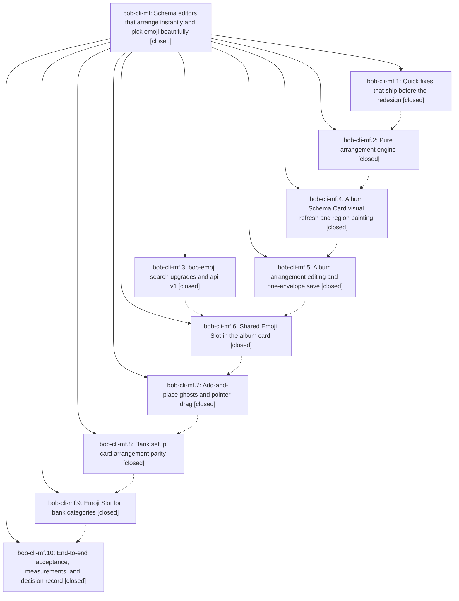

# Bead: bob-cli-mf — Schema editors that arrange instantly and pick emoji beautifully

[Bead Pages](../README.md) / bob-cli-mf

**Status:** ✓ closed · **Resolution:** done · **Type:** ▸ plan · **Tier:** epic
**Owner:** `bryanbugyi34@gmail.com` · **Created by:** [bbugyi200.apollo.research.51.linker.w0](https://github.com/bobs-org/bob-cli--agents/blob/main/sessions/bbugyi200.apollo.research.51.linker.w0.md) · **Assignee:** `bob-cli-mf.land`
**Created:** 2026-11-16 15:38:38 EST · **Closed:** 2026-11-17 05:01:56 EST
**Plan:** [202611/schema\_editor\_arrange\_and\_emoji.md](https://github.com/bobs-org/bob-cli--plans/blob/main/202611/schema_editor_arrange_and_emoji.md)

<!-- sase:links:start -->

## Links

| Relation | Artifact | Why |
| --- | --- | --- |
| implemented-by | [plan:202611/schema_editor_arrange_and_emoji.md][1] | derived from the plan's `bead_id:` frontmatter field |

_Plus 1 automatic references — see [Referenced By](#referenced-by)._

[1]: https://github.com/bobs-org/bob-cli--plans/blob/main/202611/schema_editor_arrange_and_emoji.md

<!-- sase:links:end -->

## Description

The album Schema Card and the Bank setup card move fields, choices, categories, groups, and rules any distance with an instant local preview, then save the whole arrangement as one guarded bob transaction with one commit and one Undo. Every emoji prompt is a searchable Emoji Slot. Both cards use a calmer, contextual layout. Bob stays the only writer, and nothing is saved without a successful preview of the exact envelope.

## Notes

[2026-11-17T01:58:36Z · bob-cli-mj.land] DISCOVERED ISSUE: bob-plugins master b5491d3 full npm test still reds on test-ledger-tools-bank-setup.cjs: not ok 'Setup card model preserves Category-card order and maps category gestures to guarded ops' and 'Setup card selects by key, protects focused typing, and stages shared New category input'. This matches bob-cli-mf.4's PROPOSED FOLLOW-UP (category.set label '☕ Cafe' vs 'Cafe' after e35afc1). Reproduced by bob-cli-mj.land; bob-cli-mj.2 and bob-cli-mj.4 proposed the same follow-up. Not caused by the video epic bob-cli-mj.

[2026-11-17T10:01:56Z · bob-cli-mf.land] LANDED by bob-cli-mf.land.

VERIFY: Read the epic, its plan, all 10 phases, and every note. Checked the epic's bob-plugins commits (e35afc1, daceef0, afbb325, 3136865, 866bb77, 86ddb9f, 1ff96bd, 3c69a57, d898d01, 9babe42, 9ae8142) against the plan and decisions:
- quiet_once Enter latch with loud second Enter (album and bank).
- CLDR keywords vendored (bob-emoji 0.2.0, frozen api v1).
- bank_cross_group=no: category moves clamp at the group edge with "⏎ edit to change group".
- decision_record=no: no memory edited.
- Also present: Emoji Slot with fallback and digit-keycap note, region painting, close-during-save Notice with undo seed, stale rebase-preview, timing rings, and the "bob disagrees" order check.
- Every hand-edited fragment is ≤1000 lines. build:check is clean.
- 22 focused suites: 226 pass, 2 skip, 0 fail.
- The epic note's bank-setup reds (category.set "☕ Cafe" and q-in-input, caused by mf.1) were fixed in mf.8 3c69a57: bank-setup 37/37.

EPIC REGRESSION FIXED IN LANDING: mf.8 added a `var(--text-warning, #c9a227)` hex fallback to bob-ledger-tools styles.css. It broke the reading-board and stats stylesheet contracts, which forbid hex in the CSS tail. The phases had called these pre-existing only by comparing against bases that already contained epic commits. Dropped the fallback, bumped bob-ledger-tools to 1.127.2, and regenerated the docs inventory. build:check, docs:check (447 pass, 1 skip), and bob plugins sync -p bob-ledger-tools all pass.

Full npm test now: 7129 pass, 13 fail, 3 skip. All 13 failures also fail on a git-archive export of the true pre-epic base e35afc1~1 (14 fail there). None is HEAD-only.

INTEGRATE: Post-start bob-cli commits (attachments, capture video, bank closing balance) do not touch albums update or bank config update. The epic changed no bob-cli code, and the mounted plugin docs are gitignored. Post-start bob-plugins commits from other beads (67073ac headers-expanded, 1795245 bank period balance, the mj video zoom series) were built on by later phases or touch disjoint fragments. Nothing duplicates or conflicts.

FOLLOW-UPS:
- Pre-existing suite reds (mf.2#1, mf.4#2, mf.5#1, mf.6#2, mf.9#1, mf.10#6): corroborated with +1 on bob-cli-md, bob-cli-me, bob-cli-m8, bob-cli-km, bob-cli-io, bob-cli-ki, and bob-cli-ju, plus the load flakes bob-cli-3w and bob-cli-lp.
- Declined, Chromium-missing (mf.4#2): those tests skip, they do not fail.
- Declined, bank-setup reds (mf.4#1, mf.7#1, epic note #1): fixed by mf.8.
- Declined, screenshots (mf.4#3, mf.6#1): mf.10 captured and reviewed 29 album and 21 bank real-Obsidian screenshots, including the Emoji Slot empty, filtered, and browse states in light and dark.
- Created bob-cli-mk (medium): real-Obsidian drag, ghost-add, and bank group-move walkthroughs (mf.7#2, mf.8#1). These are unit- and writer-e2e-covered, but this host has no Obsidian or Xvfb.
- Created bob-cli-ml (large): album-level emoji (mf.10#5).
- Created bob-cli-mm (large): stage-attributed save latency before CLI trims (mf.10#1, #2, #7).
- Declined, decision record (mf.10#4): the reviewer explicitly chose decision_record=no, and filing it would reverse that answer.

No --epic-symbol entries. No parent bead.

## Phases

| Bead | Title | Status | Size | Created | Agents | Commits |
|---|---|---|---|---|---:|---:|
| [bob-cli-mf.1](bob-cli-mf.1.md) | Quick fixes that ship before the redesign | ✓ closed | small | 2026-11-16 | 1 | 1 |
| [bob-cli-mf.10](bob-cli-mf.10.md) | End-to-end acceptance, measurements, and decision record | ✓ closed | medium | 2026-11-16 | 1 | 2 |
| [bob-cli-mf.2](bob-cli-mf.2.md) | Pure arrangement engine | ✓ closed | medium | 2026-11-16 | 1 | 1 |
| [bob-cli-mf.3](bob-cli-mf.3.md) | bob-emoji search upgrades and api v1 | ✓ closed | medium | 2026-11-16 | 1 | 1 |
| [bob-cli-mf.4](bob-cli-mf.4.md) | Album Schema Card visual refresh and region painting | ✓ closed | medium | 2026-11-16 | 1 | 1 |
| [bob-cli-mf.5](bob-cli-mf.5.md) | Album arrangement editing and one-envelope save | ✓ closed | medium | 2026-11-16 | 1 | 1 |
| [bob-cli-mf.6](bob-cli-mf.6.md) | Shared Emoji Slot in the album card | ✓ closed | medium | 2026-11-16 | 1 | 0 |
| [bob-cli-mf.7](bob-cli-mf.7.md) | Add-and-place ghosts and pointer drag | ✓ closed | medium | 2026-11-16 | 1 | 1 |
| [bob-cli-mf.8](bob-cli-mf.8.md) | Bank setup card arrangement parity | ✓ closed | medium | 2026-11-16 | 1 | 1 |
| [bob-cli-mf.9](bob-cli-mf.9.md) | Emoji Slot for bank categories | ✓ closed | small | 2026-11-16 | 1 | 1 |

## Lineage

## Agents

| Agent | Bead | Commits |
|---|---|---:|
| [bbugyi200.apollo.bob-cli-mf.1](https://github.com/bobs-org/bob-cli--agents/blob/main/agents/bbugyi200.apollo.bob-cli-mf.1/README.md) | [bob-cli-mf.1](bob-cli-mf.1.md) | 1 |
| [bbugyi200.apollo.bob-cli-mf.10](https://github.com/bobs-org/bob-cli--agents/blob/main/agents/bbugyi200.apollo.bob-cli-mf.10/README.md) | [bob-cli-mf.10](bob-cli-mf.10.md) | 2 |
| [bbugyi200.apollo.bob-cli-mf.2](https://github.com/bobs-org/bob-cli--agents/blob/main/agents/bbugyi200.apollo.bob-cli-mf.2/README.md) | [bob-cli-mf.2](bob-cli-mf.2.md) | 1 |
| [bbugyi200.apollo.bob-cli-mf.3](https://github.com/bobs-org/bob-cli--agents/blob/main/agents/bbugyi200.apollo.bob-cli-mf.3/README.md) | [bob-cli-mf.3](bob-cli-mf.3.md) | 1 |
| [bbugyi200.apollo.bob-cli-mf.4](https://github.com/bobs-org/bob-cli--agents/blob/main/agents/bbugyi200.apollo.bob-cli-mf.4/README.md) | [bob-cli-mf.4](bob-cli-mf.4.md) | 1 |
| [bbugyi200.apollo.bob-cli-mf.5](https://github.com/bobs-org/bob-cli--agents/blob/main/agents/bbugyi200.apollo.bob-cli-mf.5/README.md) | [bob-cli-mf.5](bob-cli-mf.5.md) | 1 |
| [bbugyi200.apollo.bob-cli-mf.6](https://github.com/bobs-org/bob-cli--agents/blob/main/sessions/bbugyi200.apollo.bob-cli-mf.6.md) | [bob-cli-mf.6](bob-cli-mf.6.md) | 0 |
| [bbugyi200.apollo.bob-cli-mf.7](https://github.com/bobs-org/bob-cli--agents/blob/main/agents/bbugyi200.apollo.bob-cli-mf.7/README.md) | [bob-cli-mf.7](bob-cli-mf.7.md) | 1 |
| [bbugyi200.apollo.bob-cli-mf.8](https://github.com/bobs-org/bob-cli--agents/blob/main/agents/bbugyi200.apollo.bob-cli-mf.8/README.md) | [bob-cli-mf.8](bob-cli-mf.8.md) | 1 |
| [bbugyi200.apollo.bob-cli-mf.9](https://github.com/bobs-org/bob-cli--agents/blob/main/agents/bbugyi200.apollo.bob-cli-mf.9/README.md) | [bob-cli-mf.9](bob-cli-mf.9.md) | 1 |
| [bbugyi200.apollo.bob-cli-mf.land](https://github.com/bobs-org/bob-cli--agents/blob/main/agents/bbugyi200.apollo.bob-cli-mf.land/README.md) | [bob-cli-mf](README.md) | 2 |

## Commits

| Repo | Commit | Subject | Bead | Committed |
|---|---|---|---|---|
| bob-plugins | [`bob-plugins@e35afc1`](https://github.com/bobs-org/bob-plugins/commit/e35afc1fa0c331883ff9dc2691f1cf735be3df21) | fix(bank): preserve category emoji and editor shortcuts | [bob-cli-mf.1](bob-cli-mf.1.md) | 2026-11-16 15:46:44 EST |
| bob-plugins | [`bob-plugins@daceef0`](https://github.com/bobs-org/bob-plugins/commit/daceef0e0c6dfab253353bcb166bab5add273e7f) | feat(bob-emoji): search upgrades and api v1 with CLDR keywords | [bob-cli-mf.3](bob-cli-mf.3.md) | 2026-11-16 16:05:11 EST |
| bob-plugins | [`bob-plugins@afbb325`](https://github.com/bobs-org/bob-plugins/commit/afbb325018212e38dadbab900ca3ae1d5bd8b8e6) | feat(bob-ledger-tools): add pure schema arrangement engine | [bob-cli-mf.2](bob-cli-mf.2.md) | 2026-11-16 16:37:00 EST |
| bob-plugins | [`bob-plugins@3136865`](https://github.com/bobs-org/bob-plugins/commit/313686540a2b60943efce67ae2d8e50381a8a5fb) | feat(bob-ledger-tools): refresh Album Schema Card shell and region paint | [bob-cli-mf.4](bob-cli-mf.4.md) | 2026-11-16 17:20:20 EST |
| bob-plugins | [`bob-plugins@866bb77`](https://github.com/bobs-org/bob-plugins/commit/866bb77c859d19046784324c58fd4e97ec86b00d) | feat(bob-ledger-tools): wire album arrangement editing and one-envelope save | [bob-cli-mf.5](bob-cli-mf.5.md) | 2026-11-16 18:18:09 EST |
| bob-plugins | [`bob-plugins@1ff96bd`](https://github.com/bobs-org/bob-plugins/commit/1ff96bd15c67be57865454137b605277bf5170f9) | feat(ledger-tools): add-and-place ghosts and pointer drag for the album Schema Card | [bob-cli-mf.7](bob-cli-mf.7.md) | 2026-11-16 22:13:14 EST |
| bob-plugins | [`bob-plugins@3c69a57`](https://github.com/bobs-org/bob-plugins/commit/3c69a570b1f2566b0a940c61ef644336ca7678b0) | feat(ledger-tools): arrange bank categories, groups, and rules locally | [bob-cli-mf.8](bob-cli-mf.8.md) | 2026-11-16 23:17:41 EST |
| bob-plugins | [`bob-plugins@d898d01`](https://github.com/bobs-org/bob-plugins/commit/d898d01b03c51e516e82dc36f945bff599559147) | feat(bank): use the Emoji Slot for bank category stages | [bob-cli-mf.9](bob-cli-mf.9.md) | 2026-11-16 23:55:04 EST |
| bob-plugins | [`bob-plugins@9babe42`](https://github.com/bobs-org/bob-plugins/commit/9babe42d50746942ffa09ea0c94b69e136a81aec) | feat(ledger-tools): add schema arrangement cards | [bob-cli-mf.10](bob-cli-mf.10.md) | 2026-11-17 03:18:58 EST |
| bob-plugins | [`bob-plugins@9ae8142`](https://github.com/bobs-org/bob-plugins/commit/9ae8142d2950d24d5ea09dd555a10969dfdab822) | fix(ledger-tools): refresh saved arrangements and complete acceptance | [bob-cli-mf.10](bob-cli-mf.10.md) | 2026-11-17 04:26:29 EST |
| bob-plugins | [`bob-plugins@b1832a7`](https://github.com/bobs-org/bob-plugins/commit/b1832a79d517f4beae899a1e1c376ce8786ba83e) | fix(ledger-tools): drop hex fallback from bank setup hotkey-shift badge | [bob-cli-mf](README.md) | 2026-11-17 05:02:53 EST |
| bob-cli--plans | [`bob-cli--plans@2697ed1`](https://github.com/bobs-org/bob-cli--plans/commit/2697ed1ede2f8638ac29ffd616d4f2629047fe06) | chore(plans): mark schema\_editor\_arrange\_and\_emoji done | [bob-cli-mf](README.md) | 2026-11-17 05:03:28 EST |

<!-- sase:referenced-by:start -->

## Referenced By

| Relation | Artifact | Why | Uses |
| --- | --- | --- | ---: |
| read-by | [agent:bob-cli-mf.6--5][1] | Confirm the parent epic remains open after closing phase bob-cli-mf.6 | 1 |

[1]: https://github.com/bobs-org/bob-cli--agents/blob/main/sessions/bbugyi200.apollo.bob-cli-mf.6.md

<!-- sase:referenced-by:end -->
