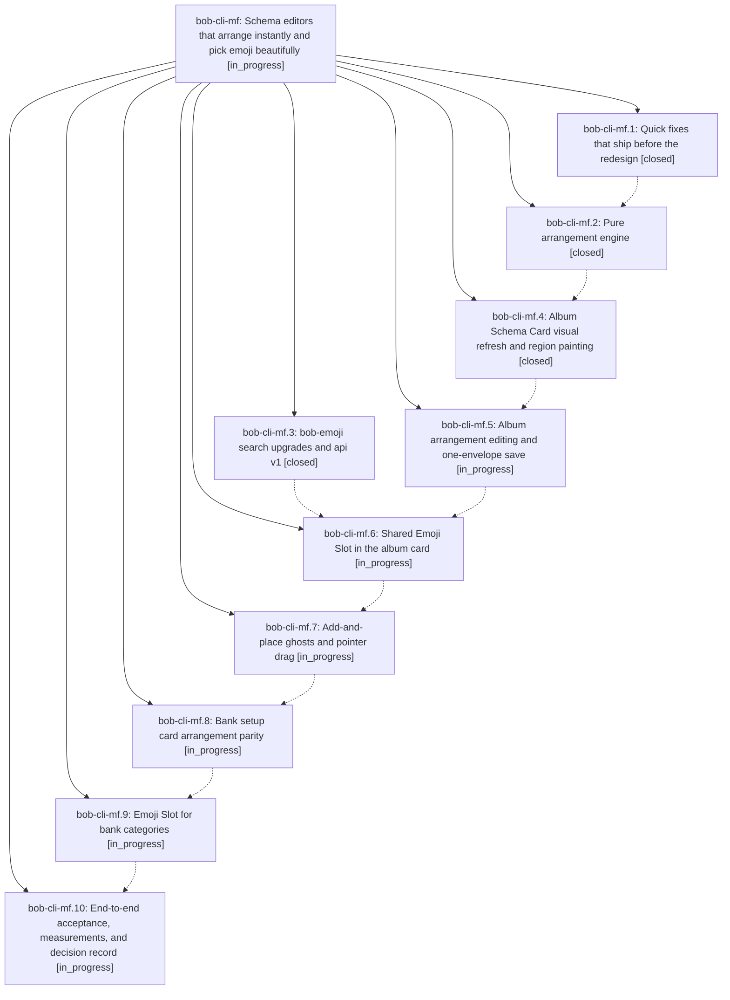

# Bead: bob-cli-mf — Schema editors that arrange instantly and pick emoji beautifully

[Bead Pages](../README.md) / bob-cli-mf

**Status:** ◐ in_progress · **Type:** ▸ plan · **Tier:** epic
**Owner:** `bryanbugyi34@gmail.com` · **Created by:** [bbugyi200.apollo.research.51.linker.w0](https://github.com/bobs-org/bob-cli--agents/blob/main/sessions/bbugyi200.apollo.research.51.linker.w0.md) · **Assignee:** `bob-cli-mf.land`
**Created:** 2026-11-16 15:38:38 EST
**Plan:** [202611/schema\_editor\_arrange\_and\_emoji.md](https://github.com/bobs-org/bob-cli--plans/blob/main/202611/schema_editor_arrange_and_emoji.md)

<!-- sase:links:start -->

## Links

| Relation | Artifact | Why |
| --- | --- | --- |
| implemented-by | [plan:202611/schema_editor_arrange_and_emoji.md][1] | derived from the plan's `bead_id:` frontmatter field |

[1]: https://github.com/bobs-org/bob-cli--plans/blob/main/202611/schema_editor_arrange_and_emoji.md

<!-- sase:links:end -->

## Description

The album Schema Card and the Bank setup card move fields, choices, categories, groups, and rules any distance with an instant local preview, then save the whole arrangement as one guarded bob transaction with one commit and one Undo. Every emoji prompt is a searchable Emoji Slot. Both cards use a calmer, contextual layout. Bob stays the only writer, and nothing is saved without a successful preview of the exact envelope.

## Phases

| Bead | Title | Status | Size | Created | Agents | Commits |
|---|---|---|---|---|---:|---:|
| [bob-cli-mf.1](bob-cli-mf.1.md) | Quick fixes that ship before the redesign | ✓ closed | small | 2026-11-16 | 1 | 1 |
| [bob-cli-mf.10](bob-cli-mf.10.md) | End-to-end acceptance, measurements, and decision record | ◐ in_progress | medium | 2026-11-16 | 1 | 0 |
| [bob-cli-mf.2](bob-cli-mf.2.md) | Pure arrangement engine | ✓ closed | medium | 2026-11-16 | 1 | 1 |
| [bob-cli-mf.3](bob-cli-mf.3.md) | bob-emoji search upgrades and api v1 | ✓ closed | medium | 2026-11-16 | 1 | 1 |
| [bob-cli-mf.4](bob-cli-mf.4.md) | Album Schema Card visual refresh and region painting | ✓ closed | medium | 2026-11-16 | 1 | 1 |
| [bob-cli-mf.5](bob-cli-mf.5.md) | Album arrangement editing and one-envelope save | ◐ in_progress | medium | 2026-11-16 | 1 | 0 |
| [bob-cli-mf.6](bob-cli-mf.6.md) | Shared Emoji Slot in the album card | ◐ in_progress | medium | 2026-11-16 | 1 | 0 |
| [bob-cli-mf.7](bob-cli-mf.7.md) | Add-and-place ghosts and pointer drag | ◐ in_progress | medium | 2026-11-16 | 1 | 0 |
| [bob-cli-mf.8](bob-cli-mf.8.md) | Bank setup card arrangement parity | ◐ in_progress | medium | 2026-11-16 | 1 | 0 |
| [bob-cli-mf.9](bob-cli-mf.9.md) | Emoji Slot for bank categories | ◐ in_progress | small | 2026-11-16 | 1 | 0 |

## Lineage

## Agents

| Agent | Bead | Commits |
|---|---|---:|
| [bbugyi200.apollo.bob-cli-mf.1](https://github.com/bobs-org/bob-cli--agents/blob/main/agents/bbugyi200.apollo.bob-cli-mf.1/README.md) | [bob-cli-mf.1](bob-cli-mf.1.md) | 1 |
| [bbugyi200.apollo.bob-cli-mf.10](https://github.com/bobs-org/bob-cli--agents/blob/main/agents/bbugyi200.apollo.bob-cli-mf.10/README.md) | [bob-cli-mf.10](bob-cli-mf.10.md) | 0 |
| [bbugyi200.apollo.bob-cli-mf.2](https://github.com/bobs-org/bob-cli--agents/blob/main/agents/bbugyi200.apollo.bob-cli-mf.2/README.md) | [bob-cli-mf.2](bob-cli-mf.2.md) | 1 |
| [bbugyi200.apollo.bob-cli-mf.3](https://github.com/bobs-org/bob-cli--agents/blob/main/agents/bbugyi200.apollo.bob-cli-mf.3/README.md) | [bob-cli-mf.3](bob-cli-mf.3.md) | 1 |
| [bbugyi200.apollo.bob-cli-mf.4](https://github.com/bobs-org/bob-cli--agents/blob/main/agents/bbugyi200.apollo.bob-cli-mf.4/README.md) | [bob-cli-mf.4](bob-cli-mf.4.md) | 1 |
| [bbugyi200.apollo.bob-cli-mf.5](https://github.com/bobs-org/bob-cli--agents/blob/main/agents/bbugyi200.apollo.bob-cli-mf.5/README.md) | [bob-cli-mf.5](bob-cli-mf.5.md) | 0 |
| [bbugyi200.apollo.bob-cli-mf.6](https://github.com/bobs-org/bob-cli--agents/blob/main/agents/bbugyi200.apollo.bob-cli-mf.6/README.md) | [bob-cli-mf.6](bob-cli-mf.6.md) | 0 |
| [bbugyi200.apollo.bob-cli-mf.7](https://github.com/bobs-org/bob-cli--agents/blob/main/agents/bbugyi200.apollo.bob-cli-mf.7/README.md) | [bob-cli-mf.7](bob-cli-mf.7.md) | 0 |
| [bbugyi200.apollo.bob-cli-mf.8](https://github.com/bobs-org/bob-cli--agents/blob/main/agents/bbugyi200.apollo.bob-cli-mf.8/README.md) | [bob-cli-mf.8](bob-cli-mf.8.md) | 0 |
| [bbugyi200.apollo.bob-cli-mf.9](https://github.com/bobs-org/bob-cli--agents/blob/main/agents/bbugyi200.apollo.bob-cli-mf.9/README.md) | [bob-cli-mf.9](bob-cli-mf.9.md) | 0 |
| [bbugyi200.apollo.bob-cli-mf.land](https://github.com/bobs-org/bob-cli--agents/blob/main/agents/bbugyi200.apollo.bob-cli-mf.land/README.md) | [bob-cli-mf](README.md) | 0 |

## Commits

| Repo | Commit | Subject | Bead | Committed |
|---|---|---|---|---|
| bob-plugins | [`bob-plugins@e35afc1`](https://github.com/bobs-org/bob-plugins/commit/e35afc1fa0c331883ff9dc2691f1cf735be3df21) | fix(bank): preserve category emoji and editor shortcuts | [bob-cli-mf.1](bob-cli-mf.1.md) | 2026-11-16 15:46:44 EST |
| bob-plugins | [`bob-plugins@daceef0`](https://github.com/bobs-org/bob-plugins/commit/daceef0e0c6dfab253353bcb166bab5add273e7f) | feat(bob-emoji): search upgrades and api v1 with CLDR keywords | [bob-cli-mf.3](bob-cli-mf.3.md) | 2026-11-16 16:05:11 EST |
| bob-plugins | [`bob-plugins@afbb325`](https://github.com/bobs-org/bob-plugins/commit/afbb325018212e38dadbab900ca3ae1d5bd8b8e6) | feat(bob-ledger-tools): add pure schema arrangement engine | [bob-cli-mf.2](bob-cli-mf.2.md) | 2026-11-16 16:37:00 EST |
| bob-plugins | [`bob-plugins@3136865`](https://github.com/bobs-org/bob-plugins/commit/313686540a2b60943efce67ae2d8e50381a8a5fb) | feat(bob-ledger-tools): refresh Album Schema Card shell and region paint | [bob-cli-mf.4](bob-cli-mf.4.md) | 2026-11-16 17:20:20 EST |
