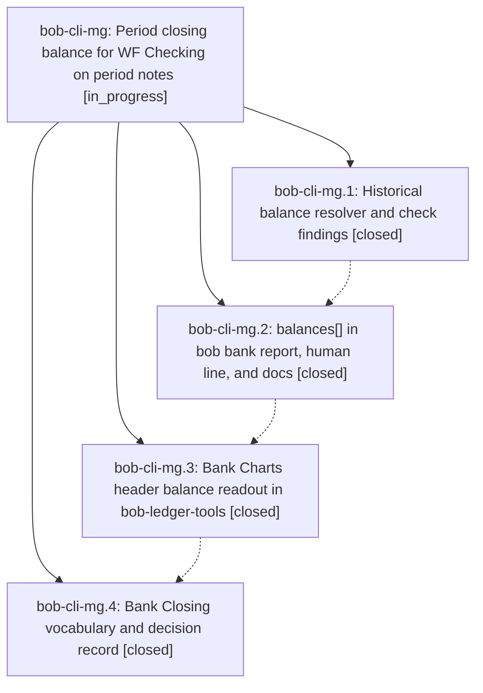

# Bead: bob-cli-mg — Period closing balance for WF Checking on period notes

[Bead Pages](../README.md) / bob-cli-mg

**Status:** ◐ in_progress · **Type:** ▸ plan · **Tier:** epic
**Owner:** `bryanbugyi34@gmail.com` · **Created by:** [bbugyi200.apollo.research.50.linker.w0](https://github.com/bobs-org/bob-cli--agents/blob/main/sessions/bbugyi200.apollo.research.50.linker.w0.md) · **Assignee:** `bob-cli-mg.land`
**Created:** 2026-11-16 15:40:33 EST
**Plan:** [202611/wf\_checking\_period\_close.md](https://github.com/bobs-org/bob-cli--plans/blob/main/202611/wf_checking_period_close.md)

<!-- sase:links:start -->

## Links

| Relation | Artifact | Why |
| --- | --- | --- |
| implemented-by | [plan:202611/wf_checking_period_close.md][1] | derived from the plan's `bead_id:` frontmatter field |

_Plus 1 automatic references — see [Referenced By](#referenced-by)._

[1]: https://github.com/bobs-org/bob-cli--plans/blob/main/202611/wf_checking_period_close.md

<!-- sase:links:end -->

## Description

Every week, quarter, ISO-year, and all-time note shows the checking account's exact posted balance at the end of that period (or, honestly labeled, as of the last imported day). bob computes the balance live from bank evidence, and it is never written into notes. Daily notes stay untouched.

## Phases

| Bead | Title | Status | Size | Created | Agents | Commits |
|---|---|---|---|---|---:|---:|
| [bob-cli-mg.1](bob-cli-mg.1.md) | Historical balance resolver and check findings | ✓ closed | medium | 2026-11-16 | 1 | 1 |
| [bob-cli-mg.2](bob-cli-mg.2.md) | balances\[\] in bob bank report, human line, and docs | ✓ closed | small | 2026-11-16 | 1 | 1 |
| [bob-cli-mg.3](bob-cli-mg.3.md) | Bank Charts header balance readout in bob-ledger-tools | ✓ closed | medium | 2026-11-16 | 1 | 1 |
| [bob-cli-mg.4](bob-cli-mg.4.md) | Bank Closing vocabulary and decision record | ✓ closed | small | 2026-11-16 | 1 | 1 |

## Lineage

## Agents

| Agent | Bead | Commits |
|---|---|---:|
| [bbugyi200.apollo.bob-cli-mg.1](https://github.com/bobs-org/bob-cli--agents/blob/main/agents/bbugyi200.apollo.bob-cli-mg.1/README.md) | [bob-cli-mg.1](bob-cli-mg.1.md) | 1 |
| [bbugyi200.apollo.bob-cli-mg.2](https://github.com/bobs-org/bob-cli--agents/blob/main/agents/bbugyi200.apollo.bob-cli-mg.2/README.md) | [bob-cli-mg.2](bob-cli-mg.2.md) | 1 |
| [bbugyi200.apollo.bob-cli-mg.3](https://github.com/bobs-org/bob-cli--agents/blob/main/agents/bbugyi200.apollo.bob-cli-mg.3/README.md) | [bob-cli-mg.3](bob-cli-mg.3.md) | 1 |
| [bbugyi200.apollo.bob-cli-mg.4](https://github.com/bobs-org/bob-cli--agents/blob/main/agents/bbugyi200.apollo.bob-cli-mg.4/README.md) | [bob-cli-mg.4](bob-cli-mg.4.md) | 1 |
| [bbugyi200.apollo.bob-cli-mg.land](https://github.com/bobs-org/bob-cli--agents/blob/main/agents/bbugyi200.apollo.bob-cli-mg.land/README.md) | [bob-cli-mg](README.md) | 0 |

## Commits

| Repo | Commit | Subject | Bead | Committed |
|---|---|---|---|---|
| bob-cli | [`e49dbd4`](https://github.com/bobs-org/bob-cli/commit/e49dbd465daac7888ff45eb00e2f4e00c1beed6e) | feat(bank): add historical posted-balance resolver and check findings | [bob-cli-mg.1](bob-cli-mg.1.md) | 2026-11-16 16:34:25 EST |
| bob-cli | [`7b26a70`](https://github.com/bobs-org/bob-cli/commit/7b26a707d955c87a48609b92d52cac9f7012b276) | feat(bank): report period closing balances in bank report | [bob-cli-mg.2](bob-cli-mg.2.md) | 2026-11-16 17:37:43 EST |
| bob-cli | [`3f47869`](https://github.com/bobs-org/bob-cli/commit/3f4786912cb40ca87e7ae231f085b05a65652a13) | docs(bank): document bank period balance readout | [bob-cli-mg.3](bob-cli-mg.3.md) | 2026-11-16 19:07:26 EST |
| bob-cli | [`a57fdba`](https://github.com/bobs-org/bob-cli/commit/a57fdba0b4b70c005ffb408739e4069f85681c37) | docs(memory): add bank closing glossary | [bob-cli-mg.4](bob-cli-mg.4.md) | 2026-11-16 19:15:09 EST |

<!-- sase:referenced-by:start -->

## Referenced By

| Relation | Artifact | Why | Uses |
| --- | --- | --- | ---: |
| read-by | [agent:bob-cli-mg.1][1] | Need the parent epic scope, notes, and whether earlier work landed | 1 |

[1]: https://github.com/bobs-org/bob-cli--agents/blob/main/agents/bbugyi200.apollo.bob-cli-mg.1/README.md

<!-- sase:referenced-by:end -->
