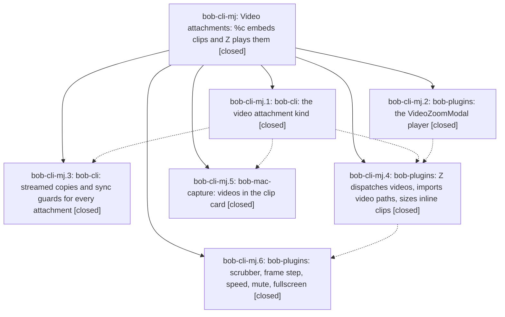

# Bead: bob-cli-mj — Video attachments: %c embeds clips and Z plays them

[Bead Pages](../README.md) / bob-cli-mj

**Status:** ✓ closed · **Resolution:** done · **Type:** ▸ plan · **Tier:** epic
**Owner:** `bryanbugyi34@gmail.com` · **Created by:** [bbugyi200.athena.research.63.linker.w0](https://github.com/bobs-org/bob-cli--agents/blob/main/sessions/bbugyi200.athena.research.63.linker.w0.md) · **Assignee:** `bob-cli-mj.land`
**Created:** 2026-11-16 17:31:30 EST · **Closed:** 2026-11-16 21:02:06 EST
**Plan:** [202611/video\_attachments\_z\_player.md](https://github.com/bobs-org/bob-cli--plans/blob/main/202611/video_attachments_z_player.md)

<!-- sase:links:start -->

## Links

| Relation | Artifact | Why |
| --- | --- | --- |
| implemented-by | [plan:202611/video_attachments_z_player.md][1] | derived from the plan's `bead_id:` frontmatter field |

_Plus 1 automatic references — see [Referenced By](#referenced-by)._

[1]: https://github.com/bobs-org/bob-cli--plans/blob/main/202611/video_attachments_z_player.md

<!-- sase:links:end -->

## Description

With a video path on the clipboard, `%c` embeds the clip under the new task as `![[vid/NAME.mp4|400]]`; in Obsidian the clip sits in the same 400 px column as screenshots, and `Z` opens a calm, keyboard-first player that shares the image viewer's chrome, origin line, and `y`/`r` gestures. Every attachment bob copies is one vault sync can carry, and Bob Mac Capture previews a video as a video.

## Notes

[2026-11-17T02:02:06Z · bob-cli-mj.land] LANDED. Verified all six phases against plan:202611/video_attachments_z_player.md and the source. bob-cli ff563ebd (mj.1): AttachmentKind::Video (mp4/mov/webm/mkv) goes to vid/ as ![[vid/NAME|400]]; size_bytes is in the capture/import JSON; there is a shared human_bytes formatter; the dry-run padding is fixed; help and docs carry the catalog. bob-cli 74834270 (mj.3): bounded 64 KiB streamed hashing and copying, source-change aborts, 95 MiB refusal (attachment_too_large/too_large), 50 MiB warning, gitignore refusal (attachment_not_synced/not_synced, fail-open), and docs. Ubuntu CI test, lint, and package passed on 74834270; the macOS test job hits its 45m timeout as it has on every run since before this epic. A fresh-build smoke in a scratch git vault gave clip.mp4 -> vid/clip.mp4 with kind video, embed ![[vid/clip.mp4|400]], and size_bytes; .heic was refused as gitignored; a 100 MiB file was refused as too_large. bob-plugins 32d7e11/307646c/b5491d3 (mj.2/.4/.6): ImageZoomModal hooks, VideoZoomModal, Z dispatch with notices, ico, findMediaPathBullet, old-bob degradation, inline 400px CSS, transport (scrubber, frame step, speed, g/G, mute, fullscreen, flash), docs, and the real-Obsidian e2e. Fragments are at most 1000 lines. npm run build leaves no diff. All 6 image/video zoom suites and the video e2e self-test pass, and the deployed vault main.js, styles.css, and manifest match the repo. Justified deviation: the plan's @supports attr(width px) rule was dropped. attr() would read the <video>'s own (absent) width rather than the wrapper's, which would break the 400px column the e2e asserts. bob-mac-capture 2c40f68d (mj.5): video count, size, AVFoundation poster/duration, and leftover structured warnings by message; exact-SHA macOS CI is green. DECISIONS honored: no clip-videos-embed-from-vid strand was written and no memory was edited. Installed bob is still 0.5.0; the daily release train ships the video kind, and until then the plugin shows its 'Update bob to import videos' degradation. Mac-only items for Bryan: HEVC .mov playback, macOS fullscreen, and real off-host sync of a vid/ clip. INTEGRATION: the only commits since the epic started are bank epic bob-cli-mg (7b26a707, 3f478691, a57fdba0) and bob-plugins ledger-tools bank/album work (3136865, 866bb77, 1795245). None touch attachments or zoom, and no other attachment writer needed changes (gmail/attach keeps its own 25 MiB file/mail path, unchanged since before the epic). No --epic-symbol entries. FOLLOW-UP TRIAGE (proposed by mj.2/.4/.5/.6): (1) the docs/reference/glossary.md drift comes from a57fdba0 (bob-cli-mg.4), so it is a DISCOVERED ISSUE note on active epic bob-cli-mg rather than a fix here, to avoid colliding with that lander's glossary edits. (2) bob-plugins npm test, 14 failures on b5491d3: corroborated with +1 on bob-cli-md (walkMode x4 plus priority-notice hex; this epic added no hex), bob-cli-me (bracket-mode-indicator plus highlights-hints x2), and bob-cli-m8 (block-marks e2e). The bank Setup card x2 went as a DISCOVERED ISSUE note on active epic bob-cli-mf (matches mf.4's follow-up). (3) Perf-budget flakes: +1 on bob-cli-io (35 ms), bob-cli-ki (298.2 ms), and bob-cli-ju (153.0 ms). No new task was warranted. The ref-pdf, period-links-only, and dependency-stage perf mentions did not reproduce separately in my run, so no +1 was recorded for them.

## Phases

| Bead | Title | Status | Size | Created | Agents | Commits |
|---|---|---|---|---|---:|---:|
| [bob-cli-mj.1](bob-cli-mj.1.md) | bob-cli: the video attachment kind | ✓ closed | medium | 2026-11-16 | 1 | 1 |
| [bob-cli-mj.2](bob-cli-mj.2.md) | bob-plugins: the VideoZoomModal player | ✓ closed | medium | 2026-11-16 | 1 | 1 |
| [bob-cli-mj.3](bob-cli-mj.3.md) | bob-cli: streamed copies and sync guards for every attachment | ✓ closed | medium | 2026-11-16 | 1 | 1 |
| [bob-cli-mj.4](bob-cli-mj.4.md) | bob-plugins: Z dispatches videos, imports video paths, sizes inline clips | ✓ closed | medium | 2026-11-16 | 1 | 1 |
| [bob-cli-mj.5](bob-cli-mj.5.md) | bob-mac-capture: videos in the clip card | ✓ closed | medium | 2026-11-16 | 1 | 1 |
| [bob-cli-mj.6](bob-cli-mj.6.md) | bob-plugins: scrubber, frame step, speed, mute, fullscreen | ✓ closed | medium | 2026-11-16 | 1 | 1 |

## Lineage

## Agents

| Agent | Bead | Commits |
|---|---|---:|
| [bbugyi200.athena.bob-cli-mj.1](https://github.com/bobs-org/bob-cli--agents/blob/main/agents/bbugyi200.athena.bob-cli-mj.1/README.md) | [bob-cli-mj.1](bob-cli-mj.1.md) | 1 |
| [bbugyi200.athena.bob-cli-mj.2](https://github.com/bobs-org/bob-cli--agents/blob/main/agents/bbugyi200.athena.bob-cli-mj.2/README.md) | [bob-cli-mj.2](bob-cli-mj.2.md) | 1 |
| [bbugyi200.athena.bob-cli-mj.3](https://github.com/bobs-org/bob-cli--agents/blob/main/agents/bbugyi200.athena.bob-cli-mj.3/README.md) | [bob-cli-mj.3](bob-cli-mj.3.md) | 1 |
| [bbugyi200.athena.bob-cli-mj.4](https://github.com/bobs-org/bob-cli--agents/blob/main/agents/bbugyi200.athena.bob-cli-mj.4/README.md) | [bob-cli-mj.4](bob-cli-mj.4.md) | 1 |
| [bbugyi200.athena.bob-cli-mj.5](https://github.com/bobs-org/bob-cli--agents/blob/main/sessions/bbugyi200.athena.bob-cli-mj.5.md) | [bob-cli-mj.5](bob-cli-mj.5.md) | 1 |
| [bbugyi200.athena.bob-cli-mj.6](https://github.com/bobs-org/bob-cli--agents/blob/main/agents/bbugyi200.athena.bob-cli-mj.6/README.md) | [bob-cli-mj.6](bob-cli-mj.6.md) | 1 |
| [bbugyi200.athena.bob-cli-mj.land](https://github.com/bobs-org/bob-cli--agents/blob/main/agents/bbugyi200.athena.bob-cli-mj.land/README.md) | [bob-cli-mj](README.md) | 1 |

## Commits

| Repo | Commit | Subject | Bead | Committed |
|---|---|---|---|---|
| bob-plugins | [`bob-plugins@32d7e11`](https://github.com/bobs-org/bob-plugins/commit/32d7e11ccf78751d33f11ab744976e91cdc9a042) | feat(navigation): add VideoZoomModal player with media hooks | [bob-cli-mj.2](bob-cli-mj.2.md) | 2026-11-16 17:57:31 EST |
| bob-cli | [`ff563eb`](https://github.com/bobs-org/bob-cli/commit/ff563ebd884836da71209ca601bbdc3409b10c1e) | feat(capture)!: embed clipboard videos from vid/ | [bob-cli-mj.1](bob-cli-mj.1.md) | 2026-11-16 18:33:26 EST |
| bob-cli | [`7483427`](https://github.com/bobs-org/bob-cli/commit/748342701f592c5c0f7005ed064f8ed83a762911) | feat(attachments)!: stream and guard attachment copies | [bob-cli-mj.3](bob-cli-mj.3.md) | 2026-11-16 19:40:36 EST |
| bob-mac-capture | [`bob-mac-capture@2c40f68`](https://github.com/bobs-org/bob-mac-capture/commit/2c40f68df3a1ff3a6207f1687f43d80d7841c7f8) | feat(capture): show video posters and sizes in the clip card | [bob-cli-mj.5](bob-cli-mj.5.md) | 2026-11-16 19:59:17 EST |
| bob-plugins | [`bob-plugins@307646c`](https://github.com/bobs-org/bob-plugins/commit/307646ce78f7ab3a2257c2eac92b1e020fa70829) | feat(navigation): add video media to Z zoom | [bob-cli-mj.4](bob-cli-mj.4.md) | 2026-11-16 20:02:01 EST |
| bob-plugins | [`bob-plugins@b5491d3`](https://github.com/bobs-org/bob-plugins/commit/b5491d3b4f5d4a5ad1bc839cd655e2b6ba01fd77) | feat(navigation): add video transport to VideoZoomModal | [bob-cli-mj.6](bob-cli-mj.6.md) | 2026-11-16 20:44:51 EST |
| bob-cli--plans | [`bob-cli--plans@fcc8be0`](https://github.com/bobs-org/bob-cli--plans/commit/fcc8be038d4ff47aaf3e3484b748907be252f0e8) | chore(plans): mark video attachments epic plan done | [bob-cli-mj](README.md) | 2026-11-16 21:02:52 EST |

<!-- sase:referenced-by:start -->

## Referenced By

| Relation | Artifact | Why | Uses |
| --- | --- | --- | ---: |
| read-by | [agent:bob-cli-mj.1][1] | Need epic scope for phase mj.1 | 1 |

[1]: https://github.com/bobs-org/bob-cli--agents/blob/main/agents/bbugyi200.athena.bob-cli-mj.1/README.md

<!-- sase:referenced-by:end -->
