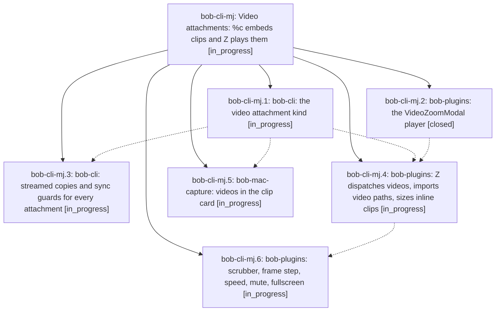

# Bead: bob-cli-mj — Video attachments: %c embeds clips and Z plays them

[Bead Pages](../README.md) / bob-cli-mj

**Status:** ◐ in_progress · **Type:** ▸ plan · **Tier:** epic
**Owner:** `bryanbugyi34@gmail.com` · **Created by:** [bbugyi200.athena.research.63.linker.w0](https://github.com/bobs-org/bob-cli--agents/blob/main/sessions/bbugyi200.athena.research.63.linker.w0.md) · **Assignee:** `bob-cli-mj.land`
**Created:** 2026-11-16 17:31:30 EST
**Plan:** [202611/video\_attachments\_z\_player.md](https://github.com/bobs-org/bob-cli--plans/blob/main/202611/video_attachments_z_player.md)

<!-- sase:links:start -->

## Links

| Relation | Artifact | Why |
| --- | --- | --- |
| implemented-by | [plan:202611/video_attachments_z_player.md][1] | derived from the plan's `bead_id:` frontmatter field |

[1]: https://github.com/bobs-org/bob-cli--plans/blob/main/202611/video_attachments_z_player.md

<!-- sase:links:end -->

## Description

With a video path on the clipboard, `%c` embeds the clip under the new task as `![[vid/NAME.mp4|400]]`; in Obsidian the clip sits in the same 400 px column as screenshots, and `Z` opens a calm, keyboard-first player that shares the image viewer's chrome, origin line, and `y`/`r` gestures. Every attachment bob copies is one vault sync can carry, and Bob Mac Capture previews a video as a video.

## Phases

| Bead | Title | Status | Size | Created | Agents | Commits |
|---|---|---|---|---|---:|---:|
| [bob-cli-mj.1](bob-cli-mj.1.md) | bob-cli: the video attachment kind | ◐ in_progress | medium | 2026-11-16 | 1 | 0 |
| [bob-cli-mj.2](bob-cli-mj.2.md) | bob-plugins: the VideoZoomModal player | ✓ closed | medium | 2026-11-16 | 1 | 1 |
| [bob-cli-mj.3](bob-cli-mj.3.md) | bob-cli: streamed copies and sync guards for every attachment | ◐ in_progress | medium | 2026-11-16 | 1 | 0 |
| [bob-cli-mj.4](bob-cli-mj.4.md) | bob-plugins: Z dispatches videos, imports video paths, sizes inline clips | ◐ in_progress | medium | 2026-11-16 | 1 | 0 |
| [bob-cli-mj.5](bob-cli-mj.5.md) | bob-mac-capture: videos in the clip card | ◐ in_progress | medium | 2026-11-16 | 1 | 0 |
| [bob-cli-mj.6](bob-cli-mj.6.md) | bob-plugins: scrubber, frame step, speed, mute, fullscreen | ◐ in_progress | medium | 2026-11-16 | 1 | 0 |

## Lineage

## Agents

| Agent | Bead | Commits |
|---|---|---:|
| [bbugyi200.athena.bob-cli-mj.1](https://github.com/bobs-org/bob-cli--agents/blob/main/agents/bbugyi200.athena.bob-cli-mj.1/README.md) | [bob-cli-mj.1](bob-cli-mj.1.md) | 0 |
| [bbugyi200.athena.bob-cli-mj.2](https://github.com/bobs-org/bob-cli--agents/blob/main/agents/bbugyi200.athena.bob-cli-mj.2/README.md) | [bob-cli-mj.2](bob-cli-mj.2.md) | 1 |
| [bbugyi200.athena.bob-cli-mj.3](https://github.com/bobs-org/bob-cli--agents/blob/main/agents/bbugyi200.athena.bob-cli-mj.3/README.md) | [bob-cli-mj.3](bob-cli-mj.3.md) | 0 |
| [bbugyi200.athena.bob-cli-mj.4](https://github.com/bobs-org/bob-cli--agents/blob/main/agents/bbugyi200.athena.bob-cli-mj.4/README.md) | [bob-cli-mj.4](bob-cli-mj.4.md) | 0 |
| [bbugyi200.athena.bob-cli-mj.5](https://github.com/bobs-org/bob-cli--agents/blob/main/agents/bbugyi200.athena.bob-cli-mj.5/README.md) | [bob-cli-mj.5](bob-cli-mj.5.md) | 0 |
| [bbugyi200.athena.bob-cli-mj.6](https://github.com/bobs-org/bob-cli--agents/blob/main/agents/bbugyi200.athena.bob-cli-mj.6/README.md) | [bob-cli-mj.6](bob-cli-mj.6.md) | 0 |
| [bbugyi200.athena.bob-cli-mj.land](https://github.com/bobs-org/bob-cli--agents/blob/main/agents/bbugyi200.athena.bob-cli-mj.land/README.md) | [bob-cli-mj](README.md) | 0 |

## Commits

| Repo | Commit | Subject | Bead | Committed |
|---|---|---|---|---|
| bob-plugins | [`bob-plugins@32d7e11`](https://github.com/bobs-org/bob-plugins/commit/32d7e11ccf78751d33f11ab744976e91cdc9a042) | feat(navigation): add VideoZoomModal player with media hooks | [bob-cli-mj.2](bob-cli-mj.2.md) | 2026-11-16 17:57:31 EST |
