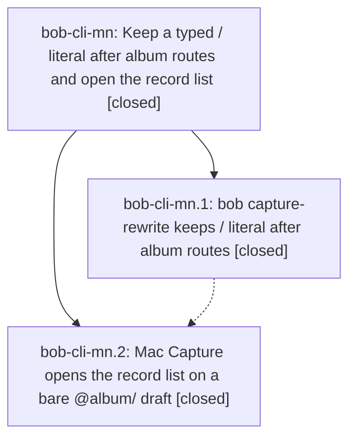

# Bead: bob-cli-mn — Keep a typed / literal after album routes and open the record list

[Bead Pages](../README.md) / bob-cli-mn

**Status:** ✓ closed · **Resolution:** done · **Type:** ▸ plan · **Tier:** epic
**Owner:** `bryanbugyi34@gmail.com` · **Created by:** [bbugyi200.athena.1d8](https://github.com/bobs-org/bob-cli--agents/blob/main/sessions/bbugyi200.athena.1d8.md) · **Assignee:** `bob-cli-mn.land`
**Created:** 2026-11-17 06:44:44 EST · **Closed:** 2026-11-17 10:56:49 EST
**Plan:** [202611/album\_slash\_record\_list.md](https://github.com/bobs-org/bob-cli--plans/blob/main/202611/album_slash_record_list.md)

<!-- sase:links:start -->

## Links

| Relation | Artifact | Why |
| --- | --- | --- |
| implemented-by | [plan:202611/album_slash_record_list.md][1] | derived from the plan's `bead_id:` frontmatter field |

[1]: https://github.com/bobs-org/bob-cli--plans/blob/main/202611/album_slash_record_list.md

<!-- sase:links:end -->

## Description

In Bob Mac Capture, typing `/` right after an album route such as `@eat` inserts a literal `/` (the `@eat/` record route) instead of the `/` → `#` capture alias, an explicit `#` still opens the section menu, and a draft that is only `@eat/` immediately lists that album's existing record notes.

## Notes

[2026-11-17T15:56:49Z · bob-cli-mn.land] Verified the approved plan plan:202611/album_slash_record_list.md, the epic (no prior notes), both closed phases, and every phase note: bob-cli-mn.1 #1 and bob-cli-mn.2 #1-4. Read actual implementation, regression tests, fixtures, help/docs, and commits f6924787 in bob-cli and 19a23f40, 991c877e, 22a95b64, 4d96d4a5 in bob-mac-capture.

The Rust adapter performs the bounded album-head lookup, threads the same policy through rewrite and tip proof, preserves slash for valid/invalid album claims, preserves the non-album/missing-vault fallback and @ collapse, and suppresses the misleading album hash tip. The Mac guard uses Bob's whole-draft record_route span, reaches capture-complete, and preserves title-bearing cached routes. Reviewed response freshness, record-target rendering, and acceptance; none requires an authored title. Generated fixtures and hosted regressions cover the typed slash and cache paths.

DECISIONS honored: only glossary:capture-alias was changed among memory files, with the selected album-route exception and regenerated documentation. No release-version or changelog edits. Bob remains the grammar authority.

Integration review: fetched both origins and compared current master histories from the epic's creation/first implementation commits. bob-cli remains f6924787; Mac master is 4d96d4a5. There are no non-epic commits in those windows and no conflicting/duplicated consumers to integrate. The three later Mac notes are addressed by their committed test-harness fixes. Exact-SHA Mac CI 44111365749 on 4d96d4a5 passed Check scripts, lint, Build, Test, Bundle, launch smoke, and install/reinstall (https://github.com/bobs-org/bob-mac-capture/actions/runs/44111365749).

Verification: just check passed via ToolRun a969480aad05abd96b726bd885a3e9fd; just docs-check passed all implemented gates including 448 documentation tests. A scratch-vault probe using the current Cargo-resolved executable verified album/mixed-case/title-bearing slash, non-album alias, @ collapse, null album hash tip, record_route span, existing record completion, and explicit # create menu. No check-full was run.

Follow-up triage: neither child contains a PROPOSED FOLLOW-UP entry; none was filed, corroborated, attached, or declined. No remaining epic-caused issue was found. sase bead epic-symbols bob-cli-mn reports no entries. This checkout has no symvision recipe. Both phases are done and there is no parent bead.

## Phases

| Bead | Title | Status | Size | Created | Agents | Commits |
|---|---|---|---|---|---:|---:|
| [bob-cli-mn.1](bob-cli-mn.1.md) | bob capture-rewrite keeps / literal after album routes | ✓ closed | medium | 2026-11-17 | 1 | 1 |
| [bob-cli-mn.2](bob-cli-mn.2.md) | Mac Capture opens the record list on a bare @album/ draft | ✓ closed | small | 2026-11-17 | 1 | 4 |

## Lineage

## Agents

| Agent | Bead | Commits |
|---|---|---:|
| [bbugyi200.athena.bob-cli-mn.1](https://github.com/bobs-org/bob-cli--agents/blob/main/sessions/bbugyi200.athena.bob-cli-mn.1.md) | [bob-cli-mn.1](bob-cli-mn.1.md) | 1 |
| [bbugyi200.athena.bob-cli-mn.2](https://github.com/bobs-org/bob-cli--agents/blob/main/sessions/bbugyi200.athena.bob-cli-mn.2.md) | [bob-cli-mn.2](bob-cli-mn.2.md) | 4 |
| [bbugyi200.athena.bob-cli-mn.land](https://github.com/bobs-org/bob-cli--agents/blob/main/agents/bbugyi200.athena.bob-cli-mn.land/README.md) | [bob-cli-mn](README.md) | 1 |

## Commits

| Repo | Commit | Subject | Bead | Committed |
|---|---|---|---|---|
| bob-cli | [`f692478`](https://github.com/bobs-org/bob-cli/commit/f6924787fa43424d6fb217261adf264debbf2272) | feat(capture): keep / literal after album routes | [bob-cli-mn.1](bob-cli-mn.1.md) | 2026-11-17 07:26:42 EST |
| bob-mac-capture | [`bob-mac-capture@19a23f4`](https://github.com/bobs-org/bob-mac-capture/commit/19a23f40db527d6db0d1992aa24a45d13a5909b0) | feat(capture): list album records after a typed @album/ | [bob-cli-mn.2](bob-cli-mn.2.md) | 2026-11-17 08:13:30 EST |
| bob-mac-capture | [`bob-mac-capture@991c877`](https://github.com/bobs-org/bob-mac-capture/commit/991c877e5cfe3030fb9516dee452af2f20f39f39) | test(capture): keep the alias tip when the route list filters | [bob-cli-mn.2](bob-cli-mn.2.md) | 2026-11-17 09:21:10 EST |
| bob-mac-capture | [`bob-mac-capture@22a95b6`](https://github.com/bobs-org/bob-mac-capture/commit/22a95b6425efd7eb560103d574adc3d7689035ac) | test(ci): wait out SIGTERM cleanup in macos-ci-check tests | [bob-cli-mn.2](bob-cli-mn.2.md) | 2026-11-17 09:32:22 EST |
| bob-mac-capture | [`bob-mac-capture@4d96d4a`](https://github.com/bobs-org/bob-mac-capture/commit/4d96d4a5a9027967c18f0e25618ef064c4c001ff) | test(capture): keep the follow-up tip after a separator rewrite | [bob-cli-mn.2](bob-cli-mn.2.md) | 2026-11-17 10:10:53 EST |
| bob-cli--plans | [`bob-cli--plans@f8cebbd`](https://github.com/bobs-org/bob-cli--plans/commit/f8cebbdfe8ecb7df3decb81707ee9030b456de06) | docs(plan): mark album slash record list epic done | [bob-cli-mn](README.md) | 2026-11-17 10:57:55 EST |
