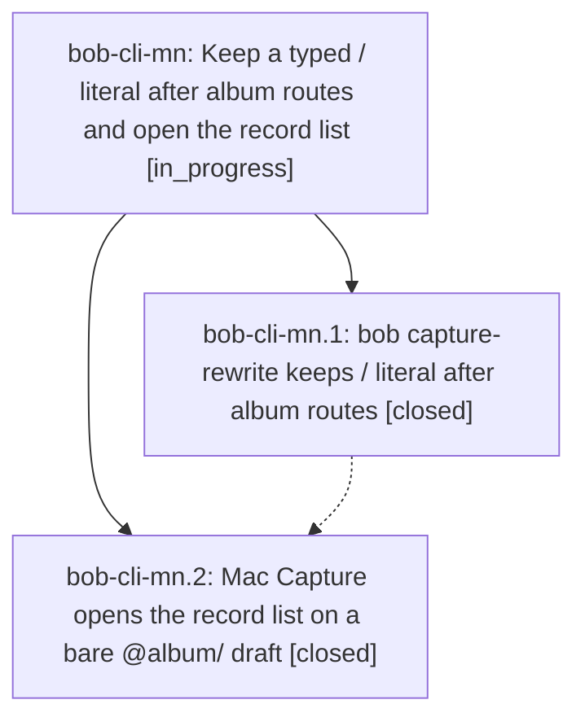

# Bead: bob-cli-mn — Keep a typed / literal after album routes and open the record list

[Bead Pages](../README.md) / bob-cli-mn

**Status:** ◐ in_progress · **Type:** ▸ plan · **Tier:** epic
**Owner:** `bryanbugyi34@gmail.com` · **Created by:** [bbugyi200.athena.1d8](https://github.com/bobs-org/bob-cli--agents/blob/main/sessions/bbugyi200.athena.1d8.md) · **Assignee:** `bob-cli-mn.land`
**Created:** 2026-11-17 06:44:44 EST
**Plan:** [202611/album\_slash\_record\_list.md](https://github.com/bobs-org/bob-cli--plans/blob/main/202611/album_slash_record_list.md)

<!-- sase:links:start -->

## Links

| Relation | Artifact | Why |
| --- | --- | --- |
| implemented-by | [plan:202611/album_slash_record_list.md][1] | derived from the plan's `bead_id:` frontmatter field |

[1]: https://github.com/bobs-org/bob-cli--plans/blob/main/202611/album_slash_record_list.md

<!-- sase:links:end -->

## Description

In Bob Mac Capture, typing `/` right after an album route such as `@eat` inserts a literal `/` (the `@eat/` record route) instead of the `/` → `#` capture alias, an explicit `#` still opens the section menu, and a draft that is only `@eat/` immediately lists that album's existing record notes.

## Phases

| Bead | Title | Status | Size | Created | Agents | Commits |
|---|---|---|---|---|---:|---:|
| [bob-cli-mn.1](bob-cli-mn.1.md) | bob capture-rewrite keeps / literal after album routes | ✓ closed | medium | 2026-11-17 | 1 | 1 |
| [bob-cli-mn.2](bob-cli-mn.2.md) | Mac Capture opens the record list on a bare @album/ draft | ✓ closed | small | 2026-11-17 | 1 | 1 |

## Lineage

## Agents

| Agent | Bead | Commits |
|---|---|---:|
| [bbugyi200.athena.bob-cli-mn.1](https://github.com/bobs-org/bob-cli--agents/blob/main/sessions/bbugyi200.athena.bob-cli-mn.1.md) | [bob-cli-mn.1](bob-cli-mn.1.md) | 1 |
| [bbugyi200.athena.bob-cli-mn.2](https://github.com/bobs-org/bob-cli--agents/blob/main/sessions/bbugyi200.athena.bob-cli-mn.2.md) | [bob-cli-mn.2](bob-cli-mn.2.md) | 1 |
| [bbugyi200.athena.bob-cli-mn.land](https://github.com/bobs-org/bob-cli--agents/blob/main/agents/bbugyi200.athena.bob-cli-mn.land/README.md) | [bob-cli-mn](README.md) | 0 |

## Commits

| Repo | Commit | Subject | Bead | Committed |
|---|---|---|---|---|
| bob-cli | [`f692478`](https://github.com/bobs-org/bob-cli/commit/f6924787fa43424d6fb217261adf264debbf2272) | feat(capture): keep / literal after album routes | [bob-cli-mn.1](bob-cli-mn.1.md) | 2026-11-17 07:26:42 EST |
| bob-mac-capture | [`bob-mac-capture@19a23f4`](https://github.com/bobs-org/bob-mac-capture/commit/19a23f40db527d6db0d1992aa24a45d13a5909b0) | feat(capture): list album records after a typed @album/ | [bob-cli-mn.2](bob-cli-mn.2.md) | 2026-11-17 08:13:30 EST |
