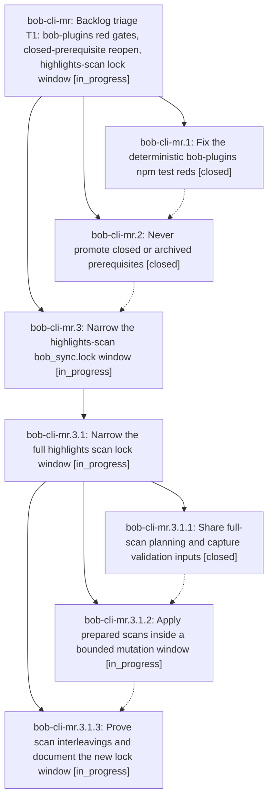

# Bead: bob-cli-mr — Backlog triage T1: bob-plugins red gates, closed-prerequisite reopen, highlights-scan lock window

[Bead Pages](../README.md) / bob-cli-mr

**Status:** ◐ in_progress · **Type:** ▸ plan · **Tier:** epic
**Owner:** `bryanbugyi34@gmail.com` · **Created by:** [bbugyi200.athena.1dh](https://github.com/bobs-org/bob-cli--agents/blob/main/sessions/bbugyi200.athena.1dh.md) · **Assignee:** `bob-cli-mr.land`
**Created:** 2026-11-17 11:16:43 EST
**Plan:** [202611/backlog\_triage\_t1\_red\_gates\_closed\_prereqs\_scan\_lock.md](https://github.com/bobs-org/bob-cli--plans/blob/main/202611/backlog_triage_t1_red_gates_closed_prereqs_scan_lock.md)

<!-- sase:links:start -->

## Links

| Relation | Artifact | Why |
| --- | --- | --- |
| implemented-by | [plan:202611/backlog_triage_t1_red_gates_closed_prereqs_scan_lock.md][1] | derived from the plan's `bead_id:` frontmatter field |

[1]: https://github.com/bobs-org/bob-cli--plans/blob/main/202611/backlog_triage_t1_red_gates_closed_prereqs_scan_lock.md

<!-- sase:links:end -->

## Description

bob-plugins npm test has no deterministic reds, capture never reopens a closed or archived prerequisite, a writing highlights scan holds bob_sync.lock only while it writes, and the lander chains the next five-bead triage epic until every open task bead is closed.

## Phases

| Bead | Title | Status | Size | Created | Agents | Commits |
|---|---|---|---|---|---:|---:|
| [bob-cli-mr.1](bob-cli-mr.1.md) | Fix the deterministic bob-plugins npm test reds | ✓ closed | medium | 2026-11-17 | 1 | 0 |
| [bob-cli-mr.2](bob-cli-mr.2.md) | Never promote closed or archived prerequisites | ✓ closed | medium | 2026-11-17 | 1 | 1 |
| [bob-cli-mr.3](bob-cli-mr.3.md) | Narrow the highlights-scan bob\_sync.lock window | ◐ in_progress | large | 2026-11-17 | 1 | 0 |

## Lineage

## Agents

| Agent | Bead | Commits |
|---|---|---:|
| [bbugyi200.athena.bob-cli-mr.1](https://github.com/bobs-org/bob-cli--agents/blob/main/agents/bbugyi200.athena.bob-cli-mr.1/README.md) | [bob-cli-mr.1](bob-cli-mr.1.md) | 0 |
| [bbugyi200.athena.bob-cli-mr.2](https://github.com/bobs-org/bob-cli--agents/blob/main/sessions/bbugyi200.athena.bob-cli-mr.2.md) | [bob-cli-mr.2](bob-cli-mr.2.md) | 1 |
| [bbugyi200.athena.bob-cli-mr.3](https://github.com/bobs-org/bob-cli--agents/blob/main/sessions/bbugyi200.athena.bob-cli-mr.3.md) | [bob-cli-mr.3](bob-cli-mr.3.md) | 0 |
| [bbugyi200.athena.bob-cli-mr.3.1.1](https://github.com/bobs-org/bob-cli--agents/blob/main/agents/bbugyi200.athena.bob-cli-mr.3.1.1/README.md) | [bob-cli-mr.3.1.1](bob-cli-mr.3.1.1.md) | 1 |
| [bbugyi200.athena.bob-cli-mr.3.1.2](https://github.com/bobs-org/bob-cli--agents/blob/main/agents/bbugyi200.athena.bob-cli-mr.3.1.2/README.md) | [bob-cli-mr.3.1.2](bob-cli-mr.3.1.2.md) | 0 |
| [bbugyi200.athena.bob-cli-mr.3.1.3](https://github.com/bobs-org/bob-cli--agents/blob/main/agents/bbugyi200.athena.bob-cli-mr.3.1.3/README.md) | [bob-cli-mr.3.1.3](bob-cli-mr.3.1.3.md) | 0 |
| [bbugyi200.athena.bob-cli-mr.3.1.land](https://github.com/bobs-org/bob-cli--agents/blob/main/agents/bbugyi200.athena.bob-cli-mr.3.1.land/README.md) | [bob-cli-mr.3.1](bob-cli-mr.3.1.md) | 0 |
| [bbugyi200.athena.bob-cli-mr.land](https://github.com/bobs-org/bob-cli--agents/blob/main/agents/bbugyi200.athena.bob-cli-mr.land/README.md) | [bob-cli-mr](README.md) | 0 |

## Commits

| Repo | Commit | Subject | Bead | Committed |
|---|---|---|---|---|
| bob-cli | [`b0bddbb`](https://github.com/bobs-org/bob-cli/commit/b0bddbb98247331181bd0c9f6aa3ed07e6f6541e) | fix(capture): never promote closed or archived prerequisites | [bob-cli-mr.2](bob-cli-mr.2.md) | 2026-11-17 12:04:33 EST |
| bob-cli | [`1e8f77a`](https://github.com/bobs-org/bob-cli/commit/1e8f77af0541ab29fdec657e9139a0c95a10f597) | feat(scan): share prepared full-scan planning and validation inputs | [bob-cli-mr.3.1.1](bob-cli-mr.3.1.1.md) | 2026-11-17 12:59:58 EST |
