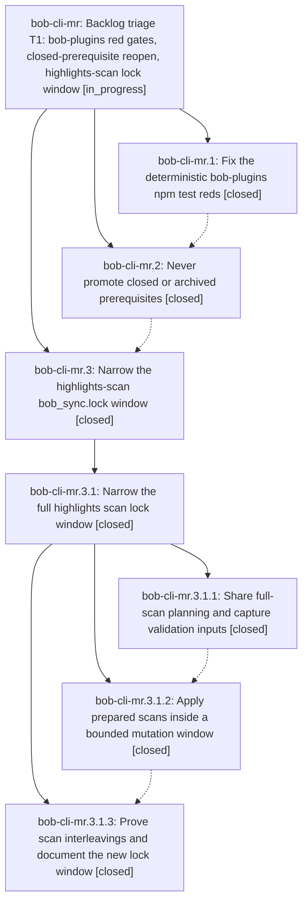

# Bead: bob-cli-mr — Backlog triage T1: bob-plugins red gates, closed-prerequisite reopen, highlights-scan lock window

[Bead Pages](../README.md) / bob-cli-mr

**Status:** ◐ in_progress · **Type:** ▸ plan · **Tier:** epic
**Owner:** `bryanbugyi34@gmail.com` · **Created by:** [bbugyi200.athena.1dh](https://github.com/bobs-org/bob-cli--agents/blob/main/sessions/bbugyi200.athena.1dh.md) · **Assignee:** `bob-cli-mr.land`
**Created:** 2026-11-17 11:16:43 EST
**Plan:** [202611/backlog\_triage\_t1\_red\_gates\_closed\_prereqs\_scan\_lock.md](https://github.com/bobs-org/bob-cli--plans/blob/main/202611/backlog_triage_t1_red_gates_closed_prereqs_scan_lock.md)

<!-- sase:links:start -->

## Links

| Relation | Artifact | Why |
| --- | --- | --- |
| implemented-by | [plan:202611/backlog_triage_t1_red_gates_closed_prereqs_scan_lock.md][1] | derived from the plan's `bead_id:` frontmatter field |
| related | file:explicit:1b54ca1c1f7d772c943b7307 | attached via sase artifact create --bead |
| related | file:explicit:bd831c44f897f151df7fe929 | attached via sase artifact create --bead |
| related | file:explicit:e68e1976353c86235b1d0e23 | attached via sase artifact create --bead |

_Plus 1 automatic references — see [Referenced By](#referenced-by)._

[1]: https://github.com/bobs-org/bob-cli--plans/blob/main/202611/backlog_triage_t1_red_gates_closed_prereqs_scan_lock.md

<!-- sase:links:end -->

## Description

bob-plugins npm test has no deterministic reds, capture never reopens a closed or archived prerequisite, a writing highlights scan holds bob_sync.lock only while it writes, and the lander chains the next five-bead triage epic until every open task bead is closed.

## Notes

[2026-11-17T22:30:02Z · bob-cli-mr.land] FOLLOW-UP TRIAGE before remaining-work tale (sase_new_task used): mr.3.1.1 #1 and mr.3.1.2 #1 are duplicate generated decisions-page drift, declined because 48a3116d fixed it and generate_reference(check=True) returns [] at 0e83df4c. mr.3.1.3 #1 JSON reference budget retained on causal active epic bob-cli-ms, with new attributed DISCOVERED ISSUE evidence: current canonical count 6112/6000 after records-tidy cfc3177c; ms notes #4/#6 already assign a pending 5233-word repair. All-status searches, 70 last-week tasks and active-epic scopes reviewed; b6/jz are different resolved reports; no duplicate task created. mr.3.1.3 #2 Mac receipt wording is completed by bob-mac-capture bfbedda9 (verified docs/refs.md: mutating scans publish, no-work/prelock do not, recovery-only output distinct), so no new task. mr.1 historical ju/ki timing failures remain their existing tasks; current 179-test focused plugin run is green, no fresh full-suite timing failure or +1 claimed. Carry all dispositions into the final close note.

[2026-11-17T22:32:43Z · bob-cli-mr.land] LANDING AUDIT at 0e83df4c: read all notes on mr.1/.2/.3 and nested mr.3.1/.1/.2/.3, both approved plans, the five original tasks, 9c.1, and governing decisions. Reviewed plugin b0a9c89, Rust b0bddbb9/1e8f77af/3236ceef/6c409ab2, fetched and fast-forwarded just-landed repair 0e83df4c. Actual source confirms open/archive promotion guards, shared human/JSON scan path, unlocked hook/planning/no-work, mutation lock order, protected intake, collision guards and recovery receipt publication. Focused plugin regressions pass 179/179 at a1550c8; current debug bob builds. Other bob-cli commits 99005975/48a3116d/cfc3177c add records show/update/tidy and preserve locking; nightly already owns the maintenance lock and calls its lock-free core. Their only overlapping docs hunk preserves the new scan lock contract. All seven later plugin commits are card/schema/bank/emoji consumers with no scan or promotion integration gap; Mac bfbedda9 fixes receipt docs. No source integration edit needed. Remaining epic defect reproduced: isolated same-length text.markdown comment edit at before_evidence produces one plan, success unchanged=1, and no import; next stable scan updates=1. The equivalent text.md case replans twice and imports immediately. Snapshot before planning covers vault .md/PDF/config, while text.markdown/assets get only post-planning hashes. Existing combined regression changes five inputs plus adds a PDF, masking this gap. Also source-proven: first coherence-error retry forwards invocation_date=None and can choose another date across midnight; enumerate/snapshot order leaves a pre-snapshot discovery gap. These remain epic work; preparing one medium repair tale, not a new task. No full just check run yet because repair is required; no check-full. Epic-symbols empty and symvision recipe absent. Parent link is null; nested plan is done, T1 stays wip, mo stays ready until repair verifies. T2 triage: 235 active task rows and existing triage notes plus 13 active plan scopes reviewed; selected distinct ready defects k9/dq/ht/h1/l0, no active-epic owner for them, no newly proven obsolete tasks. Fresh isolated dry-run repro confirms k9 invalid checkbox, h1 2350-0005 misdating, ht/dq exit101 tracker guards; l0 source matches created alone. Four sequential medium phases drafted and schema-validated; original Landing section copied unchanged. The repair coder must finish T1 then propose that draft, so the chain is not lost.

[2026-11-17T22:35:19Z · bob-cli-mr.land] REPAIR HANDOFF EVIDENCE: isolated read-set repro script file:explicit:bd831c44f897f151df7fe929; output on freshly built 0e83df4c file:explicit:1b54ca1c1f7d772c943b7307. Prepared T2 draft file:explicit:e68e1976353c86235b1d0e23 passed epic validation with zero warnings and contains the original Landing section unchanged. Remaining-work tale is medium, limited to coherent input capture/discovery, pinned invocation date, independent regression proof and mandatory same-turn T1/mo closeout after just check, followed by proposing T2. It has no child land agent. No epic symbols existed at audit; root parent link is null. T1 plan stays wip and mo remains open until those repairs pass. No source edits were made by this audit.

## Phases

| Bead | Title | Status | Size | Created | Agents | Commits |
|---|---|---|---|---|---:|---:|
| [bob-cli-mr.1](bob-cli-mr.1.md) | Fix the deterministic bob-plugins npm test reds | ✓ closed | medium | 2026-11-17 | 1 | 1 |
| [bob-cli-mr.2](bob-cli-mr.2.md) | Never promote closed or archived prerequisites | ✓ closed | medium | 2026-11-17 | 1 | 1 |
| [bob-cli-mr.3](bob-cli-mr.3.md) | Narrow the highlights-scan bob\_sync.lock window | ✓ closed | large | 2026-11-17 | 1 | 0 |

## Lineage

## Agents

| Agent | Bead | Commits |
|---|---|---:|
| [bbugyi200.athena.bob-cli-mr.1](https://github.com/bobs-org/bob-cli--agents/blob/main/agents/bbugyi200.athena.bob-cli-mr.1/README.md) | [bob-cli-mr.1](bob-cli-mr.1.md) | 1 |
| [bbugyi200.athena.bob-cli-mr.2](https://github.com/bobs-org/bob-cli--agents/blob/main/sessions/bbugyi200.athena.bob-cli-mr.2.md) | [bob-cli-mr.2](bob-cli-mr.2.md) | 1 |
| [bbugyi200.athena.bob-cli-mr.3](https://github.com/bobs-org/bob-cli--agents/blob/main/sessions/bbugyi200.athena.bob-cli-mr.3.md) | [bob-cli-mr.3](bob-cli-mr.3.md) | 0 |
| [bbugyi200.athena.bob-cli-mr.3.1.1](https://github.com/bobs-org/bob-cli--agents/blob/main/agents/bbugyi200.athena.bob-cli-mr.3.1.1/README.md) | [bob-cli-mr.3.1.1](bob-cli-mr.3.1.1.md) | 1 |
| [bbugyi200.athena.bob-cli-mr.3.1.2](https://github.com/bobs-org/bob-cli--agents/blob/main/sessions/bbugyi200.athena.bob-cli-mr.3.1.2.md) | [bob-cli-mr.3.1.2](bob-cli-mr.3.1.2.md) | 1 |
| [bbugyi200.athena.bob-cli-mr.3.1.3](https://github.com/bobs-org/bob-cli--agents/blob/main/sessions/bbugyi200.athena.bob-cli-mr.3.1.3.md) | [bob-cli-mr.3.1.3](bob-cli-mr.3.1.3.md) | 1 |
| [bbugyi200.athena.bob-cli-mr.3.1.land](https://github.com/bobs-org/bob-cli--agents/blob/main/sessions/bbugyi200.athena.bob-cli-mr.3.1.land.md) | [bob-cli-mr.3.1](bob-cli-mr.3.1.md) | 3 |
| [bbugyi200.athena.bob-cli-mr.land](https://github.com/bobs-org/bob-cli--agents/blob/main/sessions/bbugyi200.athena.bob-cli-mr.land.md) | [bob-cli-mr](README.md) | 1 |

## Commits

| Repo | Commit | Subject | Bead | Committed |
|---|---|---|---|---|
| bob-plugins | [`bob-plugins@b0a9c89`](https://github.com/bobs-org/bob-plugins/commit/b0a9c89d9f38a6219ef126c3d2a6719e86f572ea) | fix(navigation): clear deterministic npm test reds for walkMode guards, Platform shadowing, and block-marks dates | [bob-cli-mr.1](bob-cli-mr.1.md) | 2026-11-17 11:29:56 EST |
| bob-cli | [`b0bddbb`](https://github.com/bobs-org/bob-cli/commit/b0bddbb98247331181bd0c9f6aa3ed07e6f6541e) | fix(capture): never promote closed or archived prerequisites | [bob-cli-mr.2](bob-cli-mr.2.md) | 2026-11-17 12:04:33 EST |
| bob-cli | [`1e8f77a`](https://github.com/bobs-org/bob-cli/commit/1e8f77af0541ab29fdec657e9139a0c95a10f597) | feat(scan): share prepared full-scan planning and validation inputs | [bob-cli-mr.3.1.1](bob-cli-mr.3.1.1.md) | 2026-11-17 12:59:58 EST |
| bob-cli | [`3236cee`](https://github.com/bobs-org/bob-cli/commit/3236ceefaa690c2c9aa8d935db0de7b1a2c11ce1) | feat(scan): apply prepared full scans inside a bounded lock window | [bob-cli-mr.3.1.2](bob-cli-mr.3.1.2.md) | 2026-11-17 14:53:36 EST |
| bob-cli | [`6c409ab`](https://github.com/bobs-org/bob-cli/commit/6c409ab287f79994ac5fc257c0d47f9fc4ed273c) | test(ref): prove narrow scan lock-window interleavings | [bob-cli-mr.3.1.3](bob-cli-mr.3.1.3.md) | 2026-11-17 15:56:23 EST |
| bob-cli | [`0e83df4`](https://github.com/bobs-org/bob-cli/commit/0e83df4cd5797841998afffe227b14052c01f2d7) | feat(scan): finish highlights scan lock-window landing repairs | [bob-cli-mr.3.1](bob-cli-mr.3.1.md) | 2026-11-17 17:23:08 EST |
| bob-mac-capture | [`bob-mac-capture@bfbedda`](https://github.com/bobs-org/bob-mac-capture/commit/bfbedda918ab3884fcba3b16a6206437f3b913fa) | docs(refs): correct last-scan receipt wording for narrow lock window | [bob-cli-mr.3.1](bob-cli-mr.3.1.md) | 2026-11-17 17:23:46 EST |
| bob-cli--plans | [`bob-cli--plans@123e50c`](https://github.com/bobs-org/bob-cli--plans/commit/123e50c8854e0b23e234ec5b6a96a0a61cd533e6) | chore(plans): mark highlights\_scan\_lock\_window done | [bob-cli-mr.3.1](bob-cli-mr.3.1.md) | 2026-11-17 17:24:15 EST |
| bob-cli | [`da13fee`](https://github.com/bobs-org/bob-cli/commit/da13fee39e9c8c1dc2f7a12284bdb195ad48b705) | feat(scan): snapshot the full pre-planning read-set | [bob-cli-mr](README.md) | 2026-11-17 18:56:04 EST |

<!-- sase:referenced-by:start -->

## Referenced By

| Relation | Artifact | Why | Uses |
| --- | --- | --- | ---: |
| read-by | [agent:bob-cli-mw.1][1] | Cite the json-outputs 6112/6000 budget follow-up already recorded | 1 |

[1]: https://github.com/bobs-org/bob-cli--agents/blob/main/agents/bbugyi200.athena.bob-cli-mw.1/README.md

<!-- sase:referenced-by:end -->
