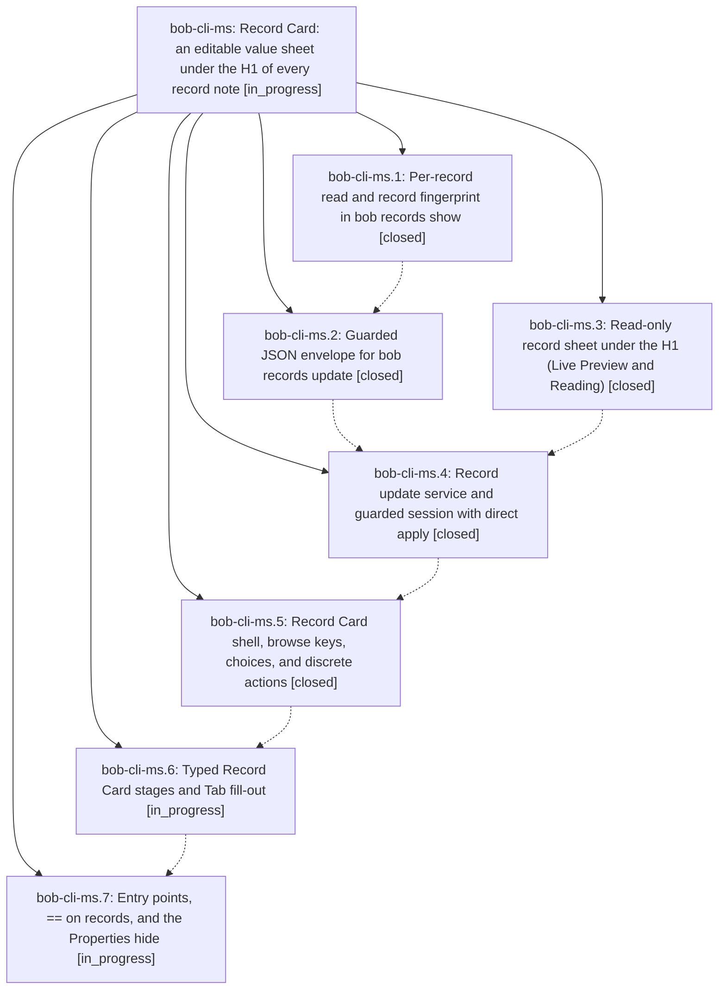

# Bead: bob-cli-ms — Record Card: an editable value sheet under the H1 of every record note

[Bead Pages](../README.md) / bob-cli-ms

**Status:** ◐ in_progress · **Type:** ▸ plan · **Tier:** epic
**Owner:** `bryanbugyi34@gmail.com` · **Created by:** [bbugyi200.apollo.research.55.linker.w0](https://github.com/bobs-org/bob-cli--agents/blob/main/sessions/bbugyi200.apollo.research.55.linker.w0.md) · **Assignee:** `bob-cli-ms.land`
**Created:** 2026-11-17 11:29:54 EST
**Plan:** [202611/record\_card.md](https://github.com/bobs-org/bob-cli--plans/blob/main/202611/record_card.md)

<!-- sase:links:start -->

## Links

| Relation | Artifact | Why |
| --- | --- | --- |
| implemented-by | [plan:202611/record_card.md][1] | derived from the plan's `bead_id:` frontmatter field |

_Plus 4 automatic references — see [Referenced By](#referenced-by)._

[1]: https://github.com/bobs-org/bob-cli--plans/blob/main/202611/record_card.md

<!-- sase:links:end -->

## Description

Every healthy record note shows its album-defined fields as a quiet, beautiful record sheet under the H1 and above ## Notes, in bob's vocabulary. Every value is editable from a keyboard-first Record Card (== , Ctrl+Shift+P, palette, Command Mode, or a click) through one guarded bob writer, with Undo. Native Properties hide only when the sheet shows every key and bob can write.

## Notes

[2026-11-17T20:49:07Z · bryanbugyi34@gmail.com] The Epic Notetaker agent should make sure that a blank line is placed in between the H1 section and the new record note schema card before landing.

[2026-11-17T21:00:45Z · bob-cli-mr.3.1.land] DISCOVERED ISSUE: bob-cli-mr.3.1 landing triage of bob-cli-mr.3.1.3 note #1 independently attributes the docs/reference/json-outputs.md 6000-word budget failure to this active epic. Using bob_docs.markdown.count_words on git blobs: b0bddbb9 and 1e8f77af = 5999; records-show commit 99005975 (ms.1) = 6058; scan commit 3236ceef stays 6058; records-update commit 48a3116d (ms.2) and current 6c409ab2 = 6089. Thus ms.1 crosses the cap and ms.2 adds 31 more words. Please trim/reorganize the existing page without raising its budget, preserving links and both records contracts. Same-root task search plus all 70 tasks created in the last week found no duplicate; attached to this causal active epic rather than filing a task. The mr.3.1 scan commits never edit this page.

[2026-11-17T21:43:22Z · bryanbugyi34@gmail.com] Actually, disregard that previous comment. Instead let's get rid of the H1 section and render the title at the top of the schema card with appropriate formatting.

[2026-11-17T21:56:52Z · eo.f0--code] Per approved plan:202611/record_card_field_jump_co_landing.md (reviewer: record_card_digits=pick, climb_keeps_field=yes, scoped_force=yes). For ms.land; carries items 1-9.

1. Digits. record_card_digits=pick: choices row 1-9 picks + saves; elsewhere digit is a teaching no-op ('Digits pick a choice on choice fields'), never moves selection.

2. Shift+J/K. record_card_digits=pick: browse-mode field steps, clamped, bump via 241xb ('No next/previous field'), announce '<Label>, field N of M', repeat-silent, reduced-motion, inert in stages/inputs/IME, never writes. Key table in docs/record-card.md, not hint strip.

3. = climbs to same field. climb_keeps_field=yes: = calls openAlbumSchemaEntry({filePath, field}), threads into selectedKey (field:<key>), fallback stats. Small diff in 241y. Test Status round-trip + unknown key.

4. CSS isolation. No bob-album-schema-dialog(-body) on Record Card; bob-record-card-* only. Reuse mu bump/announcer.

5. Docs. One sentence in record-card.md: 'Digits here pick a choice; on the album Schema Card they jump to field N.' Capped pages link out; never raise a budget.

6. Deploy discipline. Vault unwedged at f80d0dd (clean origin/master, 1.130.0; old stamp bob-cli_15 dirty b0a9c89, backup /home/bryan/.local/state/bob-cli/plugin-backups/20261117-165532). Fetch+merge + build before every sync; sync final tree. Refusal rule: Bryan pre-authorizes -F for bob-ledger-tools, bob-navigation-hotkeys, bob-command-mode for rest of both epics only when stamped root exists+clean, HEAD ancestor of origin/master, author phase closed, deploying clean origin/master (stash, ff, build:check, sync -F, pop, rebuild, sync again). Note old stamp + backup; otherwise AGENTS.md.

7. Merge friction. Keep both test:unit entries; rebuild main.js; ms takes next free minor.

8. ms.land acceptance additions: a record's == opens the Record Card. From there, = opens the Schema Card on the same field, and Shift+J and 3 navigate there and never write. The Record Card shows no Schema Card keycaps. At close, the vault holds a clean origin/master deploy of bob-ledger-tools, bob-navigation-hotkeys, and bob-command-mode.

9. Housekeeping. Epic note #2 (json-outputs budget) is resolved by this plan's bob-cli docs commit; do not redo it.

[2026-11-17T22:00:39Z · bob-cli-mu.land] DISCOVERED ISSUE: bob-cli-mu landing corroborates the JSON reference budget problem from mu.1 note #2 and mu.2 note #2. Both report docs/reference/json-outputs.md at 6089/6000 during npm run docs:check. Reviewed commits 99005975 (ms.1) and 48a3116d (ms.2), which add the records contracts and cross the budget as already recorded in this epic note #2. No duplicate task after same-root all-status search and 70-task last-week sweep; retain this as ms integration work.

[2026-11-17T22:18:57Z · eo.f0--code] Note #2 (json-outputs budget) is resolved by this plan's docs commit: 6089 to 5233 words (cap 6000, target <=5850 for em--code headroom). Commit subject docs(reference): trim json-outputs.md back under its word budget. Agent eo.f0--code per plan:202611/record_card_field_jump_co_landing.md. Gates: just docs-check passes; BOB_CLI_DIR bob-plugins npm run docs:check passes; 7 anchors, 171 table rows, both records contracts kept; no broken in-repo links.

[2026-11-17T22:29:57Z · bob-cli-mr.land] DISCOVERED ISSUE corroboration from bob-cli-mr landing, proposing bead mr.3.1.3 note #1: canonical count_words on current 0e83df4c docs/reference/json-outputs.md is 6112/6000 (cfc3177c added records tidy after the prior 6089 report). Your notes #4/#6 already assign the 5233-word repair to eo.f0--code; that docs commit is not in origin/master as fetched in this audit. Preserve that pending repair rather than creating duplicate work. Same-type then all-type semantic search and all 70 tasks from the last week found no matching task; b6 is resolved generated drift and jz tracks different mounted pages. No new task or +1 on unrelated tasks.

[2026-11-17T23:53:49Z · bob-cli-mw.land] DISCOVERED ISSUE: Daily Headline landing triage, proposed by bob-cli-mw.1 note #2. The records tidy addition cfc3177c (record H1/empty Notes cleanup aligned with ms note #3) mounts NativeCommand::RecordsTidy in src/runner.rs and completion/tree.rs, but current 225a6fb still has no records/tidy catalog entry or exclusion in native/catalog/table.rs, no completion kinds decision for its TYPE argument, and no RecordsTidy in the canonical-path test expected array. mw.1 reproduced all three lib failures on clean pre-headline 0e83df4c: public_leaves_are_entries_or_excluded, every_value_arg_has_a_decision (records tidy:type), every_native_command_is_on_exactly_one_canonical_path (92 vs 91). Landing independently rechecked the unchanged source and cfc3177c diff; a bounded local cargo reproduction timed out compiling dependencies before tests, so this is source corroboration, not a fresh test result. Same-type and all-type task searches plus all 68 tasks created in the last week found no semantic duplicate; 4j concerns the already-fixed highlights audio argument, hp concerns duplicate clipboard registration. Please integrate the tidy command into the three registries as Record Card landing work; no duplicate task created.

## Phases

| Bead | Title | Status | Size | Created | Agents | Commits |
|---|---|---|---|---|---:|---:|
| [bob-cli-ms.1](bob-cli-ms.1.md) | Per-record read and record fingerprint in bob records show | ✓ closed | medium | 2026-11-17 | 1 | 1 |
| [bob-cli-ms.2](bob-cli-ms.2.md) | Guarded JSON envelope for bob records update | ✓ closed | medium | 2026-11-17 | 1 | 1 |
| [bob-cli-ms.3](bob-cli-ms.3.md) | Read-only record sheet under the H1 (Live Preview and Reading) | ✓ closed | large | 2026-11-17 | 1 | 1 |
| [bob-cli-ms.4](bob-cli-ms.4.md) | Record update service and guarded session with direct apply | ✓ closed | medium | 2026-11-17 | 1 | 1 |
| [bob-cli-ms.5](bob-cli-ms.5.md) | Record Card shell, browse keys, choices, and discrete actions | ✓ closed | large | 2026-11-17 | 1 | 1 |
| [bob-cli-ms.6](bob-cli-ms.6.md) | Typed Record Card stages and Tab fill-out | ◐ in_progress | large | 2026-11-17 | 1 | 1 |
| [bob-cli-ms.7](bob-cli-ms.7.md) | Entry points, == on records, and the Properties hide | ◐ in_progress | medium | 2026-11-17 | 1 | 0 |

## Lineage

## Agents

| Agent | Bead | Commits |
|---|---|---:|
| [bbugyi200.apollo.bob-cli-ms.1](https://github.com/bobs-org/bob-cli--agents/blob/main/sessions/bbugyi200.apollo.bob-cli-ms.1.md) | [bob-cli-ms.1](bob-cli-ms.1.md) | 1 |
| [bbugyi200.apollo.bob-cli-ms.2](https://github.com/bobs-org/bob-cli--agents/blob/main/agents/bbugyi200.apollo.bob-cli-ms.2/README.md) | [bob-cli-ms.2](bob-cli-ms.2.md) | 1 |
| [bbugyi200.apollo.bob-cli-ms.3](https://github.com/bobs-org/bob-cli--agents/blob/main/sessions/bbugyi200.apollo.bob-cli-ms.3.md) | [bob-cli-ms.3](bob-cli-ms.3.md) | 1 |
| [bbugyi200.apollo.bob-cli-ms.4](https://github.com/bobs-org/bob-cli--agents/blob/main/agents/bbugyi200.apollo.bob-cli-ms.4/README.md) | [bob-cli-ms.4](bob-cli-ms.4.md) | 1 |
| [bbugyi200.apollo.bob-cli-ms.5](https://github.com/bobs-org/bob-cli--agents/blob/main/sessions/bbugyi200.apollo.bob-cli-ms.5.md) | [bob-cli-ms.5](bob-cli-ms.5.md) | 1 |
| [bbugyi200.apollo.bob-cli-ms.6](https://github.com/bobs-org/bob-cli--agents/blob/main/sessions/bbugyi200.apollo.bob-cli-ms.6.md) | [bob-cli-ms.6](bob-cli-ms.6.md) | 1 |
| [bbugyi200.apollo.bob-cli-ms.7](https://github.com/bobs-org/bob-cli--agents/blob/main/agents/bbugyi200.apollo.bob-cli-ms.7/README.md) | [bob-cli-ms.7](bob-cli-ms.7.md) | 0 |
| [bbugyi200.apollo.bob-cli-ms.land](https://github.com/bobs-org/bob-cli--agents/blob/main/agents/bbugyi200.apollo.bob-cli-ms.land/README.md) | [bob-cli-ms](README.md) | 0 |

## Commits

| Repo | Commit | Subject | Bead | Committed |
|---|---|---|---|---|
| bob-cli | [`9900597`](https://github.com/bobs-org/bob-cli/commit/99005975e15aaa3c2440b36e8f87dc4481908500) | feat(records): add per-record show STEM and fingerprint | [bob-cli-ms.1](bob-cli-ms.1.md) | 2026-11-17 13:38:16 EST |
| bob-plugins | [`bob-plugins@60b5602`](https://github.com/bobs-org/bob-plugins/commit/60b5602130e4655efdf0b2dda2e6c1afcc5234ae) | feat(ledger-tools): render a read-only record sheet under album H1s | [bob-cli-ms.3](bob-cli-ms.3.md) | 2026-11-17 14:39:27 EST |
| bob-cli | [`48a3116`](https://github.com/bobs-org/bob-cli/commit/48a3116d8aacce34fc3093c97048dcdcd913f7c1) | feat(records): guarded JSON envelope for bob records update | [bob-cli-ms.2](bob-cli-ms.2.md) | 2026-11-17 15:41:57 EST |
| bob-plugins | [`bob-plugins@f49e175`](https://github.com/bobs-org/bob-plugins/commit/f49e175436ce002e48e258bc60bc433b3167190e) | feat(ledger-tools): add record update session and writer | [bob-cli-ms.4](bob-cli-ms.4.md) | 2026-11-17 16:24:19 EST |
| bob-plugins | [`bob-plugins@c1da817`](https://github.com/bobs-org/bob-plugins/commit/c1da817c213b0ebf1f3ae4b47b4d41a69230948c) | feat(ledger-tools): add Record Card shell for discrete field edits | [bob-cli-ms.5](bob-cli-ms.5.md) | 2026-11-17 17:52:48 EST |
| bob-plugins | [`bob-plugins@ba2b090`](https://github.com/bobs-org/bob-plugins/commit/ba2b09061153621311f179c102cfcab8c1b8e0b7) | feat(record-card): typed stages with Tab fill-out | [bob-cli-ms.6](bob-cli-ms.6.md) | 2026-11-17 19:29:14 EST |

<!-- sase:referenced-by:start -->

## Referenced By

| Relation | Artifact | Why | Uses |
| --- | --- | --- | ---: |
| read-by | [agent:bob-cli-mr.land--2][1] | Need ms JSON budget notes | 2 |
| read-by | [agent:bob-cli-ms.2][2] | Need epic scope for phase 2 | 1 |
| read-by | [agent:bob-cli-mw.1][3] | Cite whether records-tidy catalog/completion failures belong to this epic | 1 |
| read-by | [agent:eo.f0--code][4] | Need note number for report | 2 |

[1]: https://github.com/bobs-org/bob-cli--agents/blob/main/sessions/bbugyi200.apollo.bob-cli-mr.land.md
[2]: https://github.com/bobs-org/bob-cli--agents/blob/main/agents/bbugyi200.apollo.bob-cli-ms.2/README.md
[3]: https://github.com/bobs-org/bob-cli--agents/blob/main/agents/bbugyi200.apollo.bob-cli-mw.1/README.md
[4]: https://github.com/bobs-org/bob-cli--agents/blob/main/sessions/bbugyi200.apollo.eo.f0.md

<!-- sase:referenced-by:end -->
