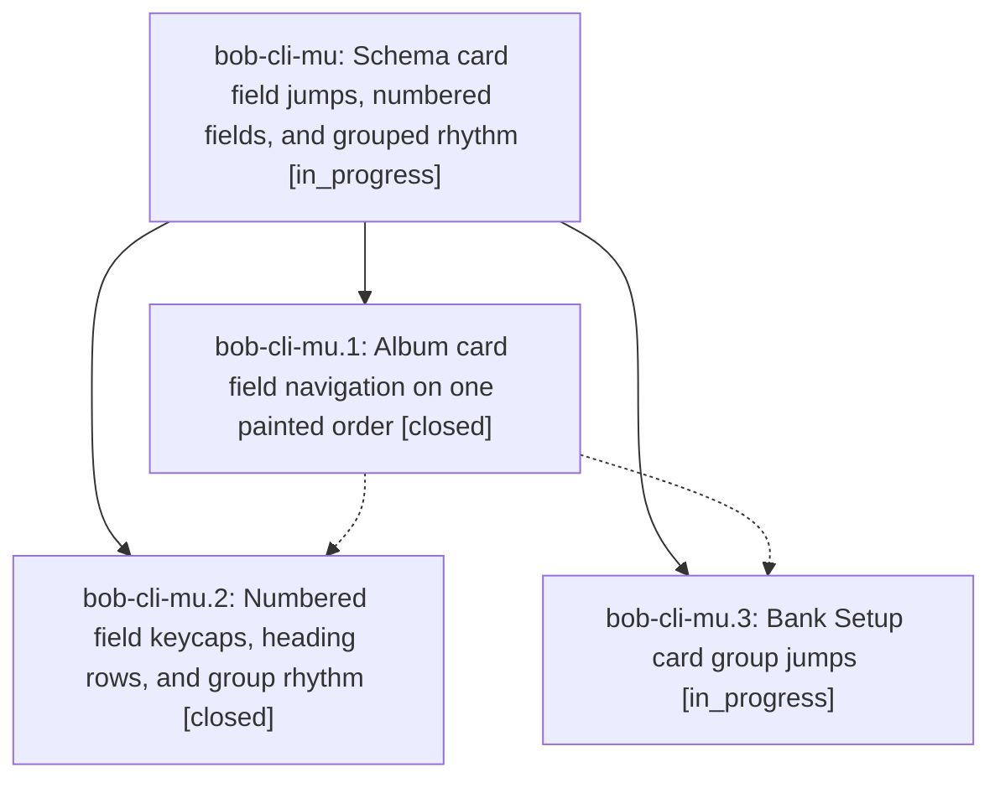

# Bead: bob-cli-mu — Schema card field jumps, numbered fields, and grouped rhythm

[Bead Pages](../README.md) / bob-cli-mu

**Status:** ◐ in_progress · **Type:** ▸ plan · **Tier:** epic
**Owner:** `bryanbugyi34@gmail.com` · **Created by:** [bbugyi200.apollo.research.57.linker.w0](https://github.com/bobs-org/bob-cli--agents/blob/main/sessions/bbugyi200.apollo.research.57.linker.w0.md) · **Assignee:** `bob-cli-mu.land`
**Created:** 2026-11-17 15:36:25 EST
**Plan:** [202611/schema\_card\_field\_jumps.md](https://github.com/bobs-org/bob-cli--plans/blob/main/202611/schema_card_field_jumps.md)

<!-- sase:links:start -->

## Links

| Relation | Artifact | Why |
| --- | --- | --- |
| implemented-by | [plan:202611/schema_card_field_jumps.md][1] | derived from the plan's `bead_id:` frontmatter field |

[1]: https://github.com/bobs-org/bob-cli--plans/blob/main/202611/schema_card_field_jumps.md

<!-- sase:links:end -->

## Description

On the album Schema Card (opened from album and record notes), Shift+J/Shift+K step between fields and 1–9 jump straight to a numbered field, with a keycap showing each field's number beside its name and clear space between field groups. On the bank Setup card (~/bob/bank.md), Shift+J/Shift+K step between category groups while digit hotkeys keep working. Every jump is pure navigation that never writes, and the numbers and jumps always follow the order painted on screen.

## Phases

| Bead | Title | Status | Size | Created | Agents | Commits |
|---|---|---|---|---|---:|---:|
| [bob-cli-mu.1](bob-cli-mu.1.md) | Album card field navigation on one painted order | ✓ closed | medium | 2026-11-17 | 1 | 1 |
| [bob-cli-mu.2](bob-cli-mu.2.md) | Numbered field keycaps, heading rows, and group rhythm | ✓ closed | medium | 2026-11-17 | 1 | 1 |
| [bob-cli-mu.3](bob-cli-mu.3.md) | Bank Setup card group jumps | ◐ in_progress | small | 2026-11-17 | 1 | 0 |

## Lineage

## Agents

| Agent | Bead | Commits |
|---|---|---:|
| [bbugyi200.apollo.bob-cli-mu.1](https://github.com/bobs-org/bob-cli--agents/blob/main/agents/bbugyi200.apollo.bob-cli-mu.1/README.md) | [bob-cli-mu.1](bob-cli-mu.1.md) | 1 |
| [bbugyi200.apollo.bob-cli-mu.2](https://github.com/bobs-org/bob-cli--agents/blob/main/agents/bbugyi200.apollo.bob-cli-mu.2/README.md) | [bob-cli-mu.2](bob-cli-mu.2.md) | 1 |
| [bbugyi200.apollo.bob-cli-mu.3](https://github.com/bobs-org/bob-cli--agents/blob/main/agents/bbugyi200.apollo.bob-cli-mu.3/README.md) | [bob-cli-mu.3](bob-cli-mu.3.md) | 0 |
| [bbugyi200.apollo.bob-cli-mu.land](https://github.com/bobs-org/bob-cli--agents/blob/main/agents/bbugyi200.apollo.bob-cli-mu.land/README.md) | [bob-cli-mu](README.md) | 0 |

## Commits

| Repo | Commit | Subject | Bead | Committed |
|---|---|---|---|---|
| bob-plugins | [`bob-plugins@137c77f`](https://github.com/bobs-org/bob-plugins/commit/137c77f60dbf39494b1b47e519ad61c930bfa9e2) | feat(schema-card): jump between fields with Shift+J/K and 1-9 in painted order | [bob-cli-mu.1](bob-cli-mu.1.md) | 2026-11-17 16:04:12 EST |
| bob-plugins | [`bob-plugins@e32deb6`](https://github.com/bobs-org/bob-plugins/commit/e32deb60574b3a2d09241e8d87d4501348fbe4c5) | feat(schema-card): number painted fields with hanging keycaps and a field hint | [bob-cli-mu.2](bob-cli-mu.2.md) | 2026-11-17 16:29:12 EST |
