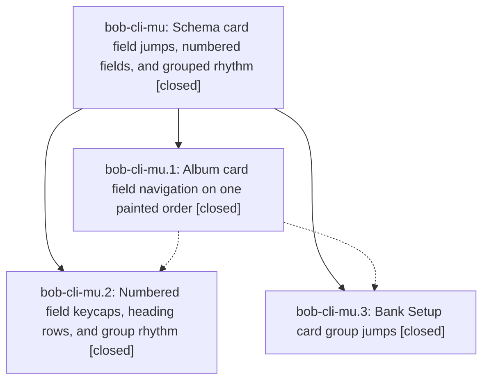

# Bead: bob-cli-mu — Schema card field jumps, numbered fields, and grouped rhythm

[Bead Pages](../README.md) / bob-cli-mu

**Status:** ✓ closed · **Resolution:** done · **Type:** ▸ plan · **Tier:** epic
**Owner:** `bryanbugyi34@gmail.com` · **Created by:** [bbugyi200.apollo.research.57.linker.w0](https://github.com/bobs-org/bob-cli--agents/blob/main/sessions/bbugyi200.apollo.research.57.linker.w0.md) · **Assignee:** `bob-cli-mu.land`
**Created:** 2026-11-17 15:36:25 EST · **Closed:** 2026-11-17 18:16:41 EST
**Plan:** [202611/schema\_card\_field\_jumps.md](https://github.com/bobs-org/bob-cli--plans/blob/main/202611/schema_card_field_jumps.md)

<!-- sase:links:start -->

## Links

| Relation | Artifact | Why |
| --- | --- | --- |
| implemented-by | [plan:202611/schema_card_field_jumps.md][1] | derived from the plan's `bead_id:` frontmatter field |
| related | file:explicit:8c900ff7e5039639f9276cc6 | attached via sase artifact create --bead |

_Plus 2 automatic references — see [Referenced By](#referenced-by)._

[1]: https://github.com/bobs-org/bob-cli--plans/blob/main/202611/schema_card_field_jumps.md

<!-- sase:links:end -->

## Description

On the album Schema Card (opened from album and record notes), Shift+J/Shift+K step between fields and 1–9 jump straight to a numbered field, with a keycap showing each field's number beside its name and clear space between field groups. On the bank Setup card (~/bob/bank.md), Shift+J/Shift+K step between category groups while digit hotkeys keep working. Every jump is pure navigation that never writes, and the numbers and jumps always follow the order painted on screen.

## Notes

[2026-11-17T21:55:55Z · eo.f0--code] Per approved plan:202611/record_card_field_jump_co_landing.md (reviewer: record_card_digits=pick, climb_keeps_field=yes, scoped_force=yes).

1. Acceptance correction. Replace 'Record note: == opens the same card' with: from a record note, Edit album schema (palette) opens the Schema Card, and Shift+J / 3 work there. A record's == is album-only today. bob-cli-ms.7 owns that route: it will open the Record Card, which is expected and not a regression. Do not change 248m. If ms.7 has already landed, also check that = from the Record Card reaches the Schema Card with field jumps working.

2. Deploy. Vault unwedged at f80d0dd (clean origin/master, bob-ledger-tools 1.130.0). Old stamp: bob-cli_15 dirty b0a9c89 build (v1.129.0, 2026-11-17T18:48:30Z, digest cd40fa09...), backup /home/bryan/.local/state/bob-cli/plugin-backups/20261117-165532. Before each sync, fetch and merge origin/master, then run npm run build. Sync may refuse because a running bob-cli-ms agent's dirty deploy is in place. If that stamp's source_head already contains every bob-cli-mu commit (137c77f, e32deb6, f80d0dd), mu's work is live: record that, then continue without waiting and without forcing.

3. Docs. The json-outputs budget is fixed by this plan's bob-cli docs commit (Step 3); do not re-fix it here.

Refusal rule: Bryan pre-authorizes -F for bob-ledger-tools, bob-navigation-hotkeys, and bob-command-mode, for the rest of these two epics only. Use only when ALL hold: stamped source_root exists and has no uncommitted changes; its HEAD is an ancestor of origin/master; the author's phase bead is closed; you deploy a clean, up-to-date origin/master (stash, fast-forward, run npm run build:check, sync -F, pop, rebuild, then sync again without -F). Afterwards, note the old stamp and sync's backup directory on your bead. In every other case, follow AGENTS.md.

[2026-11-17T22:05:25Z · bob-cli-mu.land] LANDING AUDIT / FOLLOW-UP TRIAGE before repair tale: read the epic and all notes on mu.1/.2/.3, approved plan:202611/schema_card_field_jumps.md, its consolidated design report, epic plugin commits 137c77f/e32deb6/f80d0dd, and actual source/tests. Field-number decision=no honored; no memory edits. Shared painted order, parent-first/clamped jumps, digit-count retirement, key gates, no-write navigation, announcer/reveal/reduced-motion helpers, keycaps and bank lowercase hotkeys are implemented. Reviewed only intervening non-epic plugin commit f49e175 (Record Card session/writer): direct apply remains opt-in; existing schema semantics survive. bob-cli records/scan changes since epic creation do not require field-jump integration. Refetched both origins: bob-cli=6c409ab2 and plugins=f80d0dd, no drift. Focused album field-jump/shell/arrange/place-drag, bank group-jump/arrange, record-sheet/update and album/bank e2e-wrapper suites pass; build:check and docs:inventory:check pass. No full npm test or just check rerun yet; no source changes made and repairs remain.

EPIC REMAINS INCOMPLETE: actual painter serialized into Chromium with current CSS at 16px yields 18.09375px keycaps instead of 23.2px; Status/Claim/Section labels are at 518.40625/488/582.8125px while first chip and + field are at 60.796875px. Existing space-between row justification plus new em-at-0.78-font sizing break the promised common axis and keycap box. Runtime empty-schema schemaFieldStep(-1,{}) bumps +1 instead of -1. Generic browser reproduction is not real Obsidian acceptance; Obsidian/xvfb-run absent here, and required visual screenshots remain unverified. These are retained as remaining epic work in one medium repair tale with explicit same-turn epic closeout. Durable reproduction script, measurements, and audit: file:explicit:8c900ff7e5039639f9276cc6.

FOLLOW-UP OUTCOMES: mu.1 #2 and mu.2 #2 JSON reference budget routed via sase_new_task as DISCOVERED ISSUE corroboration on causal active epic bob-cli-ms, no duplicate task. Independent count_words of git blobs: 5999 at b0bddbb9, 6058 at 99005975 (ms.1), 6089 at 48a3116d (ms.2) and HEAD; budget bump declined in favor of owner-epic repair. mu.1 #3, mu.2 #1 and mu.3 #1 timing reports recorded as attributed +1 on bob-cli-km (event-link-times), io (frees-marks), ki (keep-moving-marks-surface), ju (off-clock-link-chips). mu.1 #3 dependencies-stage-entry-and-view also corroborated bob-cli-3w; m1 is a distinct growth-ratio node and was deliberately not corroborated. No new lander full-suite timing failure claimed, no duplicate task, no blanket threshold increase. All-status semantic search, all 70 tasks from the last week, and all 14 active epic scopes reviewed. mu.1 #1 is stray read-command text, no work to implement. All deployment refusal notes superseded: normal bob plugins sync --repo current-linked-checkout --no-pull -p bob-ledger-tools succeeded, up to date, 0 copied/0 skipped/3 unchanged, no force. Post-sync Obsidian smoke not claimed. No epic-symbol entries; symvision absent in both checkouts; no parent_bead. Carry every disposition into the eventual close note.

[2026-11-17T23:16:41Z · bob-cli-mu.land] Repair-and-closeout of bob-cli-mu (same-turn tale plan:202611/schema_card_landing_repair.md). Phases mu.1/.2/.3 were already CLOSED. No child tale bead. field_number_record=no: no memory edits.

PRODUCT. Dialog field rows are start-aligned; filled counts stay trailing via margin-inline-start:auto; keycap box uses row-em (`width/height: calc(var(--bob-schema-keycap) / var(--bob-schema-digit))` with digit `font-size: calc(1em * var(--bob-schema-digit))`); gutter includes 1px border + pad + grip + gaps + keycap; gripless rows reserve the grip slot. Empty-schema schemaFieldStep uses the requested sign (`down ? 1 : -1`); digits still bump +1. Fragment 241yf is 107 lines. Record Card shell c1da817 uses its own classes; `=` on that card still calls openAlbumSchemaEntry; record-note `==` stays album-only (ms.7). Inline header and record sheet stay unnumbered.

ATHENA OBSIDIAN (xvfb-run, patched tree). Desktop geometry: axisDelta.max=0, keyWidth===21.75 expected. Shift+J from stats -> field:status; digit 3 -> field:category; edits=0. YAML Done uses isMarkdownSource (mode===source || source===true) and passes; done-blocked passes. 375 Electron innerWidth stays 900 while the schema modal is open; measured axis at that width is still max=0. Bank Shift+J from category:groceries -> group:Everyday, no writer calls. Leftover probe flakes (not product geometry/jump defects): album schema-arrange-option-code-local / schema-arrange-nudge-budget n=0 after the jump probe; bank setup-group-jump-shift-k stays on the first model.items category when painted order has no preceding group (parent-first Shift+K is unit-tested: groceries back -> group:Everyday). CDP keys often miss contentEl; synthetic bubbling KeyboardEvent is the working fallback.

TESTS. Focused field-jump/arrange/shell/place-drag/bank-group-jump/record-card/record-sheet/double-equals/e2e-wrapper suites: 123 pass, 1 skip (BOB_BIN). Empty-schema Shift+K -> [-1]. npm run build + build:check green (inventory current). Full npm test: 5 load-timing fails, 0 product fails — event-link-times, frees-marks, keep-moving-marks-surface, keep-moving-marks KT1–KT8, off-clock-link-chips. docs:check on this bob-cli checkout still flags json-outputs.md 6089/6000; origin now has 3914ab50 trimming that file (workspace is 3 behind: 3914ab50, 0e83df4c scan lock-window, cfc3177c records tidy). Smoke self-test 17/17. Apollo has no Obsidian; real visual pass was Athena.

DEPLOY. bob-plugins FF-merged origin/master to c1da817 then reapplied the repair. Live vault sync refused: stamp is ws bob-cli_10 dirty f80d0dd @ 2026-11-17T22:04:02Z; bob-cli-ms.6 is still RUNNING there. Vault manifest/styles match c1da817; vault main.js matches no commit. Original mu commits 137c77f/e32deb6/f80d0dd are ancestors so field jumps, keycaps, and bank group jumps are live; the geometry/empty-schema repair is not in the live vault. No -F. Athena scratch verified the repaired bundle.

FOLLOW-UPS (lander triage, no new beads): mu.1 #2 / mu.2 #2 json-outputs DISCOVERED ISSUE on bob-cli-ms (5999 -> 6058 -> 6089); budget bump not adopted; origin 3914ab50 now trims it. mu.1 #3 / mu.2 #1 / mu.3 #1 + this npm test corroborate bob-cli-km, bob-cli-io, bob-cli-ki, bob-cli-ju. mu.1 #3 also bob-cli-3w; bob-cli-m1 deliberately not corroborated. mu.1 #1 accidental note. Deployment-blocked phase notes superseded by earlier clean sync; this repair’s live-vault copy waits on ms.6. Epic note #1: record == is album-only; json-outputs owned by ms; -F only under the two-epic rule (not used). No --epic-symbol entries. just symvision absent in both checkouts. No parent_bead at close.

[2026-11-17T23:17:50Z · bob-cli-mu.land] just check in this bob-cli checkout passed (exit 0). just symvision still absent. No parent_bead after close.

## Phases

| Bead | Title | Status | Size | Created | Agents | Commits |
|---|---|---|---|---|---:|---:|
| [bob-cli-mu.1](bob-cli-mu.1.md) | Album card field navigation on one painted order | ✓ closed | medium | 2026-11-17 | 1 | 1 |
| [bob-cli-mu.2](bob-cli-mu.2.md) | Numbered field keycaps, heading rows, and group rhythm | ✓ closed | medium | 2026-11-17 | 1 | 1 |
| [bob-cli-mu.3](bob-cli-mu.3.md) | Bank Setup card group jumps | ✓ closed | small | 2026-11-17 | 1 | 1 |

## Lineage

## Agents

| Agent | Bead | Commits |
|---|---|---:|
| [bbugyi200.apollo.bob-cli-mu.1](https://github.com/bobs-org/bob-cli--agents/blob/main/agents/bbugyi200.apollo.bob-cli-mu.1/README.md) | [bob-cli-mu.1](bob-cli-mu.1.md) | 1 |
| [bbugyi200.apollo.bob-cli-mu.2](https://github.com/bobs-org/bob-cli--agents/blob/main/agents/bbugyi200.apollo.bob-cli-mu.2/README.md) | [bob-cli-mu.2](bob-cli-mu.2.md) | 1 |
| [bbugyi200.apollo.bob-cli-mu.3](https://github.com/bobs-org/bob-cli--agents/blob/main/agents/bbugyi200.apollo.bob-cli-mu.3/README.md) | [bob-cli-mu.3](bob-cli-mu.3.md) | 1 |
| [bbugyi200.apollo.bob-cli-mu.land](https://github.com/bobs-org/bob-cli--agents/blob/main/sessions/bbugyi200.apollo.bob-cli-mu.land.md) | [bob-cli-mu](README.md) | 1 |

## Commits

| Repo | Commit | Subject | Bead | Committed |
|---|---|---|---|---|
| bob-plugins | [`bob-plugins@137c77f`](https://github.com/bobs-org/bob-plugins/commit/137c77f60dbf39494b1b47e519ad61c930bfa9e2) | feat(schema-card): jump between fields with Shift+J/K and 1-9 in painted order | [bob-cli-mu.1](bob-cli-mu.1.md) | 2026-11-17 16:04:12 EST |
| bob-plugins | [`bob-plugins@e32deb6`](https://github.com/bobs-org/bob-plugins/commit/e32deb60574b3a2d09241e8d87d4501348fbe4c5) | feat(schema-card): number painted fields with hanging keycaps and a field hint | [bob-cli-mu.2](bob-cli-mu.2.md) | 2026-11-17 16:29:12 EST |
| bob-plugins | [`bob-plugins@f80d0dd`](https://github.com/bobs-org/bob-plugins/commit/f80d0dd09ff23e5cb46f8ac4bb0fa09d81025c9a) | feat(bank-setup): walk category groups in painted order with Shift+J/K | [bob-cli-mu.3](bob-cli-mu.3.md) | 2026-11-17 16:51:37 EST |
| bob-plugins | [`bob-plugins@b067881`](https://github.com/bobs-org/bob-plugins/commit/b067881386a0bd4239102f9de6f13e3571aa53a9) | fix(schema-card): size field keycaps on the row em and bump empty-schema Shift+K up | [bob-cli-mu](README.md) | 2026-11-17 18:19:30 EST |

<!-- sase:referenced-by:start -->

## Referenced By

| Relation | Artifact | Why | Uses |
| --- | --- | --- | ---: |
| read-by | [agent:bob-cli-mu.3][1] | Check epic status and sibling phases | 1 |
| read-by | [agent:eo.f0--code][2] | Need notes | 4 |

[1]: https://github.com/bobs-org/bob-cli--agents/blob/main/agents/bbugyi200.apollo.bob-cli-mu.3/README.md
[2]: https://github.com/bobs-org/bob-cli--agents/blob/main/sessions/bbugyi200.apollo.eo.f0.md

<!-- sase:referenced-by:end -->
