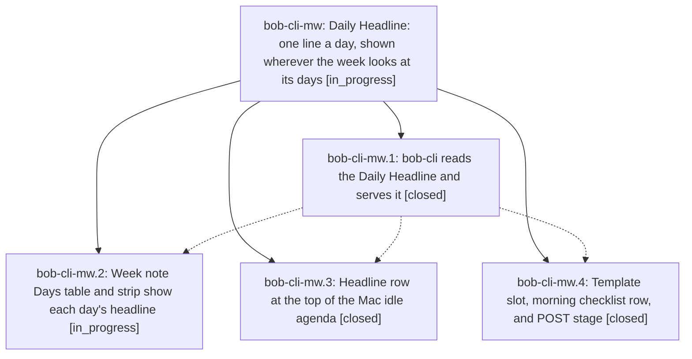

# Bead: bob-cli-mw — Daily Headline: one line a day, shown wherever the week looks at its days

[Bead Pages](../README.md) / bob-cli-mw

**Status:** ◐ in_progress · **Type:** ▸ plan · **Tier:** epic
**Owner:** `bryanbugyi34@gmail.com` · **Created by:** [bbugyi200.athena.1dq](https://github.com/bobs-org/bob-cli--agents/blob/main/sessions/bbugyi200.athena.1dq.md) · **Assignee:** `bob-cli-mw.land`
**Created:** 2026-11-17 17:23:39 EST
**Plan:** [202611/daily\_headline.md](https://github.com/bobs-org/bob-cli--plans/blob/main/202611/daily_headline.md)

<!-- sase:links:start -->

## Links

| Relation | Artifact | Why |
| --- | --- | --- |
| implemented-by | [plan:202611/daily_headline.md][1] | derived from the plan's `bead_id:` frontmatter field |

[1]: https://github.com/bobs-org/bob-cli--plans/blob/main/202611/daily_headline.md

<!-- sase:links:end -->

## Description

Every daily note can carry one Bryan-written `**Headline:**` line naming the result that would make the day count. bob reads it (and never writes it) and serves it to the week note's Days table and strip, the weekly brief, the terminal, and the top of the Bob Mac Capture idle agenda. A concise POST checklist row in gtd_daily.md prompts it each morning.

## Phases

| Bead | Title | Status | Size | Created | Agents | Commits |
|---|---|---|---|---|---:|---:|
| [bob-cli-mw.1](bob-cli-mw.1.md) | bob-cli reads the Daily Headline and serves it | ✓ closed | medium | 2026-11-17 | 1 | 1 |
| [bob-cli-mw.2](bob-cli-mw.2.md) | Week note Days table and strip show each day's headline | ◐ in_progress | small | 2026-11-17 | 1 | 0 |
| [bob-cli-mw.3](bob-cli-mw.3.md) | Headline row at the top of the Mac idle agenda | ✓ closed | medium | 2026-11-17 | 1 | 1 |
| [bob-cli-mw.4](bob-cli-mw.4.md) | Template slot, morning checklist row, and POST stage | ✓ closed | small | 2026-11-17 | 1 | 0 |

## Lineage

## Agents

| Agent | Bead | Commits |
|---|---|---:|
| [bbugyi200.athena.bob-cli-mw.1](https://github.com/bobs-org/bob-cli--agents/blob/main/agents/bbugyi200.athena.bob-cli-mw.1/README.md) | [bob-cli-mw.1](bob-cli-mw.1.md) | 1 |
| [bbugyi200.athena.bob-cli-mw.2](https://github.com/bobs-org/bob-cli--agents/blob/main/sessions/bbugyi200.athena.bob-cli-mw.2.md) | [bob-cli-mw.2](bob-cli-mw.2.md) | 0 |
| [bbugyi200.athena.bob-cli-mw.3](https://github.com/bobs-org/bob-cli--agents/blob/main/agents/bbugyi200.athena.bob-cli-mw.3/README.md) | [bob-cli-mw.3](bob-cli-mw.3.md) | 1 |
| [bbugyi200.athena.bob-cli-mw.4](https://github.com/bobs-org/bob-cli--agents/blob/main/agents/bbugyi200.athena.bob-cli-mw.4/README.md) | [bob-cli-mw.4](bob-cli-mw.4.md) | 0 |
| [bbugyi200.athena.bob-cli-mw.land](https://github.com/bobs-org/bob-cli--agents/blob/main/agents/bbugyi200.athena.bob-cli-mw.land/README.md) | [bob-cli-mw](README.md) | 0 |

## Commits

| Repo | Commit | Subject | Bead | Committed |
|---|---|---|---|---|
| bob-cli | [`2a58d06`](https://github.com/bobs-org/bob-cli/commit/2a58d06701cc74324c055970e69eaa9de8757dba) | feat(periods): serve Daily Headline on week days and capture --tasks | [bob-cli-mw.1](bob-cli-mw.1.md) | 2026-11-17 18:04:26 EST |
| bob-mac-capture | [`bob-mac-capture@18de389`](https://github.com/bobs-org/bob-mac-capture/commit/18de389ef75541ba76144470e5fb0426cccbf57b) | feat(agenda): show Daily Headline row under Today title | [bob-cli-mw.3](bob-cli-mw.3.md) | 2026-11-17 18:42:17 EST |
