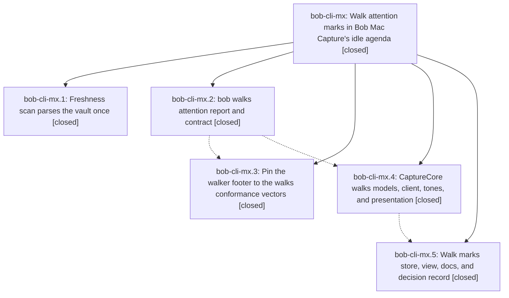

# Bead: bob-cli-mx — Walk attention marks in Bob Mac Capture's idle agenda

[Bead Pages](../README.md) / bob-cli-mx

**Status:** ✓ closed · **Resolution:** done · **Type:** ▸ plan · **Tier:** epic
**Owner:** `bryanbugyi34@gmail.com` · **Created by:** [bbugyi200.apollo.es](https://github.com/bobs-org/bob-cli--agents/blob/main/sessions/bbugyi200.apollo.es.md) · **Assignee:** `bob-cli-mx.land`
**Created:** 2026-11-17 17:59:52 EST · **Closed:** 2026-11-18 00:25:16 EST
**Plan:** [202611/mac\_walk\_attention\_marks.md](https://github.com/bobs-org/bob-cli--plans/blob/main/202611/mac_walk_attention_marks.md)

<!-- sase:links:start -->

## Links

| Relation | Artifact | Why |
| --- | --- | --- |
| implemented-by | [plan:202611/mac_walk_attention_marks.md][1] | derived from the plan's `bead_id:` frontmatter field |

_Plus 3 automatic references — see [Referenced By](#referenced-by)._

[1]: https://github.com/bobs-org/bob-cli--plans/blob/main/202611/mac_walk_attention_marks.md

<!-- sase:links:end -->

## Description

Whenever the Obsidian walker selector shows attention for a family (an off-family dot or selected-family ink) — `s` review, `w` lanes, `b` bank — Bob Mac Capture's idle agenda shows that family's mark (its letter with a hue dot) at the title row's trailing edge, computed by bob from the same contract, and shows nothing otherwise.

## Notes

[2026-11-18T03:15:20Z · bob-cli-ms.land] DISCOVERED ISSUE (from bob-cli-ms landing): just docs-check on master 97f844ca fails its documentation unit tests stage after lint, drift, strict build, lychee, search smoke, tutorial and media all pass. tools/docs/tests/test_contracts.py::test_current_registry_and_generated_nav_are_complete_and_unique asserts len(registry.entries) == 51 but sees 52, and ::test_readme_table_matches_original_contract_index_snapshot's README_TABLE_SHA256 no longer matches. c50f8895 (bob-cli-mx.2, feat(walks): add read-only attention report and contract) added the walks entry to docs/_meta/contracts.yml and the docs/README.md contract table without updating those two pinned values. The Record Card epic adds no contract. Fix: bump the count to 52 and refresh README_TABLE_SHA256 after confirming the new row is intended. Same-type and all-type task searches found only closed bob-cli-hs (an earlier schema-16 snapshot refresh, different cause); no task created.

[2026-11-18T05:25:16Z · bob-cli-mx.land] VERIFIED (step 1). Read the epic, all 5 phases with every note, the plan, and the epic commits.
- scan-once: bob-cli 3c796c7c. RichTaskIndex shares one settings read and TaskIndex across the freshness scan. 161 freshness lib tests pass.
- bob-walks: bob-cli c50f8895. src/native/walks computes s, w, and b independently. Labels match the walker footer. JSON schema 1, docs/walks.md, vectors S1-S5, W1-W8, B1-B4. 30 walks CLI tests and 9 lib tests pass, including goldens and freshness parity.
- plugin-parity: bob-plugins 5964d35. 17/17 walk-attention vectors still pass at bob-plugins HEAD, and the walker-footer sources are unchanged since.
- mac-walks-core and mac-walk-marks: bob-mac-capture fee9ffab and a19bdd0a. The exact-SHA master CI run 44240009172 on a19bdd0a passed.
- DECISIONS honored: the marks are bare (no frame). s and b carry counts, w stays bare. The memory edits stay within decisions and decisions:idle-capture-shows-ledger-agenda.

FIXED IN THIS LANDING (caused by the epic):
(a) tools/docs/tests/test_contracts.py pinned 51 contracts and the old README table SHA. The walks contract row from c50f8895 made it 52. The old SHA matches the table exactly as it was before c50f8895, so the only change is the walks row. Bumped the count to 52 and refreshed the SHA. This resolves the bob-cli-ms.land DISCOVERED ISSUE and the mx.5 note #2 follow-up.
(b) 4f801ee2 left two metadata: keys in decisions/idle-capture-shows-ledger-agenda, which broke a docs unit test's YAML load. Merged them into one block (superseded-in-part, superseded_by, decided).
(c) 4f801ee2 never ran docs-gen, so docs/develop/decisions.md lacked the new record. Regenerated it.
(d) The new record's evidence cited bob-mac-capture/docs/idle-agenda.md and docs/settings.md, which failed the published-URL gate. It now cites the mounted docs/reference/mac-capture pages. It also cites the phase commits the plan asked for, and the landed master CI run 44240009172 on a19bdd0a instead of the precommit snapshot. The claim is unchanged.
(e) The plan's render refresh, deferred in mx.5 note #1: ran just docs-media in bob-mac-capture from master run 44240009172. capture-agenda light and dark now show s with count 16, w, and b with count 3 on the title row. task-completion was re-imported and refs-browse came back byte-identical.

GATES: bob-cli just check passes. bob-mac-capture just docs-test passes. BOB_CLI_DIR=<this workspace> just docs-check passes every gate: lint, drift, strict build, URLs, lychee, edit links, search, tutorial, media, and 447 docs unit tests.

INTEGRATION (step 2): The bob-cli commits since 3c796c7c (9950a3d4, 0a309950, 97f844ca, 2f14eef5, 03ab2b3d) touch notebook capture, Pomodoro capture, vault-sync, and the glossary. None touches walks, freshness, plan, bank, or contracts. bob-plugins 9ad471d, 8a0c2f1, and f8a8619 are record-sheet and schema work and do not touch the walker footer. There are no later bob-mac-capture commits. Nothing needed rewiring.

FOLLOW-UP TRIAGE (no task created):
- mx.1 #1 (records tidy registry and help tests): resolved by c50f8895. All four tests pass at HEAD.
- mx.2 #1 (plugin index collision): already tracked by bob-cli-it. Not reproduced in this landing's docs-check, so no +1.
- mx.3 #1 (bob-ledger-tools.md over word budget): already tracked by bob-cli-il. Docs lint passes now, so not reproduced and no +1.
- mx.3 #2 and mx.4 #1 (glossary drift): fixed by 03ab2b3d, and bob-cli-mz is closed. The drift gate passes.
- mx.3 #3, record-sheet midnight test: the old test called setupRecordSheet with the real clock and assumed today was 2026-11-17. bob-plugins f8a8619 and 9ad471d pinned recordSheetToday to 2032-05-06, and it passes 3/3 at HEAD.
- mx.3 #3, the four unnamed perf-budget load flakes: declined. They have no test names, and the class is already covered by bob-cli-ki, km, ju, io, m1, and lp.
- mx.4 #2 (CaptureDotRouteAliasTests later-alias red): fixed in a19bdd0a with new later-alias fixtures, and master CI is green. Added a note on related bob-cli-ko that a19bdd0a relaxed its asks assertion to >= 1.
- mx.5 #1 (render refresh): epic work, done in (e).
- mx.5 #2 and epic note #1 (contract pins): epic work, done in (a).
Epic symbols: none. There is no parent bead.

## Phases

| Bead | Title | Status | Size | Created | Agents | Commits |
|---|---|---|---|---|---:|---:|
| [bob-cli-mx.1](bob-cli-mx.1.md) | Freshness scan parses the vault once | ✓ closed | small | 2026-11-17 | 1 | 1 |
| [bob-cli-mx.2](bob-cli-mx.2.md) | bob walks attention report and contract | ✓ closed | medium | 2026-11-17 | 1 | 1 |
| [bob-cli-mx.3](bob-cli-mx.3.md) | Pin the walker footer to the walks conformance vectors | ✓ closed | small | 2026-11-17 | 1 | 1 |
| [bob-cli-mx.4](bob-cli-mx.4.md) | CaptureCore walks models, client, tones, and presentation | ✓ closed | medium | 2026-11-17 | 1 | 1 |
| [bob-cli-mx.5](bob-cli-mx.5.md) | Walk marks store, view, docs, and decision record | ✓ closed | medium | 2026-11-17 | 1 | 2 |

## Lineage

## Agents

| Agent | Bead | Commits |
|---|---|---:|
| [bbugyi200.apollo.bob-cli-mx.1](https://github.com/bobs-org/bob-cli--agents/blob/main/sessions/bbugyi200.apollo.bob-cli-mx.1.md) | [bob-cli-mx.1](bob-cli-mx.1.md) | 1 |
| [bbugyi200.apollo.bob-cli-mx.2](https://github.com/bobs-org/bob-cli--agents/blob/main/sessions/bbugyi200.apollo.bob-cli-mx.2.md) | [bob-cli-mx.2](bob-cli-mx.2.md) | 1 |
| [bbugyi200.apollo.bob-cli-mx.3](https://github.com/bobs-org/bob-cli--agents/blob/main/agents/bbugyi200.apollo.bob-cli-mx.3/README.md) | [bob-cli-mx.3](bob-cli-mx.3.md) | 1 |
| [bbugyi200.apollo.bob-cli-mx.4](https://github.com/bobs-org/bob-cli--agents/blob/main/sessions/bbugyi200.apollo.bob-cli-mx.4.md) | [bob-cli-mx.4](bob-cli-mx.4.md) | 1 |
| [bbugyi200.apollo.bob-cli-mx.5](https://github.com/bobs-org/bob-cli--agents/blob/main/sessions/bbugyi200.apollo.bob-cli-mx.5.md) | [bob-cli-mx.5](bob-cli-mx.5.md) | 2 |
| [bbugyi200.apollo.bob-cli-mx.land](https://github.com/bobs-org/bob-cli--agents/blob/main/agents/bbugyi200.apollo.bob-cli-mx.land/README.md) | [bob-cli-mx](README.md) | 2 |

## Commits

| Repo | Commit | Subject | Bead | Committed |
|---|---|---|---|---|
| bob-cli | [`3c796c7`](https://github.com/bobs-org/bob-cli/commit/3c796c7c2d70b728b2a17e16174ba5083c62bd28) | perf(freshness): reuse task index during scans | [bob-cli-mx.1](bob-cli-mx.1.md) | 2026-11-17 19:17:09 EST |
| bob-cli | [`c50f889`](https://github.com/bobs-org/bob-cli/commit/c50f8895b5487722d2072a7d1c47a43f2ced9814) | feat(walks): add read-only attention report and contract | [bob-cli-mx.2](bob-cli-mx.2.md) | 2026-11-17 20:24:29 EST |
| bob-plugins | [`bob-plugins@5964d35`](https://github.com/bobs-org/bob-plugins/commit/5964d3504b5c0b9eeecfdf74b8aad06dd778d3e1) | test(ledger-tools): pin walker footer to walks conformance vectors | [bob-cli-mx.3](bob-cli-mx.3.md) | 2026-11-17 20:44:09 EST |
| bob-mac-capture | [`bob-mac-capture@fee9ffa`](https://github.com/bobs-org/bob-mac-capture/commit/fee9ffabfd34dadfeb67b281daa26655d18ab4c5) | feat(walks): capture-core models, client, tones, and presentation | [bob-cli-mx.4](bob-cli-mx.4.md) | 2026-11-17 20:45:01 EST |
| bob-cli | [`4f801ee`](https://github.com/bobs-org/bob-cli/commit/4f801ee2032c441a3eb0b5b4ce0b53927395076c) | docs(memory): record idle capture walk attention decision | [bob-cli-mx.5](bob-cli-mx.5.md) | 2026-11-17 23:49:14 EST |
| bob-mac-capture | [`bob-mac-capture@a19bdd0`](https://github.com/bobs-org/bob-mac-capture/commit/a19bdd0a4d9802d5eb1fd5b2a0429b478f6398f9) | feat(capture): show walk attention marks in idle agenda | [bob-cli-mx.5](bob-cli-mx.5.md) | 2026-11-17 23:49:43 EST |
| bob-cli | [`71176f4`](https://github.com/bobs-org/bob-cli/commit/71176f47ebe1fcf182b6c3a8e7f3c2a07cebe9cc) | fix(walks): land walk attention marks epic | [bob-cli-mx](README.md) | 2026-11-18 00:26:21 EST |
| bob-mac-capture | [`bob-mac-capture@c44dd87`](https://github.com/bobs-org/bob-mac-capture/commit/c44dd8784c97dc6c0fbcb0d25f12ae2257e536a8) | docs(agenda): refresh renders with walk attention marks | [bob-cli-mx](README.md) | 2026-11-18 00:26:50 EST |

<!-- sase:referenced-by:start -->

## Referenced By

| Relation | Artifact | Why | Uses |
| --- | --- | --- | ---: |
| read-by | [agent:bob-cli-ms.land][1] | Check whether the walks contract docs test failure belongs to this active epic | 1 |
| read-by | [agent:bob-cli-mx.3][2] | Need epic scope for phase work | 1 |
| read-by | [agent:bob-cli-mx.5--5][3] | Confirm the epic's accepted memory decision and scope for this phase | 1 |

[1]: https://github.com/bobs-org/bob-cli--agents/blob/main/sessions/bbugyi200.apollo.bob-cli-ms.land.md
[2]: https://github.com/bobs-org/bob-cli--agents/blob/main/agents/bbugyi200.apollo.bob-cli-mx.3/README.md
[3]: https://github.com/bobs-org/bob-cli--agents/blob/main/sessions/bbugyi200.apollo.bob-cli-mx.5.md

<!-- sase:referenced-by:end -->
