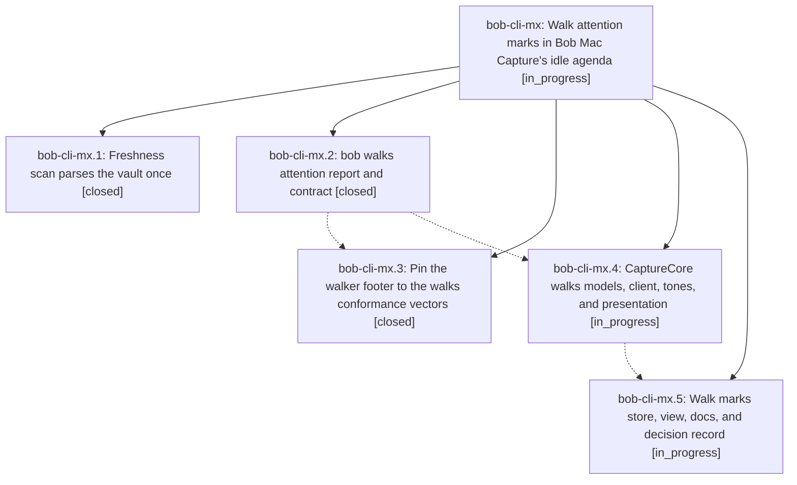

# Bead: bob-cli-mx — Walk attention marks in Bob Mac Capture's idle agenda

[Bead Pages](../README.md) / bob-cli-mx

**Status:** ◐ in_progress · **Type:** ▸ plan · **Tier:** epic
**Owner:** `bryanbugyi34@gmail.com` · **Created by:** [bbugyi200.apollo.es](https://github.com/bobs-org/bob-cli--agents/blob/main/sessions/bbugyi200.apollo.es.md) · **Assignee:** `bob-cli-mx.land`
**Created:** 2026-11-17 17:59:52 EST
**Plan:** [202611/mac\_walk\_attention\_marks.md](https://github.com/bobs-org/bob-cli--plans/blob/main/202611/mac_walk_attention_marks.md)

<!-- sase:links:start -->

## Links

| Relation | Artifact | Why |
| --- | --- | --- |
| implemented-by | [plan:202611/mac_walk_attention_marks.md][1] | derived from the plan's `bead_id:` frontmatter field |

[1]: https://github.com/bobs-org/bob-cli--plans/blob/main/202611/mac_walk_attention_marks.md

<!-- sase:links:end -->

## Description

Whenever the Obsidian walker selector shows attention for a family (an off-family dot or selected-family ink) — `s` review, `w` lanes, `b` bank — Bob Mac Capture's idle agenda shows that family's mark (its letter with a hue dot) at the title row's trailing edge, computed by bob from the same contract, and shows nothing otherwise.

## Phases

| Bead | Title | Status | Size | Created | Agents | Commits |
|---|---|---|---|---|---:|---:|
| [bob-cli-mx.1](bob-cli-mx.1.md) | Freshness scan parses the vault once | ✓ closed | small | 2026-11-17 | 1 | 1 |
| [bob-cli-mx.2](bob-cli-mx.2.md) | bob walks attention report and contract | ✓ closed | medium | 2026-11-17 | 1 | 1 |
| [bob-cli-mx.3](bob-cli-mx.3.md) | Pin the walker footer to the walks conformance vectors | ✓ closed | small | 2026-11-17 | 1 | 1 |
| [bob-cli-mx.4](bob-cli-mx.4.md) | CaptureCore walks models, client, tones, and presentation | ◐ in_progress | medium | 2026-11-17 | 1 | 0 |
| [bob-cli-mx.5](bob-cli-mx.5.md) | Walk marks store, view, docs, and decision record | ◐ in_progress | medium | 2026-11-17 | 1 | 0 |

## Lineage

## Agents

| Agent | Bead | Commits |
|---|---|---:|
| [bbugyi200.apollo.bob-cli-mx.1](https://github.com/bobs-org/bob-cli--agents/blob/main/sessions/bbugyi200.apollo.bob-cli-mx.1.md) | [bob-cli-mx.1](bob-cli-mx.1.md) | 1 |
| [bbugyi200.apollo.bob-cli-mx.2](https://github.com/bobs-org/bob-cli--agents/blob/main/sessions/bbugyi200.apollo.bob-cli-mx.2.md) | [bob-cli-mx.2](bob-cli-mx.2.md) | 1 |
| [bbugyi200.apollo.bob-cli-mx.3](https://github.com/bobs-org/bob-cli--agents/blob/main/agents/bbugyi200.apollo.bob-cli-mx.3/README.md) | [bob-cli-mx.3](bob-cli-mx.3.md) | 1 |
| [bbugyi200.apollo.bob-cli-mx.4](https://github.com/bobs-org/bob-cli--agents/blob/main/agents/bbugyi200.apollo.bob-cli-mx.4/README.md) | [bob-cli-mx.4](bob-cli-mx.4.md) | 0 |
| [bbugyi200.apollo.bob-cli-mx.5](https://github.com/bobs-org/bob-cli--agents/blob/main/agents/bbugyi200.apollo.bob-cli-mx.5/README.md) | [bob-cli-mx.5](bob-cli-mx.5.md) | 0 |
| [bbugyi200.apollo.bob-cli-mx.land](https://github.com/bobs-org/bob-cli--agents/blob/main/agents/bbugyi200.apollo.bob-cli-mx.land/README.md) | [bob-cli-mx](README.md) | 0 |

## Commits

| Repo | Commit | Subject | Bead | Committed |
|---|---|---|---|---|
| bob-cli | [`3c796c7`](https://github.com/bobs-org/bob-cli/commit/3c796c7c2d70b728b2a17e16174ba5083c62bd28) | perf(freshness): reuse task index during scans | [bob-cli-mx.1](bob-cli-mx.1.md) | 2026-11-17 19:17:09 EST |
| bob-cli | [`c50f889`](https://github.com/bobs-org/bob-cli/commit/c50f8895b5487722d2072a7d1c47a43f2ced9814) | feat(walks): add read-only attention report and contract | [bob-cli-mx.2](bob-cli-mx.2.md) | 2026-11-17 20:24:29 EST |
| bob-plugins | [`bob-plugins@5964d35`](https://github.com/bobs-org/bob-plugins/commit/5964d3504b5c0b9eeecfdf74b8aad06dd778d3e1) | test(ledger-tools): pin walker footer to walks conformance vectors | [bob-cli-mx.3](bob-cli-mx.3.md) | 2026-11-17 20:44:09 EST |
