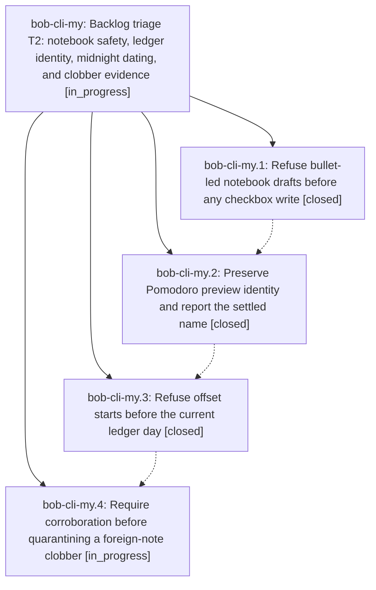

# Bead: bob-cli-my — Backlog triage T2: notebook safety, ledger identity, midnight dating, and clobber evidence

[Bead Pages](../README.md) / bob-cli-my

**Status:** ◐ in_progress · **Type:** ▸ plan · **Tier:** epic
**Owner:** `bryanbugyi34@gmail.com` · **Created by:** [bbugyi200.athena.bob-cli-mr.land--2](https://github.com/bobs-org/bob-cli--agents/blob/main/sessions/bbugyi200.athena.bob-cli-mr.land.md) · **Assignee:** `bob-cli-my.land`
**Created:** 2026-11-17 19:17:52 EST
**Plan:** [202611/backlog\_triage\_t2.md](https://github.com/bobs-org/bob-cli--plans/blob/main/202611/backlog_triage_t2.md)

<!-- sase:links:start -->

## Links

| Relation | Artifact | Why |
| --- | --- | --- |
| implemented-by | [plan:202611/backlog_triage_t2.md][1] | derived from the plan's `bead_id:` frontmatter field |

_Plus 1 automatic references — see [Referenced By](#referenced-by)._

[1]: https://github.com/bobs-org/bob-cli--plans/blob/main/202611/backlog_triage_t2.md

<!-- sase:links:end -->

## Description

Five remaining wrong-write and capture-identity defects are fixed, their task beads are resolved with evidence, and the lander continues the five-task backlog chain.

## Phases

| Bead | Title | Status | Size | Created | Agents | Commits |
|---|---|---|---|---|---:|---:|
| [bob-cli-my.1](bob-cli-my.1.md) | Refuse bullet-led notebook drafts before any checkbox write | ✓ closed | medium | 2026-11-17 | 1 | 1 |
| [bob-cli-my.2](bob-cli-my.2.md) | Preserve Pomodoro preview identity and report the settled name | ✓ closed | medium | 2026-11-17 | 1 | 1 |
| [bob-cli-my.3](bob-cli-my.3.md) | Refuse offset starts before the current ledger day | ✓ closed | medium | 2026-11-17 | 1 | 1 |
| [bob-cli-my.4](bob-cli-my.4.md) | Require corroboration before quarantining a foreign-note clobber | ◐ in_progress | medium | 2026-11-17 | 1 | 0 |

## Lineage

## Agents

| Agent | Bead | Commits |
|---|---|---:|
| [bbugyi200.athena.bob-cli-my.1](https://github.com/bobs-org/bob-cli--agents/blob/main/sessions/bbugyi200.athena.bob-cli-my.1.md) | [bob-cli-my.1](bob-cli-my.1.md) | 1 |
| [bbugyi200.athena.bob-cli-my.2](https://github.com/bobs-org/bob-cli--agents/blob/main/agents/bbugyi200.athena.bob-cli-my.2/README.md) | [bob-cli-my.2](bob-cli-my.2.md) | 1 |
| [bbugyi200.athena.bob-cli-my.3](https://github.com/bobs-org/bob-cli--agents/blob/main/agents/bbugyi200.athena.bob-cli-my.3/README.md) | [bob-cli-my.3](bob-cli-my.3.md) | 1 |
| [bbugyi200.athena.bob-cli-my.4](https://github.com/bobs-org/bob-cli--agents/blob/main/agents/bbugyi200.athena.bob-cli-my.4/README.md) | [bob-cli-my.4](bob-cli-my.4.md) | 0 |
| [bbugyi200.athena.bob-cli-my.land](https://github.com/bobs-org/bob-cli--agents/blob/main/agents/bbugyi200.athena.bob-cli-my.land/README.md) | [bob-cli-my](README.md) | 0 |

## Commits

| Repo | Commit | Subject | Bead | Committed |
|---|---|---|---|---|
| bob-cli | [`9950a3d`](https://github.com/bobs-org/bob-cli/commit/9950a3d4f4c4793774308587696929fb22502e32) | fix(capture): refuse ambiguous notebook bullets | [bob-cli-my.1](bob-cli-my.1.md) | 2026-11-17 20:18:53 EST |
| bob-cli | [`0a30995`](https://github.com/bobs-org/bob-cli/commit/0a3099506e6d2629b9dd1d4c0e176126ffa68e1d) | fix(capture): preserve Pomodoro preview identity and report settled name | [bob-cli-my.2](bob-cli-my.2.md) | 2026-11-17 21:07:36 EST |
| bob-cli | [`97f844c`](https://github.com/bobs-org/bob-cli/commit/97f844caf4a942f275dc22336136834a94ed2cfa) | fix(capture): refuse past-midnight Pomodoro offset starts | [bob-cli-my.3](bob-cli-my.3.md) | 2026-11-17 21:37:44 EST |

<!-- sase:referenced-by:start -->

## Referenced By

| Relation | Artifact | Why | Uses |
| --- | --- | --- | ---: |
| read-by | [agent:bob-cli-my.2][1] | Need epic scope and decisions for phase work | 1 |

[1]: https://github.com/bobs-org/bob-cli--agents/blob/main/agents/bbugyi200.athena.bob-cli-my.2/README.md

<!-- sase:referenced-by:end -->
