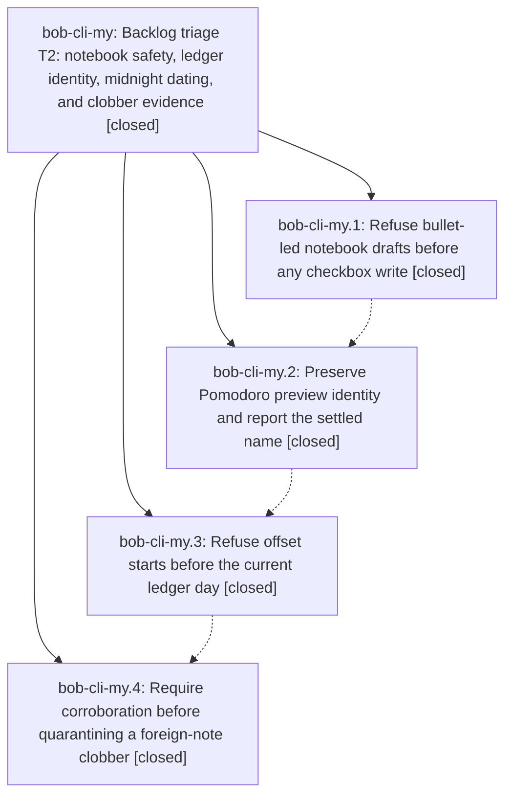

# Bead: bob-cli-my — Backlog triage T2: notebook safety, ledger identity, midnight dating, and clobber evidence

[Bead Pages](../README.md) / bob-cli-my

**Status:** ✓ closed · **Resolution:** done · **Type:** ▸ plan · **Tier:** epic
**Owner:** `bryanbugyi34@gmail.com` · **Created by:** [bbugyi200.athena.bob-cli-mr.land--2](https://github.com/bobs-org/bob-cli--agents/blob/main/sessions/bbugyi200.athena.bob-cli-mr.land.md) · **Assignee:** `bob-cli-my.land`
**Created:** 2026-11-17 19:17:52 EST · **Closed:** 2026-11-17 22:18:35 EST
**Plan:** [202611/backlog\_triage\_t2.md](https://github.com/bobs-org/bob-cli--plans/blob/main/202611/backlog_triage_t2.md)

<!-- sase:links:start -->

## Links

| Relation | Artifact | Why |
| --- | --- | --- |
| implemented-by | [plan:202611/backlog_triage_t2.md][1] | derived from the plan's `bead_id:` frontmatter field |

_Plus 3 automatic references — see [Referenced By](#referenced-by)._

[1]: https://github.com/bobs-org/bob-cli--plans/blob/main/202611/backlog_triage_t2.md

<!-- sase:links:end -->

## Description

Five remaining wrong-write and capture-identity defects are fixed, their task beads are resolved with evidence, and the lander continues the five-task backlog chain.

## Notes

[2026-11-18T03:10:28Z · bob-cli-my.land] FOLLOW-UP TRIAGE: Reviewed every note on my.1-.4. my.1 note #1 and my.3 note #1 propose the same generated-glossary failure; consolidated them into small CI task bob-cli-mz. Independently ran just docs-check on clean 2f14eef5: lint passes, generated drift fails only docs/reference/glossary.md. The canonical generator diff adds only the item-start dot route alias introduced by standalone 9b8ab39c; no epic implementation file caused it. Same-type and all-task semantic searches, all 68 tasks created in the last week, and all 14 active epic scopes found no duplicate or causal active owner. Declined reopening b6 because its decisions-page node is fixed and distinct. No second task for the duplicate phase proposal. All other phase notes describe verified implementation/test evidence; my.4 omitted closing l0, which this landing will complete after check passes.

[2026-11-18T03:16:32Z · bob-cli-my.land] BACKLOG CONTINUATION TRIAGE: Reviewed the 230 active task rows (10 snoozed), all 14 active epic scopes, and complete candidate notes. Selected 8a (remaining unknown short flags), ja (opaque record-field alias writes), ia (Reply-To recipients), mz (generated glossary), and 3w (+31 recurrent stage-ranker gate) for the next independent five-phase epic. A freshly built binary resolved through cargo metadata target_directory reproduces 8a, both ja examples, and jp; jp remains open below the higher-priority recurring gate, and l6 still has its stale marker row. ia remains source-proven at reply_recipients reading From/self-sent To only. 6g is a separate alias-precedence feature, left for a later decision. No additional candidate was verifiably obsolete or duplicate. The old workspace-local target/debug/bob was stale and was not used as closure evidence. The next plan copies the Landing section byte-for-byte and passes explain/edit/revalidate with no warnings. No active epic owns these five defects.

[2026-11-18T03:18:35Z · bob-cli-my.land] Verified the epic plan and every note on my.1-.4, plus all five original tasks k9/dq/ht/h1/l0. Reviewed actual source and commits 9950a3d4 (shared atomic notebook refusal), 0a309950 (task/session exclusion, explicit continuation remapping and settled output name), 97f844ca (negative start refusal preserving overnight ends), and 2f14eef5 (corroborated foreign-note identity). The accepted notebook and open-name decisions are honored; there are no reviewer DECISIONS on this epic. All five task beads are closed; this lander closed l0, which my.4 had omitted.

Named check e1d8a4363162f5aa75feefe4432a1420 ran just check and exited 0 (659278ms), including all new notebook, ledger-identity, midnight and scratch-vault clobber regressions. No check-full. Inspected drift since the first epic commit and fetched origin/master twice: c50f8895 adds read-only walks, shared freshness counts and records-tidy registry integration, without calling or duplicating the repaired writers/tracker/clobber logic. Also reviewed preceding 3c796c7c task-index reuse. No integration edit is needed; HEAD equals origin/master at 2f14eef5.

Follow-ups: my.1 note #1 and my.3 note #1 are one pre-existing generated Capture Alias glossary drift, independently reproduced by docs-check. Created sized CI task mz after same-type/all-type duplicate searches, the 68-task last-week sweep, and all 14 active epic scopes. Declined reopening b6 (different, already-fixed decisions-page node) and declined a second task for the duplicate proposal. All other child notes are addressed. The next independent backlog plan selects 8a/ja/ia/mz/3w after reviewing 230 active rows and excluding 10 snoozed tasks and active-epic ownership; exact outcomes are recorded in this epic's triage notes. It passed explain/edit/revalidate and retains the Landing section unchanged.

Epic-symbol audit is empty; no symvision recipe exists. Closing normally, without force. Plan status will be set done; parent link will be reread after close.

## Phases

| Bead | Title | Status | Size | Created | Agents | Commits |
|---|---|---|---|---|---:|---:|
| [bob-cli-my.1](bob-cli-my.1.md) | Refuse bullet-led notebook drafts before any checkbox write | ✓ closed | medium | 2026-11-17 | 1 | 1 |
| [bob-cli-my.2](bob-cli-my.2.md) | Preserve Pomodoro preview identity and report the settled name | ✓ closed | medium | 2026-11-17 | 1 | 1 |
| [bob-cli-my.3](bob-cli-my.3.md) | Refuse offset starts before the current ledger day | ✓ closed | medium | 2026-11-17 | 1 | 1 |
| [bob-cli-my.4](bob-cli-my.4.md) | Require corroboration before quarantining a foreign-note clobber | ✓ closed | medium | 2026-11-17 | 1 | 1 |

## Lineage

## Agents

| Agent | Bead | Commits |
|---|---|---:|
| [bbugyi200.athena.bob-cli-my.1](https://github.com/bobs-org/bob-cli--agents/blob/main/sessions/bbugyi200.athena.bob-cli-my.1.md) | [bob-cli-my.1](bob-cli-my.1.md) | 1 |
| [bbugyi200.athena.bob-cli-my.2](https://github.com/bobs-org/bob-cli--agents/blob/main/agents/bbugyi200.athena.bob-cli-my.2/README.md) | [bob-cli-my.2](bob-cli-my.2.md) | 1 |
| [bbugyi200.athena.bob-cli-my.3](https://github.com/bobs-org/bob-cli--agents/blob/main/agents/bbugyi200.athena.bob-cli-my.3/README.md) | [bob-cli-my.3](bob-cli-my.3.md) | 1 |
| [bbugyi200.athena.bob-cli-my.4](https://github.com/bobs-org/bob-cli--agents/blob/main/agents/bbugyi200.athena.bob-cli-my.4/README.md) | [bob-cli-my.4](bob-cli-my.4.md) | 1 |
| [bbugyi200.athena.bob-cli-my.land](https://github.com/bobs-org/bob-cli--agents/blob/main/agents/bbugyi200.athena.bob-cli-my.land/README.md) | [bob-cli-my](README.md) | 1 |

## Commits

| Repo | Commit | Subject | Bead | Committed |
|---|---|---|---|---|
| bob-cli | [`9950a3d`](https://github.com/bobs-org/bob-cli/commit/9950a3d4f4c4793774308587696929fb22502e32) | fix(capture): refuse ambiguous notebook bullets | [bob-cli-my.1](bob-cli-my.1.md) | 2026-11-17 20:18:53 EST |
| bob-cli | [`0a30995`](https://github.com/bobs-org/bob-cli/commit/0a3099506e6d2629b9dd1d4c0e176126ffa68e1d) | fix(capture): preserve Pomodoro preview identity and report settled name | [bob-cli-my.2](bob-cli-my.2.md) | 2026-11-17 21:07:36 EST |
| bob-cli | [`97f844c`](https://github.com/bobs-org/bob-cli/commit/97f844caf4a942f275dc22336136834a94ed2cfa) | fix(capture): refuse past-midnight Pomodoro offset starts | [bob-cli-my.3](bob-cli-my.3.md) | 2026-11-17 21:37:44 EST |
| bob-cli | [`2f14eef`](https://github.com/bobs-org/bob-cli/commit/2f14eef5dcbdcd46151ae9b87fb94ac4784496c9) | fix(vault-sync): corroborate created-time identity matches | [bob-cli-my.4](bob-cli-my.4.md) | 2026-11-17 22:00:47 EST |
| bob-cli--plans | [`bob-cli--plans@5e5f243`](https://github.com/bobs-org/bob-cli--plans/commit/5e5f24350779e743de3cfdeedae1eabfe2d41cfc) | docs(plans): mark backlog triage T2 complete | [bob-cli-my](README.md) | 2026-11-17 22:19:46 EST |

<!-- sase:referenced-by:start -->

## Referenced By

| Relation | Artifact | Why | Uses |
| --- | --- | --- | ---: |
| read-by | [agent:bob-cli-my.2][1] | Need epic scope and decisions for phase work | 1 |
| read-by | [agent:bob-cli-my.3][2] | epic context | 1 |
| read-by | [agent:bob-cli-my.4][3] | Need the epic DECISIONS and completion requirements for phase clobber-evidence | 2 |

[1]: https://github.com/bobs-org/bob-cli--agents/blob/main/agents/bbugyi200.athena.bob-cli-my.2/README.md
[2]: https://github.com/bobs-org/bob-cli--agents/blob/main/agents/bbugyi200.athena.bob-cli-my.3/README.md
[3]: https://github.com/bobs-org/bob-cli--agents/blob/main/agents/bbugyi200.athena.bob-cli-my.4/README.md

<!-- sase:referenced-by:end -->
